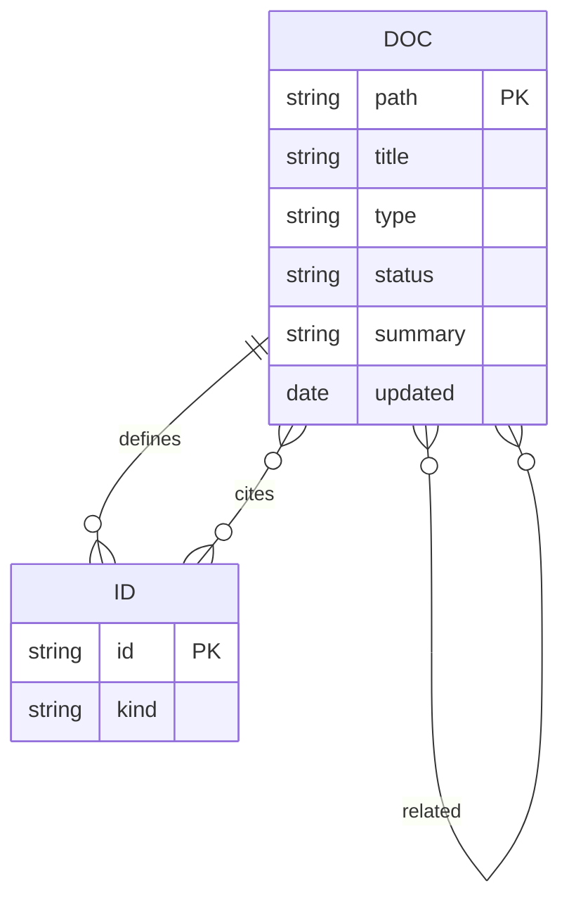

# AGENTS.md

Source of truth: `docs/requirements/` (entry point: `README.md`, then `docs/requirements/README.md`).
Historical original (Spanish, reference only): lan-solution-template-SRS-v1.6.md.
ADR index: docs/roadmap/PROPOSAL.md#adr-index.
Roadmap proposal: `docs/roadmap/PROPOSAL.md`.
Traceability: `docs/requirements/traceability.md`.

## Rules

- Current phase is documentation plus incremental POC-1 slices (see `docs/backlog/README.md`). Start a slice only when the human says so, and only on that slice's branch.
- Generate every project file with its official CLI via `pnpm dlx` (`nx`, `@nestjs/cli`, `@angular/cli`, `@tauri-apps/cli`). Never hardcode what a CLI generates. If a CLI is unknown, run `--help` first. Hand-edit a file only where no CLI exists, and list that edit in the slice result page.
- Generators such as `nest generate` may create `*.spec.ts` files. Delete them in the same commit (REQ-TEST-01: no unit or integration suites).
- Run CLIs through `pnpm dlx` and `pnpm` only. Other installs (`brew`, `apt`) stay forbidden.
- Pin every dependency to an exact version (no `^` or `~`). `savePrefix: ''` in `pnpm-workspace.yaml` enforces it for `pnpm add`, including `--save-catalog`. The `.npmrc` key `save-exact` is ignored by pnpm 12.
- Branch prefixes follow the SRS (REQ-VERSION-02): `major/`, `minor/`, `fix/`, `docs/`, `chore/`.
- Do not invent requirements the SRS does not state. Mark unverified claims "not verified".
- Brotli is banned until the human lifts it (the Brotli decoder vulnerability reported in October 2026, not verified against a primary source). Do not add `Content-Encoding: br`, brotli precompression or a brotli dependency. Use gzip if compression is needed.
- Commit freely on a feature branch (human decision). Push, pull request, `gh` and any other GitHub write need explicit user approval.
- Never commit to `main`. Work on a feature branch and commit there.
- Tests: unit and integration tests are forbidden (REQ-TEST-01). Write only app-level black-box suites that go through the assembled app, the kind Nest and Angular call e2e: one APP suite per app, target layout `tests/<app>/` (not migrated yet). Mock only the system edges (for example the filesystem and outbound API calls) and assert on the mocks in spy style: `expect(spy).toHaveBeenCalledTimes(n)`, `expect(spy).toHaveBeenCalledWith(...)`, `expect(spy).not.toHaveBeenCalled()`. Never mock the app's own providers or business contracts. The database stays real, a SQLite file under a temp base and a PostgreSQL container, because mocks cannot cover REQ-TEST-06; files on disk use a temp base path first (docs/results/RESEARCH-app-suite-test-doubles.md). The SRS fixes the runners: Jest and Supertest for Nest (REQ-TEST-04), Playwright for Angular (REQ-TEST-05), WebdriverIO for Tauri (REQ-TEST-08). Read REQ-TEST-01 to REQ-TEST-10 before proposing test work.

## Before you output

Before writing anything, name where the output goes and read the standard of that place. Do not work from memory. Every output has a destination: docs, code, tests, a commit, a delegated brief or the human.

- Docs: `docs/standards/README.md` (metadata block v1, English prose, regenerate `docs/meta.toon`).
- Code: [ADR-013](docs/architecture/adr/ADR-013-nest-standalone-architecture.md) and the sibling files of the same app. Generate project files with the CLI. Match their naming and comment density. Prefer the framework's own module or a standard package over hand-written code: hand-written infrastructure (static serving, parsing, caching) is a defect. `apps/api-gateway/src/web-handler.ts` and `web-bundle.ts` are known debt, not precedent.
- Tests: the Tests rule above. App-level black box, mocks only at the system edges, spy-style assertions, and one Arrange, Act, Assert flow per test (REQ-TEST-01).
- Commits and pull requests: the Commits section. No attribution.
- Answers to the human: answer the question asked, first and short. Do not list the human's own policies as gaps. Do not pass work off as out of scope when the human asked for it or it was started. Do not repeat a reminder the human already declined.
- Delegated work: a brief that builds binaries, worktrees or containers makes the agent delete the artifacts when done, run `df` before and after, and keep scratch under about 1 GB; compare with `sha256` instead of keeping copies. Say which question the agent answers and check that no earlier result already answers it. If Docker is needed and not running, start it.
- Interrupts: when the human interrupts, stop and launch nothing until told. Check an agent's state before reporting it.

## Commits

Each commit message follows [Conventional Commits](https://www.conventionalcommits.org/). The style mirrors the sibling repo `nest-base`.

```text
<type>: Title

Short description.

- Concrete action 1.
- Concrete action n.
```

| Type | When to use |
|---|---|
| `feat` | New features or capabilities |
| `fix` | Bug fixes |
| `docs` | Documentation only |
| `chore` | Tooling, configuration, dependencies, CI |
| `task` | Changes to existing functionality |
| `spike` | Research or exploration |

- Subject line: imperative mood, lowercase, no final period, 72 characters at most.
- Body: a short description, then bullets that list each concrete change.
- No `Co-Authored-By` lines and no AI attribution, in commits or in PR descriptions.

## Query the docs

The file `docs/meta.toon` indexes every `.md` file except this file and `README.md`.



Map the diagram to the fields of `docs/meta.toon`:

- `defines` is the field `ids`.
- `cites` is the field `refs`.
- `related` is the field `related`.

Read commands. Run them from the repository root. They need `jq`. The repository does not install `jq`.

```sh
# Where is REQ-CFG-05 defined?
toon -d docs/meta.toon | jq -r '.docs[] | select(.ids | index("REQ-CFG-05")) | .doc'
# Which files cite REQ-CFG-05?
toon -d docs/meta.toon | jq -r '.docs[] | select(.refs | index("REQ-CFG-05")) | .doc'
# What is related to a file?
toon -d docs/meta.toon | jq -r --arg f docs/requirements/04-configuration.md '.docs[] | select(.doc == $f) | .related[]'
# Find every mention of an id.
rg -n 'REQ-CFG-05' docs/
```

Write steps:

1. Edit the block on line 1 of the file.
2. Run the regeneration command.
3. Run the check command.

Both commands are in [Metadata block v1](docs/standards/README.md#metadata-block-v1) and [Checks](docs/standards/README.md#checks).
