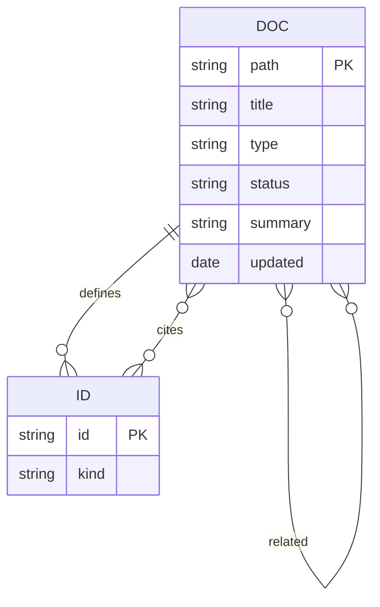

# AGENTS.md

Source of truth: `docs/requirements/` (entry point: `README.md`, then `docs/requirements/README.md`).
Historical original (Spanish, reference only): lan-solution-template-SRS-v1.6.md.
ADR index: docs/roadmap/PROPOSAL.md#adr-index.
Roadmap proposal: `docs/roadmap/PROPOSAL.md`.
Traceability: `docs/requirements/traceability.md`.

## Rules

- Current phase is documentation plus incremental POC-1 slices (see `docs/backlog/README.md`). Start a slice only when the human says so, and only on that slice's branch.
- Generate every project file with its official CLI via `pnpm dlx` (`nx`, `@nestjs/cli`, `@angular/cli`, `@tauri-apps/cli`). Never hardcode what a CLI generates. If a CLI is unknown, run `--help` first. Hand-edit a file only where no CLI exists, and list that edit in the slice result page.
- Generators such as `nest generate` may create `*.spec.ts` files. Delete them in the same commit (REQ-TEST-01: no unit or integration suites).
- Run CLIs through `pnpm dlx` and `pnpm` only. Other installs (`brew`, `apt`) stay forbidden.
- Branch prefixes follow the SRS (REQ-VERSION-02): `major/`, `minor/`, `fix/`, `docs/`, `chore/`.
- Do not invent requirements the SRS does not state. Mark unverified claims "not verified".
- No commit, push, or GitHub write without explicit user approval.
- Never commit to `main`. Work on a feature branch and commit there.

## Commits

Each commit message follows [Conventional Commits](https://www.conventionalcommits.org/). The style mirrors the sibling repo `nest-base`.

```text
<type>: Title

Short description.

- Concrete action 1.
- Concrete action n.
```

| Type | When to use |
|---|---|
| `feat` | New features or capabilities |
| `fix` | Bug fixes |
| `docs` | Documentation only |
| `chore` | Tooling, configuration, dependencies, CI |
| `task` | Changes to existing functionality |
| `spike` | Research or exploration |

- Subject line: imperative mood, lowercase, no final period, 72 characters at most.
- Body: a short description, then bullets that list each concrete change.
- No `Co-Authored-By` lines and no AI attribution, in commits or in PR descriptions.

## Query the docs

The file `docs/meta.toon` indexes every `.md` file except this file and `README.md`.



Map the diagram to the fields of `docs/meta.toon`:

- `defines` is the field `ids`.
- `cites` is the field `refs`.
- `related` is the field `related`.

Read commands. Run them from the repository root. They need `jq`. The repository does not install `jq`.

```sh
# Where is REQ-CFG-05 defined?
toon -d docs/meta.toon | jq -r '.docs[] | select(.ids | index("REQ-CFG-05")) | .doc'
# Which files cite REQ-CFG-05?
toon -d docs/meta.toon | jq -r '.docs[] | select(.refs | index("REQ-CFG-05")) | .doc'
# What is related to a file?
toon -d docs/meta.toon | jq -r --arg f docs/requirements/04-configuration.md '.docs[] | select(.doc == $f) | .related[]'
# Find every mention of an id.
rg -n 'REQ-CFG-05' docs/
```

Write steps:

1. Edit the block on line 1 of the file.
2. Run the regeneration command.
3. Run the check command.

Both commands are in [Metadata block v1](docs/standards/README.md#metadata-block-v1) and [Checks](docs/standards/README.md#checks).
