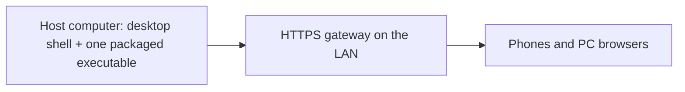
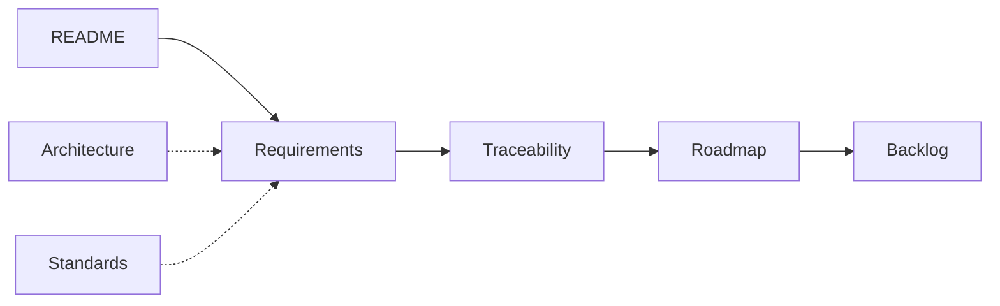

# LAN Solution Template

[Home](README.md) | [Requirements](docs/requirements/README.md) | [Architecture](docs/architecture/overview.md) | [Standards](docs/standards/README.md) | [Roadmap](docs/roadmap/PROPOSAL.md) | [Traceability](docs/requirements/traceability.md) | [Backlog](docs/backlog/README.md)

## Navigation

- [At a glance](#at-a-glance)
- [What it is](#what-it-is)
- [Who it is for](#who-it-is-for)
- [Current status](#current-status)
- [Set up the dev environment](#set-up-the-dev-environment)
- [Reading order](#reading-order)
- [Documentation map](#documentation-map)
- [How to contribute](#how-to-contribute)
- [Identifiers and the original SRS](#identifiers-and-the-original-srs)
- [License](#license)

---

## At a glance

[Back to navigation](#navigation)

| Question | Answer |
| --- | --- |
| What | A LAN-first, offline-capable GitHub Template Repository. |
| For whom | Template authors, reviewers and delivering AI agents. |
| Where we are | POC-1 to POC-4 are built, with the persistence system (PRs #17 and #18). POC-5 is built on the branch `minor/poc-05-tauri-sidecar` in server mode and verified on macOS only, with no pull request yet ([result](docs/results/POC-05-Result.md)). POC-6 to POC-9 are plans. The roadmap is a proposal. |
| What comes next | The [roadmap](docs/roadmap/PROPOSAL.md) plans POC-1 to POC-9. The [backlog](docs/backlog/README.md) holds one epic per POC. |

---

## What it is

[Back to navigation](#navigation)

A commercial, cross-platform template. One host computer runs the application. Phones and browsers on the local network use it. No Internet service is required. Full statement: [Purpose and scope](docs/requirements/01-purpose-and-scope.md).

The full production diagram is in [Architecture overview](docs/architecture/overview.md#production-topology).

---

## Who it is for

[Back to navigation](#navigation)

- Template authors and maintainers. They need a verifiable base for host-installed applications.
- Reviewers. They check the requirements, the roadmap and their traceability.
- AI agents that deliver the template. They follow the [delivery instructions](docs/requirements/12-agent-delivery.md) and [AGENTS.md](AGENTS.md).

---

## Current status

[Back to navigation](#navigation)

- Phase: documentation plus incremental POC slices ([backlog](docs/backlog/README.md)).
- Built: POC-1 (toolchain and workspace), POC-2 (single SEA and supervisor), POC-3 (config and SQLite persistence). system (PR #17) and POC-4 (PR #18) are merged.
- The [roadmap](docs/roadmap/PROPOSAL.md) is a proposal, not approved.

---

## Set up the dev environment

[Back to navigation](#navigation)

Needs Node `>=26.13.0 <27` and pnpm. The commands run from the repository root. In dev the base directory is the current directory ([ADR-007](docs/architecture/adr/ADR-007-persistence-system.md)): `config/`, `data/`, `logs/` and `certs/` are created or read there and are ignored by git.

1. `pnpm install`
2. `mkdir -p config && cp libs/shared-core/config.example.json config/config.json`. The gateway never creates the config: a missing or invalid file stops the start.
3. `pnpm dev:certs`. It creates the local CA and the certificate under `certs/`. Run it once, and again when the network names change. It never replaces an existing CA: if you delete `certs/`, the next run creates a new CA, and every device keeps trusting the old one until you remove it and trust the new one.
4. `pnpm dev:gateway`. It builds and starts the gateway over HTTPS. It only validates the files in `certs/`: when they are missing or invalid it exits 1 and names the problem and `pnpm dev:certs`.
5. `pnpm dev:trust`. It trusts that CA on this machine, like `dotnet dev-certs https --trust`: the login keychain on macOS, the current user's Root store on Windows. The system asks for your password or Touch ID. On Linux it prints the steps. Restart the browser afterwards.
6. `pnpm dev:all` runs the gateway and the Angular dev server. The gateway is at `https://localhost:8443`, the Angular app at `http://localhost:4200`.

A PWA needs HTTPS to register its service worker, so a browser that does not trust the CA shows a certificate warning and the PWA does not work. For a packaged binary, run `node tools/scripts/generate-certs.ts --base artifacts/sea-runtime` and `pnpm dev:trust --base artifacts/sea-runtime` (the base needs its `config/config.json`). A phone or another device installs `ca.crt` by hand: see the [device trust guide](docs/architecture/device-trust-guide.md). Why: [ADR-008](docs/architecture/adr/ADR-008-tls-trust-model.md#phone-trust).

---

## Reading order

[Back to navigation](#navigation)

1. [Purpose and scope](docs/requirements/01-purpose-and-scope.md): what is built and what is left out.
2. [Requirements index](docs/requirements/README.md): the SRS split by section, then the [amendments](docs/requirements/amendments-2026-10-30.md).
3. [Architecture overview](docs/architecture/overview.md): how the parts run together.
4. [Roadmap proposal](docs/roadmap/PROPOSAL.md): the planned POCs and the open questions.
5. [Backlog](docs/backlog/README.md): one draft epic per POC.
6. [Traceability](docs/requirements/traceability.md): where each requirement is defined and planned.

---

## Documentation map

[Back to navigation](#navigation)

The chain runs from requirement to plan. Architecture and standards support it.

- [Requirements](docs/requirements/README.md): one page per SRS section, with the REQ and AC ids.
- [Architecture](docs/architecture/overview.md): diagrams and the ADRs.
- [Standards](docs/standards/README.md): technical and normative references.
- [Traceability](docs/requirements/traceability.md): each REQ and AC id mapped to its page and to a POC.
- [Roadmap](docs/roadmap/PROPOSAL.md): proposal of POCs and open questions.
- [Backlog](docs/backlog/README.md): draft epics derived from the roadmap.
- [Third-party licenses](docs/backlog/third-party-licenses.md): backlog item for license notices, with the [spike](docs/results/SPIKE-third-party-licenses.md).
- [Persistence system](docs/backlog/persistence-system.md): strict config and lazy engine loading, with [ADR-007](docs/architecture/adr/ADR-007-persistence-system.md). Dev setup (`pnpm dev:gateway`, `pnpm dev:web`): [How to run in dev](docs/backlog/persistence-system.md#how-to-run-in-dev).
- [HTTPS gateway](docs/backlog/poc-4-https-gateway-angular-pwa.md): local CA built with Node built-ins, with [ADR-008](docs/architecture/adr/ADR-008-tls-trust-model.md), the [POC-4 result](docs/results/POC-04-Result.md) and the [device trust guide](docs/architecture/device-trust-guide.md).
- [Page metadata](docs/meta.toon): generated from the toon-meta blocks. Never edit it by hand. Regeneration: [Metadata block v1](docs/standards/README.md#metadata-block-v1).

Versions and stack constraints live in [Technology baseline](docs/requirements/02-technology-baseline.md).

---

## How to contribute

[Back to navigation](#navigation)

- Name branches with one of these prefixes ([REQ-VERSION-02](docs/requirements/11-nx-quality-testing.md)): `major/`, `minor/`, `fix/`, `docs/`, `chore/`.
- Follow [AGENTS.md](AGENTS.md). Do not invent requirements the SRS does not state.
- Mark unverified claims "not verified".
- Commit on a feature branch, never on `main`. Push, pull requests and GitHub writes need approval from the repository owner.

---

## Identifiers and the original SRS

[Back to navigation](#navigation)

- The SRS defines the REQ and AC ids. The FR, NFR, D, R, A and Q ids come from files outside this repository. See the [identifier glossary](docs/standards/identifier-glossary.md).
- [`lan-solution-template-SRS-v1.6.md`](lan-solution-template-SRS-v1.6.md) is the historical Spanish original, kept for reference. The canonical source is [`docs/requirements/`](docs/requirements/README.md).
- Decisions and their state: [ADR index](docs/roadmap/PROPOSAL.md#adr-index).

---

## License

[Back to navigation](#navigation)

[PostgreSQL License](LICENSE) (SPDX: `PostgreSQL`). Every workspace `package.json` declares the same `license`.

Third-party notices are documentation only: no generator, no flag. See the [backlog item](docs/backlog/third-party-licenses.md), the [spike](docs/results/SPIKE-third-party-licenses.md) and [OQ18 to OQ22](docs/roadmap/PROPOSAL.md#open-questions).
