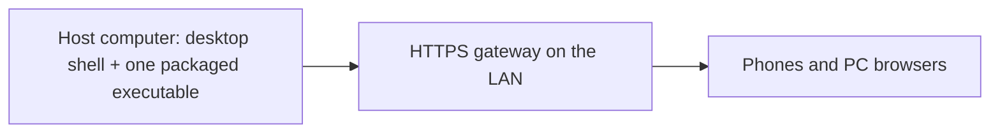
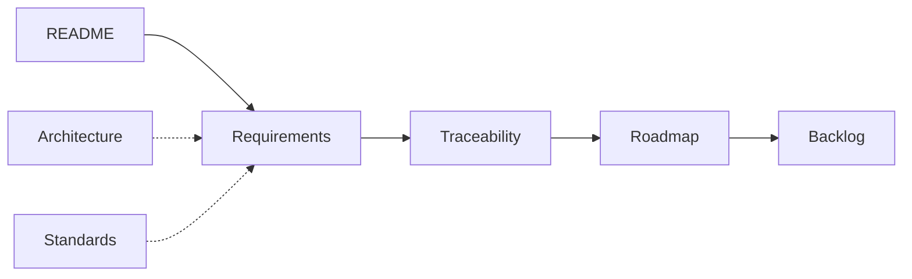

# LAN Solution Template

[Home](README.md) | [Requirements](docs/requirements/README.md) | [Architecture](docs/architecture/overview.md) | [Standards](docs/standards/README.md) | [Roadmap](docs/roadmap/PROPOSAL.md) | [Traceability](docs/requirements/traceability.md) | [Backlog](docs/backlog/README.md)

## Navigation

- [At a glance](#at-a-glance)
- [What it is](#what-it-is)
- [Who it is for](#who-it-is-for)
- [Current status](#current-status)
- [Reading order](#reading-order)
- [Documentation map](#documentation-map)
- [How to contribute](#how-to-contribute)
- [Identifiers and the original SRS](#identifiers-and-the-original-srs)

---

## At a glance

[Back to navigation](#navigation)

| Question | Answer |
| --- | --- |
| What | A LAN-first, offline-capable GitHub Template Repository. |
| For whom | Template authors, reviewers and delivering AI agents. |
| Where we are | Documentation only. No application code. Roadmap is a proposal. |
| What comes next | The [roadmap](docs/roadmap/PROPOSAL.md) plans POC-1 to POC-9. The [backlog](docs/backlog/README.md) drafts one epic per POC; POC-1 is split into five slices (1a to 1e). |

---

## What it is

[Back to navigation](#navigation)

A commercial, cross-platform template. One host computer runs the application. Phones and browsers on the local network use it. No Internet service is required. Full statement: [Purpose and scope](docs/requirements/01-purpose-and-scope.md).

The full production diagram is in [Architecture overview](docs/architecture/overview.md#production-topology).

---

## Who it is for

[Back to navigation](#navigation)

- Template authors and maintainers. They need a verifiable base for host-installed applications.
- Reviewers. They check the requirements, the roadmap and their traceability.
- AI agents that deliver the template. They follow the [delivery instructions](docs/requirements/12-agent-delivery.md) and [AGENTS.md](AGENTS.md).

---

## Current status

[Back to navigation](#navigation)

- Phase: documentation only. No application code. Nothing is installed.
- Branch: `docs/split-srs`. It splits the original SRS into English pages. No commits yet.
- The [roadmap](docs/roadmap/PROPOSAL.md) is a proposal, not approved. The [backlog](docs/backlog/README.md) holds local drafts.
- Many component versions are marked "not verified". Source: roadmap risks R-02 and R11 in the [roadmap context](docs/roadmap/PROPOSAL.md#context). The SRS itself does not make that claim.

---

## Reading order

[Back to navigation](#navigation)

1. [Purpose and scope](docs/requirements/01-purpose-and-scope.md): what is built and what is left out.
2. [Requirements index](docs/requirements/README.md): the SRS split by section, then the [amendments](docs/requirements/amendments-2026-10-30.md).
3. [Architecture overview](docs/architecture/overview.md): how the parts run together.
4. [Roadmap proposal](docs/roadmap/PROPOSAL.md): the planned POCs and the open questions.
5. [Backlog](docs/backlog/README.md): one draft epic per POC.
6. [Traceability](docs/requirements/traceability.md): where each requirement is defined and planned.

---

## Documentation map

[Back to navigation](#navigation)

The chain runs from requirement to plan. Architecture and standards support it.

- [Requirements](docs/requirements/README.md): one page per SRS section, with the REQ and AC ids.
- [Architecture](docs/architecture/overview.md): diagrams and ADR placeholders.
- [Standards](docs/standards/README.md): technical and normative references.
- [Traceability](docs/requirements/traceability.md): each REQ and AC id mapped to its page and to a POC.
- [Roadmap](docs/roadmap/PROPOSAL.md): proposal of POCs and open questions.
- [Backlog](docs/backlog/README.md): draft epics derived from the roadmap.
- [Page metadata](docs/meta.toon): machine-readable metadata of every page except `AGENTS.md` and `README.md`. Generated from the toon-meta blocks and the file bodies. Never edit it by hand. Regeneration command: [Metadata block v1](docs/standards/README.md#metadata-block-v1).

Versions and stack constraints live in [Technology baseline](docs/requirements/02-technology-baseline.md).

---

## How to contribute

[Back to navigation](#navigation)

- Name branches with one of these prefixes ([REQ-VERSION-02](docs/requirements/11-nx-quality-testing.md)): `major/`, `minor/`, `fix/`, `docs/`, `chore/`.
- Follow [AGENTS.md](AGENTS.md). This phase is documentation only. Do not invent requirements the SRS does not state.
- Mark unverified claims "not verified".
- Do not commit, push or write to GitHub without approval from the repository owner.

---

## Identifiers and the original SRS

[Back to navigation](#navigation)

- The SRS defines the REQ and AC ids. The FR, NFR, D, R, A and Q ids come from files outside this repository. See the [identifier glossary](docs/standards/identifier-glossary.md).
- [`lan-solution-template-SRS-v1.6.md`](lan-solution-template-SRS-v1.6.md) is the historical Spanish original, kept for reference. The canonical source is [`docs/requirements/`](docs/requirements/README.md).
- Decisions and their state: [ADR index](docs/roadmap/PROPOSAL.md#adr-index).
