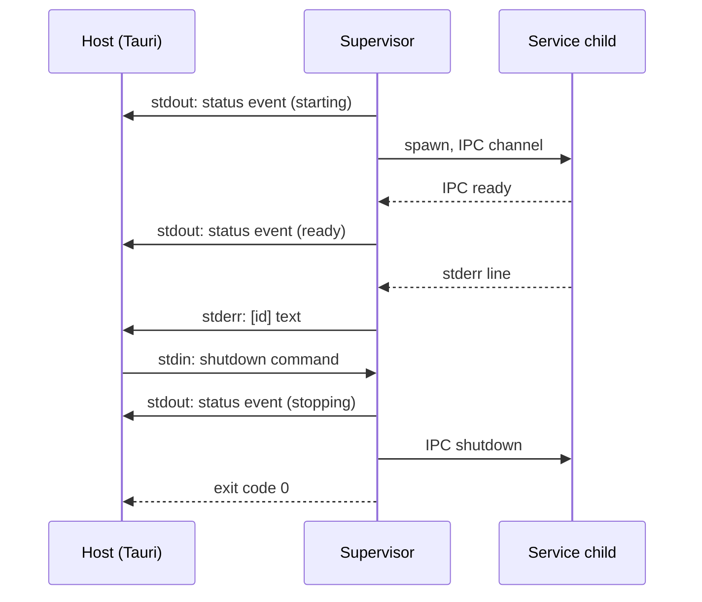

<!-- toon-meta
fmt: TOON
doc: docs/architecture/adr/ADR-006-sidecar-status-contract.md
title: "ADR-006 Sidecar status contract and typed service array"
type: architecture
summary: "Defines the stdio contract with the host, no HTTP listener, and one typed array that declares the services."
ids[0]:
related[5]: docs/architecture/adr/ADR-002-single-sea-portability.md,docs/architecture/overview.md,docs/backlog/service-status-indicator.md,docs/backlog/poc-5-tauri-sidecar-desktop-shell.md,docs/requirements/traceability.md
status: current
updated: 2026-11-03
-->

# ADR-006: Sidecar status contract and typed service array

[Overview](../overview.md) | [Roadmap](../../roadmap/PROPOSAL.md) | [ADR-002](ADR-002-single-sea-portability.md) | [Service status indicator backlog](../../backlog/service-status-indicator.md)

## Navigation

- [Status](#status)
- [Context](#context)
- [Decision](#decision)
- [Options rejected](#options-rejected)
- [Consequences](#consequences)
- [Not verified](#not-verified)

## Status

Accepted, 2026-11-03 (merged in PR #15). The human asked for this direction in the `sea-runtime-nest` request: "no veo porque esta app deba ser http, en serio" and "el status que sea-runtime debe pasar a tauri DEBE SER lo que tauri espera de su sidecar y este es totalmente independiente del /api/health que entrega el api gateway". The details below are agent proposals. The contract is implemented in `libs/service-registry/src` and `apps/sea-runtime`, merged in PR #15.

This ADR reverses one decision of PR #13. That PR added a supervisor-owned HTTP `GET /status` endpoint. The agent took that decision without a human answer (see the [indicator page](../../backlog/service-status-indicator.md#open-questions)). The human now rejects it.

The ADR number follows the files in `adr/`. The [overview](../overview.md#architecture-decisions) lists the current numbers.

## Context

The supervisor (`apps/sea-runtime`) runs as a Tauri sidecar. After PR #13 it had an HTTP listener on `supervisor.statusPort` (default 3001). Nothing consumes it:

- Tauri is the real consumer. It starts the supervisor, so it already holds the process pipes. An HTTP port adds nothing for it.
- The web UI that motivated the endpoint does not exist.
- The listener adds a port, a security surface and a "port busy" failure mode to a process that had none.

What the host can see of a sidecar. Sources: https://v2.tauri.app/develop/sidecar/ and docs.rs `tauri-plugin-shell` (`CommandEvent`, `TerminatedPayload`).

- The host receives `CommandEvent::Stdout`, `Stderr`, `Error` and `Terminated`.
- stdout and stderr arrive one line per event. The split is at `\n` or `\r`.
- `Terminated` carries `code: Option<i32>` and `signal: Option<i32>`.
- The host can write to the child's stdin (`child.write`).
- The Node IPC channel between the supervisor and its children is invisible to the host.

Anything else about Tauri is not verified.

## Decision

### Sidecar contract: four channels

The supervisor opens no HTTP listener. The key `supervisor.statusPort` is removed from the config. The host sees the supervisor through stdout, stderr, stdin and the exit code.

| Channel | Direction | Content |
|---|---|---|
| stdout | supervisor to host | Machine events only. One JSON object per line. |
| stderr | supervisor to host | Every human log line, prefixed `[id] text`. |
| stdin | host to supervisor | Commands. One JSON object per line. |
| exit code | supervisor to host | `0`, `1` or `2`. |



Rules:

- **stdout** carries one event kind today: `status`. Its body is the aggregate `state` and `services`, a list of `{id, status}`. The supervisor sends it on every change, also at start and at `stopping`. Nothing else is written to stdout. Schema: `sidecarEventSchema` in `libs/service-registry/src/sidecar-protocol.ts`.
- **stderr** carries every human log line. Supervisor lines are `[supervisor] text`. Child output is re-emitted with the service prefix, `[<id>] text`.
- **stdin** carries host commands. One kind today: `shutdown`. Schema: `sidecarCommandSchema`. A stdin line that is not valid JSON, or does not match the schema, is logged to stderr and ignored.
- **stdin EOF** also triggers shutdown. This is a design assumption: the host going away closes the pipe, so the sidecar must not outlive it. It is not verified against Tauri.
- **Exit codes**: `0` clean shutdown. `1` aggregate state `error`, or a startup failure. `2` rejected selector.
- Every line is validated with zod in `libs/service-registry`. `encodeSidecarEvent` parses the event before it writes, so the supervisor never writes a line the host cannot parse. `decodeSidecarCommand` parses every stdin line.

The state and status words are the ones in `states.ts` ([ADR-002](ADR-002-single-sea-portability.md#state-words-in-statests)). The `restarting` word exists per service only. The aggregate set is unchanged.

### Independence from `/api/health`

The contract does not depend on `/api/health` of the `api-gateway`. That endpoint is unchanged. It is gateway-owned and keeps its own vocabulary (`{"status":"<aggregate state>"}`). A gateway restart does not interrupt the stdout events, because the supervisor, not the gateway, writes them.

### Typed service array

`apps/sea-runtime/src/services.ts` exports `SERVICES`, built with `defineServices` from `libs/service-registry/src/service-routes.ts`:

```ts
export const SERVICES = defineServices([{ id: 'api-gateway', web: true }]);
```

| Field | Meaning |
|---|---|
| `id` | Service id. Required. |
| `project` | Workspace package that holds the bootstrap. Default: the `id`. |
| `dependsOn` | Ids this service waits for. A name that is not a declared id is a compile error. The schema repeats the check at run time. |
| `enabled` | Default `true`. |
| `web` | The service receives the embedded web bundle over IPC on every start. Default `false`. |

- To add a service: add one entry and the workspace dependency.
- The assembler (`tools/scripts/compile-sea.ts`) reads this array. It writes the services asset in the shape of `servicesAssetSchema`. The `project` field stays out of the asset, as it is a build-time detail.
- The supervisor starts the services in `startupOrder`.

### Supervisor as Nest modules

The supervisor becomes Nest modules: persistence, supervisor, sidecar stdio and web bundle. The sidecar stdio adapters are the only code that reads stdin and writes stdout. The restart backoff and window move to rxjs. They keep the numbers of [REQ-RUNTIME-05](../../requirements/09-desktop-tauri.md) in `SUPERVISOR_CONFIG`. The policy does not change.

## Options rejected

- **Keep the HTTP `GET /status` listener (PR #13).** Rejected by the human. No consumer needs it, and Tauri already holds the stdio pipes.
- **Use the Node IPC channel for the host.** The host cannot see it.
- **Read the host status from `/api/health`.** The gateway serves it, so it does not answer while the gateway restarts. The human also asked for a contract independent of it.
- **Mix logs and events on stdout.** The host would parse every line to tell them apart. Separate channels remove that.

## Consequences

- No port, no listener and no `supervisor.statusPort` key in the supervisor. A web UI that wants status needs a new owner and a new decision. See [Service status indicator](../../backlog/service-status-indicator.md).
- The one JSON line per state change that [ADR-002](ADR-002-single-sea-portability.md) described moves into a schema and gets a `kind` field. Log lines move from stdout to stderr. A consumer that read the old unprefixed stdout lines must change.
- Adding a service is a one-entry change. The dependency order is checked before the code runs.
- The tray can show per-service status from stdout. Whether it shows `degraded` stays open (rabbit hole A5 in the [roadmap](../../roadmap/PROPOSAL.md#poc-5-tauri-desktop-shell-with-sea-sidecar)).

## Not verified

- How Tauri behaves on stdin EOF, and whether it closes the pipe when the app quits.
- Line splitting with a very long JSON line: the limits of `CommandEvent::Stdout` are not verified.
- Windows behavior of all four channels.
- Any Tauri behavior beyond the list in [Context](#context).
