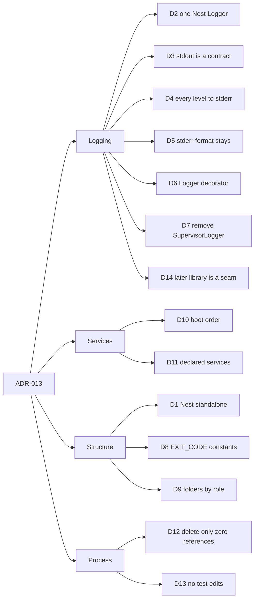
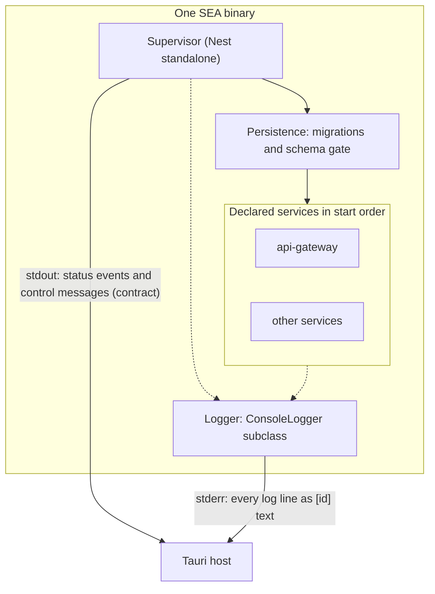
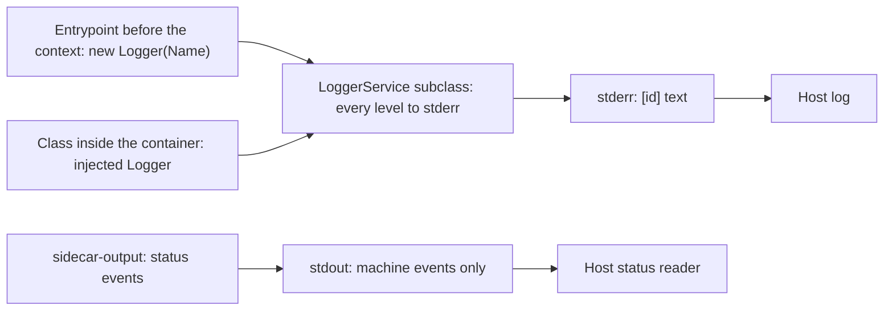

<!-- toon-meta
fmt: TOON
doc: docs/architecture/adr/ADR-013-nest-standalone-architecture.md
title: "ADR-013 Nest standalone architecture"
type: architecture
summary: "Target architecture of the Nest standalone refactor: one Nest Logger, stdout contract, EXIT_CODE constants, folder conventions, boot order."
ids[0]:
related[9]: docs/architecture/adr/ADR-006-sidecar-status-contract.md,docs/architecture/adr/ADR-007-persistence-system.md,docs/architecture/adr/ADR-008-tls-trust-model.md,docs/architecture/adr/ADR-012-sea-runtime-child-registry.md,docs/architecture/declared-services.md,docs/architecture/nest-standalone-boot.md,docs/backlog/nest-standalone-refactor.md,docs/backlog/nest-standalone-cleanup-inventory.md,docs/backlog/log-service-otel-grpc.md
status: proposed
updated: 2026-11-06
-->

# ADR-013: Nest standalone architecture

[Overview](../overview.md) | [Roadmap](../../roadmap/PROPOSAL.md) | [ADR-006](ADR-006-sidecar-status-contract.md) | [ADR-007](ADR-007-persistence-system.md) | [ADR-008](ADR-008-tls-trust-model.md) | [ADR-012](ADR-012-sea-runtime-child-registry.md) | [Declared services](../declared-services.md) | [Nest standalone boot](../nest-standalone-boot.md) | [Epic](../../backlog/nest-standalone-refactor.md)

## Navigation

- [Status](#status)
- [Context](#context)
- [Decision](#decision)
- [Options rejected](#options-rejected)
- [Consequences](#consequences)
- [Risks](#risks)
- [Not verified](#not-verified)

## Status

Proposed, 2026-11-06. Documentation only: no file under `apps/`, `libs/` or `tools/` changes with this ADR.

This ADR governs the refactor. Four pages detail it:

- [Declared services](../declared-services.md): the service model, startup order and the typed array.
- [Nest standalone boot](../nest-standalone-boot.md): the boot order, with diagrams.
- [Epic](../../backlog/nest-standalone-refactor.md): the slices.
- [Cleanup inventory](../../backlog/nest-standalone-cleanup-inventory.md): the dead code candidates, with evidence.

Each decision carries a status. **Accepted** means the human decided it in the planning conversation of the branch `docs/nest-standalone-refactor`. **Proposed** means the agent proposes it and the human has not reviewed it yet. A Proposed decision becomes Accepted when the human says so.

## Context

The supervisor and every service run as Nest applications inside one SEA binary ([ADR-002](ADR-002-single-sea-portability.md), [ADR-012](ADR-012-sea-runtime-child-registry.md)). The sidecar talks to the host through the four channels of [ADR-006](ADR-006-sidecar-status-contract.md).

Parts of the code still sit outside the Nest container. They write output with ad hoc console calls and end the process with direct exits. Two types describe the same service, and some symbols look dead.

The Nest default logger sends most levels to stdout. Stdout is the machine channel, so a log line there would corrupt the status events the host reads.

This ADR sets one target: a true Nest standalone application. It has one logger, a clean stdout, named exit codes and folders by role. The refactor changes structure, not behavior.

The evidence for today's code lives in the [boot page](../nest-standalone-boot.md), the [declared services page](../declared-services.md) and the [cleanup inventory](../../backlog/nest-standalone-cleanup-inventory.md). Agent code maps produced it; see [Not verified](#not-verified).

## Decision

The map groups the fourteen decisions. The two diagrams after it show the target at run time and the logger flow.

### D1. A true Nest standalone application

Status: Accepted

Every process of the binary is a Nest application made with `NestFactory.createApplicationContext`. No singleton is wired by hand outside the container.

A shared value is a provider. Code reads configuration through `AppConfigModule` and `InjectConfig`, as `nest-base` does.

### D2. One logger: the Nest Logger

Status: Accepted

All human-readable output uses the Nest `Logger`. Inside the container a class receives it through DI. Entrypoints, before the context exists, use `new Logger(Name)`.

Code makes no `console.*` call and no direct write to `process.stdout` or `process.stderr` for logs. One logging path is easier to guard than two.

### D3. stdout is a machine contract and carries no logs

Status: Accepted

Stdout carries only the status events of [ADR-006](ADR-006-sidecar-status-contract.md) and the control messages. The bytes of those events do not change.

The event writer `sidecar-output.ts` is the only place that may write to stdout. It is not a log writer.

### D4. The application logger sends every level to stderr

Status: Proposed

The application logger is a `ConsoleLogger` subclass that routes every level to stderr. It is installed with `app.useLogger` in each context and as the static logger before the context exists.

Reason: the default `ConsoleLogger` writes `log`, `warn`, `debug` and `verbose` to stdout, which would break D3. The host requires only D3 (stdout carries only the ADR-006 events). D4 is this design's consequence of how Nest routes levels, not a host requirement.

### D5. The stderr line format stays `[id] text`

Status: Proposed

[ADR-006](ADR-006-sidecar-status-contract.md) names `[id] text` as the stderr line, and the host forwards stderr to its log ([ADR-009](ADR-009-desktop-process-model.md)). The D4 subclass reproduces the line, including `[supervisor] text` and the service prefix.

D5 holds because D13 forbids observable changes, so the lines stay as they are, not because the host asks for them. Whether the host parses the prefix is not verified.

The format changes only after a read of every consumer proves nothing depends on it. The change then needs a new ADR.

### D6. A Logger decorator

Status: Proposed

A decorator modeled on `InjectConfig` lets a class ask for the logger of its own name without `new Logger(...)`. `nest-base` has no such decorator.

Proposed location: `libs/shared-core/src/decorators/inject-logger.decorator.ts`. The name and path are proposals.

### D7. SupervisorLogger is always removed

Status: Proposed

The `SupervisorLogger` class is deleted. Its callers (6 injection sites, see [slice 2 of the epic](../../backlog/nest-standalone-refactor.md#slice-2-nest-logger)) use the injected Nest `Logger`, as D2 requires. No second logger survives.

The D4 subclass formats `[context] message`, so the stderr lines stay byte-identical. That includes the `spawned service id as pid N` and `state X` lines.

Acceptance criterion of the code phase: a capture of stderr before and after shows identical lines. If a line differs, fix the subclass or the message. Do not keep the class.

### D8. Exit codes are named constants

Status: Proposed

One `EXIT_CODE` contract in a `constants/` path replaces the magic numbers of `process.exit` and `process.exitCode`. The values stay: `0`, `1` and `2` keep the meaning of [ADR-006](ADR-006-sidecar-status-contract.md).

The constant covers every value found, including `130` on signal in the PostgreSQL smoke. The inventory lists them.

### D9. Folders by role and self-describing names

Status: Accepted

Code groups by role. `constants/` holds constants such as `EXIT_CODE` and `SERVICES`. `interfaces/` holds types not derived from a schema. `schemas/` holds zod schemas, `services/` holds providers and `modules/` holds Nest modules.

Events use RxJS and validation uses zod. A declared type is `z.infer` of its schema. A collection export has a plural name, and the use site never types it with `[]`.

Neither `nest-base` nor `virgenherrera` has these folders, so this is a convention of this repository.

### D10. Boot order

Status: Accepted

The sea-runtime process starts. Persistence runs its migrations and the schema gate inside the supervisor. The services then start in `startOrder`, with the `api-gateway` among them.

Logging is not a service and has no place in `startOrder`. TLS certificates are made at install time, and the gateway only reads them ([ADR-008](ADR-008-tls-trust-model.md)). The [boot page](../nest-standalone-boot.md) holds the steps and diagrams.

### D11. One declared-services model

Status: Proposed

One constant, `SERVICES` of type `DeclaredServices`, replaces `ServiceRoute` and `ServiceDefinition`. The assembler and the supervisor read the same constant. The [declared services page](../declared-services.md) holds the model.

The human decided two points on 2026-11-06. First, a service has no pre or post routines. Earlier work is an earlier service, and shutdown work uses the Nest hooks `onApplicationShutdown` and `beforeApplicationShutdown`. Migrations stay a supervisor step, because a task that ends would be restarted.

Second, `SERVICES` is a plain constant with no helper function. Zod validates it at run time, in the supervisor and in the assembler. The compile-time check of `dependsOn` is lost on purpose.

The `web` field is deprecated and this refactor does not touch it ([details](../declared-services.md#deprecated-the-web-flag)).

The supervisor does not wait for a ready message before it launches the next service. Array order only breaks ties, so `dependsOn` stays ([evidence](../declared-services.md#startup-order-and-shutdown)).

### D12. Cleanup deletes only what has zero references

Status: Proposed

A symbol is deleted only with zero references in source, tests, tools, scripts and non-TypeScript files. A barrel re-export hit counts as a reference.

The maps report only `ControlMessage` and `StatusSnapshot` as confirmed dead. Everything else stays until a QC check proves it dead. Each inventory row carries evidence and a QC status, initially `pending`.

### D13. Pure refactor: no test or smoke is edited

Status: Accepted

Every test and smoke keeps passing without edits. If removing something needs a test edit, the thing is not dead and stays.

A behavior change found on the way is a separate decision with its own ADR.

### D14. A later logging library is only a seam

Status: Proposed

A later epic may add a logging library. It would use OpenTelemetry records, RxJS pipes, an async file sink and a logging child process ([log service backlog](../../backlog/log-service-otel-grpc.md)).

This ADR only requires that all code depends on the Nest `LoggerService` interface. The later library can then replace the D4 writer without touching callers.

## Options rejected

| Option | Reason |
|---|---|
| Keep `console.*` in the code and wrap only the Nest part | Two logging paths survive, and the stdout contract of D3 stays easy to break. |
| Use the default `ConsoleLogger` | It writes `log`, `warn`, `debug` and `verbose` to stdout. That breaks D3. |
| Make logging a service started by the supervisor | Logging must work before any service starts and during boot failures. It is not a service. |
| Generate the TLS certificates in the gateway at start | They are made at install time and the gateway only reads them ([ADR-008](ADR-008-tls-trust-model.md)). This avoids a write path in a network service. |
| Change the exit values while naming them | It would break the host and the smokes. D8 names the values and keeps them. |
| Edit tests during the refactor to remove dead code | It would hide behavior changes. D13 forbids it. |
| Build the OpenTelemetry logging library now | It is a separate epic. D14 keeps the seam only. |

## Consequences

- One writer, the D4 subclass, owns every log byte. Only the ADR-006 events use stdout.
- Entrypoints and tools use the same `Logger` API as the services, so call sites read the same everywhere.
- Exit values are readable and searchable by name. The numbers stay as they are.
- The repository gains a folder convention its reference repository lacks. The epic applies it slice by slice.
- The old stderr text must be reproduced, which constrains the logger design (D5 and D7).
- Tools under `tools/scripts` use `console.*` for command output, for example `version-check.ts` and `installer-build.ts`. Whether D2 reaches them or only `apps/` and `libs/` is a question for the epic.

## Risks

- **stderr line format.** A consumer may depend on a detail of `[id] text` the maps did not show, such as spacing, a trailing newline or timestamps. The new logger would break it. Mitigation: D5 and D7 require a before and after capture. `ConsoleLogger` adds a prefix, a timestamp and colors by default. The subclass must switch them off or override the formatting.
- **ConsoleLogger channel.** The claim that `warn` goes to stdout rests on one map of version 12.3.2, and the linked version is unknown. If it differs, D4 may be unneeded or wrong. Mitigation: the first slice checks the version in use and the stream of each level with a small run. It does this before the subclass exists.
- **Boot failures before the logger is installed.** A failure before `createApplicationContext` prints nowhere unless the static logger is ready. Mitigation: the static logger of D4 is the first thing an entrypoint creates.
- **Lost output on exit.** `process.exit` right after a log call can truncate a buffered stderr write. Today's `console.error` has the same hazard.
- **Dead-code false positives.** Barrels and string-based loading hide usage (D12). Mitigation: zero references in every file type, and the QC column.
- **Decorator as a new public name.** D6 adds a name to `shared-core` that other code would then use. It stays proposed until the human accepts it.

## Not verified

| Item | Why it is missing | Who verifies |
|---|---|---|
| Version of `@nestjs/common` linked at run time, and the stream of each level in it | The maps read version 12.3.2 and did not find the top-level link in this repository | Epic slice 1, with a small run |
| Whether any smoke or consumer reads the `[id] text` prefix | The maps found none, and a code comment says one does | Code phase, by reading every consumer |
| Every file and line cited in the linked pages | They come from agent maps, and no one re-read them for this ADR | Human review, or the QC minion |
| Whether the overview lists ADR-012 correctly | The maps say lines 39 and 157 call it a placeholder, which contradicts the file in `adr/` | Docs slice of the epic |
| Whether D2 reaches the scripts under `tools/scripts` | The question is open for the epic | Human decision in the epic |
| Whether the D4 subclass reproduces the `SupervisorLogger` lines byte-identically (D7) | It needs a before and after capture of stderr | Code phase |
| Whether the Nest writer changes the lost-output hazard on exit | Nobody ran the writer against a fast exit | Code phase |
| Placement of `DeclaredServices` in a library, and the path of the Logger decorator | Both are open in the declared services page and in D6 | Human decision at the start of the code phase |
| Whether a child of the same SEA binary reads the embedded assets, and whether rspack can embed the web bundle | No run exists. The maps found no code that reads assets from a child | The later epic on the service-owned web build |

[Back to navigation](#navigation)
