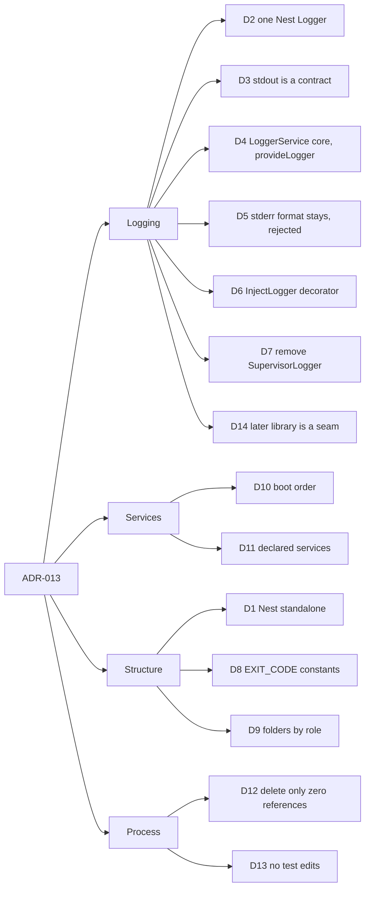
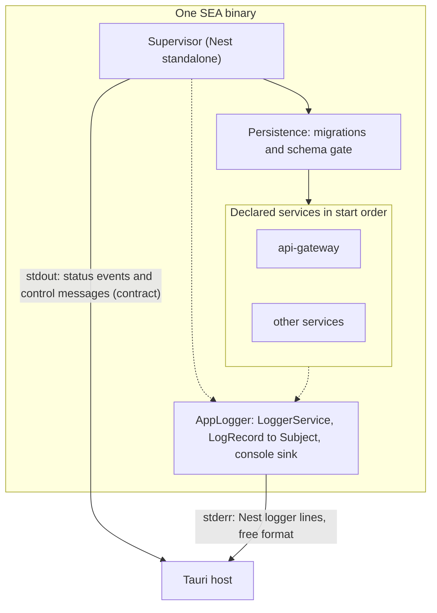
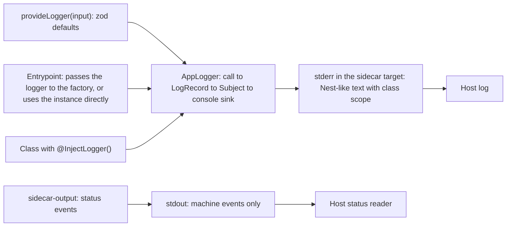

<!-- toon-meta
fmt: TOON
doc: docs/architecture/adr/ADR-013-nest-standalone-architecture.md
title: "ADR-013 Nest standalone architecture"
type: architecture
summary: "Target architecture of the Nest standalone refactor: one Nest Logger, stdout contract, EXIT_CODE constants, folder conventions, boot order."
ids[0]:
related[9]: docs/architecture/adr/ADR-006-sidecar-status-contract.md,docs/architecture/adr/ADR-007-persistence-system.md,docs/architecture/adr/ADR-008-tls-trust-model.md,docs/architecture/adr/ADR-012-sea-runtime-child-registry.md,docs/architecture/declared-services.md,docs/architecture/nest-standalone-boot.md,docs/backlog/nest-standalone-refactor.md,docs/backlog/nest-standalone-cleanup-inventory.md,docs/backlog/log-service-otel-grpc.md
status: proposed
updated: 2026-11-09
-->

# ADR-013: Nest standalone architecture

[Overview](../overview.md) | [Roadmap](../../roadmap/PROPOSAL.md) | [ADR-006](ADR-006-sidecar-status-contract.md) | [ADR-007](ADR-007-persistence-system.md) | [ADR-008](ADR-008-tls-trust-model.md) | [ADR-012](ADR-012-sea-runtime-child-registry.md) | [Declared services](../declared-services.md) | [Nest standalone boot](../nest-standalone-boot.md) | [Epic](../../backlog/nest-standalone-refactor.md)

## Navigation

- [Status](#status)
- [Context](#context)
- [Decision](#decision)
- [Options rejected](#options-rejected)
- [Consequences](#consequences)
- [Risks](#risks)
- [Not verified](#not-verified)
- [Implementation status](#implementation-status)

## Status

Proposed, 2026-11-06. The human has not yet accepted the Proposed decisions. The code slices are built on the branches `chore/nest-standalone-s1-exit-codes` (slices 1 and 2), `chore/nest-standalone-s3-declared-services`, `chore/nest-standalone-s4-dead-code` and `chore/nest-standalone-s5-folders`. See the [epic result](../../backlog/nest-standalone-refactor.md#result).

This ADR governs the refactor. Four pages detail it:

- [Declared services](../declared-services.md): the service model, startup order and the typed array.
- [Nest standalone boot](../nest-standalone-boot.md): the boot order, with diagrams.
- [Epic](../../backlog/nest-standalone-refactor.md): the slices.
- [Cleanup inventory](../../backlog/nest-standalone-cleanup-inventory.md): the dead code candidates, with evidence.

Each decision carries a status. **Accepted** means the human decided it in the planning conversation of the branch `docs/nest-standalone-refactor`. **Proposed** means the agent proposes it and the human has not reviewed it yet. A Proposed decision becomes Accepted when the human says so.

## Context

The supervisor and every service run as Nest applications inside one SEA binary ([ADR-002](ADR-002-single-sea-portability.md), [ADR-012](ADR-012-sea-runtime-child-registry.md)). The sidecar talks to the host through the four channels of [ADR-006](ADR-006-sidecar-status-contract.md).

Parts of the code still sit outside the Nest container. They write output with ad hoc console calls and end the process with direct exits. Two types describe the same service, and some symbols look dead.

The Nest default logger sends most levels to stdout. Stdout is the machine channel, so a log line there would corrupt the status events the host reads.

This ADR sets one target: a true Nest standalone application. It has one logger, a clean stdout, named exit codes and folders by role. The refactor changes structure, not behavior.

The evidence for today's code lives in the [boot page](../nest-standalone-boot.md), the [declared services page](../declared-services.md) and the [cleanup inventory](../../backlog/nest-standalone-cleanup-inventory.md). Agent code maps produced it; see [Not verified](#not-verified).

## Decision

The map groups the fourteen decisions. The two diagrams after it show the target at run time and the logger flow.







### D1. A true Nest standalone application

Status: Accepted

Every process of the binary is a Nest application made with `NestFactory.createApplicationContext`. No singleton is wired by hand outside the container.

A shared value is a provider. Code reads configuration through `AppConfigModule` and `InjectConfig`, as `nest-base` does.

### D2. One logger: the Nest Logger

Status: Accepted

All human-readable output uses the Nest `Logger`. Inside the container a class receives it through DI. Entrypoints create the logger with `provideLogger` and pass it to the factory. Where no Nest app exists, or before the app does, they call the instance directly.

Code makes no `console.*` call and no direct write to `process.stdout` or `process.stderr` for logs. One logging path is easier to guard than two.

### D3. stdout is a machine contract and carries no logs

Status: Accepted

Stdout carries only the status events of [ADR-006](ADR-006-sidecar-status-contract.md) and the control messages. The bytes of those events do not change.

The event writer `sidecar-output.ts` is the only place that may write to stdout. It is not a log writer.

The `--generate-certs` command uses the `cli` target of the logger. It is an install operation, not the sidecar. The target prints plain text through the console sink: `log` to stdout and `error` to stderr. The installer `postinstall` (`apps/desktop/installer`, line 95) reads the output with an anchored `sed`, `^CA SHA-256 `. A prefix, PID, date or level would break it.

### D4. One logger core and one factory: `AppLogger` and `provideLogger`

Status: Accepted

The library lives in `libs/shared-core/src/logger/`. `provideLogger(input)` (`provide-logger.ts:6`) parses the input with `loggerConfigSchema` and returns an `AppLogger`. The entrypoint builds the logger from its config, for example `provideLogger({ prefix })`, which `loggerConfigSchema` validates. Where a Nest app exists, the entrypoint passes the instance to the factory with the `logger` option of `NestFactory.create` or `NestFactory.createApplicationContext`. The factory installs it before it initializes the app, so `new Logger(Context)` and `@InjectLogger()` reach it.

Where no Nest app exists (`sea-entry`, the `--generate-certs` command), the entrypoint uses the instance directly. It also uses the instance for what happens before the app exists: invalid config, the TLS message and `handleFatal`. Nothing is installed globally, and the repository does not call `Logger.overrideLogger`.

Why this form. Passing `{ logger }` to the factory calls `Logger.overrideLogger` internally, so the effect equals a direct call and only the place of the call changes. The official documentation sets no single rule. The common community pattern is to pass the logger to the factory, or to use `bufferLogs` with `app.useLogger`.

| Source | What it says | Reference |
|---|---|---|
| `@nestjs/core` installed, `NestFactory` | `registerLoggerConfiguration` calls `Logger.overrideLogger` when `logger` is set, before initialization | `nest-factory.js:75`, `nest-factory.js:160-178` |
| NestJS logger documentation | Shows the `logger` option and `bufferLogs` with `app.useLogger`; does not document `Logger.overrideLogger` | https://docs.nestjs.com/techniques/logger |
| `nest-winston` README | Passes `WinstonModule.createLogger(...)` as the `logger` option of `NestFactory.create` | https://github.com/gremo/nest-winston |
| `nestjs-pino` README | Uses `bufferLogs: true` and `app.useLogger(app.get(Logger))`, with config in `LoggerModule.forRoot` | https://github.com/iamolegga/nestjs-pino |
| Nest pull request 17893 | A logger must be attached before `init()` or `listen()`; `overrideLogger(levels)` there sets log levels | https://github.com/nestjs/nest/pull/17893 |

`AppLogger` implements the Nest `LoggerService` interface. It does not extend `ConsoleLogger`, which ties the text format and the stream routing to Nest's own class. The core has four steps.

1. A call such as `logger.error(message, stack, context)` reaches the pure function `buildLogRecord`. It repeats the Nest convention for `optionalParams`: the last string is the context, and `error` takes the stack second.
2. `buildLogRecord` returns a `LogRecord` that follows the OpenTelemetry data model. Its fields are `timestamp`, `severityNumber`, `severityText`, `body`, `attributes`, `resource` and `scope`. The resource holds `service.name` and `process.pid`. The scope holds the class name.
3. `AppLogger` emits the record to an RxJS `Subject`.
4. A sink is an RxJS pipeline over that stream. Today there is one, the console sink. It formats the record and writes one line.

Formatters are pure functions from a record to a string. There are three: Nest-like text with an ISO 8601 UTC timestamp, JSON with the OpenTelemetry keys, and plain text. In the `sidecar` target the console sink writes every level to stderr. In the `cli` target it uses the plain formatter: `log` to stdout and `error` to stderr. The default `ConsoleLogger` writes `log`, `warn`, `debug` and `verbose` to stdout, which would break D3. The host requires only D3. Stderr is this design's choice.

The severity map below is this repository's decision. The OpenTelemetry specification gives ranges, not a Nest mapping.

| Nest level | `severityText` | `severityNumber` |
|---|---|---|
| `fatal` | `FATAL` | 21 |
| `error` | `ERROR` | 17 |
| `warn` | `WARN` | 13 |
| `log` | `INFO` | 9 |
| `debug` | `DEBUG` | 5 |
| `verbose` | `TRACE` | 1 |

| Source | Datum | Reference |
|---|---|---|
| OpenTelemetry logs data model | Fields of a `LogRecord`; severity ranges TRACE 1-4, DEBUG 5-8, INFO 9-12, WARN 13-16, ERROR 17-20, FATAL 21-24 | https://opentelemetry.io/docs/specs/otel/logs/data-model/ |
| OpenTelemetry service semantic conventions | `service.name` is a required resource key | https://opentelemetry.io/docs/specs/semconv/resource/service/ |
| OpenTelemetry process semantic conventions | `process.pid` is an integer resource key | https://opentelemetry.io/docs/specs/semconv/resource/process/ |
| `@nestjs/common` 12.3.2, `LoggerService` | Only `log`, `error` and `warn` are required; `debug`, `verbose` and `fatal` are optional | `logger.service.d.ts:6-36` |
| `@nestjs/common` 12.3.2, `Logger` | The instance `Logger` appends its context last: `error(m)` becomes `error(m, undefined, ctx)` | `logger.service.js:64-74` |
| `@nestjs/common` 12.3.2, `ConsoleLogger` | A last string argument is read as the context | `console-logger.service.js:547-551` |

All input comes through one zod object, `loggerConfigSchema` (`schemas/logger-config.ts:4`). The logger reads nothing from argv, the environment or the terminal.

| Field | Default | Effect |
|---|---|---|
| `prefix` | none, required (`logger-config.ts:6`) | Process name. It becomes `service.name` in the resource. |
| `target` | `sidecar` (`logger-config.ts:8`) | `sidecar`: every level to stderr. `cli`: plain text, see D3. |
| `json` | `false` (`logger-config.ts:10`) | One JSON object per line, with the OpenTelemetry keys. |

The schema has no `colors` field, because nothing consumed it.

The text line carries the process name and the class name as scope. The JSON record carries `service.name`, `process.pid` and the scope name, so a reader can tell processes apart.

A file sink with rotation is a documented extension and is not built. Its shape is a pipeline over the same `Subject`: `bufferTime`, then `concatMap` for serial writes, then `scan` to count bytes. The epic lists it as a [follow-up](../../backlog/nest-standalone-refactor.md#follow-ups).

### D5. The stderr line format `[id] text` stays

Status: Rejected

Reason: nothing consumes the prefix. The host forwards stderr to its log and parses none of it (`apps/desktop/src-tauri/src/sidecar.rs:150-173`). The criterion of byte-identical lines was a refactor criterion, not a host requirement. The stderr line is now the Nest format, and [ADR-006](ADR-006-sidecar-status-contract.md) no longer makes it a contract.

### D6. A logger decorator, `@InjectLogger()`

Status: Accepted

`InjectLogger()` (`inject-logger.decorator.ts:21`) defines a getter on the class prototype. The getter returns one `Logger` per class from a `WeakMap` (`inject-logger.decorator.ts:5`). The context is the class name. A subclass gets its own logger. The `Logger` type is exported from the same file (`inject-logger.decorator.ts:3`).

The field uses `private declare readonly`:

```ts
@InjectLogger() private declare readonly logger: Logger;
```

Evidence from a test with `tsc` and `swc`:

| Variant | Result |
|---|---|
| Original decorator, assignment to the prototype | Fails with target ES2023, and in the bundler that ignores the `tsconfig`. |
| Variant F: getter on the prototype, cached per class, field with `declare` | Works in `tsc` and `swc`. |

With ES2022 and later, a normal class field is defined on the instance and hides the prototype getter. `declare` avoids that. The contexts also depend on class names, so `keep_classnames` in `tools/rspack/nest.config.ts` is a requirement.

### D7. SupervisorLogger is always removed

Status: Accepted

The `SupervisorLogger` class is deleted. Its callers (6 injection sites, see [slice 2 of the epic](../../backlog/nest-standalone-refactor.md#slice-2-nest-logger)) use the Nest `Logger`, as D2 requires. No second logger survives.

D7 is met. Its original byte-identical criterion fell with D5.

### D8. Exit codes are named constants

Status: Proposed

One `EXIT_CODE` contract (created in slice 1 at `libs/service-registry/src/exit-code.ts`, moved in slice 5 to `libs/service-registry/src/constants/exit-code.ts`) replaces the magic numbers of `process.exit` and `process.exitCode`. The values stay: `0`, `1` and `2` keep the meaning of [ADR-006](ADR-006-sidecar-status-contract.md).

The constant covers every value found, including `130` on signal in the PostgreSQL smoke. The inventory lists them.

### D9. Folders by role and self-describing names

Status: Accepted

Code groups by role. `constants/` holds constants such as `EXIT_CODE` and `SERVICES`. `interfaces/` holds types not derived from a schema. `schemas/` holds zod schemas, `services/` holds providers and `modules/` holds Nest modules.

Events use RxJS and validation uses zod. A declared type is `z.infer` of its schema. A collection export has a plural name, and the use site never types it with `[]`.

Neither `nest-base` nor `virgenherrera` has these folders, so this is a convention of this repository.

Slice 5 applied D9 only in part. It moved the 41 files whose role is a single D9 role, 41 of the 91 `.ts` files in `api-gateway`, `sea-runtime`, `service-registry` and `shared-core`. The other 50 stay, because this is a pure refactor and each of them has a reason:

| Not moved | Files | Reason |
|---|---|---|
| Entrypoints and barrels | 6 | The build and the package manifests name them by path: `sea-entry.ts` (`apps/tools-cli/src/sea/sea-paths.service.ts:54`), `services.ts` (`apps/tools-cli/src/sea/sea-paths.service.ts:58`), the two `main.ts` (`start:prod` runs `node dist/main`, `package.json:17` in each app) and the two barrels `index.ts` (`"main": "dist/index.js"`). `sea-modules.d.ts` stays with them. |
| `tls/` and `db/` | 16 | The `shared-core` package exports point at their built path (`libs/shared-core/package.json:11-18`). `apps/tools-cli/src/services/parity-engine.ts:5-6` and `apps/tools-cli/src/commands/generate-certs.command.ts:8` load the built files through those exports. |
| Mixed role or loose functions | 28 | A file holds a module with providers, a controller, or plain functions. No D9 folder fits it. |

### D10. Boot order

Status: Accepted

The sea-runtime process starts. Persistence runs its migrations and the schema gate inside the supervisor. The services then start in `startOrder`, with the `api-gateway` among them.

Logging is not a service and has no place in `startOrder`. TLS certificates are made at install time, and the gateway only reads them ([ADR-008](ADR-008-tls-trust-model.md)). The [boot page](../nest-standalone-boot.md) holds the steps and diagrams.

### D11. One declared-services model

Status: Proposed

One constant, `SERVICES` of type `DeclaredServices`, replaces `ServiceRoute` and `ServiceDefinition`. The assembler and the supervisor read the same constant. The [declared services page](../declared-services.md) holds the model.

The human decided two points on 2026-11-06. First, a service has no pre or post routines. Earlier work is an earlier service, and shutdown work uses the Nest hooks `onApplicationShutdown` and `beforeApplicationShutdown`. Migrations stay a supervisor step, because a task that ends would be restarted.

Second, `SERVICES` is a plain constant with no helper function. Zod validates it at run time, in the supervisor and in the assembler. The compile-time check of `dependsOn` is lost on purpose.

The `web` field is deprecated and this refactor does not touch it ([details](../declared-services.md#deprecated-the-web-flag)).

The supervisor does not wait for a ready message before it launches the next service. Array order only breaks ties, so `dependsOn` stays ([evidence](../declared-services.md#startup-order-and-shutdown)).

### D12. Cleanup deletes only what has zero references

Status: Proposed

A symbol is deleted only with zero references in source, tests, tools, scripts and non-TypeScript files. A barrel re-export hit counts as a reference.

The maps report only `ControlMessage` and `StatusSnapshot` as confirmed dead. Everything else stays until a QC check proves it dead. Each inventory row carries evidence and a QC status, initially `pending`.

### D13. Pure refactor: no test or smoke is edited

Status: Accepted

Every test and smoke keeps passing without edits. If removing something needs a test edit, the thing is not dead and stays.

A behavior change found on the way is a separate decision with its own ADR.

### D14. A later logging library is only a seam

Status: Proposed

D4 already holds the record model and the RxJS pipeline. A later epic may add an async file sink and a logging child process ([log service backlog](../../backlog/log-service-otel-grpc.md)).

This ADR only requires that all code depends on the Nest `LoggerService` interface. The later library can then replace `AppLogger` without touching callers.

## Options rejected

| Option | Reason |
|---|---|
| Keep `console.*` in the code and wrap only the Nest part | Two logging paths survive, and the stdout contract of D3 stays easy to break. |
| Subclass `ConsoleLogger` (the first design of D4) | It ties the text format and the stream routing to Nest's class. A record with a pipeline separates the format from the destination. |
| Use the default `ConsoleLogger` | It writes `log`, `warn`, `debug` and `verbose` to stdout. That breaks D3. |
| Make logging a service started by the supervisor | Logging must work before any service starts and during boot failures. It is not a service. |
| Generate the TLS certificates in the gateway at start | They are made at install time and the gateway only reads them ([ADR-008](ADR-008-tls-trust-model.md)). This avoids a write path in a network service. |
| Change the exit values while naming them | It would break the host and the smokes. D8 names the values and keeps them. |
| Edit tests during the refactor to remove dead code | It would hide behavior changes. D13 forbids it. |
| Build the OpenTelemetry logging library now | It is a separate epic. D14 keeps the seam only. |

## Consequences

- One writer, `AppLogger`, owns every log byte of the sidecar. Only the ADR-006 events use stdout.
- Entrypoints and tools use the same `Logger` API as the services, so call sites read the same everywhere. The text of stderr is not a contract, so a test must not assert on it.
- Exit values are readable and searchable by name. The numbers stay as they are.
- The repository gains a folder convention its reference repository lacks. The epic applies it slice by slice.
- Tools under `tools/scripts` use `console.*` for command output, for example `version-check.ts` and `installer-build.ts`. Whether D2 reaches them or only `apps/` and `libs/` is a question for the epic.

## Risks

- **Contexts depend on class names.** `@InjectLogger()` and `new Logger(Name)` use `constructor.name`. A minifier that renames classes breaks the contexts. `keep_classnames` in `tools/rspack/nest.config.ts` is a requirement.
- **Boot failures before the app exists.** A failure before the factory runs prints through the default Nest logger unless the entrypoint uses its own instance. Mitigation: `provideLogger` is the first thing an entrypoint calls, and `handleFatal` and early messages use that instance.
- **Lost output on exit.** `process.exit` right after a log call can truncate a buffered stderr write. Today's `console.error` has the same hazard.
- **Dead-code false positives.** Barrels and string-based loading hide usage (D12). Mitigation: zero references in every file type, and the QC column.

## Not verified

| Item | Why it is missing | Who verifies |
|---|---|---|
| Version of `@nestjs/common` linked at run time, and the stream of each level in it | The maps read version 12.3.2 and did not find the top-level link in this repository | Epic slice 1, with a small run |
| Inheritance of the child stderr and the Nest format on a real terminal | Nobody ran a supervisor with a child on a TTY | Code phase |
| Every file and line cited in the linked pages | They come from agent maps, and no one re-read them for this ADR | Human review, or the QC minion |
| Whether the overview lists ADR-012 correctly | The maps say lines 39 and 157 call it a placeholder, which contradicts the file in `adr/` | Docs slice of the epic |
| Whether D2 reaches the scripts under `tools/scripts` | The question is open for the epic | Human decision in the epic |
| Whether the Nest writer changes the lost-output hazard on exit | Nobody ran the writer against a fast exit | Code phase |
| The map from Nest levels to `severityNumber` | It is this repository's decision. The OpenTelemetry specification does not map Nest. | Human review |
| Flush of `bufferTime` when the stream completes | No source confirms it. The file sink is not built. | The epic that builds the file sink |
| A size-based rotation pattern in RxJS | No verified source exists | The epic that builds the file sink |
| Placement of `DeclaredServices` in a library, | It is open in the declared services page | Human decision at the start of the code phase |
| Whether a child of the same SEA binary reads the embedded assets, and whether rspack can embed the web bundle | No run exists. The maps found no code that reads assets from a child | The later epic on the service-owned web build |

[Back to navigation](#navigation)

## Implementation status

[Back to navigation](#navigation)

Audit of 2026-11-09 against `main` at `cfec959`. The decision text above is kept as the record. This table says what the code does today.

| Decision | Decision status | Implementation | Check | Evidence | Gap |
|---|---|---|---|---|---|
| D1 true Nest standalone application | Accepted | Partial | confirmed | `apps/sea-runtime/src/main.ts:28`, `apps/api-gateway/src/app.bootstrap.ts:18` | Gateway uses NestFactory.create (HTTP app), not createApplicationContext. sea-entry.ts runs the dispatcher outside any container (the ADR names this as the no-app case). |
| D2 one logger: Nest Logger | Accepted | Outdated | adjudicated | `apps/sea-runtime/src/services/supervisor.service.ts:2`, `apps/sea-runtime/src/main.ts:15`, `apps/sea-runtime/src/services/sidecar-output.ts:8`, `apps/tools-cli/src/main.ts:29-31`, `apps/tools-cli/src/commands/version-check.command.ts:31-33` | apps and libs have no console log calls. The `tools/scripts` part is stale on purpose: `tools-cli` replaced the scripts, runs with the Nest logger off and its commands write with process.stdout and process.stderr. web-angular main.ts:6 uses console.error. |
| D3 stdout machine contract, no logs | Accepted | Implemented | single source | `apps/sea-runtime/src/services/sidecar-output.ts:4`, `apps/sea-runtime/src/services/sidecar-output.ts:8`, `libs/shared-core/src/tls/certs-command.ts:41` | none |
| D4 AppLogger core and provideLogger factory | Accepted | Implemented | confirmed | `libs/shared-core/src/logger/provide-logger.ts:19`, `libs/shared-core/src/logger/app-logger.ts:7`, `libs/shared-core/src/schemas/logger-config.ts:4` | none |
| D5 stderr [id] text format stays | Rejected | Implemented | single source | `libs/shared-core/src/logger/provide-logger.ts:11`, `libs/shared-core/src/logger/console-sink.ts:25` | Rejection reflected: sidecar target now writes Nest-like text, not [id] text |
| D6 @InjectLogger() decorator | Accepted | Implemented | single source | `libs/shared-core/src/logger/inject-logger.decorator.ts:5`, `libs/shared-core/src/logger/inject-logger.decorator.ts:21`, `libs/shared-core/src/logger/inject-logger.decorator.ts:22` | none |
| D7 remove SupervisorLogger | Accepted | Implemented | confirmed | `apps/sea-runtime/src/services/persistence.service.ts:4` | Zero references to SupervisorLogger in apps, libs, tools; callers use InjectLogger |
| D8 EXIT_CODE named constants | Proposed | Partial | confirmed | `libs/service-registry/src/constants/exit-code.ts:2`, `apps/sea-runtime/src/main.ts:43`, `apps/api-gateway/src/main.ts:93` | EXIT_CODE has only 0, 1 and 2. ADR says it covers every value including 130; smoke-pg.ts:74 uses literal 130 and supervisor.service.ts:38-39 passes literal 0. |
| D9 folders by role, self-describing names | Accepted | Partial | confirmed | `libs/service-registry/src/constants/exit-code.ts:2`, `libs/service-registry/src/schemas/declared-services.ts:7`, `apps/sea-runtime/src/modules/runtime.module.ts:1` | ADR says slice 5 applied D9 only in part (41 of 91 files moved). Some folders stay by documented exceptions. Counts not re-verified. |
| D10 boot order: persistence then services | Accepted | Implemented | single source | `apps/sea-runtime/src/services/persistence.service.ts:25`, `apps/sea-runtime/src/services/persistence.service.ts:71`, `apps/sea-runtime/src/services/supervisor.service.ts:30` | none |
| D11 one declared-services model SERVICES | Proposed | Implemented | single source | `apps/sea-runtime/src/services.ts:4`, `libs/service-registry/src/schemas/declared-services.ts:18`, `libs/service-registry/src/schemas/declared-services.ts:64` | ServiceRoute and ServiceDefinition have zero references. Supervisor reads entries via SeaServiceRoutes/loadServiceRoutes, not SERVICES directly (not traced). |
| D12 delete only zero-reference symbols | Proposed | Not verified | confirmed | none | Policy. ControlMessage and StatusSnapshot have zero grep hits, but QC status per inventory row was not checked. |
| D13 pure refactor, no test/smoke edits | Accepted | Not verified | confirmed | none | Needs git history comparison of tests and smokes. Not run (read-only audit). |
| D14 later logging library is only a seam | Proposed | Implemented | single source | `libs/shared-core/src/logger/provide-logger.ts:19`, `libs/shared-core/src/logger/app-logger.ts:7`, `libs/shared-core/src/logger/console-sink.ts:46` | none |
