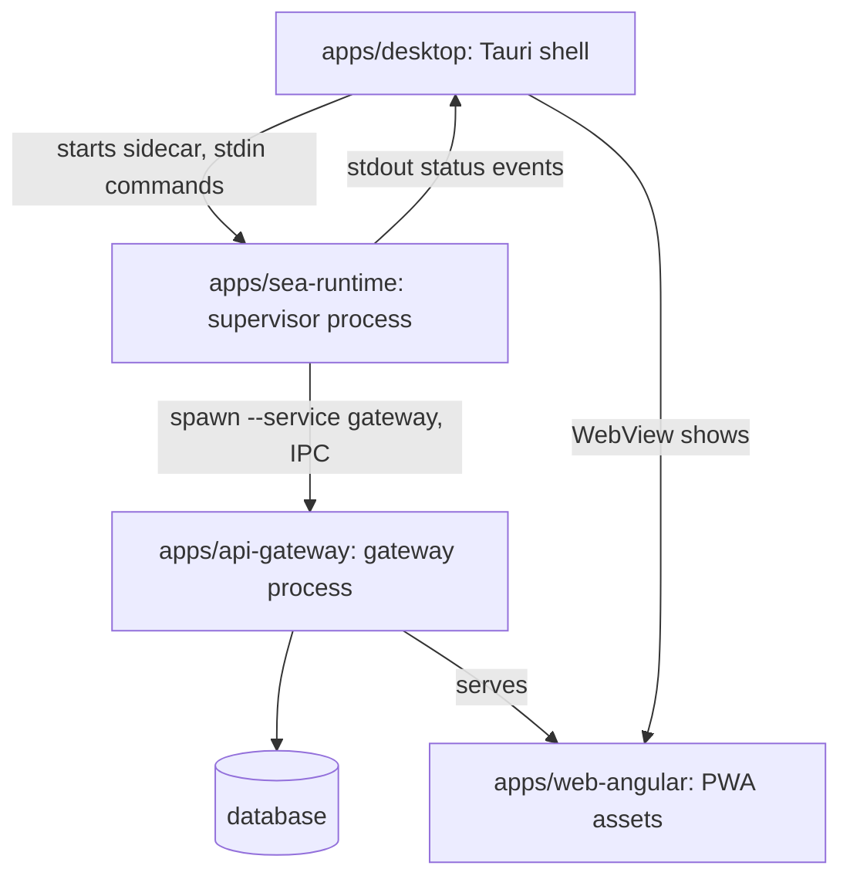

<!-- toon-meta
fmt: TOON
doc: docs/architecture/current-state.md
title: Current state and direction
type: architecture
summary: What exists today per app, lib and tool, the human's test direction of 2026-11-09, and the gaps.
ids[0]:
related[6]: docs/architecture/overview.md,docs/backlog/td-compile-sea-standalone.md,docs/backlog/README.md,docs/requirements/11-nx-quality-testing.md,docs/architecture/adr/ADR-013-nest-standalone-architecture.md,docs/architecture/platform-matrix.md
status: current
updated: 2026-11-09
-->

# Current state and direction

[Home](../../README.md) | [Requirements](../requirements/README.md) | [Architecture](../architecture/overview.md) | [Standards](../standards/README.md) | [Roadmap](../roadmap/PROPOSAL.md) | [Traceability](../requirements/traceability.md) | [Backlog](../backlog/README.md)

## Navigation

- [At a glance](#at-a-glance)
- [Purpose](#purpose)
- [Component map](#component-map)
- [Direction](#direction)
- [Gaps](#gaps)
- [Open decisions](#open-decisions)
- [ADR implementation status](#adr-implementation-status)

---

## At a glance

| Question | Answer | Section |
| --- | --- | --- |
| What exists? | Four apps, three libs, and loose scripts and configs under `tools/` | [Component map](#component-map) |
| Where does the human want to go? | Tests under `./tests/[TestStageName]/`, one setup per stage | [Direction](#direction) |
| What is missing? | A real runner for the smoke scripts, a `tools/scripts` tsconfig, desktop and web tests | [Gaps](#gaps) |
| What is not decided? | REQ-TEST-01, stage names, nest-commander, sea-runtime test design | [Open decisions](#open-decisions) |
| How far are the ADRs built? | Counts per ADR | [ADR implementation status](#adr-implementation-status) |

---

## Purpose

[Back to navigation](#navigation)

This page says what exists now and where the human decided to move. It is not a requirement. It adds no id. The requirements stay in [docs/requirements](../requirements/README.md), and the target design stays in the [overview](overview.md). Where a claim has no file behind it, the page says "not verified".

---

## Component map

[Back to navigation](#navigation)

| Component | What it does | Runs as | Tested today |
| --- | --- | --- | --- |
| `apps/api-gateway` | Nest gateway that serves `/api` and the PWA over HTTPS and talks to the database. | Gateway child process (`--service gateway`) of the single SEA; Nest watch mode in development. | `tsc --noEmit` and one Jest spec, `apps/api-gateway/test/health/get-health.spec.ts`. |
| `apps/sea-runtime` | Nest standalone supervisor: starts, restarts and stops the services and reports status on stdout. | Supervisor process, the entry of the single SEA; the Tauri sidecar. | `tsc --noEmit`; `sea-runtime:package` runs `tools/scripts/smoke-sea.ts`; `sea-runtime:smoke-pg` runs `tools/scripts/smoke-pg.ts`. No test files. |
| `apps/web-angular` | Angular PWA that the gateway serves. | Static assets inside the SEA; `ng serve` behind a dev proxy in development. | `tsc --noEmit -p tsconfig.app.json` only. `test:dynamic` is an `echo`. |
| `apps/desktop` | Tauri shell that starts the supervisor as a sidecar, plus the macOS installer scripts. | Native desktop process (Rust) and the build-time installer step. | `tsc --noEmit -p tsconfig.json`, `cargo check`, and a WebdriverIO e2e (`apps/desktop/e2e/host.e2e.ts`, run by `tools/scripts/e2e-desktop.ts`). No Rust unit tests. |
| `libs/shared-core` | Shared contracts, Zod schemas, config and the logger. | Library, bundled into each process. | `tsc --noEmit` only. `test:dynamic` is an `echo`. |
| `libs/service-registry` | Closed service registry, dispatcher, startup order and aggregate state. | Library, bundled into the supervisor and the dispatcher. | `tsc --noEmit` only. `test:dynamic` is an `echo`. |
| `libs/db-migrations` | Drizzle migrations and descriptors for the sqlite and pg engines. | Library; the SQL is built ahead of time and embedded in the SEA. | `tsc --noEmit`; `parity` runs `tools/scripts/db-parity.ts`; `drift:sqlite` and `drift:pg` use `git diff --exit-code`. |
| `tools/scripts` | Seventeen loose Node scripts: build, smoke, verify, release and installer helpers. | Node scripts started by package scripts and Nx targets; some run by hand. | `test-filter.ts` adapts to Jest; the smoke scripts are their own checks. No other test. |
| `tools/rspack` | One rspack config for the Nest bundle (`tools/rspack/nest.config.ts`). | Build time, read by the bundler. | Not tested. |
| `tools/vector` | The pinned sqlite-vector asset table (`tools/vector/sqlite-vector-1.1.2.json`). | Data file read by `compile-sea.ts`. | Not tested. |

Process view of the production topology. The edges come from the [overview](overview.md#production-topology) and the [Tauri sidecar](overview.md#tauri-sidecar) sequence.

---

## Direction

[Back to navigation](#navigation)

The human decided this on 2026-11-09. It is a direction, not a requirement. No requirement changed.

- Tests live under `./tests/[TestStageName]/`, with one setup per stage. The stage names are placeholders. A rename to self-descriptive names is a later iteration.
- `api-gateway`: Jest and Supertest, the Nest e2e kind.
- `web-angular`: app-level e2e with Playwright, set up with `ng add playwright-ng-schematics`. Not verified that it fits the current Angular version (the repo pins Angular through `catalog:angular` in `pnpm-workspace.yaml`).
- `sea-runtime`: to investigate and design. A hypothesis: Jest black-box tests against the isolated runtime in a child process. A possible two-level split: the compiled runtime, and the real SEA binary.
- `tools/scripts`: intended to become one CLI app instead of loose scripts. `nest-commander` is a candidate. Not verified. See [TD-TOOLS-01](../backlog/td-compile-sea-standalone.md).
- vitest is not part of the plan. The vitest entry in `apps/sea-runtime/package.json` is unused: no vitest config and no test file exist.

---

## Gaps

[Back to navigation](#navigation)

| Today | Target | What closes the gap |
| --- | --- | --- |
| Hand-written `check()` smoke scripts: `tools/scripts/smoke-sea.ts`, `tools/scripts/smoke-pg.ts`, `tools/scripts/verify-platform.ts`. | A real test runner and the stage layout under `./tests/`. | No page yet. The sea-runtime test design is open. |
| `tools/scripts/smoke-dev.ts` gets `Cannot find name 'process'` in the editor (VS Code). Likely cause, not verified by running tsc: no tsconfig includes it. The only tsconfig that covers `tools/scripts` files is `apps/desktop/tsconfig.json`, for `installer-*.ts`. | Every script under type check, with Node types. | [TD-TOOLS-01](../backlog/td-compile-sea-standalone.md) (one CLI app). No page yet for a stopgap tsconfig. |
| The Rust desktop shell has no unit tests. It has `cargo check` and a WebdriverIO e2e. | Not decided. | No page yet. |
| `web-angular` and the three libs have only `tsc --noEmit`. Their `test:dynamic` scripts are `echo` no-ops. | Playwright e2e for the web app (direction). Libs: not decided. | No page yet. |
| `api-gateway` has one Jest spec. [REQ-TEST-01](../requirements/11-nx-quality-testing.md) forbids unit and integration suites. | Jest and Supertest e2e under `./tests/`. | The requirement decision, see [Open decisions](#open-decisions). |

---

## Open decisions

[Back to navigation](#navigation)

All four belong to the human. This page changes none of them.

1. REQ-TEST-01 in [11-nx-quality-testing.md](../requirements/11-nx-quality-testing.md) forbids unit and integration suites. `api-gateway` already has a Jest spec (`apps/api-gateway/test/health/get-health.spec.ts`). Changing the requirement is the human's decision.
2. The rename of the placeholder stage names to self-descriptive names.
3. `nest-commander` or a plain class for the `tools/scripts` CLI app.
4. The design of the `sea-runtime` tests.

---

## ADR implementation status

[Back to navigation](#navigation)

The counts come from an audit of 194 decision rows across the 13 ADRs (`jq`, grouped by `implementation`). Each ADR holds its own row table in its `## Implementation status` section.

| ADR | Implemented | Partial | Not implemented | Outdated | Not verified |
| --- | --- | --- | --- | --- | --- |
| [ADR-001](adr/ADR-001-version-substitutions.md) | 7 | 2 | 1 | 0 | 0 |
| [ADR-002](adr/ADR-002-single-sea-portability.md) | 21 | 7 | 0 | 0 | 0 |
| [ADR-003](adr/ADR-003-config-and-db-strategy.md) | 12 | 0 | 2 | 1 | 0 |
| [ADR-004](adr/ADR-004-drizzle-build-time-migrations.md) | 16 | 0 | 1 | 1 | 0 |
| [ADR-005](adr/ADR-005-live-schema-validation.md) | 13 | 1 | 0 | 0 | 0 |
| [ADR-006](adr/ADR-006-sidecar-status-contract.md) | 13 | 1 | 0 | 0 | 0 |
| [ADR-007](adr/ADR-007-persistence-system.md) | 16 | 2 | 0 | 1 | 0 |
| [ADR-008](adr/ADR-008-tls-trust-model.md) | 21 | 1 | 0 | 1 | 0 |
| [ADR-009](adr/ADR-009-desktop-process-model.md) | 14 | 0 | 0 | 0 | 0 |
| [ADR-010](adr/ADR-010-first-run-admin-setup.md) | 0 | 0 | 7 | 0 | 0 |
| [ADR-011](adr/ADR-011-macos-installer-and-install-time-trust.md) | 12 | 0 | 0 | 0 | 0 |
| [ADR-012](adr/ADR-012-sea-runtime-child-registry.md) | 5 | 0 | 1 | 0 | 0 |
| [ADR-013](adr/ADR-013-nest-standalone-architecture.md) | 8 | 4 | 0 | 0 | 2 |

The audit data file is not part of the repository. The row tables inside the ADRs are the record.
