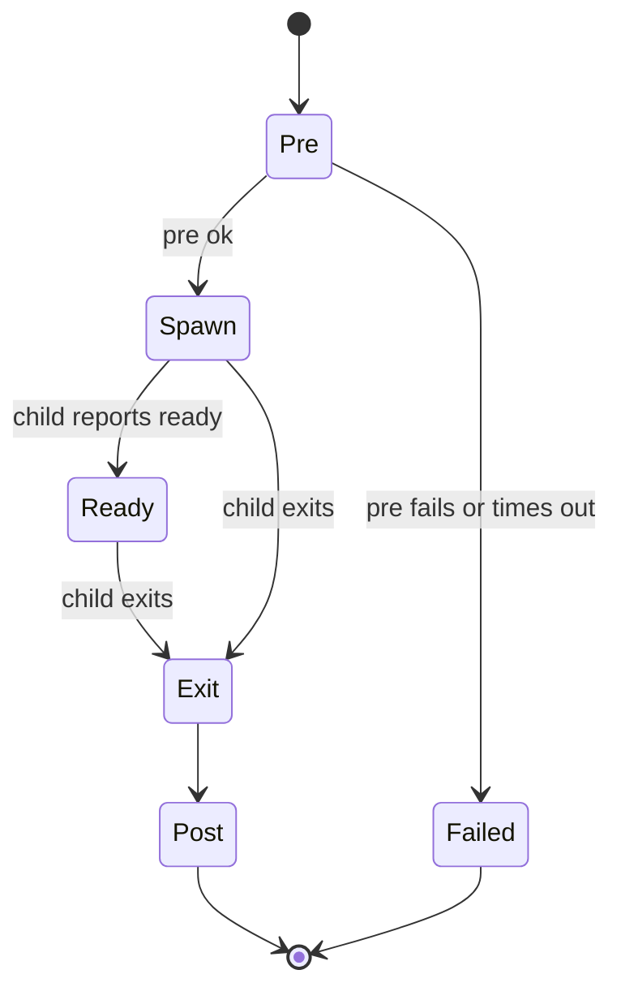
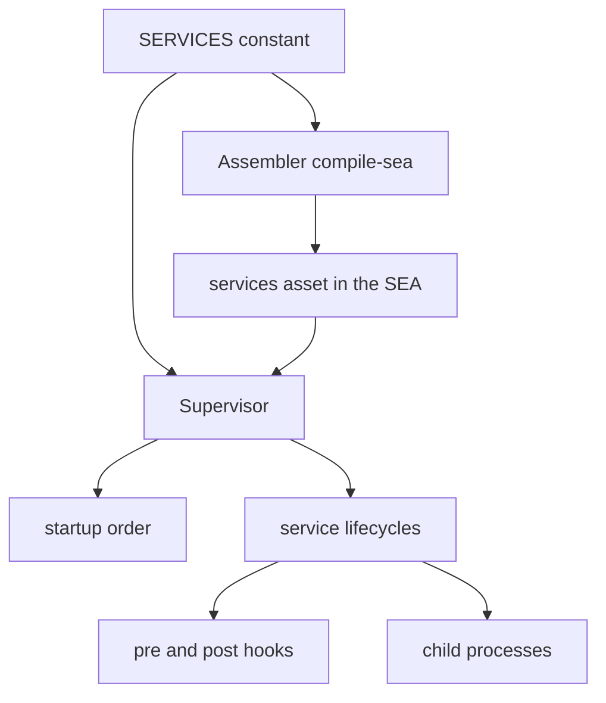

<!-- toon-meta
fmt: TOON
doc: docs/architecture/declared-services.md
title: "Declared services contract"
type: architecture
summary: "Proposed single DeclaredServices model replacing ServiceRoute and ServiceDefinition, with pre and post hooks and runtime validation."
ids[0]:
related[7]: docs/architecture/adr/ADR-013-nest-standalone-architecture.md,docs/architecture/nest-standalone-boot.md,docs/backlog/nest-standalone-refactor.md,docs/backlog/nest-standalone-cleanup-inventory.md,docs/architecture/adr/ADR-009-desktop-process-model.md,docs/architecture/adr/ADR-006-sidecar-status-contract.md,docs/architecture/overview.md
status: proposed
updated: 2026-11-06
-->

# Declared services contract

[Overview](overview.md) | [ADR-013](adr/ADR-013-nest-standalone-architecture.md) | [Nest standalone boot](nest-standalone-boot.md) | [ADR-009](adr/ADR-009-desktop-process-model.md) | [Epic](../backlog/nest-standalone-refactor.md) | [Cleanup inventory](../backlog/nest-standalone-cleanup-inventory.md)

## Navigation

- [Status](#status)
- [Context](#context)
- [Proposed contract](#proposed-contract)
- [Name and project derivation](#name-and-project-derivation)
- [Pre and post hooks](#pre-and-post-hooks)
- [Validation](#validation)
- [Who reads DeclaredServices](#who-reads-declaredservices)
- [Migration table](#migration-table)
- [Open decision: compile-time dependsOn check](#open-decision-compile-time-dependson-check)
- [Not verified](#not-verified)

## Status

Proposed, 2026-11-06. Documentation only. No file under `apps/`, `libs/` or `tools/` changes in this phase. The later code refactor is a pure refactor: every existing test and smoke passes unchanged.

Claims taken from the mapping reports are marked "reported by mapping, not verified". The code lines cited below were read by the author of this page unless the text says otherwise.

## Context

Two models describe a service today.

- `ServiceRoute` (`libs/service-registry/src/service-routes.ts`) is live. It carries `id`, `project`, `dependsOn`, `enabled` and `web`. `defineServices` builds it, and `apps/sea-runtime/src/services.ts` declares the single entry `api-gateway`.
- `ServiceDefinition` (`libs/service-registry/src/service-definition.ts`) carries `id`, `entry`, `dependsOn` and `enabled`. Reported by mapping, not verified: `serviceDefinitionSchema`, `serviceRegistrySchema` and `ServiceRegistry` have no code reader, and nothing reads `entry`. `ServiceDefinition` is used only as a `Pick` type in `startup-order.ts`. QC must verify before any delete.

The two models overlap on three fields and disagree on the rest. Every service id is typed by hand, although the service path already holds the name. A service also has no place to declare work that must run before its process starts or after it ends.

## Proposed contract

One model replaces both. The export follows the style of Angular routes.

```ts
// Proposed. Not implemented.
export const SERVICES: DeclaredServices = [
  { path: 'apps/api-gateway', web: true },
];
```

Type names:

| Name | Meaning |
| --- | --- |
| `declaredServiceSchema` | zod schema of one service. |
| `DeclaredService` | `Readonly<z.infer<typeof declaredServiceSchema>>`. The element type. |
| `DeclaredServices` | `readonly DeclaredService[]`. The collection type. Use sites never write `[]`. |
| `SERVICES` | The one constant of type `DeclaredServices`. |

Fields of `DeclaredService` (proposed):

| Field | Required | Meaning |
| --- | --- | --- |
| `path` | yes | Workspace-relative path of the service package. The name is derived from it. |
| `dependsOn` | no, default empty | Names of services that must be ready first. |
| `enabled` | no, default true | A disabled service is declared but never started. |
| `web` | no, default false | The service receives the embedded web bundle over IPC on every start. |
| `pre` | no | Hook run in the supervisor before the spawn. |
| `post` | no | Hook run in the supervisor after the child exits. |

The input has no `id`. The input has no `entry`.

Example with hooks, proposed:

```ts
// Proposed. Not implemented. Names and bodies are illustrative.
export const SERVICES: DeclaredServices = [
  {
    path: 'apps/api-gateway',
    web: true,
    pre: { run: verifyTlsIdentity, timeoutMs: 10_000 },
    post: { run: flushGatewayState, timeoutMs: 5_000 },
  },
];
```

## Name and project derivation

The name of a service is `path.parse(path).base`. The name replaces `id` everywhere: argv (`--service <name>`), log prefix, status events and `dependsOn` references.

- Use `.base`, not `.name`. `.name` strips a dot suffix, so a path ending in `x.y` would lose `.y`.
- `path.parse` works on a string and touches no disk. It works inside the SEA binary.
- `project` (the workspace package that holds `dist/main.js`) is derived from the same path. Today `project` defaults to the id (comment at `service-routes.ts:9`). Under the proposal the package folder is the path, so the assembler reads the path directly and the `project` input disappears. Whether the folder name always equals the Nx project name is not verified.
- Two services whose paths share a base name collide. Validation rejects them as a duplicate name.

## Pre and post hooks

Proposal. The semantics below are not implemented and need a human decision before the code phase. Each hook is a named, typed function declared next to the service. The default timeouts are proposed values.



### Semantics

| Aspect | Proposal | Tradeoff |
| --- | --- | --- |
| Where it runs | In the supervisor process, not in the child. | The hook sees supervisor state and the DI container. It cannot run in the child's isolation. |
| `pre` failure | The service does not start. Its lifecycle state is failed and the aggregate state is failed. | Safe: a service never runs on a broken precondition. Strict: one bad hook stops its dependents too. |
| `pre` timeout | Same as failure. Proposed default 10 000 ms. | A slow but healthy hook is killed. A higher default delays failure detection. |
| `post` trigger | Runs after the child exits for any reason: clean stop, crash, restart. | Cleanup always has a chance. A crash loop runs `post` on every restart. |
| `post` failure | Logged, never thrown. Shutdown continues. | Shutdown cannot hang on cleanup. A failing cleanup is easy to miss in the log. |
| `post` timeout | Logged, hook abandoned. Proposed default 5 000 ms. | Bounded shutdown. A hook cut short may leave state half cleaned. |
| Order across services | `pre` follows startup order. `post` follows reverse startup order, matching the stop order in `SupervisorService` (reported by mapping, not verified for hooks). | Dependents stop before their dependencies. Hooks add time to both start and stop. |
| Restarts | Whether `pre` runs again on each restart is open. Proposal: yes, because a restart is a spawn. | Re-running keeps preconditions true. It also repeats side effects. |
| Hook type | A named function with an explicit signature, never an inline closure in the array. | Easy to test and to log by name. One more symbol per hook. |

Hooks take the validated config singleton through DI, per the nest rule that config is read from the already validated singleton. The exact signature is not defined in this page.

## Validation

Validation stays internal and runs at run time with zod. The checks match what `routesSchema` does today (reported at `service-routes.ts:18-35`), applied to names instead of ids:

1. Names are unique.
2. Every `dependsOn` entry names a declared service.
3. The enabled services have no startup cycle. The check calls the same ordering function as the supervisor.
4. Hook timeouts are positive integers.

The type is `z.infer` of the schema. No hand-written interface duplicates it. Validation runs once, where `SERVICES` is first consumed, and a failure aborts with the zod issue path.

## Who reads DeclaredServices



- The assembler reads `SERVICES` at build time to find each package and to write the services asset (reported by mapping, not verified: `compile-sea.ts:276,467,485`). The asset omits `project` today; under the proposal it omits `path` details the supervisor does not need.
- The supervisor reads the asset at run time through the routes source (`apps/sea-runtime/src/supervisor/service-routes-source.ts`, reported by mapping). It orders services, runs hooks and spawns children.
- Both read the one constant, so the two views cannot drift.
- Hook functions are code, not data. They cannot travel in a JSON asset. How the supervisor resolves a hook declared in `SERVICES` at run time is open, see [Not verified](#not-verified).

Boot order around the supervisor, certificates and migrations is in [Nest standalone boot](nest-standalone-boot.md).

## Migration table

| Old | New | Note |
| --- | --- | --- |
| `ServiceRoute` | `DeclaredService` | One element type, `z.infer` of `declaredServiceSchema`. |
| `serviceRouteSchema` | `declaredServiceSchema` | Strict object, as today. |
| `ServiceDefinition` | removed | Merged into `DeclaredService`. QC to verify zero readers before delete. |
| `serviceDefinitionSchema` | removed | Same. |
| `ServiceRegistry` | `DeclaredServices` | Collection type. |
| `serviceRegistrySchema` | internal collection schema | Not exported unless the assembler needs it. QC to verify before delete. |
| `routesSchema` | internal collection schema | Same checks plus hook rules. |
| `defineServices` | open, see [open decision](#open-decision-compile-time-dependson-check) | Kept as a helper or dropped. |
| `servicesAssetSchema` | stays, derived from `declaredServiceSchema` | Shape of the asset the supervisor reads. |
| `entry` | removed | Reported by mapping, not verified: no reader. |
| `project` | derived from `path` | No longer an input. |
| `id` | `name`, derived with `path.parse(path).base` | No longer an input. argv flag value, log prefix and status keys change source, not value, for `api-gateway`. |
| `serviceIdSchema` | `serviceNameSchema` (proposed) | Used by `serviceArgs` and `dependsOn`. |

`api-gateway` keeps the same name, so argv, the `[api-gateway] text` log line and status events are byte identical. This is the pure-refactor condition and needs a proof in the code phase.

## Open decision: compile-time dependsOn check

Today `defineServices` checks `dependsOn` against declared ids at compile time. It uses a generic `Id` inferred from the `id` field and `NoInfer` on `dependsOn`, so a dependency that names no declared service is a TypeScript error (`service-routes.ts:38-50`). A plain `DeclaredServices` array loses that, because the type no longer carries the literal names. Names are derived from `path` by a function, which TypeScript cannot follow.

| Option | Description | Gains | Loses |
| --- | --- | --- |
| 1. Keep a `defineServices` helper | `SERVICES = defineServices([...])` with literal path types. | Editor and `tsc` error on an unknown `dependsOn`. | The plain `export const SERVICES: DeclaredServices = [...]` style. Name derivation must be re-expressed in template literal types, or `dependsOn` must name paths. More type machinery. |
| 2. Runtime plus assembler check only | A plain typed array. The collection schema and the assembler reject unknown names. | The simple Angular-route style. No type machinery. | Feedback arrives at assembler or startup time, not in the editor. A mistake compiles and fails later. |

Recommendation: option 2. The project already validates the same rules at run time, the declared list is short, and the assembler fails the build before any binary ships. What is lost is the editor-time error. The cost of a late error is one failed `compile-sea` run. Revisit if the list grows enough that mistakes become frequent.

This decision needs the human before the code phase.

## Not verified

- That `serviceDefinitionSchema`, `serviceRegistrySchema` and `entry` have no reader. Reported by mapping. A QC check must repeat the search across `src`, tests, `tools`, scripts and non-TS files before any delete.
- That `docs/results/POC-02c-assembler-registry.md:20` is stale. It says `compile-sea` validates with `serviceRegistrySchema`; the mapping found no such call. Recorded in the cleanup inventory, not fixed here.
- That the package folder name always equals the derived name and the Nx project name.
- How the supervisor resolves hook functions at run time, since the services asset is data and hooks are code. Likely the supervisor imports `SERVICES` directly; the asset keeps only data fields.
- Whether `pre` runs again on each restart, and the proposed timeouts of 10 000 ms and 5 000 ms.
- That `post` order matches the supervisor's reverse stop order in every shutdown path.
- Where `DeclaredServices` lives: `libs/service-registry` today. Recommendation: stay there. The lib already owns ordering and the supervisor protocol, and a new lib would split one concept across two. Not verified against every importer.
