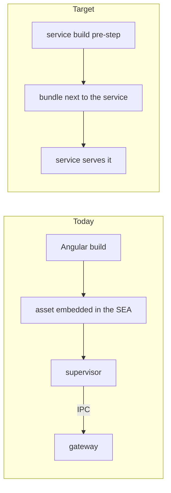
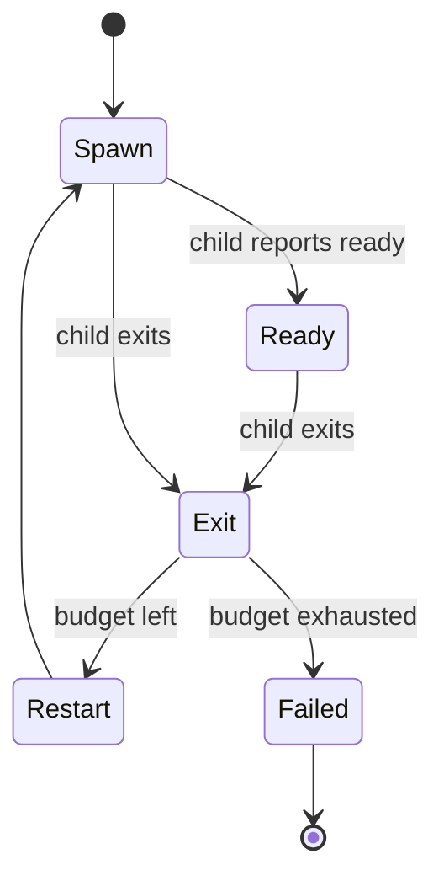
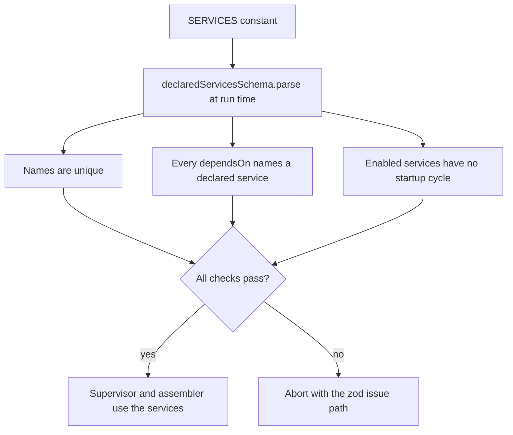
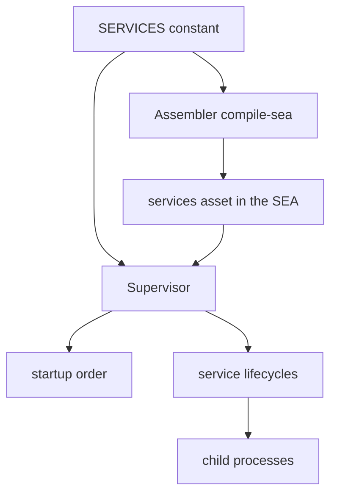

<!-- toon-meta
fmt: TOON
doc: docs/architecture/declared-services.md
title: "Declared services contract"
type: architecture
summary: "Single DeclaredServices model (implemented in slice 3) that replaced ServiceRoute and ServiceDefinition, validated at run time, with no per-service routines."
ids[0]:
related[7]: docs/architecture/adr/ADR-013-nest-standalone-architecture.md,docs/architecture/nest-standalone-boot.md,docs/backlog/nest-standalone-refactor.md,docs/backlog/nest-standalone-cleanup-inventory.md,docs/architecture/adr/ADR-009-desktop-process-model.md,docs/architecture/adr/ADR-006-sidecar-status-contract.md,docs/architecture/overview.md
status: current
updated: 2026-11-06
-->

# Declared services contract

[Overview](overview.md) | [ADR-013](adr/ADR-013-nest-standalone-architecture.md) | [Nest standalone boot](nest-standalone-boot.md) | [ADR-009](adr/ADR-009-desktop-process-model.md) | [Epic](../backlog/nest-standalone-refactor.md) | [Cleanup inventory](../backlog/nest-standalone-cleanup-inventory.md)

## Navigation

- [Status](#status)
- [Context](#context)
- [Contract](#contract)
- [Name and project derivation](#name-and-project-derivation)
- [Startup order and shutdown](#startup-order-and-shutdown)
- [Validation](#validation)
- [Who reads DeclaredServices](#who-reads-declaredservices)
- [Migration table](#migration-table)
- [Decision: plain typed array](#decision-plain-typed-array)
- [Not verified](#not-verified)

## Status

Implemented in slice 3, 2026-11-06. Two decisions by the human shaped it: the contract carries no per-service routines, and the array is a plain typed constant validated at run time.

Slice 3 is a pure refactor. The `services.json` asset is byte-identical to the one built before the slice. The model lives in `libs/service-registry/src/schemas/declared-services.ts`.

The author read the code lines cited in the tables. Claims taken from mapping reports are collected in [Not verified](#not-verified).

## Context

Before slice 3, two models described a service. The table shows the old state; the [migration table](#migration-table) maps each symbol to its replacement.

| Model | Source | Fields | State |
| --- | --- | --- | --- |
| `ServiceRoute` (removed) | libs/service-registry/src/service-routes.ts | id, project, dependsOn, enabled, web | Was live. A helper function built it. `apps/sea-runtime/src/services.ts` declared one entry, `api-gateway`. |
| `ServiceDefinition` (removed) | libs/service-registry/src/service-definition.ts | id, entry, dependsOn, enabled | Nothing read `entry`. `startup-order.ts` used the type only as a `Pick`; it now picks from `ServiceEntry`. |

The two models overlapped on three fields and disagreed on the rest. Every service id was typed by hand, although the service path already holds the name.

A service is a long-lived process. The supervisor spawns it, reads its ready message and restarts it when it exits.

- Work that must run before a service is declared as another service earlier in the array.
- Work that must run at shutdown belongs to the service itself, through the Nest lifecycle hooks.

## Contract

One model replaces both. The export follows the style of Angular routes.

```ts
// A plain typed constant: no helper function wraps it.
export const SERVICES: DeclaredServices = [
  { path: 'apps/api-gateway', web: true },
];
```

Type names:

| Name | Meaning |
| --- | --- |
| `declaredServiceSchema` | zod schema of one service. |
| `DeclaredService` | `Readonly<z.input<typeof declaredServiceSchema>>`. The element type. `z.input` keeps `dependsOn`, `enabled` and `web` optional, so `{ path, web: true }` compiles. |
| `ServiceEntry` | `Readonly<z.infer<typeof serviceEntrySchema>>`. What the supervisor reads: `id`, `dependsOn`, `enabled`, `web`, in that key order. `serviceEntries(SERVICES)` validates the declaration and derives the entries. |
| `DeclaredServices` | `readonly DeclaredService[]`. The collection type. Use sites never write `[]`. |
| `SERVICES` | The one constant of type `DeclaredServices`. |

Fields of `DeclaredService`:

| Field | Required | Meaning |
| --- | --- | --- |
| `path` | yes | Workspace-relative path of the service package. The name is derived from it. |
| `dependsOn` | no, default empty | Names of services that must start earlier. Kept, see [Startup order and shutdown](#startup-order-and-shutdown). |
| `enabled` | no, default true | A disabled service is declared but never started. |
| `web` (Deprecated) | no, default false | Deprecated. Today the supervisor sends the embedded web bundle to this service over IPC at every start (`apps/sea-runtime/src/services/child-spawner.ts:20-21`). A service-owned web build will replace it, see [Deprecated: the web flag](#deprecated-the-web-flag). |

The input has no `id` and no `entry`.

### Deprecated: the web flag

The `web` field stays in the contract unchanged and is marked deprecated. Nothing moves in this refactor, and the command line argument `--web ipc` does not change.

Today the Angular build output is embedded in the SEA binary. The supervisor reads it and sends it to the gateway over IPC at every start. The IPC path exists because the gateway must run without SEA (REQ-NET-02, `docs/roadmap/PROPOSAL.md:808`).

The target is an idea of the human, not scheduled. The build script of the service takes care of what it needs, for example a pre-step that runs the Angular build and leaves the bundle next to the service. The `web` flag and the `--web ipc` argument then disappear. See the follow-up in the [epic](../backlog/nest-standalone-refactor.md#follow-ups).



| Blocker | Evidence |
| --- | --- |
| The gateway must run without SEA. | REQ-NET-02, `docs/roadmap/PROPOSAL.md:808`. |
| Removing the field and the argument changes contracts, so it is not a pure refactor. | High-risk items 3 and 5 of the task size rules. |
| Child access to the embedded assets and bundling with rspack are not verified. | No run exists. The epic that takes the idea verifies both. |

A service is one long-lived process. A task that ends is not a service: the supervisor would treat its exit as a crash and restart it. For that reason the database migrations stay a step of the supervisor, not a declared service ([Nest standalone boot](nest-standalone-boot.md)).



| Source | Finding |
| --- | --- |
| apps/sea-runtime/src/services/service-lifecycle.ts:101 | Any exit, clean or not, goes through the restart plan. |
| apps/sea-runtime/src/services/service-lifecycle.ts:107-119 | A spent budget sets the status to failed. Otherwise the status is restarting and a timer respawns the child. |

## Name and project derivation

The name of a service is `path.parse(path).base`. The name replaces `id` everywhere: argv (`--service <name>`), log prefix, status events and `dependsOn` references.

- Use `.base`, not `.name`. `.name` strips a dot suffix, so a path ending in `x.y` would lose `.y`.
- `path.parse` works on a string and touches no disk. It works inside the SEA binary.
- `project` is the workspace package that holds `dist/main.js`. It is the derived name, so the assembler compares the name with the workspace dependency and the `project` input is gone. The base of the path must equal the package name (not verified for future services; one service exists).
- Two services whose paths share a base name collide. Validation rejects them as a duplicate name.

## Startup order and shutdown

The code was read to settle one question: does the supervisor wait for a service to be ready before it launches the next one? It does not.

| Source | Finding |
| --- | --- |
| apps/sea-runtime/src/services/supervisor.service.ts:41-49 | One synchronous `for` loop over `startOrder()`. Each iteration creates the lifecycle and calls `lifecycle.start()` without awaiting anything. |
| apps/sea-runtime/src/services/service-lifecycle.ts:59-63 | `start()` subscribes and returns at once. It returns no promise and no readiness signal. |
| apps/sea-runtime/src/services/service-lifecycle.ts:83-91 | The ready message only sets the status to ready. Nothing gates the next spawn on it. |
| libs/service-registry/src/startup-order.ts:4,18-20 | `startupOrder` is a topological sort over `dependsOn`. Ties keep registry order. It orders the spawns and does nothing else. |
| libs/service-registry/src/startup-order.ts:5 | A code comment says ordering of two or more services is unverified. |
| apps/sea-runtime/src/services/supervisor.service.ts:79-82 | Shutdown runs in reverse start order. |

Result:

- The array order does not order startup. It only breaks ties between services that `dependsOn` leaves unordered. dependsOn stays in the contract and keeps the meaning "starts earlier".
- No service waits for the ready message of another one. Making the supervisor wait is a behavior change and is out of scope.
- At shutdown the supervisor sends the shutdown message, then stops the process tree.

Work before a service: declare it as another service earlier in the array, and name it in `dependsOn` when the order matters.

Work at shutdown: the service does it. A Nest service runs onApplicationShutdown and beforeApplicationShutdown when the child closes its application. The supervisor adds no routine and no extra time limit.

## Validation

Validation stays internal and always runs at run time with zod, the way Angular validates its route configuration. Both readers run it: the supervisor when it reads the services, and the assembler when it reads `SERVICES` at build time.



The checks are those of the former `routesSchema`, applied to derived names (`declaredServicesSchema` in declared-services.ts). The cycle check calls the same ordering function as the supervisor.

The type is `z.input` of the schema. No hand-written interface duplicates it. Each reader validates once, where it first consumes `SERVICES`. The editor does not check `dependsOn` names; see [Decision: plain typed array](#decision-plain-typed-array).

## Who reads DeclaredServices



- The assembler reads `SERVICES` at build time to find each package and to write the services asset. The asset holds `ServiceEntry` objects only: no path, no project.
- The supervisor reads the asset at run time through the routes source. It validates the services, orders them and spawns children.
- Both read the one constant, so the two views cannot drift.
- Both validate with the same schema, so a wrong declaration fails in either place.

| Source | Reader |
| --- | --- |
| apps/tools-cli/src/sea (`compile-sea`, `contract.serviceEntries(SERVICES)`) | Assembler. |
| apps/sea-runtime/src/supervisor/service-routes-source.ts (`serviceEntries` in dev, `servicesAssetSchema` in SEA) | Supervisor. |
| apps/sea-runtime/src/sea-entry.ts and main.ts (`serviceEntries(SERVICES)`) | Entrypoints, on import. |

Boot order around the supervisor, certificates and migrations is in [Nest standalone boot](nest-standalone-boot.md).

## Migration table

| Old | New | Note |
| --- | --- | --- |
| `ServiceRoute` | `DeclaredService` (input) and `ServiceEntry` (what the supervisor reads) | Removed in slice 3. `DeclaredService` is `z.input` of `declaredServiceSchema`. |
| `serviceRouteSchema` | `declaredServiceSchema` | Strict object, as today. |
| `ServiceDefinition` | removed | Removed in slice 3. The only reader, `startupOrder`, now picks from `ServiceEntry`. |
| `serviceDefinitionSchema` | removed | Same. |
| `ServiceRegistry` | `DeclaredServices` | Collection type. Had no reader. |
| `serviceRegistrySchema` | removed | Zero readers outside its file. |
| `routesSchema` | `declaredServicesSchema` (internal) | Same checks, applied to names. |
| `RouteInput` | removed | Went with `defineServices`. |
| `defineServices` | removed | Decided by the human, 2026-11-06. `SERVICES` is a plain `DeclaredServices` constant. See [Decision: plain typed array](#decision-plain-typed-array). |
| `pre` and `post` (proposed fields, never implemented) | dropped | Decided by the human, 2026-11-06. Work before a service is another service earlier in the array. Work at shutdown is a Nest lifecycle hook of the service. |
| `servicesAssetSchema` | stays, built from `serviceEntrySchema` | Shape of the asset the supervisor reads. Key order `id, dependsOn, enabled, web` keeps the asset byte-identical. |
| `entry` | removed | No reader found. |
| `project` | derived from `path` | No longer an input. |
| `id` | `name`, derived with `path.parse(path).base` | No longer an input. argv flag value, log prefix and status keys change source, not value, for `api-gateway`. |
| `serviceIdSchema` | stays, moved to `dispatcher.ts` | Used by `serviceArgs`, `dependsOn` and the dispatcher selector. A rename is not part of slice 3. |
| `serviceArgs` | stays, moved to `dispatcher.ts` | Read by `child-spawner.ts`. |

`api-gateway` keeps the same name, so argv, the `[api-gateway] text` log line and status events are byte identical. The `services.json` hash was the same before and after slice 3.

## Decision: plain typed array

Decided by the human, 2026-11-06. `SERVICES` is `export const SERVICES: DeclaredServices = [...]` with a simple type and no helper function. Zod validation always runs at run time, in the supervisor and in the assembler, the same way Angular validates its route configuration.

What is lost on purpose: the editor and `tsc` no longer flag a `dependsOn` entry that names no declared service. A mistake compiles and fails at the first run of the assembler or the supervisor, with the zod issue path. The cost of a late error is one failed `compile-sea` run. This is no longer an open decision.

## Not verified

| Item | Why it is missing | Who verifies |
| --- | --- | --- |
| `docs/results/POC-02c-assembler-registry.md:20` is stale | It says `compile-sea` validates with `serviceRegistrySchema`; the symbol is deleted. Recorded in the cleanup inventory | Whoever edits that result page |
| Windows path separators | `path.parse` follows the host platform; Windows was not run | QC |
| Package folder name equals the derived name and the Nx project name | Not checked against every package | QC |
| The supervisor should wait for the ready message before the next launch | Today it does not. Changing it is a behavior change outside this refactor | Human decision |
| Reverse stop order holds in every shutdown path | Only one path was read | QC |
| `DeclaredServices` lives in `libs/service-registry` | Recommendation: stay there, because the lib already owns ordering and the supervisor protocol. Not checked against every importer | QC |
