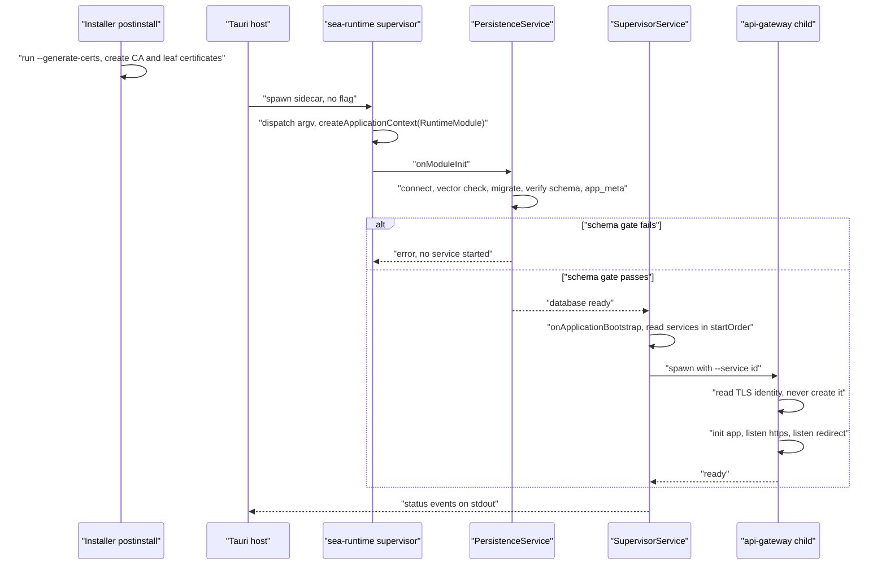
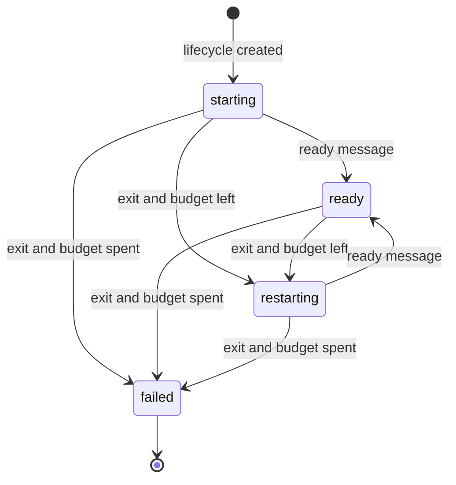
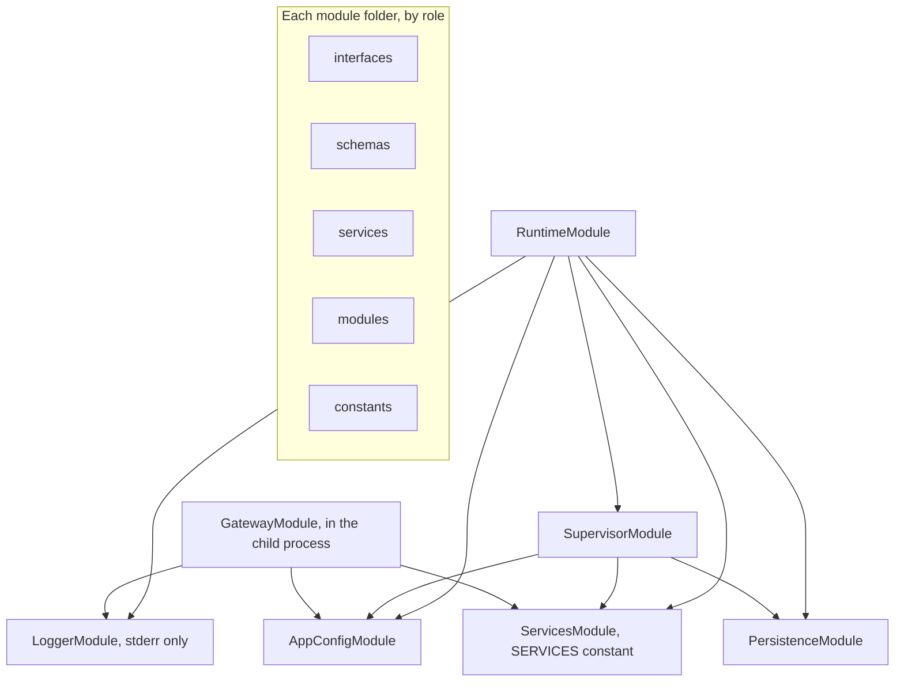
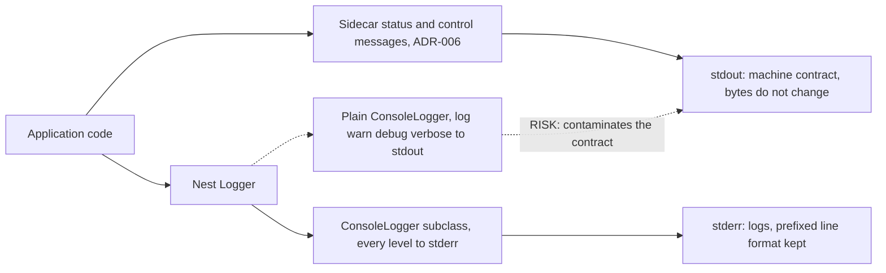

<!-- toon-meta
fmt: TOON
doc: docs/architecture/nest-standalone-boot.md
title: Nest standalone boot and channels
type: architecture
summary: Diagrams of the standalone Nest boot order, module graph, stdout and stderr channels, exit codes and folder layout.
ids[0]:
related[7]: docs/architecture/adr/ADR-013-nest-standalone-architecture.md,docs/architecture/declared-services.md,docs/backlog/nest-standalone-refactor.md,docs/backlog/nest-standalone-cleanup-inventory.md,docs/architecture/adr/ADR-006-sidecar-status-contract.md,docs/architecture/adr/ADR-012-sea-runtime-child-registry.md,docs/architecture/overview.md
status: proposed
updated: 2026-11-06
-->

# Nest standalone boot and channels

[Home](../../README.md) | [Requirements](../requirements/README.md) | [Architecture](overview.md) | [Standards](../standards/README.md) | [Roadmap](../roadmap/PROPOSAL.md) | [Traceability](../requirements/traceability.md) | [Backlog](../backlog/README.md)

See also: [ADR-013](adr/ADR-013-nest-standalone-architecture.md) | [Declared services](declared-services.md) | [Epic](../backlog/nest-standalone-refactor.md) | [Cleanup inventory](../backlog/nest-standalone-cleanup-inventory.md)

## Navigation

- [At a glance](#at-a-glance)
- [Boot order](#boot-order)
- [Service lifecycle](#service-lifecycle)
- [Target module graph](#target-module-graph)
- [Output channels](#output-channels)
- [Exit codes](#exit-codes)
- [Target folder tree](#target-folder-tree)
- [Not verified](#not-verified)

---

## At a glance

[Back to navigation](#navigation)

This page supports the refactor proposed in [ADR-013](adr/ADR-013-nest-standalone-architecture.md). The refactor is a pure structure change. The stdout contract of [ADR-006](adr/ADR-006-sidecar-status-contract.md), the exit code numbers and the boot order do not change. The service model is in [declared services](declared-services.md).

Every file and line cited below comes from mapping reports of the current code. [Not verified](#not-verified) lists what a QC check must confirm before the code phase relies on it.

| Topic | What you find | Section |
| --- | --- | --- |
| Boot | Order from the runtime to the gateway, with certificates | [Boot order](#boot-order) |
| Lifecycle | States of one supervised service | [Service lifecycle](#service-lifecycle) |
| Modules | Target dependency graph of Nest modules | [Target module graph](#target-module-graph) |
| Channels | stdout contract against stderr logs | [Output channels](#output-channels) |
| Exit codes | Every current `process.exit` and the `EXIT_CODE` contract | [Exit codes](#exit-codes) |
| Folders | Target tree of one app | [Target folder tree](#target-folder-tree) |

---

## Boot order

[Back to navigation](#navigation)



The runtime dispatches the arguments and creates the application context. Persistence then runs the migrations and the schema gate inside the supervisor process. Only after that does the supervisor start the services in `startOrder`, the gateway among them.

- Logging is not a service and has no step.
- The installer creates the certificates before the boot with `--generate-certs`. The gateway only reads them.
- If the certificates are missing, the gateway fails to start. The supervisor restarts it within its budget.

| Source | Covers |
| --- | --- |
| `apps/sea-runtime/src/sea-entry.ts:6-19` | Dispatch, certificate flag. |
| `apps/sea-runtime/src/main.ts:6-12` | Application context. |
| `apps/sea-runtime/src/persistence/persistence.service.ts:26-80` | Migrations and schema gate. |
| `apps/sea-runtime/src/supervisor/supervisor.service.ts:30-61` | Service start in order. |
| `apps/api-gateway/src/app.bootstrap.ts:22-32` | Gateway listen steps. |
| `apps/desktop/installer/macos/scripts/postinstall:86-98` | Certificate creation. |

---

## Service lifecycle

[Back to navigation](#navigation)



The status starts as `starting` and changes only on a ready message or after an exit. A child that sends no ready message within `readinessTimeoutMs` receives SIGKILL. The kill ends in the same exit handler, so a startup failure spends the same restart budget. A spent budget sets `failed` and no further spawn happens.

Source: `apps/sea-runtime/src/supervisor/service-lifecycle.ts:46,89,92-96,110-118`.

---

## Target module graph

[Back to navigation](#navigation)



The diagram is the target dependency graph. The module names are a proposal, not current code.

- Every module reads configuration from the validated config singleton.
- Every logger goes through the Nest `Logger`.
- The assembler and the supervisor read the same `SERVICES` constant.
- Each module folder uses the five role folders in the [folder tree](#target-folder-tree).

| Source | Covers |
| --- | --- |
| `apps/sea-runtime/src/runtime/runtime.module.ts` | Runtime module imports. |
| `apps/api-gateway/src/core.module.ts` | Gateway module imports. |
| Mapping C (nest-base layout) | Role folders and module style. |

---

## Output channels

[Back to navigation](#navigation)



stdout is the machine contract of ADR-006: one JSON object per line, never a log, with unchanged bytes. All logs go through the Nest `Logger` to stderr.

- The default Nest `ConsoleLogger` writes `log`, `warn`, `debug` and `verbose` to stdout. It writes only `error` and `fatal` to stderr.
- Used as is, it would put log lines into the contract channel (the dotted path).
- The target logger is a `ConsoleLogger` subclass that sends every level to stderr.
- Its output keeps the line format `[id] text` until the code phase proves no consumer needs it.
- SupervisorLogger is always removed. Its callers use the injected Nest `Logger`, and the subclass formats `[context] message` so the emitted lines stay identical (capture before and after).
- A later epic may replace the logger behind the Nest `LoggerService` interface. This page does not design it.

| Source | Covers |
| --- | --- |
| `console-logger.service.js:95-148`, `233-241` in `@nestjs/common` | Default level routing. |
| `libs/service-registry/src/supervisor-log.ts:5` | Current supervisor log prefix. |
| `apps/sea-runtime/src/sidecar/sidecar-output.ts:8` | Contract writer. |

---

## Exit codes

[Back to navigation](#navigation)

The refactor replaces each magic number with a named `EXIT_CODE` constant (slice 1: `libs/service-registry/src/exit-code.ts`; the `constants` folder comes in slice 5). The numeric values do not change.

The table lists 26 `process.exit` calls and one `process.exitCode` assignment, as found by mapping. Observable means that a smoke test or a contract comment asserts the value.

| File | Line | Value | Observable |
| --- | --- | --- | --- |
| `apps/sea-runtime/src/supervisor/supervisor.service.ts` | 84 | 0 or `SUPERVISOR_CONFIG.errorExitCode` | yes, smoke-sea L272-273 expects 0 after shutdown |
| `apps/sea-runtime/src/sea-entry.ts` | 12 | `DISPATCHER_CONFIG.rejectExitCode` | yes, smoke-sea L460-465 |
| `apps/sea-runtime/src/sea-entry.ts` | 17 | `process.exitCode` from `runGenerateCerts` (assignment, not a call) | yes, smoke-dev L146 checks a nonzero status |
| `apps/sea-runtime/src/main.ts` | 20 | 1 | yes, smoke-pg L282-283 and smoke-sea start-failure checks |
| `apps/api-gateway/src/main.ts` | 16 | 1 | yes, smoke-dev L162-170 gateway startup failure |
| `apps/api-gateway/src/main.ts` | 51 | 0 | yes, clean close after the shutdown message |
| `tools/scripts/smoke-pg.ts` | 74 | 130 on signal | no |
| `tools/scripts/smoke-pg.ts` | 198 | 1 | no |
| `tools/scripts/test-filter.ts` | 27 | 2 | no |
| `tools/scripts/test-filter.ts` | 53 | 1 | no |
| `tools/scripts/test-filter.ts` | 56 | child status or 1 passthrough | no |
| `tools/scripts/version-check.ts` | 54 | 1 | no |
| `tools/scripts/smoke-sea.ts` | 357 | 1 | no |
| `tools/scripts/pack-migrations.ts` | 156 | 1 | no |
| `tools/scripts/smoke-dev.ts` | 79 | 1 | no |
| `tools/scripts/db-parity.ts` | 145 | code passthrough | no |
| `tools/scripts/db-parity.ts` | 148 | 1 | no |
| `tools/scripts/compile-sea.ts` | 497 | 1 | no |
| `tools/scripts/generate-certs.ts` | 18 | 1 | no |
| `tools/scripts/e2e-desktop.ts` | 84 | 1 | no |
| `tools/scripts/verify-platform.ts` | 35 | `NOT_VERIFIED_EXIT` | no |
| `tools/scripts/verify-platform.ts` | 161 | 1 | no |
| `tools/scripts/trust-ca.ts` | 16 | code passthrough | no |
| `tools/scripts/trust-ca.ts` | 53 | 2 | no |
| `tools/scripts/branch-name.ts` | 29 | 2 | no |
| `tools/scripts/branch-name.ts` | 37 | 2 | no |
| `tools/scripts/branch-name.ts` | 47 | 1 | no |

Six observable sites sit in `apps/`. The rest are in `tools/scripts`. The 27 rows match 26 calls plus one assignment. The mapping found no `*.spec.ts` or `*.test.ts` under `apps` or `libs` that touches these sites.

---

## Target folder tree

[Back to navigation](#navigation)

```text
apps/<app>/src/
  main.ts          entrypoint: creates the application context, no logic
  <app>.module.ts  root module
  interfaces/      contracts and types that no schema derives
  schemas/         zod schemas, declared types are z.infer of them
  services/        injectable classes with the behavior
  modules/         Nest modules, one per feature
  constants/       constants, including EXIT_CODE and SERVICES
```

The role folders (`interfaces`, `schemas`, `services`, `modules`, `constants`) are a proposal of the refactor. Mapping C found that `nest-base` and `virgenherrera` do not use them. They use feature folders with a barrel `index.ts`, a `dto` subfolder, and `*.module.ts`, `*.controller.ts` and `*.filter.ts` files. The layout is therefore a decision of this project, not a copy of the reference.

Source: mapping C (`folder_convention_check`, `nest_base_tree`).

---

## Not verified

[Back to navigation](#navigation)

| Item | Why it is missing | Who verifies |
| --- | --- | --- |
| Every file and line cited on this page | Mapping reports supplied them; nobody re-read the code | QC before the code phase |
| The runtime links the `@nestjs/common` version that mapping C inspected | Mapping C could not confirm it | QC |
| The timing of the gateway exit when certificates are missing | Not observed | Code phase smoke |
| Any consumer reads the `[id] text` stderr format | Mapping B found no smoke assertion on the prefix | QC |
