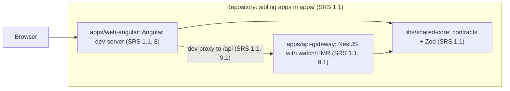
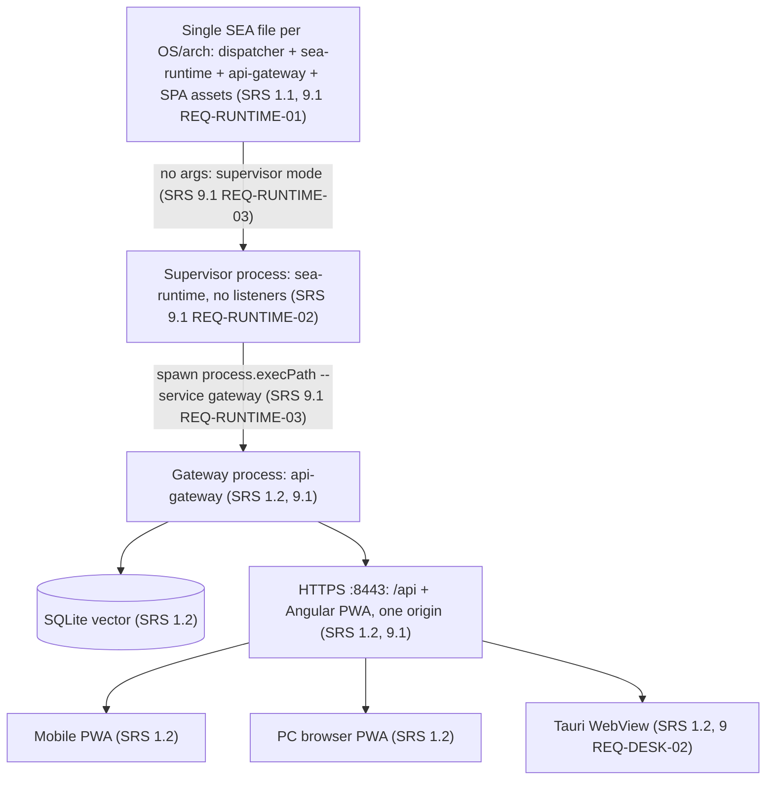
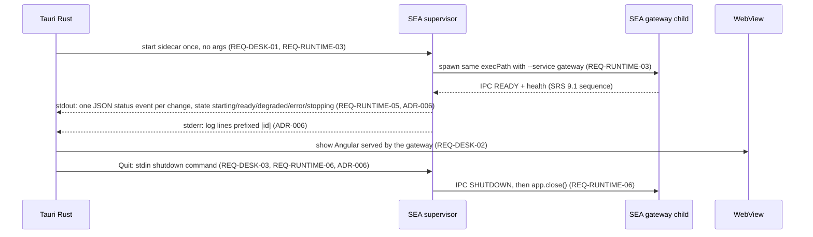

<!-- toon-meta
fmt: TOON
doc: docs/architecture/overview.md
title: Architecture overview
type: architecture
summary: Mermaid architecture diagrams citing SRS sections for runtime and desktop topology.
ids[0]:
related[10]: README.md,docs/architecture/adr/ADR-001-version-substitutions.md,docs/architecture/adr/ADR-002-single-sea-portability.md,docs/architecture/adr/ADR-003-config-and-db-strategy.md,docs/architecture/adr/ADR-004-drizzle-build-time-migrations.md,docs/architecture/adr/ADR-005-live-schema-validation.md,docs/architecture/adr/ADR-006-sidecar-status-contract.md,docs/architecture/adr/ADR-007-persistence-system.md,docs/roadmap/PROPOSAL.md,docs/requirements/02-technology-baseline.md
status: current
updated: 2026-11-03
-->

# Architecture overview

[Home](../../README.md) | [Requirements](../requirements/README.md) | [Architecture](../architecture/overview.md) | [Standards](../standards/README.md) | [Roadmap](../roadmap/PROPOSAL.md) | [Traceability](../requirements/traceability.md) | [Backlog](../backlog/README.md)

## Navigation

- [At a glance](#at-a-glance)
- [Overview](#overview)
- [Development topology](#development-topology)
- [Production topology](#production-topology)
- [Tauri sidecar](#tauri-sidecar)
- [Architecture decisions](#architecture-decisions)
  - [ADR-001: Toolchain substitution](#adr-001-toolchain-substitution)
  - [ADR-002: Single-SEA portability](#adr-002-single-sea-portability)
  - [ADR-003: Config and database strategy](#adr-003-config-and-database-strategy)
  - [ADR-004: Drizzle build-time migrations](#adr-004-drizzle-build-time-migrations)
  - [ADR-005: Live schema validation](#adr-005-live-schema-validation)
  - [ADR-006: Sidecar status contract](#adr-006-sidecar-status-contract)
  - [ADR-007: Persistence system](#adr-007-persistence-system)
  - [ADR-008: TLS trust model](#adr-008-tls-trust-model)
  - [ADR-009: Desktop process model](#adr-009-desktop-process-model)
  - [ADR-010: Auth mechanism](#adr-010-auth-mechanism)
  - [ADR-011: Release flow](#adr-011-release-flow)
  - [Topics without an ADR number](#topics-without-an-adr-number)

---

## At a glance

[Back to navigation](#navigation)

| View | Shows | Section |
| --- | --- | --- |
| Development | Separate apps behind a dev proxy | [Development topology](#development-topology) |
| Production | One SEA, a supervisor, a gateway, one HTTPS origin | [Production topology](#production-topology) |
| Desktop | Tauri starts the SEA supervisor as a sidecar | [Tauri sidecar](#tauri-sidecar) |
| Decisions | Eleven ADR entries. ADR-001 to ADR-007 are written; four are placeholders. | [Architecture decisions](#architecture-decisions) |

---

## Overview

[Back to navigation](#navigation)

This page holds the architecture diagrams required by NFR-DOC-01 (Mermaid diagrams). Every node cites the SRS v1.6 section that states it. The SRS is the reference for scope and behavior. Per SRS section 12 item 8, keep these diagrams in sync with the build. Nothing is implemented yet (documentation phase).

---

## Development topology

[Back to navigation](#navigation)

Separate apps behind a dev proxy.

Sources:

- Sibling apps with independent sources, configuration and Nx targets: SRS section 1.1.
- In development, Angular calls the gateway over HTTP. It does not import sources: SRS section 1.1 (diagram interpretation).
- The gateway MAY start directly with watch/HMR behind the Angular proxy. No SEA, Tauri or supervisor is needed. Source: SRS section 9.1 (accepted trade-off).
- The development proxy must be tested: SRS section 12 item 3.

---

## Production topology

[Back to navigation](#navigation)

One SEA, a supervisor and a gateway process, one HTTPS origin.

Sources:

- One physical SEA per platform/architecture. The same file runs several times. Each run has its own Node runtime and DI container. Source: SRS section 1.1 and [REQ-RUNTIME-01](../requirements/09-desktop-tauri.md).
- The gateway HTTPS is the only public HTTP entry point of the LAN. The supervisor publishes no HTTP. Source: SRS section 1.1 and [REQ-RUNTIME-02](../requirements/09-desktop-tauri.md).
- Same origin `https://IP-or-hostname:8443/` hosts `/api/**` and the PWA: SRS section 1.2.
- The baseline starts only `api-gateway`: SRS section 1.2 and [REQ-RUNTIME-05](../requirements/09-desktop-tauri.md).
- SQLite vector persistence: SRS section 1.2 (topology diagram).

---

## Tauri sidecar

[Back to navigation](#navigation)

Sources:

- The SEA is distributed through `bundle.externalBin` as a sidecar, per target triple. Source: SRS section 9, [REQ-DESK-01](../requirements/09-desktop-tauri.md).
- Tauri/Rust starts, monitors and stops only the supervisor. The supervisor manages the Nest processes. Source: SRS section 9, [REQ-DESK-02](../requirements/09-desktop-tauri.md) and [REQ-DESK-05](../requirements/09-desktop-tauri.md).
- The WebView shows the same Angular served from the gateway process: SRS section 9, [REQ-DESK-02](../requirements/09-desktop-tauri.md).
- The host stays operable from LAN clients with the window hidden: SRS section 9, [REQ-DESK-06](../requirements/09-desktop-tauri.md).
- Sidecar channels: stdout carries `status` events (JSON, one per line), stderr carries the logs, stdin carries host commands. The supervisor opens no HTTP listener. Contract and Tauri facts: [ADR-006](adr/ADR-006-sidecar-status-contract.md). The host side is not verified (POC-5).
- Shutdown over IPC on `stdio`, then timeout and forced termination: SRS section 9.1, [REQ-RUNTIME-06](../requirements/09-desktop-tauri.md).

---

## Architecture decisions

[Back to navigation](#navigation)

The [ADR index](../roadmap/PROPOSAL.md#adr-index) in the roadmap proposal records the ADR numbering. ADR-001 to ADR-007 are written files under `docs/architecture/adr/`. ADR-008 to ADR-011 are placeholders, numbered in the order the POCs write them. The numbers are proposals, not SRS requirements. Topics come from SRS v1.6 text.

### ADR-001: Toolchain substitution

Status: accepted by human decision, recorded 2026-10-31. Written by POC-1e because version substitutions happened ([POC-1](../roadmap/PROPOSAL.md#poc-1-toolchain-viability-and-workspace-skeleton)). Full record: [ADR-001](adr/ADR-001-version-substitutions.md).

### ADR-002: Single-SEA portability

Status: current. Written by POC-2 ([POC-2](../roadmap/PROPOSAL.md#poc-2-single-sea-and-runtime-supervisor)). Full record: [ADR-002](adr/ADR-002-single-sea-portability.md). Topic: a single SEA executable per OS/architecture (SRS 9.1, [REQ-RUNTIME-01](../requirements/09-desktop-tauri.md)).

### ADR-003: Config and database strategy

Status: current. Written by POC-3 ([POC-3](../roadmap/PROPOSAL.md#poc-3-config-and-sqlite-vector-persistence-inside-the-sea)). Full record: [ADR-003](adr/ADR-003-config-and-db-strategy.md).

### ADR-004: Drizzle build-time migrations

Status: accepted. Full record: [ADR-004](adr/ADR-004-drizzle-build-time-migrations.md). It also covers the Drizzle tag choice and the RC fallback that this page listed as a placeholder (SRS section 12 item 5, amendment to SRS v1.6 L95; see [REQ-STACK-07](../requirements/02-technology-baseline.md)).

### ADR-005: Live schema validation

Status: accepted. Full record: [ADR-005](adr/ADR-005-live-schema-validation.md).

### ADR-006: Sidecar status contract

Status: proposed. Full record: [ADR-006](adr/ADR-006-sidecar-status-contract.md).

### ADR-007: Persistence system

Status: proposed. Full record: [ADR-007](adr/ADR-007-persistence-system.md).

### ADR-008: TLS trust model

Status: placeholder. Written by POC-4 ([POC-4](../roadmap/PROPOSAL.md#poc-4-https-gateway-serving-the-angular-pwa)). No topic in this page.

### ADR-009: Desktop process model

Status: placeholder. Written by POC-5 ([POC-5](../roadmap/PROPOSAL.md#poc-5-tauri-desktop-shell-with-sea-sidecar)). Topic here: Tauri v2 sidecar through `bundle.externalBin` (SRS 9, [REQ-DESK-01](../requirements/09-desktop-tauri.md)).

### ADR-010: Auth mechanism

Status: placeholder. Written by POC-7 ([POC-7](../roadmap/PROPOSAL.md#poc-7-auth-and-roles)). No topic in this page.

### ADR-011: Release flow

Status: placeholder. Written by POC-9, which is on HOLD ([POC-9](../roadmap/PROPOSAL.md#poc-9-github-actions-cicd-and-releases-hold)). No topic in this page.

### Topics without an ADR number

The proposal assigns no ADR id to these topics. They stay unnumbered until a human records them.

- Angular, gateway and supervisor as sibling apps, joined only at build/distribution (SRS 1.1).
- `sea-runtime` as a Nest standalone supervisor without listeners (SRS 9.1, [REQ-RUNTIME-02](../requirements/09-desktop-tauri.md)).
- Re-entry of the same binary through a Zod-validated `--service` dispatcher (SRS 9.1, [REQ-RUNTIME-03](../requirements/09-desktop-tauri.md)).
- Shutdown through Node IPC over `stdio` instead of relying on `SIGTERM` (SRS 9.1, [REQ-RUNTIME-06](../requirements/09-desktop-tauri.md)).
