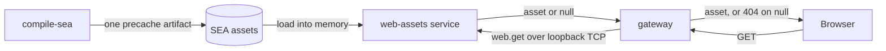

<!-- toon-meta
fmt: TOON
doc: docs/architecture/proposals/web-assets-service.md
title: "Proposal: web-assets service"
type: architecture
summary: "Serve the Angular build from a Nest microservice that holds one precache artifact, so the gateway has no stage branches. Proposal and spike plan only."
ids[0]:
related[3]: docs/architecture/stages.md,docs/architecture/current-state.md,docs/requirements/06-web-gateway-https-pwa.md
status: proposed
updated: 2026-11-09
-->

# Proposal: web-assets service

[Up](../stages.md)

## Navigation

- [Problem](#problem)
- [Proposal](#proposal)
- [Precache format and rules](#precache-format-and-rules)
- [What goes away](#what-goes-away)
- [What it needs](#what-it-needs)
- [What it changes in the SRS](#what-it-changes-in-the-srs)
- [Spike plan](#spike-plan)
- [Alternatives considered](#alternatives-considered)

## Problem

[Back to navigation](#navigation)

Human direction, 2026-11-09, paraphrased (not a quote, see [stages](../stages.md#human-direction)): the product is one fullstack app that behaves the same at every stage. Stage differences come only from declared inputs, never from branches inside the app. A Jest APP test has no SEA and no IPC, so it cannot serve the bundle. This page decides nothing; it proposes a spike.

- The gateway has a `--web none|ipc` flag ([server-config.ts](../../../apps/api-gateway/src/schemas/server-config.ts)) and the supervisor sends the bundle over IPC ([open question 8](../stages.md#open-questions)).
- Hand-written code serves the files: [web-handler.ts](../../../apps/api-gateway/src/web-handler.ts) (59 lines), [web-bundle.ts](../../../apps/api-gateway/src/web-bundle.ts) (89) and a mirror in [sea-runtime](../../../apps/sea-runtime/src/web/web-bundle.ts) (39). [AGENTS.md](../../../AGENTS.md) calls the first two known debt.

## Proposal

[Back to navigation](#navigation)

- Build: `compile-sea` serializes the built Angular app into one precache artifact (buffers, sha256, content type, cache header). At run time `web-assets` is a Nest microservice, a supervisor child like the gateway. It loads the artifact into memory, reads no files, and answers `web.get` with the asset or `null`.
- Gateway: its GET controller asks `web-assets` and answers 404 on `null`; extensionless paths get the SPA fallback. No `--web`, no `isSea()`.
- Address: an optional block of `config.json`. Absent means no client, so `GET /` is 404 (the `ng serve` case). Present but unreachable is a startup error, never a mode.
- Health and transport: a Terminus assets indicator reports up or down only. Nest TCP on loopback; `dependsOn` orders the start. The APP test hosts the same Nest module in-process with a precache file from the same build step.

## Precache format and rules

[Back to navigation](#navigation)

- Human decision, 2026-11-09: Brotli is banned until the human lifts it (decoder vulnerability reported in October 2026, not verified against a primary source). No `Content-Encoding: br` and no brotli dependency. Use gzip only if compression is wanted ([AGENTS.md](../../../AGENTS.md)).
- Proposal, not decided:
  1. Bytes, not strings: a Buffer is cheaper than a string and keeps the build hash valid.
  2. One SEA asset with the layout: size of the index, JSON index, blob. The index holds, per file, the path, content type, sha256 as ETag, cache header and offsets of each variant (identity and gzip). The service serves subarray views of the blob without copying.
  3. Keep the exact Angular file names (hash cache busting). Hashed names get `immutable`; `index.html` and the service worker files (`ngsw.json`, `ngsw-worker.js`, `manifest.webmanifest`) get `no-cache`. Never transform bytes: `ngsw.json` lists the hash of every file and the Angular service worker rejects a version whose bytes differ. Gzip with `Content-Encoding` is safe because the worker sees decoded bytes (from memory of the Angular docs, not verified here).
  4. Eager load at start, with an async provider, so a bad artifact fails the start. Lazy per-asset decompression with `shareReplay` pays only if the real build is large, which is unmeasured: measure the size of the real build with `ng build` and `du` first.
  5. Media (videos, large images) stays out of the precache. The build fails loudly if a file passes a size cap. Heavy or user content is served from a real data folder with `serve-static`, which already handles Range.
  6. Over Nest TCP a Buffer is JSON serialized by default (from memory, not verified). The spike must measure the transport cost for multi-MB payloads; this favors the in-process baseline if confirmed.

## What goes away

[Back to navigation](#navigation)

- The three hand-written files above, the IPC receive path in the gateway `main`, the `--web` flag (layer 2 of [config layers](../stages.md#config-layers)) and the `web` field of [declared-services.ts](../../../libs/service-registry/src/schemas/declared-services.ts).
- The mirrored web-bundle schema ([cross-stage contracts](../stages.md#cross-stage-contracts)).

## What it needs

[Back to navigation](#navigation)

- Checked in the tree on 2026-11-09. `@nestjs/microservices` is no project's dependency and is not installed; the [catalog](../../../pnpm-workspace.yaml) holds `@nestjs/terminus` 12.1.0 only. It would be a new exact-version dependency.
- Terminus 12.1.0 has `MicroserviceHealthIndicator.pingCheck`. It loads `@nestjs/microservices` lazily (optional peer) and accepts any `Transport`. Not verified: a live TCP probe.
- A second service needs `dist/main.js` ([assembler-config.ts](../../../libs/service-registry/src/schemas/assembler-config.ts)), an entry in [services.ts](../../../apps/sea-runtime/src/services.ts) and a `workspace:*` dependency in the [sea-runtime package](../../../apps/sea-runtime/package.json). Web discovery ([sea-dependencies.service.ts](../../../apps/tools-cli/src/sea/sea-dependencies.service.ts)) and `web()` in [sea-assets.service.ts](../../../apps/tools-cli/src/sea/sea-assets.service.ts) would be replaced by the precache step.
- [config.ts](../../../libs/shared-core/src/config.ts) is `z.strictObject({ db, net, tls })` with no defaults. An optional block is one `.optional()` key reusing the `port` validator; absence gets a meaning (no client).
- [get-test-context.ts](../../../apps/api-gateway/test/get-test-context.ts) writes `config.json` in a temp base. It could write the precache file there and add the block. Not verified: in-process TCP hosting, port clashes between suites, TCP framing for several MB, artifact size.

## What it changes in the SRS

[Back to navigation](#navigation)

- [REQ-NET-03](../../requirements/06-web-gateway-https-pwa.md): SRS v1.6 materialized the Angular tree to a cache folder and served it with `@nestjs/serve-static`. Commit `e63299e` rewrote it to IPC. This proposal rewrites it again, with [REQ-NET-04](../../requirements/06-web-gateway-https-pwa.md) (IPC message). [REQ-NET-02](../../requirements/06-web-gateway-https-pwa.md): the bars on `isSea()`, environment reads and `serve-static` stay; the `--web` text changes.
- [REQ-SEA-03](../../requirements/10-node-sea-distribution.md) is untouched: `useVfs` false, code cache kept.
- [REQ-CFG-01](../../requirements/04-configuration.md) says "four properties" while the schema has three blocks; an optional block needs a wording check. [REQ-CFG-06](../../requirements/04-configuration.md) already names a microservice as a DI container.
- Loopback: I found no REQ-SEC text and no [REQ-NET-06](../../requirements/06-web-gateway-https-pwa.md) text on an internal port. An unauthenticated loopback port is a surface no requirement covers; [REQ-SEC-04](../../requirements/07-security.md) asks for one origin.

## Spike plan

[Back to navigation](#navigation)

1. Add `@nestjs/microservices` at an exact version. NO-GO if the SEA bundle breaks.
2. Build the precache artifact in `compile-sea`. NO-GO if one artifact cannot carry the Angular build.
3. Run `web-assets` as a supervised child on loopback. NO-GO if `dependsOn` cannot order it before the gateway.
4. Add the gateway controller, the optional block and the health indicator. NO-GO if a stage branch is needed.
5. Host the module in-process in the APP test and measure start time and memory against today's IPC path. NO-GO if the contract differs from the SEA host.
6. Build the in-process alternative as the baseline: the gateway exports `main(options)` and the SEA entry passes the precache. Compare lines of code left, start time and memory with the service. NO-GO for the service if this baseline beats it on any of the three.

Acceptance: zero stage branches in the gateway; same contract in every stage; one precache artifact; health reports it; start and memory measured against today.

## Alternatives considered

[Back to navigation](#navigation)

- `useVfs` with `serve-static`: costs the code cache, about +114 ms measured on a synthetic entry.
- Precache loaded inside the gateway, bytes passed by the SEA entry: the SEA entry, not the gateway, picks the input, so it meets the acceptance criterion too. Cost: the gateway must export `main(options)` instead of starting at import time. Benefit: no process, no port and no new dependency. The spike plan compares it with the service.
- Gateway reads the SEA asset itself: needs `isSea()`, barred by [REQ-NET-02](../../requirements/06-web-gateway-https-pwa.md).
- A separate public port: breaks the one-origin rule of [REQ-NET-06](../../requirements/06-web-gateway-https-pwa.md). gRPC: heavier than TCP for one call. Bun: outside the Node SEA baseline (not verified further).
