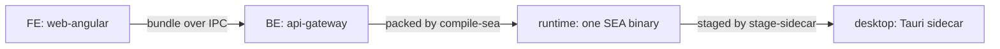

<!-- toon-meta
fmt: TOON
doc: docs/architecture/stages.md
title: Stages and promotion tools
type: architecture
summary: The human's stage idea of 2026-11-09, the promotion tools mapped to stages, proven overlaps, and open questions.
ids[0]:
related[5]: docs/architecture/overview.md,docs/architecture/current-state.md,docs/requirements/11-nx-quality-testing.md,docs/backlog/td-compile-sea-standalone.md,docs/architecture/adr/ADR-013-nest-standalone-architecture.md
status: proposed
updated: 2026-11-09
-->

# Stages and promotion tools

[Home](../../README.md) | [Requirements](../requirements/README.md) | [Architecture](../architecture/overview.md) | [Standards](../standards/README.md) | [Roadmap](../roadmap/PROPOSAL.md) | [Traceability](../requirements/traceability.md) | [Backlog](../backlog/README.md)

[Up](overview.md)

## Navigation

- [At a glance](#at-a-glance)
- [Human direction](#human-direction)
- [Stage model](#stage-model)
- [Promotion tools](#promotion-tools)
- [Overlaps proven in code](#overlaps-proven-in-code)
- [Open questions](#open-questions)

---

## At a glance

| Question | Answer | Section |
| --- | --- | --- |
| What is the idea? | One fullstack Node app seen at four stages. The stages are the boundaries of the APP test suites. | [Human direction](#human-direction) |
| What are the stages? | FE, BE, runtime, desktop | [Stage model](#stage-model) |
| What promotes an artifact between stages? | The commands of `apps/tools-cli` and one Nx version module | [Promotion tools](#promotion-tools) |
| What overlaps? | Four overlaps with two cited places each. The config schemas are spread but not proven duplicate. | [Overlaps proven in code](#overlaps-proven-in-code) |
| What is not decided? | Everything about the redesign | [Open questions](#open-questions) |

---

## Human direction

[Back to navigation](#navigation)

Source: the human, 2026-11-09, in conversation. This is a paraphrase, not a quote. It is a direction, not a requirement. It adds no id and changes no SRS text. Nothing on this page is decided.

- The product is one fullstack Node app: a Nest backend and an Angular frontend. The backend config comes from a persisted file, not from the environment.
- The sea-runtime is that same app enclosed in one self-executing binary. It exists so that the product does not embed more than one Node binary per executable.
- The Tauri desktop app is that same app again, running as a sidecar inside the shell.
- Each layer is a stage with precise boundaries. The stages are the boundaries of the APP test suites ([current-state](current-state.md#test-model)).
- The transversal tools that promote an artifact from one stage to the next must be identified and redesigned surgically, not removed for the sake of removing. First ask what each one is for.

Verified in code (it matches the idea, it does not prove it):

- Backend config is a persisted file: `CONFIG_FILE = 'config.json'` and `loadConfig(paths)` at `libs/shared-core/src/config.ts:66` and `:77`. The dispatcher states it never reads `process.env` (`libs/service-registry/src/dispatcher.ts:27`). Not verified: that no other code reads the environment. A search of `apps/api-gateway/src`, `apps/sea-runtime/src` and `libs/shared-core/src` for `process.env` found comments only.
- One binary, several roles: the SEA entry asks the dispatcher which role to run (`apps/sea-runtime/src/sea-entry.ts:1` and `:5`). The roles are `supervisor`, `service` and `generate-certs` (`libs/service-registry/src/dispatcher.ts:17` to `:21`). The gateway runs as a second process of the same file ([REQ-TEST-07](../requirements/11-nx-quality-testing.md)).
- The frontend travels over IPC into the backend: `--web ipc` (`libs/service-registry/src/dispatcher.ts:13`), `receiveWebBundle()` (`apps/api-gateway/src/main.ts:44`), the `web-bundle` message (`apps/api-gateway/src/web-bundle.ts:15`).
- The desktop shell starts the supervisor as a sidecar: see [overview](overview.md#tauri-sidecar) and `tools-cli stage-sidecar` below.

---

## Stage model

[Back to navigation](#navigation)

The stage names are working labels. Whether they are the right names is [open](#open-questions).

| Stage | What it is | Boundary (input, output) | Test suite and runner | Exists today? |
| --- | --- | --- | --- | --- |
| FE | The Angular PWA. | In: HTTPS requests to `/api`. Out: static assets and the browser behavior. | Playwright, [REQ-TEST-05](../requirements/11-nx-quality-testing.md) | No. No test files; `test:dynamic` is an `echo` ([current-state](current-state.md#test-model)). |
| BE | The Nest gateway: HTTP, database, config file. | In: `config.json`, the web bundle over IPC, HTTP. Out: HTTP responses, status over IPC. | Jest and Supertest, [REQ-TEST-04](../requirements/11-nx-quality-testing.md) | Yes: `apps/api-gateway/test/health/get-health.spec.ts`. |
| Runtime | BE plus FE assets in one SEA binary with a supervisor. | In: the executable, `config.json`, argv roles. Out: sidecar status events on stdout. | Not chosen; [REQ-TEST-07](../requirements/11-nx-quality-testing.md) (binary) and [REQ-TEST-06](../requirements/11-nx-quality-testing.md) (persistence) | Partly: hand-written smoke commands `smoke-sea` and `smoke-pg`, no runner. |
| Desktop | The runtime as a Tauri sidecar plus the WebView and installer. | In: the staged sidecar. Out: the native package and the installer. | WebdriverIO, [REQ-TEST-08](../requirements/11-nx-quality-testing.md) | Yes: `apps/desktop/e2e/host.e2e.ts`, run by `tools-cli e2e-desktop`. |

Wording of the REQ rows: [11-nx-quality-testing.md](../requirements/11-nx-quality-testing.md) lines 111 to 119.

---

## Promotion tools

[Back to navigation](#navigation)

Every command is a provider in `apps/tools-cli/src/tools-cli.module.ts`. The column "Serves" reads: P(a to b) promotes an artifact from stage a to stage b. V(stage) verifies a stage. S(stage) is support. The classification is mine and is [open](#open-questions). Citations are the `@Command` description and header comment of each file under `apps/tools-cli/src/commands/`.

| Command | Serves | Consumes | Produces | Why it exists (cite) |
| --- | --- | --- | --- | --- |
| `pack-migrations` | P(BE to runtime) | `libs/db-migrations/<engine>/migrations` | `dist/db-migrations/<engine>` | So migrations travel in the executable: `pack-migrations.command.ts:7` and `:13`. |
| `compile-sea` | P(BE, FE to runtime) | Supervisor project, services, one web bundle, `dist/db-migrations` | One Node SEA under `artifacts/<supervisor>` | REQ-SEA-01: `compile-sea.command.ts:39`; header `:31`. |
| `stage-sidecar` | P(runtime to desktop) | `artifacts/sea-runtime/sea-runtime-<triple>` | `apps/desktop/src-tauri/binaries` | REQ-DESK-01: `stage-sidecar.command.ts:7` and `:14`. |
| `installer-build` | P(desktop to installer) | Tauri host and sidecar | `.pkg` on macOS, a notice elsewhere | REQ-ECO-06: `installer-build.command.ts:5` and `:11`. |
| `installer-macos` | P(desktop to installer) | Same | `.pkg` through pkgbuild and productbuild | ADR-007: `installer-macos.command.ts:5` and `:10`. Called by `installer-build`. |
| `smoke-sea` | V(runtime) | Packaged SEA | One line per check | REQ-RUNTIME-08, REQ-TEST-07: `smoke-sea.command.ts:41`. |
| `smoke-pg` | V(runtime) | Packaged SEA and a PostgreSQL container | One line per check | REQ-TEST-06, AC-09: `smoke-pg.command.ts:32`. |
| `smoke-dev` | V(FE to BE, dev loop) | `ng serve`, built gateway | One line per check | REQ-DEV-02, REQ-DEV-04: `smoke-dev.command.ts:21`. |
| `verify-platform` | V(runtime, desktop) | Packaged SEA and Tauri package | `ok` or `FAIL` per check | REQ-SEA-06, REQ-TEST-09: `verify-platform.command.ts:28`. |
| `e2e-desktop` | V(desktop) | Instrumented Tauri host | WebdriverIO result | REQ-TEST-08, AC-20: `e2e-desktop.command.ts:19`. |
| `db-parity` | V(BE persistence) | Real migrations, descriptor | Parity verdict | Check S6: `db-parity.command.ts:18` to `:22`. |
| `generate-certs` | S(BE, runtime) | `config.json` | CA and leaf under `<base>/certs` | ADR-008, REQ-TLS-01: `generate-certs.command.ts:12`. |
| `trust-ca` | S(dev machine) | `certs/ca.crt` | Entry in the OS trust store | ADR-008, REQ-TLS-02: `trust-ca.command.ts:13`. |
| `test-filter` | S(all test stages) | Tag and runner arguments | Runner arguments, runs steps | REQ-TEST-02: `test-filter.command.ts:7`. |
| `version-check` | V(repo, desktop) | Manifests, Cargo files, `tauri.conf.json` | One line per place, exit 1 on drift | REQ-VERSION-01: `version-check.command.ts:9` and `:17`. |
| `branch-name` | S(release) | A branch name | The release bump | REQ-VERSION-02: `branch-name.command.ts:29`. |
| `tools/scripts/release-version-actions.ts` | P(release version to BE, runtime, desktop) | Nx project version | Same version in `package.json`, `Cargo.toml`, `Cargo.lock`, `tauri.conf.json` | REQ-VERSION-01, REQ-VERSION-03: `release-version-actions.ts:2` and `:102` to `:135`. |

Not verified: that each command is used only by the stage named in "Serves". The mapping reads descriptions and headers, not call sites.

Related: [TD-TOOLS-01](../backlog/td-compile-sea-standalone.md) records the move of the loose scripts into this CLI. It does not decide what each tool is for.

---

## Overlaps proven in code

[Back to navigation](#navigation)

Each claim cites both places. None is a decision to merge.

1. Repository root, two implementations.
   - `apps/tools-cli/src/services/repo-root.service.ts:8` takes the root from `process.argv[1]` plus three `..` segments.
   - `apps/sea-runtime/src/persistence/dev-assets.ts:17` walks up from `import.meta.url` to `pnpm-workspace.yaml`.
   - The two rules differ and the first depends on the built path of the CLI. Whether one should win is [open](#open-questions).
2. Certificate generation, two entry points that run the same steps.
   - `apps/tools-cli/src/commands/generate-certs.command.ts:37` and `:39` call `derivePaths`, `loadConfig` and `generateTlsIdentity`, then print the CA and leaf lines.
   - `libs/shared-core/src/tls/certs-command.ts:25` and `:27` do the same calls and print the same lines. The packaged `--generate-certs` role uses it (`apps/sea-runtime/src/sea-entry.ts:18`).
   - Both are real: one serves the dev machine, one serves the packaged binary. They share the generator, so the overlap is the wrapper, not the logic.
3. Cargo and `tauri.conf.json` version handling, read in one place and written in another.
   - `apps/tools-cli/src/commands/version-check.command.ts:60` and `:84` read with the `[package]` and crate-name regexes.
   - `tools/scripts/release-version-actions.ts:118` and `:63` use the same crate-name regex and the same anchor idea to write.
   - The reader and the writer must agree. Today they agree by copy.
4. Child-process wrapper of the smoke commands.
   - `apps/tools-cli/src/commands/smoke-sea.command.ts:208` and `:223`, `apps/tools-cli/src/commands/smoke-pg.command.ts:100` and `:122`: `events()` parses stdout lines as sidecar events and `signal()` kills the child. The error text differs (`:213` against `:105`).
   - `apps/tools-cli/src/commands/smoke-dev.command.ts:51` has a third `Child` class. Not verified: how much of it matches the other two.
   - A local `sleep` helper is defined five times: `smoke-sea.command.ts:134`, `smoke-pg.command.ts:58`, `smoke-dev.command.ts:48`, `verify-platform.command.ts:60`, `e2e-desktop.command.ts:30`.

Spread, not proven duplicate: Zod config schemas live in two libs.

- `libs/shared-core/src/config.ts:60` holds `configSchema` for the persisted `config.json` (`db`, `net`, `tls`).
- `libs/service-registry/src/schemas/supervisor-config.ts:30`, `assembler-config.ts:4` and `dispatcher-config.ts:18` hold frozen constants parsed from `{}`. `apps/api-gateway/src/schemas/server-config.ts:10` holds the gateway's own options.
- They hold different data. No field appears in two schemas in what was read. Not verified: a field-by-field comparison.

---

## Open questions

[Back to navigation](#navigation)

All open. The human decides. This page decides none.

1. Open: which tools are transversal (serve every stage) and which belong to one stage? The column "Serves" is a first reading.
2. Open: what are the stage names? FE, BE, runtime and desktop are working labels.
3. Open: do FE and BE stay separate stages, or is the stage "the Nest app with its web bundle"? Today FE has no suite and BE has one.
4. Open: is the installer a fifth stage or part of desktop?
5. Open: should promotion be one command per hop (BE to runtime, runtime to desktop) or stay as the current pieces?
6. Open: which of the four overlaps are worth removing, and which stay because they serve different stages (overlap 2 is the clearest case of two real uses)?
7. Open: does the runtime stage get its APP suite at the compiled bundle, at the SEA binary, or at both ([current-state](current-state.md#open-decisions))?
8. Open: does the dev-only repo-root rule apply to the CLI, given the CLI is not part of the shipped product?
