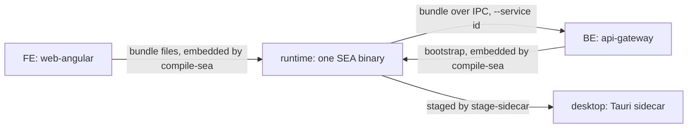

<!-- toon-meta
fmt: TOON
doc: docs/architecture/stages.md
title: Stages and promotion tools
type: architecture
summary: The human's stage idea of 2026-11-09, promotion tools, duplicates by stage boundary, config layers, and open questions.
ids[0]:
related[5]: docs/architecture/overview.md,docs/architecture/current-state.md,docs/requirements/11-nx-quality-testing.md,docs/backlog/td-compile-sea-standalone.md,docs/architecture/adr/ADR-013-nest-standalone-architecture.md
status: proposed
updated: 2026-11-09
-->

# Stages and promotion tools

[Home](../../README.md) | [Requirements](../requirements/README.md) | [Architecture](../architecture/overview.md) | [Standards](../standards/README.md) | [Roadmap](../roadmap/PROPOSAL.md) | [Traceability](../requirements/traceability.md) | [Backlog](../backlog/README.md)

[Up](overview.md)

## Navigation

- [At a glance](#at-a-glance)
- [Human direction](#human-direction)
- [Stage model](#stage-model)
- [Runtime as a host for more services](#runtime-as-a-host-for-more-services)
- [Promotion tools](#promotion-tools)
- [Duplicates and overlaps](#duplicates-and-overlaps)
- [Config layers](#config-layers)
- [Open questions](#open-questions)

---

## At a glance

| Question | Answer | Section |
| --- | --- | --- |
| What is the idea? | One fullstack Node app seen at four stages. The stages are the boundaries of the APP test suites. | [Human direction](#human-direction) |
| What are the stages? | FE, BE, runtime, desktop | [Stage model](#stage-model) |
| Why is the runtime a supervisor? | So that more services can sit next to the gateway later (human direction). One service exists today. | [Runtime as a host](#runtime-as-a-host-for-more-services) |
| What promotes an artifact between stages? | The commands of `apps/tools-cli` and one Nx version module | [Promotion tools](#promotion-tools) |
| What is duplicated? | 26 items (15 dup, 10 mirror, 1 entry) plus 2 look-alikes, each read in code, grouped by boundary | [Duplicates and overlaps](#duplicates-and-overlaps) |
| How many config layers? | Six, plus an untyped Rust read of `config.json` | [Config layers](#config-layers) |
| What is not decided? | Everything about the redesign | [Open questions](#open-questions) |

---

## Human direction

[Back to navigation](#navigation)

Source: the human, 2026-11-09, in conversation. This is a paraphrase, not a quote. It is a direction, not a requirement. It adds no id and changes no SRS text. Nothing on this page is decided.

- The product is one fullstack Node app: a Nest backend and an Angular frontend. The backend config comes from a persisted file, not from the environment.
- The sea-runtime is that same app enclosed in one self-executing binary. It exists so that the product does not embed more than one Node binary per executable.
- The sea-runtime is built this way so that, if the product ever needs a feature that calls for it, more microservices can be added next to the gateway (second message of 2026-11-09, paraphrased).
- The Tauri desktop app is that same app again, running as a sidecar inside the shell.
- Each layer is a stage with precise boundaries. The stages are the boundaries of the APP test suites ([current-state](current-state.md#test-model)).
- The transversal tools that promote an artifact from one stage to the next must be identified and redesigned surgically, not removed for the sake of removing. First ask what each one is for.

Verified in code (it matches the idea, it does not prove it):

- Backend config is a persisted file: `CONFIG_FILE = 'config.json'` and `loadConfig(paths)` at `libs/shared-core/src/config.ts:66` and `:77`. The dispatcher states it never reads `process.env` (`libs/service-registry/src/dispatcher.ts:27`). Not verified: that no other code reads the environment.
- One binary, several roles: `apps/sea-runtime/src/sea-entry.ts:5` to `:22` picks `supervisor`, `service` or `generate-certs` (`libs/service-registry/src/dispatcher.ts:17` to `:21`).
- The frontend travels over IPC into the backend: `--web ipc` (`libs/service-registry/src/dispatcher.ts:13`), the `web-bundle` message (`apps/api-gateway/src/web-bundle.ts:14`).

---

## Stage model

[Back to navigation](#navigation)

The stage names are working labels. Whether they are the right names is [open](#open-questions). The boundaries below were checked against the code on 2026-11-09.

| Stage | What it is | Boundary (input, output) | Test suite and runner | Exists today? |
| --- | --- | --- | --- | --- |
| FE | The Angular PWA. | In: responses of the gateway under `/api` (dev proxy to `https://127.0.0.1:8443`, `apps/web-angular/proxy.conf.json:2` to `:3`). Out: the built bundle files, which `compile-sea` embeds as `web/<path>` plus `web-manifest.json` (`apps/tools-cli/src/sea/sea-assets.service.ts:84` to `:85`). | Playwright, [REQ-TEST-05](../requirements/11-nx-quality-testing.md) | No. No test files; `test:dynamic` is an `echo` ([current-state](current-state.md#test-model)). |
| BE | The Nest gateway: HTTP, database, config file. | In: `config.json`, argv `--web none or ipc` (`apps/api-gateway/src/schemas/server-config.ts:10`), the web bundle, `state` and `shutdown` over IPC (`apps/api-gateway/src/main.ts:4`, `:74`), HTTP. Out: HTTP responses, `ready` over IPC (`apps/api-gateway/src/main.ts:77`). | Jest and Supertest, [REQ-TEST-04](../requirements/11-nx-quality-testing.md) | Yes: `apps/api-gateway/test/health/get-health.spec.ts`. |
| Runtime | BE plus FE assets, migrations and sqlite-vector in one SEA binary with a supervisor. | In: argv roles (`sea-entry.ts:5`), `config.json`, sidecar commands on stdin (`libs/service-registry/src/schemas/sidecar-protocol.ts:32` to `:35`). Out: status events on stdout (`sidecar-protocol.ts:21` to `:28`), certs for `--generate-certs`. The supervisor itself opens and checks the database before it spawns a service (`apps/sea-runtime/src/services/persistence.service.ts:11`). | Not chosen; [REQ-TEST-07](../requirements/11-nx-quality-testing.md) (binary) and [REQ-TEST-06](../requirements/11-nx-quality-testing.md) (persistence) | Partly: hand-written smoke commands `smoke-sea` and `smoke-pg`, no runner. |
| Desktop | The runtime as a Tauri sidecar plus the WebView and installer. | In: the staged sidecar, its stdout events (`apps/desktop/src-tauri/src/sidecar.rs:154`, `:163`), `net` of `config.json` (`sidecar.rs:85` to `:96`). Out: `shutdown` on the sidecar stdin (`sidecar.rs:12`), the native package and installer. | WebdriverIO, [REQ-TEST-08](../requirements/11-nx-quality-testing.md) | Yes: `apps/desktop/e2e/host.e2e.ts`, run by `tools-cli e2e-desktop`. |

Corrections to the first version of this table: FE input was "HTTPS requests to `/api`"; the FE sends those, it does not receive them. BE output was "status over IPC"; the gateway sends only `ready`. The runtime and desktop rows missed stdin, the database check and the Rust read of `config.json`.

Wording of the REQ rows: [11-nx-quality-testing.md](../requirements/11-nx-quality-testing.md) lines 111 to 119.

---

## Runtime as a host for more services

[Back to navigation](#navigation)

Human direction (paraphrased above): the supervisor shape exists so that more microservices can be added next to the gateway if a feature needs them. What the code already has:

| Piece | Fact | Cite |
| --- | --- | --- |
| Service table | One entry today: `[{ path: 'apps/api-gateway', web: true }]`. "Add an entry to supervise a new one." | `apps/sea-runtime/src/services.ts:3` to `:4` |
| Declared service | `path`, `dependsOn`, `enabled`, `web`; the id is the last path segment; duplicate ids are rejected. | `libs/service-registry/src/schemas/declared-services.ts:7` to `:14`, `:21`, `:47` |
| `services.json` asset | `compile-sea` writes it from the table; a SEA run reads it, a dev run reads the table. | `apps/tools-cli/src/commands/compile-sea.command.ts:99`, `:119` to `:120`; `apps/sea-runtime/src/supervisor/service-routes-source.ts:6` to `:10` |
| Dispatcher | `--service <id>` starts one registered id; an unknown id is rejected. | `libs/service-registry/src/dispatcher.ts:47` to `:57`; `apps/sea-runtime/src/sea-entry.ts:15` to `:16` |
| Supervisor spawn | Each service is `spawn(process.execPath, --service <id>)` with an IPC channel: a child of the same binary. Start order follows `dependsOn`. | `apps/sea-runtime/src/services/child-spawner.ts:21` to `:27`; `apps/sea-runtime/src/services/supervisor.service.ts:41`, `:61` |
| Readiness and restart | Readiness timeout 30 s, bounded backoff, at most 5 restarts in 300 s, graceful stop 10 s. | `libs/service-registry/src/schemas/supervisor-config.ts:7` to `:23`; `apps/sea-runtime/src/services/service-lifecycle.ts:29` to `:40`, `:92` |
| IPC control | `ready` (child to supervisor), `state` and `shutdown` (supervisor to children). | `libs/service-registry/src/schemas/control-channel.ts:10` to `:23` |

What a second service would need, from the same evidence: an entry in `services.ts`; a built bootstrap at `dist/main.js` of its project (`libs/service-registry/src/schemas/assembler-config.ts:6`), which `compile-sea` stages under the `sea-services` alias (`apps/tools-cli/src/sea/sea-bundler.service.ts:64`); and a bootstrap that sends `ready` and obeys `shutdown`, as the gateway does (`apps/api-gateway/src/main.ts:74`, `:77`). Not verified: how `compile-sea` resolves a second project (`compile-sea.command.ts:100` was not read in full), and whether a second service can share the gateway's ports, database or logger. No second service has ever been built.

---

## Promotion tools

[Back to navigation](#navigation)

Every command is a provider in `apps/tools-cli/src/tools-cli.module.ts`. The column "Serves" reads: P(a to b) promotes an artifact from stage a to stage b. V(stage) verifies a stage. S(stage) is support. The classification is mine and is [open](#open-questions). Citations are the `@Command` description and header comment of each file under `apps/tools-cli/src/commands/`.

| Command | Serves | Consumes | Produces | Why it exists (cite) |
| --- | --- | --- | --- | --- |
| `pack-migrations` | P(BE to runtime) | `libs/db-migrations/<engine>/migrations` | `dist/db-migrations/<engine>` | So migrations travel in the executable: `pack-migrations.command.ts:7` and `:13`. |
| `compile-sea` | P(BE, FE to runtime) | Supervisor project, services, one web bundle, `dist/db-migrations` | One Node SEA under `artifacts/<supervisor>` | REQ-SEA-01: `compile-sea.command.ts:39`; header `:31`. |
| `stage-sidecar` | P(runtime to desktop) | `artifacts/sea-runtime/sea-runtime-<triple>` | `apps/desktop/src-tauri/binaries` | REQ-DESK-01: `stage-sidecar.command.ts:7` and `:14`. |
| `installer-build` | P(desktop to installer) | Tauri host and sidecar | `.pkg` on macOS, a notice elsewhere | REQ-ECO-06: `installer-build.command.ts:5` and `:11`. |
| `installer-macos` | P(desktop to installer) | Same | `.pkg` through pkgbuild and productbuild | ADR-007: `installer-macos.command.ts:5` and `:10`. Called by `installer-build`. |
| `smoke-sea` | V(runtime) | Packaged SEA | One line per check | REQ-RUNTIME-08, REQ-TEST-07: `smoke-sea.command.ts:41`. |
| `smoke-pg` | V(runtime) | Packaged SEA and a PostgreSQL container | One line per check | REQ-TEST-06, AC-09: `smoke-pg.command.ts:32`. |
| `smoke-dev` | V(FE to BE, dev loop) | `ng serve`, built gateway | One line per check | REQ-DEV-02, REQ-DEV-04: `smoke-dev.command.ts:21`. |
| `verify-platform` | V(runtime, desktop) | Packaged SEA and Tauri package | `ok` or `FAIL` per check | REQ-SEA-06, REQ-TEST-09: `verify-platform.command.ts:28`. |
| `e2e-desktop` | V(desktop) | Instrumented Tauri host | WebdriverIO result | REQ-TEST-08, AC-20: `e2e-desktop.command.ts:19`. |
| `db-parity` | V(BE persistence) | Real migrations, descriptor | Parity verdict | Check S6: `db-parity.command.ts:18` to `:22`. |
| `generate-certs` | S(BE, runtime) | `config.json` | CA and leaf under `<base>/certs` | ADR-008, REQ-TLS-01: `generate-certs.command.ts:12`. |
| `trust-ca` | S(dev machine) | `certs/ca.crt` | Entry in the OS trust store | ADR-008, REQ-TLS-02: `trust-ca.command.ts:13`. |
| `test-filter` | S(all test stages) | Tag and runner arguments | Runner arguments, runs steps | REQ-TEST-02: `test-filter.command.ts:7`. |
| `version-check` | V(repo, desktop) | Manifests, Cargo files, `tauri.conf.json` | One line per place, exit 1 on drift | REQ-VERSION-01: `version-check.command.ts:9` and `:17`. |
| `branch-name` | S(release) | A branch name | The release bump | REQ-VERSION-02: `branch-name.command.ts:29`. |
| `tools/scripts/release-version-actions.ts` | P(release version to BE, runtime, desktop) | Nx project version | Same version in `package.json`, `Cargo.toml`, `Cargo.lock`, `tauri.conf.json` | REQ-VERSION-01, REQ-VERSION-03: `release-version-actions.ts:2` and `:102` to `:135`. |

Not verified: that each command is used only by the stage named in "Serves". Related: [TD-TOOLS-01](../backlog/td-compile-sea-standalone.md) records the move of the loose scripts into this CLI.

---

## Duplicates and overlaps

[Back to navigation](#navigation)

Every item was read at the cited lines on 2026-11-09. Kinds: **dup** = the same logic twice; **mirror** = two sides of one boundary kept in sync by hand; **entry** = two entry points to one operation; **concept** = looks alike, is not. "Owner?" is a hypothesis from the stage model, never a decision. Paths under `commands/` are `apps/tools-cli/src/commands/`.

### Inside tools (verification helpers)

| # | Item | Kind | Evidence | Owner? |
| --- | --- | --- | --- | --- |
| T1 | `sleep` | dup | `commands/smoke-sea.command.ts:134`, `smoke-pg.command.ts:58`, `smoke-dev.command.ts:48`, `verify-platform.command.ts:60`, `e2e-desktop.command.ts:30`: same two lines | One tools helper? |
| T2 | `freePort` (listen on 0) | dup | `e2e-desktop.command.ts:173` to `:182` (`'127.0.0.1'`), `smoke-dev.command.ts:158` to `:167` (`HOST`), `verify-platform.command.ts:67` to `:76` (`BIND`) | Same |
| T3 | `processTable` (`/proc` or `ps -A -o pid=,ppid=,comm=`) | dup | `smoke-sea.command.ts:587` to `:626`, `smoke-pg.command.ts:261` to `:293`; only typing and `?? ''` differ | Shared by the runtime suites? |
| T4 | exit within timeout | dup | `smoke-sea.command.ts:279` to `:286`, `smoke-pg.command.ts:130` to `:137` (same text), `verify-platform.command.ts:288` to `:298` | Same |
| T5 | `until` poll with deadline | dup | `smoke-sea.command.ts:150` to `:162` (async probe), `smoke-pg.command.ts:245` to `:258` (sync probe) | Same |
| T6 | `portFree` | dup | `smoke-sea.command.ts:664` to `:670` (`this.host`), `smoke-pg.command.ts:321` to `:326` (`LOOPBACK`) | Same |
| T7 | `check` step runner | dup | `smoke-sea.command.ts:427` to `:445`, `smoke-pg.command.ts:329` to `:345` (both log `TAG`), `verify-platform.command.ts:178` to `:195` (no tag, throws `ExitError`) | The runner of a future APP suite? |
| T8 | temp base `mkdtemp` and `rmSync` | dup | `smoke-dev.command.ts:115`, `:131`; `smoke-pg.command.ts:176`, `:197`; `smoke-sea.command.ts:368`, `:339`; `e2e-desktop.command.ts:52` and `verify-platform.command.ts:158` to `:160` add `realpathSync` | Same |
| T9 | `expect(condition, message)` | dup | `smoke-sea.command.ts:137` to `:139`, `verify-platform.command.ts:63` to `:65` | Same |
| T10 | sidecar `events()` and `signal()` | dup | `smoke-sea.command.ts:208` to `:225`, `smoke-pg.command.ts:100` to `:124`; error text differs at `:213` and `:105` | Same |

### Tools against libs (build inputs)

| # | Item | Kind | Evidence | Owner? |
| --- | --- | --- | --- | --- |
| L1 | Drizzle journal schema | dup | `apps/tools-cli/src/services/migration-pack.service.ts:37` to `:39`, `commands/db-parity.command.ts:27` to `:29`: same text | `libs/db-migrations` owns the journals: there? |
| L2 | Engine list | dup | `libs/db-migrations/contract/engines.ts:2` `ENGINES`; `commands/db-parity.command.ts:24` `KNOWN_ENGINES`; `migration-pack.service.ts:13` already imports `ENGINES` | The contract already exists |
| L3 | sqlite-vector pin table schema | dup | `apps/tools-cli/src/sea/sea-assets.service.ts:26` to `:41` (strict platforms), `migration-pack.service.ts:40` to `:46` (`z.unknown()` platforms) | One schema in tools? |
| L4 | read JSON, parse, `prettifyError` | dup | `apps/tools-cli/src/sea/json-file.ts:6` to `:15` throws `Error`; `migration-pack.service.ts:127` to `:131` calls `this.fail`; also `libs/shared-core/src/config.ts:83` to `:84` | Error type differs per caller |
| L5 | Cargo crate-name regex, read and write | mirror | `commands/version-check.command.ts:60`, `:84`; `tools/scripts/release-version-actions.ts:118`, `:63` | Reader and writer in one module? |

### Tools to runtime (what promotion writes, what the binary reads)

| # | Item | Kind | Evidence | Owner? |
| --- | --- | --- | --- | --- |
| P1 | Migration asset names | mirror | `migration-pack.service.ts:24` to `:27`; `apps/sea-runtime/src/persistence/assets.ts:1` to `:6` ("Keep both in sync") | A shared constant in `libs/db-migrations`? |
| P2 | `build-info.json` format | mirror | Writer: `migration-pack.service.ts:55` to `:57` (interface with one field) and `:92` to `:102` (object with five keys, no schema). Reader: `apps/sea-runtime/src/persistence/build-info.ts:9` to `:15` (strict, regex-checked) | Reader schema in a lib, used by the writer too? |
| P3 | Web manifest asset names | mirror | `apps/tools-cli/src/sea/sea-assets.service.ts:84` to `:85` (`'web-manifest.json'`, `` `web/${rel}` ``); `apps/sea-runtime/src/web/web-bundle.ts:7` to `:8` | Same question as P1 |
| P4 | sqlite-vector asset names | mirror | `sea-assets.service.ts:147` to `:148` (literals); `libs/shared-core/src/db/sqlite/vector.ts:12` to `:13` (exported constants, not imported by tools) | Tools could import them? |
| P5 | Migration manifest entry | mirror | `migration-pack.service.ts:48` to `:53` `PackedEntry`; `libs/db-migrations/contract/manifest.ts:5` to `:11`. Output is parsed by `manifestSchema` at `migration-pack.service.ts:238` to `:242` | Already single-sourced at validation |

### Runtime to BE (inside the binary)

| # | Item | Kind | Evidence | Owner? |
| --- | --- | --- | --- | --- |
| B1 | `web-bundle` IPC message schema | mirror | `apps/sea-runtime/src/web/web-bundle.ts:17` to `:20` (path `min(1)`); `apps/api-gateway/src/web-bundle.ts:6` to `:17` (path refine). Recorded choice: `libs/service-registry/src/schemas/control-channel.ts:18` | Next to the other IPC schemas in `service-registry`? |
| B2 | Certificate generation | entry | `libs/shared-core/src/tls/certs-command.ts:25` to `:30` (packaged `--generate-certs`, `sea-entry.ts:18`); `commands/generate-certs.command.ts:37` to `:52` (dev). Same calls and lines; only dev prints the new-CA warning (`:53` to `:57`) | One operation, two callers by stage? |

### Runtime and desktop (TypeScript to Rust)

| # | Item | Kind | Evidence | Owner? |
| --- | --- | --- | --- | --- |
| D1 | `config.json` `net` | mirror | `libs/shared-core/src/config.ts:42` to `:51` (strict, ports must differ); `apps/desktop/src-tauri/src/sidecar.rs:85` to `:87`, `:92` to `:96` (untyped, read twice); test copy `commands/smoke-sea.command.ts:114` to `:118` (loose) | Rust cannot import Zod: a shared schema file? |
| D2 | Install base = executable folder | mirror | `libs/shared-core/src/paths.ts:20` to `:22`; `sidecar.rs:79` to `:82` | Same |
| D3 | Sidecar stdio protocol | mirror | `libs/service-registry/src/schemas/sidecar-protocol.ts:21` to `:35`; `sidecar.rs:12` (shutdown line), `:154` (`kind == "status"`), `:163` (state names) | Same |

### Same name, different concept

| # | Item | Kind | Evidence | Note |
| --- | --- | --- | --- | --- |
| C1 | Repository root | dup (two rules) | `apps/tools-cli/src/services/repo-root.service.ts:8` (`argv[1]` plus three `..`); `apps/sea-runtime/src/persistence/dev-assets.ts:17` to `:25` (walk up to `pnpm-workspace.yaml`) | Same job, different rule. Both dev only. |
| C2 | Repository root against install base | concept | `libs/shared-core/src/paths.ts:21` to `:23` against C1 | Build-time root, not run-time base |
| C3 | Pin file against pin table | concept | `libs/shared-core/src/db/sqlite/vector.ts:12` (one embedded pin) against L3 (all platforms) | Different files |

Counts: 10 dup in tools, 4 dup and 1 mirror against libs, 5 mirrors in promotion, 1 mirror and 1 entry inside the binary, 3 mirrors across languages, 1 dup and 2 concepts by name. Total: 15 dup, 10 mirror, 1 entry, 2 concept.

---

## Config layers

[Back to navigation](#navigation)

| # | Layer | Declared | Consumed | Who sets the values |
| --- | --- | --- | --- | --- |
| 1 | Persisted `config.json` (`db`, `net`, `tls`) | `libs/shared-core/src/config.ts:60` | `loadConfig` `:77`; `certs-command.ts:26`; `generate-certs.command.ts:38`; Rust `sidecar.rs:85`, `:92` | The installer or the operator (`config.ts:80`) |
| 2 | Gateway argv (`--web`) | `apps/api-gateway/src/schemas/server-config.ts:10` | `ServerConfig.fromArgv` `:16` | The supervisor, `dispatcher.ts:13` |
| 3 | Dispatcher and SEA argv (`--service`, `--generate-certs`) | `libs/service-registry/src/schemas/dispatcher-config.ts:5` to `:13` | `sea-entry.ts:1` to `:14` | Code defaults, frozen at `:18` |
| 4 | Supervisor policy | `libs/service-registry/src/schemas/supervisor-config.ts:5` to `:26` | `service-lifecycle.ts:29` to `:40`, `:92` | Code defaults, frozen at `:30` |
| 5 | Assembler | `libs/service-registry/src/schemas/assembler-config.ts:4` to `:12` | `compile-sea.command.ts:74` | Code defaults, frozen at `:16` |
| 6 | Logger | `libs/shared-core/src/schemas/logger-config.ts:4` to `:11` | `provideLogger`, for example `certs-command.ts:41` | Each process at its call site |

Build-time asset formats are not config but travel with it: `services.json` (`declared-services.ts:36`), `sea-config.json` (`apps/sea-runtime/src/persistence/dev-assets.ts:27`), `web-manifest.json` (`web-bundle.ts:9`), the migration manifest (`manifest.ts:13`), `build-info.json` (`build-info.ts:9`) and `pin.json` (`vector.ts:12`). Only layer 1 is read from a file at run time; layers 3 to 5 have no file and no override.

---

## Open questions

[Back to navigation](#navigation)

All open. The human decides. This page decides none.

1. Open: which tools are transversal (serve every stage) and which belong to one stage? The column "Serves" is a first reading.
2. Open: what are the stage names? FE, BE, runtime and desktop are working labels.
3. Open: do FE and BE stay separate stages, or is the stage "the Nest app with its web bundle"? Today FE has no suite and BE has one.
4. Open: is the installer a fifth stage or part of desktop?
5. Open: should promotion be one command per hop (BE to runtime, runtime to desktop) or stay as the current pieces?
6. Open: does the runtime stage get its APP suite at the compiled bundle, at the SEA binary, or at both ([current-state](current-state.md#open-decisions))?
7. Open: the helpers T1 to T10 serve the runtime and desktop checks. Are they the seed of the runtime APP suite runner, or do they stay inside `tools-cli`?
8. Open: each mirror P1 to P5 is a contract between the promotion tool and the binary. Should the contract live in the lib of the stage that reads it, with the tool importing it? P5 and P4 show both patterns in use today.
9. Open: B1 is a boundary inside one binary, and the code records a choice to keep two schemas (`control-channel.ts:18`). Does the stage model change that choice?
10. Open: D1 to D3 cross a language boundary. Are they kept by hand, generated from one source, or covered only by the desktop APP suite?
11. Open: is B2 one operation with two callers, and should the dev caller and the packaged caller print the same warning?
12. Open: does the dev-only repo-root rule (C1) apply to the CLI, given the CLI is not part of the shipped product?
13. Open: what would a second service share with the gateway: the `config.json` file, the database the supervisor already opens, the ports, the web bundle? `config.json` has one `net` block today (`config.ts:42` to `:46`).
