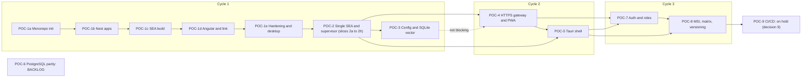

<!-- toon-meta
fmt: TOON
doc: docs/backlog/README.md
title: "Backlog index"
type: backlog
summary: "Backlog index of POC epics mapped to acceptance criteria and cycles."
related[1]: docs/roadmap/PROPOSAL.md
status: current
updated: 2026-10-31
-->

# Backlog

[Home](../../README.md) | [Requirements](../requirements/README.md) | [Architecture](../architecture/overview.md) | [Standards](../standards/README.md) | [Roadmap](../roadmap/PROPOSAL.md) | [Traceability](../requirements/traceability.md) | [Backlog](README.md)

## Navigation

- [At a glance](#at-a-glance)
- [Epics](#epics)
- [Reading notes](#reading-notes)

---

## At a glance

[Back to navigation](#navigation)

Local epics from the roadmap pitches. Start at [POC-1a](poc-1a-monorepo-init.md). POC-1 is the umbrella id of five sequential slices, 1a to 1e. POC-2 is the umbrella id of eight slices, 2a to 2h.

Edges follow "Depends on" in [PROPOSAL.md](../roadmap/PROPOSAL.md#cycles-and-bets).

| Group | Epics | State |
|---|---|---|
| Cycle 1 | POC-1 (slices 1a to 1e), POC-2 (slices 2a to 2h), POC-3 | POC-1 and POC-2 slices 2a to 2h done (branch `minor/poc-02-supervisor`, draft PR pending); POC-3 planned |
| Cycle 2 | POC-4, POC-5 | planned |
| Cycle 3 | POC-7, POC-8 | planned |
| Outside the cycles | POC-6 | BACKLOG |
| Outside the cycles | POC-9 | on hold (decision 9) |

---

## Epics

[Back to navigation](#navigation)

Slices 1a to 1e together cover the POC-1 pitch (AC-01, AC-02, AC-13, AC-19, AC-22, AC-23, AC-24, AC-32, AC-33, AC-34). Draft backlog derived only from `docs/roadmap/PROPOSAL.md` pitches. Local drafts: no GitHub issues exist for these files. Status values come from PROPOSAL.md (cycle table, `HOLD`, `BACKLOG`).

| POC | Epic file | Status | AC ids (pitch) |
|---|---|---|---|
| POC-1a | [Monorepo init](poc-1a-monorepo-init.md) | Delivered in PR #4 (commit `2c815c9`, slices 1a to 1c) | AC-01, AC-22, AC-23, AC-24 |
| POC-1b | [Nest apps](poc-1b-nest-apps.md) | Delivered on branch `minor/poc-01b-nest` (PR 3, draft) | AC-13 |
| POC-1c | [SEA build](poc-1c-sea-build.md) | Delivered on branch `minor/poc-01b-nest` (PR 3, draft) | none cited by its tasks |
| POC-1d | [Angular and link](poc-1d-angular-link.md) | Delivered on branch `minor/poc-01d-angular-link` (same PR as the spike and decision 17 docs) | AC-13 |
| POC-1e | [Hardening and desktop skeleton](poc-1e-hardening-desktop-skeleton.md) | Delivered on branch `minor/poc-01e-hardening` (one PR, human decision) | AC-01, AC-02, AC-13, AC-19, AC-22, AC-32, AC-33, AC-34 |
| POC-2 | [Single SEA and runtime supervisor (umbrella)](poc-2-single-sea-runtime-supervisor.md) | Done on `minor/poc-02-supervisor`, eight slices 2a to 2h; see [POC-02-Result](../results/POC-02-Result.md) | AC-11, AC-28, AC-29, AC-30, AC-31 |
| POC-2a | [Launcher cwd spike](poc-2a-launcher-cwd-spike.md) | Done in commit `a606db3` on `minor/poc-02-supervisor` | none cited |
| POC-2b | [Dispatcher and service registry](poc-2b-dispatcher-service-registry.md) | Done in commit `48987d4` on `minor/poc-02-supervisor` | AC-28, AC-29, AC-31 |
| POC-2c | [Assembler driven by the registry](poc-2c-assembler-registry-build.md) | Done in commit `0f7a834` on `minor/poc-02-supervisor` | AC-11 |
| POC-2d | [Supervisor readiness, logs and aggregate state](poc-2d-supervisor-readiness-logs.md) | Done in commit `97b5f01` on `minor/poc-02-supervisor` | none new |
| POC-2e | [Bounded restart](poc-2e-bounded-restart.md) | Done in commit `06ab764` on `minor/poc-02-supervisor` | AC-29 |
| POC-2f | [Coordinated shutdown and orphan checks](poc-2f-coordinated-shutdown.md) | Done in commit `85a8ed3` on `minor/poc-02-supervisor` | AC-30 |
| POC-2g | [Real-binary smoke test and Linux run](poc-2g-real-binary-smoke.md) | Done in commit `d5e8b04` on `minor/poc-02-supervisor` | AC-28, AC-29, AC-11 |
| POC-2h | [POC-02 result and ADR-002](poc-2h-result-and-adr.md) | Done in the commit that adds [POC-02-Result](../results/POC-02-Result.md) and [ADR-002](../architecture/adr/ADR-002-single-sea-portability.md), branch `minor/poc-02-supervisor` | AC-11, AC-29 |
| POC-3 | [Config and SQLite vector persistence inside the SEA](poc-3-config-sqlite-vector.md) | Cycle 1 (planned) | AC-07, AC-08, AC-10 |
| POC-4 | [HTTPS gateway serving the Angular PWA](poc-4-https-gateway-angular-pwa.md) | Cycle 2 (planned) | AC-04, AC-05, AC-12, AC-14, AC-15, AC-16, AC-17 |
| POC-5 | [Tauri desktop shell with SEA sidecar](poc-5-tauri-sidecar-desktop-shell.md) | Cycle 2 (planned) | AC-03, AC-18, AC-20, AC-30 |
| POC-6 | [PostgreSQL adapter parity (BACKLOG)](poc-6-postgresql-adapter-parity.md) | BACKLOG | AC-09 |
| POC-7 | [Auth and roles](poc-7-auth-roles.md) | Cycle 3 (planned) | AC-06 |
| POC-8 | [MSI credential dialog, platform matrix and lockstep versioning](poc-8-msi-matrix-versioning.md) | Cycle 3 (planned) | AC-21, AC-25, AC-33 |
| POC-9 | [GitHub Actions CI/CD and releases (HOLD)](poc-9-ci-cd-releases.md) | HOLD (decision 9) | AC-26, AC-27, AC-35, AC-36, AC-02, AC-32 |

---

## Reading notes

[Back to navigation](#navigation)

| Topic | Where |
|---|---|
| AC definitions | [11-nx-quality-testing.md](../requirements/11-nx-quality-testing.md) |
| Open question status | Table in PROPOSAL.md |
| OQ1, OQ2, OQ4, OQ5, OQ8 | Decided (decisions 11 to 15) |
| OQ6, OQ12 | Decided by the human |
| OQ16, OQ17 | Proposed (OQ16 is a draft; a spike decides it) |
| Blocking open questions | None |
