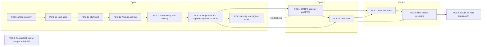

<!-- toon-meta
fmt: TOON
doc: docs/backlog/README.md
title: "Backlog index"
type: backlog
summary: "Backlog index of POC epics mapped to acceptance criteria and cycles."
related[18]: docs/results/POC-08-Result.md,docs/architecture/adr/ADR-011-macos-installer-and-install-time-trust.md,docs/results/POC-05-Result.md,docs/backlog/log-service-otel-grpc.md,docs/roadmap/PROPOSAL.md,docs/backlog/dbm-drizzle-migrations.md,docs/backlog/dbm-schema-gate.md,docs/backlog/persistence-system.md,docs/backlog/service-status-indicator.md,docs/backlog/third-party-licenses.md,docs/results/SPIKE-third-party-licenses.md,docs/results/POC-04-Result.md,docs/backlog/spike-pwa-https-trust.md,docs/results/RESEARCH-pwa-https-trust.md,docs/results/SPIKE-pwa-https-trust-Result.md,docs/backlog/td-windows-linux-distribution.md,docs/backlog/td-dev-certs-prebuild.md,docs/backlog/td-compile-sea-standalone.md
status: current
updated: 2026-11-09
-->

# Backlog

[Home](../../README.md) | [Requirements](../requirements/README.md) | [Architecture](../architecture/overview.md) | [Standards](../standards/README.md) | [Roadmap](../roadmap/PROPOSAL.md) | [Traceability](../requirements/traceability.md) | [Backlog](README.md)

## Navigation

- [At a glance](#at-a-glance)
- [Epics](#epics)
- [Reading notes](#reading-notes)

---

## At a glance

[Back to navigation](#navigation)

Local epics from the roadmap pitches. Start at [POC-1a](poc-1a-monorepo-init.md). POC-1 is the umbrella id of slices 1a to 1e. POC-2 is the umbrella id of slices 2a to 2h. Merged: PRs #4 to #6 (POC-1), #11 (POC-2), #12 and #13 (persistence stack), #14, #15, #16, #17 (persistence system), #18 (POC-4), #21 (POC-5, squash `35525d9`), #22 (POC-8, squash `e2c63e6`), #23 (POC-6, squash `c510d54`), #24 (sea-runtime review findings, `3126021`), #25 (Nest standalone refactor, squash `cfec959`).

Edges follow "Depends on" in [PROPOSAL.md](../roadmap/PROPOSAL.md#cycles-and-bets).

---

## Epics

[Back to navigation](#navigation)

Slices 1a to 1e together cover the POC-1 pitch (AC-01, AC-02, AC-13, AC-19, AC-22, AC-23, AC-24, AC-32, AC-33, AC-34). The files derive from the pitches in `docs/roadmap/PROPOSAL.md`. No GitHub issues exist for them.

| POC | Epic file | Status | AC ids (pitch) |
|---|---|---|---|
| POC-1a | [Monorepo init](poc-1a-monorepo-init.md) | Delivered in PR #4 (commit `2c815c9`, slices 1a to 1c) | AC-01, AC-22, AC-23, AC-24 |
| POC-1b | [Nest apps](poc-1b-nest-apps.md) | Delivered in PR #4 | AC-13 |
| POC-1c | [SEA build](poc-1c-sea-build.md) | Delivered in PR #4 | none cited by its tasks |
| POC-1d | [Angular and link](poc-1d-angular-link.md) | Delivered in PR #5 | AC-13 |
| POC-1e | [Hardening and desktop skeleton](poc-1e-hardening-desktop-skeleton.md) | Delivered in PR #6 | AC-01, AC-02, AC-13, AC-19, AC-22, AC-32, AC-33, AC-34 |
| POC-2 | [Single SEA and runtime supervisor (umbrella)](poc-2-single-sea-runtime-supervisor.md) | Done and merged in PR #11, slices 2a to 2h; see [POC-02-Result](../results/POC-02-Result.md) | AC-11, AC-28, AC-29, AC-30, AC-31 |
| POC-2a | [Launcher cwd spike](poc-2a-launcher-cwd-spike.md) | Done in commit `a606db3` | none cited |
| POC-2b | [Dispatcher and service registry](poc-2b-dispatcher-service-registry.md) | Done in commit `48987d4` | AC-28, AC-29, AC-31 |
| POC-2c | [Assembler driven by the registry](poc-2c-assembler-registry-build.md) | Done in commit `0f7a834` | AC-11 |
| POC-2d | [Supervisor readiness, logs and aggregate state](poc-2d-supervisor-readiness-logs.md) | Done in commit `97b5f01` | none new |
| POC-2e | [Bounded restart](poc-2e-bounded-restart.md) | Done in commit `06ab764` | AC-29 |
| POC-2f | [Coordinated shutdown and orphan checks](poc-2f-coordinated-shutdown.md) | Done in commit `85a8ed3` | AC-30 |
| POC-2g | [Real-binary smoke test and Linux run](poc-2g-real-binary-smoke.md) | Done in commit `d5e8b04` | AC-28, AC-29, AC-11 |
| POC-2h | [POC-02 result and ADR-002](poc-2h-result-and-adr.md) | Done in the commit that adds [POC-02-Result](../results/POC-02-Result.md) and [ADR-002](../architecture/adr/ADR-002-single-sea-portability.md) | AC-11, AC-29 |
| POC-3 | [Config and SQLite vector persistence inside the SEA](poc-3-config-sqlite-vector.md) | Done and merged in PR #12, slices 3a to 3g; see [POC-03-Result](../results/POC-03-Result.md); config and paths later changed by the persistence system | AC-07, AC-08, AC-10 |
| DBM | [Drizzle build-time migrations](dbm-drizzle-migrations.md) | Done and merged in PR #12, slices DBM-a to DBM-h; see [DBM-Result](../results/DBM-Result.md); extends POC-3 | AC-07, AC-08, AC-10 (as POC-3) |
| DBM schema gate | [Live schema validation at startup](dbm-schema-gate.md) | Done and merged in PR #12, slices DBM-i to DBM-n (DBM-n is the api-gateway database module); see [DBM-Schema-Gate-Result](../results/DBM-Schema-Gate-Result.md); extends DBM | AC-07, AC-08, AC-10 (as POC-3) |
| POC-4 | [HTTPS gateway serving the Angular PWA](poc-4-https-gateway-angular-pwa.md) | Done and merged in PR #18 (T0 to T8, independent verification included); decision: [ADR-008](../architecture/adr/ADR-008-tls-trust-model.md); result: [POC-04-Result](../results/POC-04-Result.md) | AC-04, AC-05, AC-12, AC-14, AC-15, AC-16, AC-17 |
| POC-5 | [Tauri desktop shell with SEA sidecar](poc-5-tauri-sidecar-desktop-shell.md) | Done and merged in PR #21 (squash `35525d9`), server mode, verified on macOS only; client mode pending; see [POC-05-Result](../results/POC-05-Result.md), [ADR-009](../architecture/adr/ADR-009-desktop-process-model.md) and the proposed [ADR-010](../architecture/adr/ADR-010-first-run-admin-setup.md) | AC-03, AC-18, AC-20, AC-30 |
| POC-6 | [PostgreSQL adapter parity (built on branch)](poc-6-postgresql-adapter-parity.md) | Built on `minor/poc-06-postgresql-parity` (adapter, migrations, parity check and the Docker APP smoke test `sea-runtime:smoke-pg`). Merged in PR #23 (squash `c510d54`). Verified on macOS arm64 with `pgvector/pgvector:pg17` only; see [POC-06-Result](../results/POC-06-Result.md) | AC-09 |
| POC-7 | [Auth and roles](poc-7-auth-roles.md) | Cycle 3 (planned) | AC-06 |
| POC-8 | [MSI credential dialog, platform matrix and lockstep versioning](poc-8-msi-matrix-versioning.md) | Built on `chore/poc-08-matrix-versioning` in macOS only (human decision, 2026-11-04): lockstep versioning, platform matrix, macOS `.pkg` installer with per-install CA and uninstall. The `.pkg` is built and inspected, NOT installed. Merged in PR #22 (squash `e2c63e6`). Result: [POC-08-Result](../results/POC-08-Result.md); decisions: the proposed [ADR-011](../architecture/adr/ADR-011-macos-installer-and-install-time-trust.md). Windows and Linux are [technical debt](td-windows-linux-distribution.md) | AC-21, AC-25, AC-33 |
| POC-9 | [GitHub Actions CI/CD and releases (HOLD)](poc-9-ci-cd-releases.md) | HOLD (decision 9) | AC-26, AC-27, AC-35, AC-36, AC-02, AC-32 |
| none | [Service status indicator](service-status-indicator.md) | Supervisor side done: `status` events on stdout ([ADR-006](../architecture/adr/ADR-006-sidecar-status-contract.md)); tray and web UI consumers open | none |
| none | [Third-party license notices](third-party-licenses.md) | Done: guide merged in PR #16, documentation only (decided 2026-11-03, OQ18 to OQ22); spike: [SPIKE-third-party-licenses](../results/SPIKE-third-party-licenses.md) | none (no REQ or AC id exists for licenses) |
| none | [SPIKE PWA HTTPS trust on phones](spike-pwa-https-trust.md) | Done on Chromium, an iOS simulator and an Android emulator; real phones closed as not needed (decided 2026-11-03: a real phone adds no new design information; mDNS, Add to Home Screen and IP change are checked at the first real deployment); see [SPIKE-pwa-https-trust-Result](../results/SPIKE-pwa-https-trust-Result.md) and [RESEARCH-pwa-https-trust](../results/RESEARCH-pwa-https-trust.md) | none |
| none | [Log service with OpenTelemetry data model and gRPC](log-service-otel-grpc.md) | Idea, TBD, no design. Outside POC-5 | none |
| none | [Technical debt: Windows and Linux distribution](td-windows-linux-distribution.md) | Technical debt, no design, nothing verified; cut from POC-8 by the human on 2026-11-04, plus the macOS follow-ups that POC-8 left | none (no new id) |
| none | [Technical debt: Nest DI by class](td-nest-di-by-class.md) | Technical debt, resolved and verified; the supervisor string tokens were replaced by injection by class (`SeaServiceRoutes` is a concrete class; `Clock` and `Random` were removed) | none (no new id) |
| none | [Technical debt: dev:certs prebuild gap](td-dev-certs-prebuild.md) | Technical debt TD-DEV-01, proposed, not scheduled; `pnpm dev:certs` does not build `service-registry`, so a clean clone fails with TS2307; fix through the Nx `build` target | none (no new id) |
| none | [Technical debt: compile-sea.ts standalone pattern](td-compile-sea-standalone.md) | Technical debt TD-TOOLS-01, proposed, not scheduled; `tools/scripts/compile-sea.ts` (498 lines) moves to the ADR-013 entrypoint pattern; open decision: Nest standalone or a simple class | none (no new id) |
| none | [Persistence system](persistence-system.md) | Done and merged in PR #17; decision: [ADR-007](../architecture/adr/ADR-007-persistence-system.md) | AC-07, AC-08, AC-10 (as POC-3) |
| none | [Epic: Nest standalone refactor](nest-standalone-refactor.md) | Done and merged in PR #25 (squash `cfec959`); human acceptance of the Proposed decisions still pending: five ordered slices (exit code constants, Nest Logger, unified DeclaredServices, dead code cleanup, folder reorganization); decision: [ADR-013](../architecture/adr/ADR-013-nest-standalone-architecture.md); evidence: [cleanup inventory](nest-standalone-cleanup-inventory.md) | none (no new id) |

---

## Reading notes

[Back to navigation](#navigation)

| Topic | Where |
|---|---|
| AC definitions | [11-nx-quality-testing.md](../requirements/11-nx-quality-testing.md) |
| Open question status | Table in PROPOSAL.md |
| OQ1, OQ2, OQ4, OQ5, OQ8 | Decided (decisions 11 to 15) |
| OQ6, OQ12, OQ15 | Decided by the human |
| OQ16 | Proposed (a draft; a spike decides it) |
| OQ17 | Decided by the human, 2026-11-04 (install-time choice: server mode installs everything, client mode loads its UI from the running gateway URL) |
| OQ18 to OQ22 | Decided by the human, 2026-11-03 (third-party licenses; see [Third-party license notices](third-party-licenses.md#decisions)) |
| OQ23 | Decided by the human, 2026-11-03 (persistence system: one base directory) |
| OQ24 | Decided by the human, 2026-11-04 (installer assistant defines the install path and creates `config/config.json`; first target: the macOS `.pkg` of POC-8) |
| OQ25 | Decided by the human, 2026-11-03 (amendment of REQ-CFG-05 approved) |
| Blocking open questions | None |
