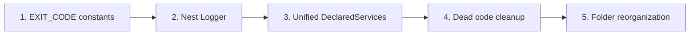
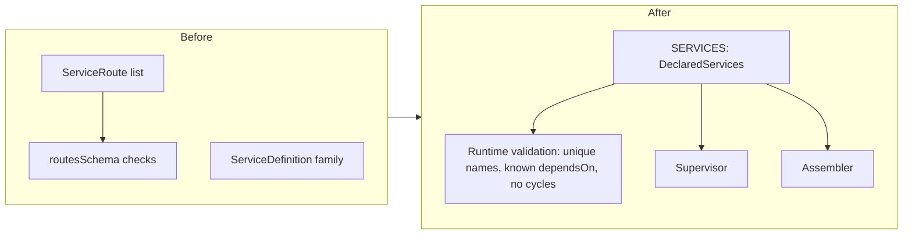

<!-- toon-meta
fmt: TOON
doc: docs/backlog/nest-standalone-refactor.md
title: "Epic: Nest standalone refactor"
type: backlog
summary: "Proposed pure-refactor epic: exit code constants, Nest Logger, unified DeclaredServices, dead code cleanup and folder reorganization, in five ordered slices."
ids[0]:
related[5]: docs/backlog/README.md,docs/backlog/nest-standalone-cleanup-inventory.md,docs/architecture/adr/ADR-013-nest-standalone-architecture.md,docs/architecture/declared-services.md,docs/architecture/nest-standalone-boot.md
status: proposed
updated: 2026-11-06
-->

# Epic: Nest standalone refactor

[Home](../../README.md) | [Requirements](../requirements/README.md) | [Architecture](../architecture/overview.md) | [Standards](../standards/README.md) | [Roadmap](../roadmap/PROPOSAL.md) | [Traceability](../requirements/traceability.md) | [Backlog](README.md)

[Up](README.md)

## Navigation

- [Summary](#summary)
- [Slice order](#slice-order)
- [Service model: before and after](#service-model-before-and-after)
- [Slice 1: EXIT_CODE constants](#slice-1-exit_code-constants)
- [Slice 2: Nest Logger](#slice-2-nest-logger)
- [Slice 3: Unified DeclaredServices](#slice-3-unified-declaredservices)
- [Slice 4: Dead code cleanup](#slice-4-dead-code-cleanup)
- [Slice 5: Folder reorganization](#slice-5-folder-reorganization)
- [Out of scope](#out-of-scope)
- [Not verified](#not-verified)

---

## Summary

[Back to navigation](#navigation)

This epic is a pure refactor in five ordered slices. Behavior, output bytes and exit codes do not change.

| Item | Value |
|---|---|
| Status | Proposed. Nothing is built. This branch carries documentation only. |
| Requirements | None. No REQ or AC id exists for this epic. |
| Design | [ADR-013](../architecture/adr/ADR-013-nest-standalone-architecture.md), [DeclaredServices](../architecture/declared-services.md), [Nest standalone boot](../architecture/nest-standalone-boot.md) |
| Related | [Cleanup inventory](nest-standalone-cleanup-inventory.md), [Technical debt: Nest DI by class](td-nest-di-by-class.md) |
| Appetite | None decided. Each slice stays near 400 changed lines or less. |

Rules for every slice:

- Start a slice only when the human says so, on its own branch (see AGENTS.md).
- Acceptance: `pnpm test` and `smoke-sea` pass, and no test or smoke file changes. A needed test edit means the slice changed behavior.
- Generate files with the official CLI. List each hand edit in the slice result. Delete generated `*.spec.ts` files in the same commit.
- Risk uses the high-risk list: 1 data, 2 security, 3 contracts others consume, 4 concurrency, 5 delivery or environment, 6 no test catches a regression.
- File lists come from mapping reports. The author did not re-check them (see [Not verified](#not-verified)).

---

## Slice order

[Back to navigation](#navigation)

| Slice | Why it sits here |
|---|---|
| 1 | Mechanical, no design. Shrinks the diff of later slices. |
| 2 | Needs the constants of slice 1 for the failure paths. |
| 3 | Largest design change. One commit. |
| 4 | Safe after slice 3 settles which model types stay. |
| 5 | Moves files last, so earlier diffs stay readable. |

---

## Service model: before and after

[Back to navigation](#navigation)

Slice 3 merges two models into one array. The supervisor and the assembler read the same constant.

Contract after slice 3:

- No `pre` or `post` hooks. Work before a service is an earlier service. Shutdown work is a Nest lifecycle hook.
- `dependsOn` stays. The supervisor does not wait for the ready message, so array order only breaks ties.
- The name comes from the path. There is no `id` input.
- The compile-time check of `dependsOn` is gone by human decision (2026-11-06).

---

## Slice 1: EXIT_CODE constants

[Back to navigation](#navigation)

| Field | Value |
|---|---|
| Goal | Replace numeric `process.exit` and `process.exitCode` arguments with a named `EXIT_CODE` contract. Values stay. |
| Files | `sea-runtime` (supervisor, sea-entry, main), `api-gateway` main, 13 files in `tools/scripts/`. Mapping: 26 exit calls, 1 assignment. |
| New file | One constants file, proposed at `libs/shared-core/src/constants/exit-code.ts`. |
| Accept | Tests and `smoke-sea` pass, no test edit. No numeric literal argument to `process.exit` remains. Startup failure exits 1, bad argument 2, clean shutdown 0. |
| Risk | none. Smokes assert the observable exits. Run `smoke-dev` and `smoke-pg` evidence where possible. |
| Size | under 150 changed lines |

---

## Slice 2: Nest Logger

[Back to navigation](#navigation)

| Field | Value |
|---|---|
| Goal | Use only the Nest `Logger`. No `console.*` and no direct stdout or stderr log writes. Decisions: [ADR-013](../architecture/adr/ADR-013-nest-standalone-architecture.md). |
| Design | A `ConsoleLogger` subclass writes every level to stderr and keeps the line `[id] text`. stdout carries only sidecar status events ([ADR-006](../architecture/adr/ADR-006-sidecar-status-contract.md)). An injection decorator is proposed under `libs/shared-core/src/logger/`. |
| Files | `sea-runtime` (main, sea-entry, `sidecar/`), `api-gateway` (main, app.bootstrap), `shared-core` certs-command, 6 `SupervisorLogger` injection sites. Mapping: 68 `console.*` calls. |
| Open | Keep `tools/scripts` output and the browser entry out of this slice (recommended, awaits the human). |
| Accept | Tests and `smoke-sea` pass, no test edit. No `console.` or stray `process.stdout.write` in `apps/sea-runtime`, `apps/api-gateway`, `libs`. A captured run shows identical stderr lines and status-only stdout. |
| Risk | item 3. The Tauri host ([ADR-009](../architecture/adr/ADR-009-desktop-process-model.md)) and the smokes read both streams. |
| Size | 250 to 400 changed lines. Over 400: split entry points from supervisor classes. |

---

## Slice 3: Unified DeclaredServices

[Back to navigation](#navigation)

| Field | Value |
|---|---|
| Goal | One model replaces `ServiceRoute` and the `ServiceDefinition` family: `export const SERVICES: DeclaredServices = [...]`. See the diagram above. |
| Design | Plain typed array, no helper. A zod schema with `superRefine` validates at run time, as `routesSchema` does today. Name is `path.parse(path).base`. Migrations stay a supervisor step. |
| Files | In `libs/service-registry/src/`: service-routes, service-definition, startup-order, dispatcher. In `apps/sea-runtime/src/`: services, supervisor files, sea-entry. Also `compile-sea.ts`. |
| Gate | Remove the `ServiceDefinition` family only after its [inventory](nest-standalone-cleanup-inventory.md) rows reach QC status `confirmed`. |
| Accept | Tests and `smoke-sea` pass, no test edit. The `services.json` asset from `compile-sea.ts` is byte-identical. No declared `id` input remains in `apps` and `libs`. |
| Risk | item 3. Runtime consumes the `services.json` asset and the dispatcher arguments. |
| Size | under 350 changed lines |

---

## Slice 4: Dead code cleanup

[Back to navigation](#navigation)

| Field | Value |
|---|---|
| Goal | Delete code with zero references, each row confirmed by the QC step of the [cleanup inventory](nest-standalone-cleanup-inventory.md). |
| Scope | Mapping confirms two symbols dead: `ControlMessage` and `StatusSnapshot`. All others stay `verify` or `keep` until confirmed. |
| Files | `control-channel.ts`, `status-snapshot.ts`, and the barrel `index.ts` if it re-exports them. All in `libs/service-registry/src/`. |
| Accept | Tests and `smoke-sea` pass, no test edit. A repository search for each deleted symbol returns nothing. A needed test edit means the symbol was not dead. |
| Risk | none for the two symbols. Re-assess later rows against item 3, because a barrel export is published. |
| Size | under 60 changed lines |

---

## Slice 5: Folder reorganization

[Back to navigation](#navigation)

| Field | Value |
|---|---|
| Goal | Group files by role: `interfaces/`, `schemas/`, `services/`, `modules/`, `constants/`. Collection exports are plural. |
| Files | The move list comes from conventions mapping at slice start. Sensitive points: two barrels (`service-registry`, `shared-core`), the alias in `sea-modules.d.ts`, paths in `compile-sea.ts`. |
| Accept | Tests and `smoke-sea` pass, no test edit. The SEA build resolves every module. Moves use `git mv`. Only import paths change inside files. |
| Risk | item 3. Other packages and the build consume barrels and the SEA alias. |
| Size | under 400 changed lines, mostly renames. Over 400: split by library. |

---

## Out of scope

[Back to navigation](#navigation)

- A logging library for the application factory (OpenTelemetry records, RxJS pipes, file sink, logging child process). It is a later epic: [Log service with OpenTelemetry data model and gRPC](log-service-otel-grpc.md). This epic only keeps the `LoggerService` seam open.
- Logging as a service in the startup order.
- Any change to TLS certificate creation.
- Any new feature, new requirement, or change to a test or smoke.

---

## Not verified

[Back to navigation](#navigation)

| Item | Why it is missing | Who verifies |
|---|---|---|
| All file and line references | Mapping reports them. The author did not re-check them. | Slice author at slice start |
| `ConsoleLogger` writes four levels to stdout and two to stderr | Mapping claim, no run | Slice 2, first step |
| `ServiceDefinition`, `serviceRegistrySchema`, `ServiceRegistry` and `entry` have no reader | Mapping claim | QC step of the inventory |
| `tools/scripts` output and the browser entry belong in slice 2 | Open decision | Human |
| Location of the constants file, logger decorator and `DeclaredServices` | Proposed paths only | Slice author |
| `EXIT_CODE` also covers `rejectExitCode` and `errorExitCode` config values | Not checked | Slice 1 |
| Slice sizes | Estimates, not counts | Slice author |
