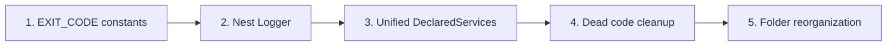
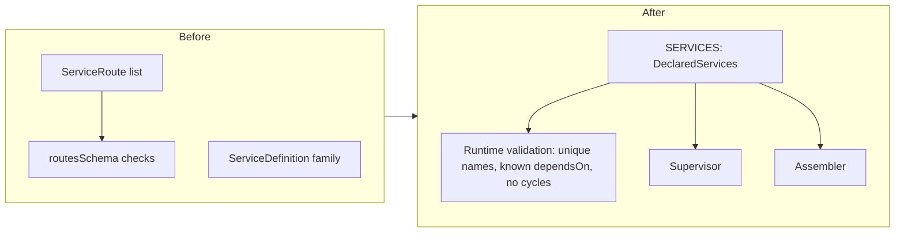

<!-- toon-meta
fmt: TOON
doc: docs/backlog/nest-standalone-refactor.md
title: "Epic: Nest standalone refactor"
type: backlog
summary: "Pure-refactor epic, built on branches (pull requests pending): exit code constants, Nest Logger, unified DeclaredServices, dead code cleanup and folder reorganization, in five ordered slices."
ids[0]:
related[7]: docs/backlog/README.md,docs/backlog/nest-standalone-cleanup-inventory.md,docs/architecture/adr/ADR-013-nest-standalone-architecture.md,docs/architecture/declared-services.md,docs/architecture/nest-standalone-boot.md,docs/backlog/td-dev-certs-prebuild.md,docs/backlog/td-compile-sea-standalone.md
status: proposed
updated: 2026-11-06
-->

# Epic: Nest standalone refactor

[Home](../../README.md) | [Requirements](../requirements/README.md) | [Architecture](../architecture/overview.md) | [Standards](../standards/README.md) | [Roadmap](../roadmap/PROPOSAL.md) | [Traceability](../requirements/traceability.md) | [Backlog](README.md)

[Up](README.md)

## Navigation

- [Summary](#summary)
- [Slice order](#slice-order)
- [Service model: before and after](#service-model-before-and-after)
- [Slice 1: EXIT_CODE constants](#slice-1-exit_code-constants)
- [Slice 2: Nest Logger](#slice-2-nest-logger)
- [Slice 3: Unified DeclaredServices](#slice-3-unified-declaredservices)
- [Slice 4: Dead code cleanup](#slice-4-dead-code-cleanup)
- [Slice 5: Folder reorganization](#slice-5-folder-reorganization)
- [Follow-ups](#follow-ups)
- [Out of scope](#out-of-scope)
- [Result](#result)
- [Not verified](#not-verified)

---

## Summary

[Back to navigation](#navigation)

This epic is a pure refactor in five ordered slices. Behavior, output bytes and exit codes do not change.

| Item | Value |
|---|---|
| Status | Built on branches, pull requests pending. Human acceptance of the Proposed decisions is pending. See [Result](#result). |
| Requirements | None. No REQ or AC id exists for this epic. |
| Design | [ADR-013](../architecture/adr/ADR-013-nest-standalone-architecture.md), [DeclaredServices](../architecture/declared-services.md), [Nest standalone boot](../architecture/nest-standalone-boot.md) |
| Related | [Cleanup inventory](nest-standalone-cleanup-inventory.md), [Technical debt: Nest DI by class](td-nest-di-by-class.md) |
| Appetite | None decided. Each slice stays near 400 changed lines or less. |

Rules for every slice:

- Start a slice only when the human says so, on its own branch (see AGENTS.md).
- Acceptance: `pnpm test` and `smoke-sea` pass, and no test or smoke file changes. A needed test edit means the slice changed behavior.
- Generate files with the official CLI. List each hand edit in the slice result. Delete generated `*.spec.ts` files in the same commit.
- Risk uses the high-risk list: 1 data, 2 security, 3 contracts others consume, 4 concurrency, 5 delivery or environment, 6 no test catches a regression.
- File lists come from mapping reports. The author did not re-check them (see [Not verified](#not-verified)).

---

## Slice order

[Back to navigation](#navigation)

| Slice | Why it sits here |
|---|---|
| 1 | Mechanical, no design. Shrinks the diff of later slices. |
| 2 | Needs the constants of slice 1 for the failure paths. |
| 3 | Largest design change. One commit. |
| 4 | Safe after slice 3 settles which model types stay. |
| 5 | Moves files last, so earlier diffs stay readable. |

---

## Service model: before and after

[Back to navigation](#navigation)

Slice 3 merges two models into one array. The supervisor and the assembler read the same constant.

Contract after slice 3:

- No `pre` or `post` hooks. Work before a service is an earlier service. Shutdown work is a Nest lifecycle hook.
- `dependsOn` stays. The supervisor does not wait for the ready message, so array order only breaks ties.
- The name comes from the path. There is no `id` input.
- The compile-time check of `dependsOn` is gone by human decision (2026-11-06).

---

## Slice 1: EXIT_CODE constants

[Back to navigation](#navigation)

| Field | Value |
|---|---|
| Goal | Replace numeric `process.exit` and `process.exitCode` arguments with a named `EXIT_CODE` contract. Values stay. |
| Files | `sea-runtime` (supervisor, sea-entry, main), `api-gateway` main, the `rejectExitCode` and `errorExitCode` defaults in `service-registry`, and the result of `runGenerateCerts` in `shared-core`. Only `apps/` and `libs/`. `tools/scripts/` (21 sites) is out of this slice: those scripts load the libs with a dynamic import from `dist`, so they cannot import `EXIT_CODE` without a prior build. |
| New file | `libs/service-registry/src/exit-code.ts`, exported by the barrel `index.ts`; slice 5 moved it to `libs/service-registry/src/constants/exit-code.ts`. It lives in `service-registry` because `shared-core` depends on `service-registry`, not the reverse. In slice 1 it sat beside `aggregate-state.ts` and `states.ts`. |
| Accept | Tests and `smoke-sea` pass, no test edit. No numeric literal argument to `process.exit` or value of `process.exitCode` remains in `apps/` and `libs/`. Startup failure exits 1, bad argument 2, clean shutdown 0. |
| Risk | none. Smokes assert the observable exits. Run `smoke-dev` and `smoke-pg` evidence where possible. |
| Size | under 150 changed lines |

---

## Slice 2: Nest Logger

[Back to navigation](#navigation)

| Field | Value |
|---|---|
| Goal | Use only the Nest `Logger`. No `console.*` and no direct stdout or stderr log writes. Decisions: [ADR-013](../architecture/adr/ADR-013-nest-standalone-architecture.md). |
| Design | Two steps. Step 1 (the slice commits) removed `SupervisorLogger` and moved the code to a `ConsoleLogger` subclass named `ServiceLogger`. Step 2 is the logging redesign, which replaced `ServiceLogger`. Its first form was a `ConsoleLogger` subclass; its current form implements `LoggerService` (record, `Subject`, console sink, see D4). `provideLogger()` builds `AppLogger` from `loggerConfigSchema` (`libs/shared-core/src/logger/provide-logger.ts:6`, `app-logger.ts:11`, `libs/shared-core/src/schemas/logger-config.ts:4`). The process name is the `prefix` option and the layer is the context, equal to the class name. The `sidecar` target writes every level to stderr. `json` is off by default and the schema has no `colors` field. Classes use `@InjectLogger()` (`inject-logger.decorator.ts:21`), and entrypoints create the logger with `provideLogger({ prefix })`, pass it to `NestFactory` with the `logger` option, and use the instance directly where no app exists or before it does. The `--generate-certs` command uses the `cli` target: plain text, `log` to stdout and `error` to stderr, because the installer `postinstall` reads it with an anchored `sed`. A child inherits stderr and its stdout is ignored. stdout carries only sidecar status events ([ADR-006](../architecture/adr/ADR-006-sidecar-status-contract.md)). Decisions: D3 to D7 of [ADR-013](../architecture/adr/ADR-013-nest-standalone-architecture.md). |
| Files | `sea-runtime` (main, sea-entry, `sidecar/`), `api-gateway` (main, app.bootstrap), `shared-core` certs-command, 6 `SupervisorLogger` injection sites (the class is removed; callers use the injected Nest `Logger`). Mapping: 68 `console.*` calls. |
| Open | Scope is `apps/` and `libs/`. `web-angular` and `tools/scripts` stay outside this slice. |
| Accept | Tests and `smoke-sea` pass, no test edit. No `console.` or stray `process.stdout.write` in `apps/sea-runtime`, `apps/api-gateway`, `libs`. Stdout is status-only. The format of stderr is free, so no test asserts on log text. |
| Risk | item 3. The Tauri host ([ADR-009](../architecture/adr/ADR-009-desktop-process-model.md)) and the smokes read both streams. |
| Size | 250 to 400 changed lines. Over 400: split entry points from supervisor classes. |

---

## Slice 3: Unified DeclaredServices

[Back to navigation](#navigation)

| Field | Value |
|---|---|
| Goal | One model replaces `ServiceRoute` and the `ServiceDefinition` family: `export const SERVICES: DeclaredServices = [...]`. See the diagram above. |
| Design | Plain typed array, no helper. A zod schema with `superRefine` validates at run time, as `routesSchema` does today. Name is `path.parse(path).base`. Migrations stay a supervisor step. |
| Files | In `libs/service-registry/src/`: service-routes, service-definition, startup-order, dispatcher. In `apps/sea-runtime/src/`: services, supervisor files, sea-entry. Also `compile-sea.ts`. |
| Gate | Remove the `ServiceDefinition` family only after its [inventory](nest-standalone-cleanup-inventory.md) rows reach QC status `confirmed`. Status: implemented in slice 3; the rows are `deleted`/`confirmed`. |
| Accept | Tests and `smoke-sea` pass, no test edit. The `services.json` asset from `compile-sea.ts` is byte-identical. No declared `id` input remains in `apps` and `libs`. |
| Risk | item 3. Runtime consumes the `services.json` asset and the dispatcher arguments. |
| Size | under 350 changed lines |

---

## Slice 4: Dead code cleanup

[Back to navigation](#navigation)

| Field | Value |
|---|---|
| Goal | Delete code with zero references, each row confirmed by the QC step of the [cleanup inventory](nest-standalone-cleanup-inventory.md). |
| Scope | Result: deleted `ControlMessage`, `StatusSnapshot`, `sharedCoreName` and `SPAWNED_PATTERN` (0 references each, QC confirmed 2026-11-06). Kept: `controlMessageSchema`, a chain candidate whose only use was `ControlMessage`; its inventory row is `verify`. |
| Files | `control-channel.ts`, `status-snapshot.ts` and `supervisor-log.ts` in `libs/service-registry/src/`, and `libs/shared-core/src/index.ts`. The barrels keep their other exports. |
| Accept | Tests and `smoke-sea` pass, no test edit. A repository search for each deleted symbol returns nothing. A needed test edit means the symbol was not dead. |
| Risk | none for the four symbols. Re-assess later rows against item 3, because a barrel export is published. |
| Size | under 60 changed lines |

---

## Slice 5: Folder reorganization

[Back to navigation](#navigation)

| Field | Value |
|---|---|
| Goal | Group files by role: `interfaces/`, `schemas/`, `services/`, `modules/`, `constants/`. Collection exports are plural. |
| Files | The move list comes from conventions mapping at slice start. Sensitive points: two barrels (`service-registry`, `shared-core`), the alias in `sea-modules.d.ts`, paths in `compile-sea.ts`. |
| Accept | Tests and `smoke-sea` pass, no test edit. The SEA build resolves every module. Moves use `git mv`. Only import paths change inside files. |
| Risk | item 3. Other packages and the build consume barrels and the SEA alias. |
| Size | under 400 changed lines, mostly renames. Over 400: split by library. |
| Result | Done with `git mv` in four blocks, 41 moves: `service-registry` 9, `shared-core` 3, `api-gateway` 7, `sea-runtime` 22. One move renames the file: `libs/service-registry/src/constants.ts` became `libs/service-registry/src/schemas/dispatcher-config.ts`. Only import paths changed inside files. `tools/` and the tests were not edited. |

Coverage is partial by design of a pure refactor. The slice moved the 41 files with a single D9 role, 41 of the 91 `.ts` files in the four packages. The other 50 stay:

| Not moved | Files | Reason |
|---|---|---|
| Entrypoints and barrels | 6 | The build and the package manifests name them by path: `sea-entry.ts` (`tools/scripts/compile-sea.ts:309`), `services.ts` (`compile-sea.ts:465`), the two `main.ts` (`start:prod` runs `node dist/main`, `package.json:17` in each app) and the two barrels `index.ts` (`"main": "dist/index.js"`). `sea-modules.d.ts` stays with them. |
| `tls/` and `db/` | 16 | The `shared-core` package exports point at their built path (`libs/shared-core/package.json:11-18`). `tools/scripts/db-parity.ts:28-29` and `compile-sea.ts:459` load the built files by path. |
| Mixed role or loose functions | 28 | A file holds a module with providers, a controller, or plain functions. No D9 folder fits it. |

---

## Follow-ups

[Back to navigation](#navigation)

Ideas outside the five slices. They have no slice and no date.

| Item | Status | Blockers and evidence |
| --- | --- | --- |
| Service-owned web build | Idea (not scheduled) | The build script of the service runs the Angular build and leaves the bundle next to the service, so the `web` flag and `--web ipc` disappear. Blockers: the gateway must run without SEA (REQ-NET-02, `docs/roadmap/PROPOSAL.md:808`); removing the field and the argument changes contracts (high-risk items 3 and 5), so it is not a pure refactor. See [the web flag](../architecture/declared-services.md#deprecated-the-web-flag). |
| File sink with rotation | Idea (not scheduled) | A sink over the same `Subject`: `bufferTime`, then `concatMap` for serial writes, then `scan` to count bytes and rotate. Not built; [ADR-013 D4](../architecture/adr/ADR-013-nest-standalone-architecture.md) documents it as an extension. Blockers: no verified source for a size-based rotation pattern in RxJS, and none for the `bufferTime` flush when the stream completes. |
| Tests that assert on log text | Idea (not scheduled) | The smokes read log text at `tools/scripts/smoke-sea.ts:689`, `tools/scripts/smoke-dev.ts:180`, `tools/scripts/smoke-dev.ts:162` and `tools/scripts/smoke-dev.ts:170`. `tools/scripts/smoke-sea.ts:395` and `tools/scripts/smoke-pg.ts:284` expect an empty stdout after a failed start. Move readiness to events or health, and failures to an exit code plus a message. Blocker: it edits smokes, so it is not a pure refactor (D13). |
| Machine-readable generate-certs output | Idea (not scheduled) | The installer `postinstall` (`apps/desktop/installer/macos/scripts/postinstall:95`) reads the fingerprint with the anchored `sed -n 's/^CA SHA-256 //p'`. Replace it with a structured output. Blocker: it changes the install script and the `cli` target text, which the installer consumes (high-risk item 3). |
| `dev:web` reads the CA from the environment | Idea (not scheduled) | The script is `NODE_EXTRA_CA_CERTS="$PWD/certs/ca.crt" pnpm --filter web-angular exec ng serve` (root `package.json`, POC-4). It breaks the rule that inputs reach the code only through a zod-validated object. Node has no command line flag for an extra CA. Leave it as is in this refactor. |
| `dev:certs` prebuild gap | Idea (not scheduled) | `pnpm dev:certs` builds `shared-core` with `pnpm --filter`, not `service-registry`, so a clean clone fails with TS2307. Present on `main` and on this branch, so the refactor did not cause it. Fix through the Nx `build` target. See [TD-DEV-01](td-dev-certs-prebuild.md). |
| `compile-sea.ts` outside the standalone pattern | Idea (not scheduled) | The 498-line build script has no class, no single `static main`, six `console.log` calls (`tools/scripts/compile-sea.ts:151`) and `process.exit(1)` (`:497`). Open decision: Nest standalone or a simple class. See [TD-TOOLS-01](td-compile-sea-standalone.md). |

---

## Out of scope

[Back to navigation](#navigation)

- A file sink and a logging child process for the application factory. The record model and the RxJS pipeline are in D4. The rest is a later epic: [Log service with OpenTelemetry data model and gRPC](log-service-otel-grpc.md). This epic only keeps the `LoggerService` seam open.
- Logging as a service in the startup order.
- Any change to TLS certificate creation.
- Any new feature, new requirement, or change to a test or smoke.

---

## Result

[Back to navigation](#navigation)

The five slices are built on stacked branches. The tip of `chore/nest-standalone-s5-folders` contains slices 1 to 5. Each slice was checked by an independent QC step. The logging design was revised after the slices: the logger is created with `provideLogger({ prefix })` and passed to the factory with the `logger` option, or used as an instance where no Nest app exists, so the repository no longer calls `Logger.overrideLogger` ([ADR-013 D4](../architecture/adr/ADR-013-nest-standalone-architecture.md)). A later revision replaced the `ConsoleLogger` subclass. `AppLogger` now implements `LoggerService`, builds an OpenTelemetry `LogRecord` per call and emits it to an RxJS `Subject`. The console sink formats the record, and the `colors` field left the schema.

| Slice | Branch | Commits | What it did | QC | Observable result |
|---|---|---|---|---|---|
| 1 | `chore/nest-standalone-s1-exit-codes` | `93cd45e` | `EXIT_CODE` in `libs/service-registry/src/constants/exit-code.ts` (ok=0, startupFailed=1, argumentRejected=2). | 9/9 | Exit codes unchanged. |
| 2 | Same branch as slice 1. It was committed there by mistake. The branch was already pushed, so history was not rewritten. | `2fc9ae4` `ServiceLogger` in shared-core, `f72d65e` sea-runtime, `cac5533` api-gateway | `SupervisorLogger` removed in step 1. The logging redesign then replaced `ServiceLogger` with `AppLogger` and accepted the D6 decorator. | 10/10 | Step 1: stderr identical, 0 differences. |
| 3 | `chore/nest-standalone-s3-declared-services` | `61e18dc`, `4f04586` | One `DeclaredServices` model. The `project` field and `entry` removed. | 10/10 | Same `services.json` hash. |
| 4 | `chore/nest-standalone-s4-dead-code` | `a63e906` | Deleted `ControlMessage`, `StatusSnapshot`, `sharedCoreName`, `SPAWNED_PATTERN`. | 9/9 | Same output and hash. |
| 5 | `chore/nest-standalone-s5-folders` | `8cd6922` service-registry (9 moves), `c41e07b` shared-core (3), `277acef` api-gateway (7), `4406bde` sea-runtime (22), `dfdf519` docs | 41 moves of 91 `.ts` files. | 11/11, cumulative check from `main` to HEAD | Same output and hash. |

Verification evidence:

| Item | Value |
|---|---|
| Baseline | `main` at `3126021` |
| `pnpm test` | Exit 0, 15 of 15 Nx tasks |
| `smoke-sea` | 30 checks |
| `services.json` sha256 | `6a6b83e8e17f4a22d03d47a8db4bac524c6c9293753decb2754db644539e0986` |
| stderr | 33 lines |
| stdout | 3 events |
| After each slice | stdout, stderr and the hash stayed identical |
| Tests and smokes | No test or smoke file was edited in the whole refactor |

Open items:

| Item | Reason |
|---|---|
| `tools/scripts` | 21 exits with a literal and their console output. They cannot import the libs without a build. Out of the refactor. |
| `apps/web-angular/src/main.ts` | Browser console. Out of the refactor. |
| `controlMessageSchema` | Chain candidate. Its inventory row stays `verify`. |
| Mixed-role files, entrypoints, `tls/`, `db/`, loose functions without a folder | Partial coverage of D9. |
| A folder for helpers | Decision open. |
| Deprecated web flag and the follow-up "Service-owned web build" | Not done. See [Follow-ups](#follow-ups). |
| Acceptance of the Proposed decisions | Pending, by the human. |
| Pull requests | Documentation pull request #25 is a draft. No pull request exists for the code branches. |

---

## Not verified

[Back to navigation](#navigation)

| Item | Why it is missing | Who verifies |
|---|---|---|
| All file and line references | Mapping reports them. The author did not re-check them. | Slice author at slice start |
| `ConsoleLogger` writes four levels to stdout and two to stderr | Mapping claim, no run | Slice 2, first step |
| Child stderr inheritance and the Nest format on a real terminal | Nobody ran a supervisor with a child on a TTY | Code phase |
| `ServiceDefinition`, `serviceRegistrySchema`, `ServiceRegistry` and `entry` have no reader | Mapping claim | QC step of the inventory |
| `tools/scripts` output and the browser entry belong in slice 2 | Open decision | Human |
| Location of the constants file and `DeclaredServices` | Proposed paths only | Slice author |
| Slice sizes | Estimates, not counts | Slice author |
