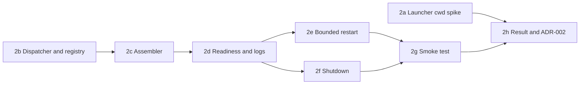

<!-- toon-meta
fmt: TOON
doc: docs/backlog/poc-2-single-sea-runtime-supervisor.md
title: "POC-2 Single SEA and runtime supervisor"
type: backlog
summary: "Umbrella for POC-2: slices 2a to 2h, order, inherited POC-1 items, and decisions that need the human."
related[10]: docs/backlog/README.md,docs/backlog/poc-1e-hardening-desktop-skeleton.md,docs/backlog/poc-2a-launcher-cwd-spike.md,docs/backlog/poc-2b-dispatcher-service-registry.md,docs/backlog/poc-2c-assembler-registry-build.md,docs/backlog/poc-2d-supervisor-readiness-logs.md,docs/backlog/poc-2e-bounded-restart.md,docs/backlog/poc-2f-coordinated-shutdown.md,docs/backlog/poc-2g-real-binary-smoke.md,docs/backlog/poc-2h-result-and-adr.md
status: current
updated: 2026-10-31
-->

# POC-2: Single SEA and runtime supervisor

[Home](../../README.md) | [Requirements](../requirements/README.md) | [Architecture](../architecture/overview.md) | [Standards](../standards/README.md) | [Roadmap](../roadmap/PROPOSAL.md) | [Traceability](../requirements/traceability.md) | [Backlog](README.md)

[Previous](poc-1e-hardening-desktop-skeleton.md) | [Up](README.md) | [Next](poc-2a-launcher-cwd-spike.md)

## Navigation

- [At a glance](#at-a-glance)
- [Goal](#goal)
- [Slices](#slices)
- [Recommended order](#recommended-order)
- [Requirements](#requirements)
- [Acceptance criteria](#acceptance-criteria)
- [Pitch task to slice map](#pitch-task-to-slice-map)
- [Inherited from POC-1](#inherited-from-poc-1)
- [Decisions for the human](#decisions-for-the-human)
- [Open questions](#open-questions)

---

## At a glance

[Back to navigation](#navigation)

| Item | Value |
|---|---|
| Status | Cycle 1 (planned), split into eight slices on 2026-10-31 |
| Appetite | 2 weeks, big batch, highest uncertainty |
| Depends on | POC-1 (slices 1a to 1e) and the POC-1f in-memory web serving (PR #9, merged) |
| Branches | one branch `minor/poc-02-supervisor` for all of POC-2, one commit or commit group per slice, one draft PR against `main` (decided, human decision D1). The old branch `minor/poc-02-sea-supervisor` is not used |
| Requirements | 13 REQ ids |
| Acceptance criteria | AC-11, AC-28, AC-29, AC-30, AC-31 |
| Rule | Start a slice only when the human says so, and only on branch `minor/poc-02-supervisor` ([AGENTS.md](../../AGENTS.md)) |

POC-2 stays the umbrella id, the way POC-1 does. Each slice has its own epic and result page. All slices share branch `minor/poc-02-supervisor`. The slice sizes are estimates of authored changed lines (additions plus deletions), ASSUMPTION, and only a planning heuristic.

---

## Goal

[Back to navigation](#navigation)

Source: [PROPOSAL pitch](../roadmap/PROPOSAL.md#poc-2-single-sea-and-runtime-supervisor).

- Prove one SEA per platform. POC-1c packages a dummy Nest app as a SEA with a minimal `tools/scripts/compile-sea.ts`. POC-1f serves the web bundle from memory over IPC. This POC makes the SEA a real supervised runtime.
- The SEA bundles the dispatcher, sea-runtime and api-gateway, and relaunches itself by role under a supervisor.
- POC-1c selects the role with a `--service <name>` argument in a generated entry. POC-2 replaces that with a Zod-validated dispatcher and a closed service registry.

| No-gos |
|---|
| No fake `auth-ms`. |
| No postject without a documented need. |
| No second executable. |
| No Express or Fastify. |
| No SPA work (POC-4 owns it). |

Circuit breaker, from the pitch: if the SEA cannot bundle the dispatcher and the real services within the appetite, stop and publish what failed. Then split bundling from supervision, or evaluate a documented postject need. The slices already separate bundling (2b, 2c) from supervision (2d, 2e, 2f).

---

## Slices

[Back to navigation](#navigation)

| Slice | Epic | Branch (decided, D1) | Depends on | Size (lines, ASSUMPTION) | Main ids |
|---|---|---|---|---|---|
| 2a | [Launcher cwd spike](poc-2a-launcher-cwd-spike.md) | `minor/poc-02-supervisor` | none (POC-1f merged) | ~120, docs only | decision 11, OQ1 |
| 2b | [Dispatcher and service registry](poc-2b-dispatcher-service-registry.md) | `minor/poc-02-supervisor` | none (2a is parallel) | ~250 | REQ-RUNTIME-03, REQ-RUNTIME-04, AC-29, AC-31 |
| 2c | [Assembler driven by the registry](poc-2c-assembler-registry-build.md) | `minor/poc-02-supervisor` | 2b | ~250 | REQ-SEA-01..03, REQ-BUILD-04, AC-11 |
| 2d | [Supervisor readiness, logs and aggregate state](poc-2d-supervisor-readiness-logs.md) | `minor/poc-02-supervisor` | 2c | ~380 | REQ-RUNTIME-05, REQ-NET-01 |
| 2e | [Bounded restart](poc-2e-bounded-restart.md) | `minor/poc-02-supervisor` | 2d | ~250 | REQ-RUNTIME-01, REQ-RUNTIME-03, REQ-RUNTIME-05 |
| 2f | [Coordinated shutdown and orphan checks](poc-2f-coordinated-shutdown.md) | `minor/poc-02-supervisor` | 2d (2e for the no-restart rule) | ~350 | REQ-RUNTIME-06, AC-30 |
| 2g | [Real-binary smoke test and Linux run](poc-2g-real-binary-smoke.md) | `minor/poc-02-supervisor` | 2e, 2f | ~300 | REQ-RUNTIME-08, REQ-TEST-07, AC-28 |
| 2h | [POC-02 result and ADR-002](poc-2h-result-and-adr.md) | `minor/poc-02-supervisor` | 2a to 2g | ~200, docs only | AC-11, AC-29 |

Total estimate: about 1800 authored lines on one branch and one draft PR, one commit or commit group per slice (decided, human decision D1). Branch prefixes follow [REQ-VERSION-02](../requirements/11-nx-quality-testing.md): `minor/` where a CLI or internal contract changes, `docs/` for documentation only.

---

## Recommended order

[Back to navigation](#navigation)

1. 2b first. It is code, it unblocks everything else, and it settles the registry shape that 2c to 2f read.
2. 2a any time, in parallel with 2b. It needs only the packaged binary on `main` and no repository code. It must finish before 2h, and its answer feeds the POC-3 paths library.
3. 2c, then 2d. 2d is the largest slice and the one most likely to hit the circuit breaker.
4. 2e and 2f in either order. 2f is the riskiest on Windows. Do 2f before 2e if the human wants the highest uncertainty first.
5. 2g after 2e and 2f, because the smoke test checks restart and shutdown.
6. 2h last. It publishes `POC-02-Result` and `ADR-002`.

---

## Requirements

[Back to navigation](#navigation)

Pitch Acceptance criteria line ([PROPOSAL pitch](../roadmap/PROPOSAL.md#poc-2-single-sea-and-runtime-supervisor)):

- [REQ-RUNTIME-01](../requirements/09-desktop-tauri.md)
- [REQ-RUNTIME-03](../requirements/09-desktop-tauri.md)
- [REQ-RUNTIME-04](../requirements/09-desktop-tauri.md)
- [REQ-RUNTIME-05](../requirements/09-desktop-tauri.md)
- [REQ-RUNTIME-06](../requirements/09-desktop-tauri.md)
- [REQ-RUNTIME-07](../requirements/09-desktop-tauri.md)
- [REQ-RUNTIME-08](../requirements/09-desktop-tauri.md)
- [REQ-SEA-01](../requirements/10-node-sea-distribution.md)
- [REQ-SEA-02](../requirements/10-node-sea-distribution.md)
- [REQ-SEA-03](../requirements/10-node-sea-distribution.md)
- [REQ-TEST-07](../requirements/11-nx-quality-testing.md)

Cited elsewhere in the pitch:

- [REQ-NET-01](../requirements/06-web-gateway-https-pwa.md)
- [REQ-BUILD-04](../requirements/11-nx-quality-testing.md)

Already built in POC-1b: [REQ-RUNTIME-02](../requirements/09-desktop-tauri.md).

[REQ-RUNTIME-04](../requirements/09-desktop-tauri.md) and [REQ-RUNTIME-07](../requirements/09-desktop-tauri.md) have no pitch task. This plan assigns them: RUNTIME-04 to [2b](poc-2b-dispatcher-service-registry.md) (registry design, no `auth-ms`), RUNTIME-07 to [2d](poc-2d-supervisor-readiness-logs.md) (loopback rule for internal services) with the migration lock left to POC-3.

---

## Acceptance criteria

[Back to navigation](#navigation)

- [AC-11](../requirements/11-nx-quality-testing.md) (partial: no Node install on the host): 2c, 2g
- [AC-28](../requirements/11-nx-quality-testing.md): 2b, 2g
- [AC-29](../requirements/11-nx-quality-testing.md): 2b, 2e, 2g
- [AC-30](../requirements/11-nx-quality-testing.md) (host OS only, others pending): 2f
- [AC-31](../requirements/11-nx-quality-testing.md) (registry design only): 2b

---

## Pitch task to slice map

[Back to navigation](#navigation)

| Pitch task | Slice |
|---|---|
| Extend `compile-sea.ts` to bundle the dispatcher with the services; native `node --build-sea`, no postject | 2c |
| Invalidate the build when a registered service is added or changed (REQ-BUILD-04) | 2c |
| Zod-validated dispatcher and closed service registry; unknown roles rejected | 2b |
| Standalone `sea-runtime` (built in POC-1b); SEA entry without arguments is supervisor mode | 2b |
| Registry design for a future `auth-ms` (AC-31) | 2b |
| Supervisor respawns `process.execPath --service <id>`, never `node` from PATH | 2e |
| `/api` health endpoint under the supervisor (REQ-NET-01) | 2d |
| Shutdown: stdio IPC, timeout, force-kill of descendants; no orphans | 2f |
| Readiness timeout, per-service logs, bounded restart (OQ11) | 2d (readiness, logs), 2e (restart) |
| Run the supervisor under systemd and launchd; verify the gateway cwd | 2a |
| Real-binary smoke test | 2g |
| Publish `POC-02-Result` and `ADR-002` | 2h |

---

## Inherited from POC-1

[Back to navigation](#navigation)

Source: [POC-1 result, open items](../results/POC-01-Result.md#open-items-and-not-verified), [POC-1f result](../results/POC-01f-web-from-memory.md#risks) and [Tauri hardening result](../results/CHORE-tauri-hardening-Result.md). Every item has one owner below. "Outside" means no POC-2 slice owns it.

| Inherited item | Owner |
|---|---|
| Linux SEA needs `libatomic.so.1`; amd64 without it untested (the deb and rpm `depends` are in place) | 2g |
| `Warning: Code cache data rejected.` on amd64 under emulation, cause not verified (POC-1c) | 2c |
| Supervisor restart on macOS not observed (POC-1c) | 2e |
| SIGINT on macOS not observed (POC-1c) | 2f |
| Children stopped by signal only, no IPC and no timeout (POC-1c) | 2f |
| cwd under systemd and launchd not verified (decision 11) | 2a |
| Windows binaries and process tree not verified | Outside. POC-8 (platform matrix); see D3 |
| Sidecar not wired in `apps/desktop` | POC-5 |
| `tauri.conf.json` CSP not exercised at runtime; WebView2 minimum; Linux Tauri builds; identifier placeholder; `@tauri-apps/cli` 2.12.4 against crate 2.12.5 | POC-5 (identifier and WebView2 also POC-8) |
| Unknown paths return the index with 200; the 404 rule for missing assets | POC-4 ([REQ-NET-07](../requirements/06-web-gateway-https-pwa.md)) |
| Phone width, keyboard and focus, Lighthouse | POC-4 |
| Test filter has no consumer, because no APP test runs under `test`; the 2g smoke test runs in `package`, so it does not close this | POC-4 (first Playwright APP test under `test:dynamic`); see D5 |
| `test:static` does no lint or format ([REQ-ECO-05](../requirements/11-nx-quality-testing.md)) | POC-4 (Angular lint first); a chore branch may do it earlier |
| `tsc --noEmit` gap of the rspack build | Closed in 1e: `test:static` runs `tsc --noEmit` in `sea-runtime`. The build itself still does no type check. Outside |
| `package` target never cached; SEA binary not reproducible | 2c records it; reproducibility itself is POC-9 (not verified) |
| `nx run-many -t package` alone skips `securityCheck` | POC-9 (CI calls the root scripts) |
| Node 26 compatibility of Nest, Angular, Tauri, Zod | Each slice records what it observes; no slice owns the full claim |
| Angular runtime 22.2.4 against 22.2.5 (D2); `esbuild` in the lockfile (N1) | Outside. A `chore/` branch when the registry has the version |
| Gateway keeps a full copy of the web bundle; memory not measured | 2d records resident memory of the packaged run |
| Fixed 10 s web receive timeout; slow start on weak hardware untested | 2d |
| Requirement text naming `ServeStaticModule`, `--web-root` and the temp extraction | 2h reviews it and records the result; edits need the human (SRS owner) |
| Only macOS arm64 tested for 1f | 2g (Linux arm64 and amd64 in Docker) |

---

## Decisions for the human

[Back to navigation](#navigation)

Decided by the human. Each row below is binding. The recommendation column keeps the original proposal for reference only.

| Id | Decision | Decided (human decision) and original recommendation | Needed by |
|---|---|---|---|
| D1 | PR layout: one PR per slice (8 PRs) against `main`, in order; or one PR for the whole POC-2. | **decided (human decision):** one branch `minor/poc-02-supervisor` for all of POC-2, one commit or commit group per slice, and one draft PR against `main`. Supersedes the original one-PR-per-slice recommendation. | Before 2b |
| D2 | Accept the proposed restart, backoff and readiness values of [OQ11](../roadmap/PROPOSAL.md#open-questions) (readiness 30 s, backoff 1 to 16 s capped at 30 s with 20 percent jitter, 5 restarts in 300 s, reset after 60 s, graceful stop 10 s). | **decided (human decision):** the OQ11 values are accepted as constants that live in one Zod schema with `DEFAULTS`, not as loose values. Measure them in 2e and 2f, and report real numbers in `POC-02-Result`. Configuration moves to the POC-3 singleton. | Before 2d |
| D3 | Windows: no Windows host exists. Close POC-2 with host macOS plus Linux in Docker, and mark Windows (process tree, `taskkill /T`, SEA run) `blocked-by-environment`, carried to POC-8. Or pause POC-2 until a Windows VM or runner exists. | **decided (human decision):** Windows is halted, marked `blocked-by-environment` (process tree, `taskkill /T`, SEA run), until the human tests it on his Windows computer on Monday. Code for the Windows branch of shutdown stays labelled not verified. [REQ-TEST-09](../requirements/11-nx-quality-testing.md) forbids claiming Windows support. | Before 2f |
| D4 | systemd evidence for 2a: a systemd container in Docker (privileged, Debian), a Linux VM, or leave systemd as not verified and verify only launchd. | **decided (human decision):** systemd and Linux evidence comes from Docker (a privileged systemd container, best effort, labelled "container, not a real host"). On Monday the human tries a VM (VMware) on the Windows computer. AGENTS.md still forbids `brew` and `apt` on the host. | Before 2a |
| D5 | Where the real-binary smoke test runs. `test` runs before `package` ([REQ-BUILD-02](../requirements/11-nx-quality-testing.md)), but the smoke needs the packaged binary. Run it as a post-step of `package` (like the 1d post-package check), or make `test` depend on `package`, which breaks the root order. | **decided (human decision):** the smoke test is a post-step of `package`, with the `@app` tag. The root order stays. [REQ-TEST-08](../requirements/11-nx-quality-testing.md) already says `package` validates the artifacts. | Before 2g |

---

## Open questions

[Back to navigation](#navigation)

Source: `docs/roadmap/PROPOSAL.md`, Open questions.

| OQ | Topic | Status |
|---|---|---|
| [OQ1](../roadmap/PROPOSAL.md#open-questions) | root and cwd under each launcher | decided (decision 11); the cwd fact is verified in 2a |
| [OQ7](../roadmap/PROPOSAL.md#open-questions) | what closes a micro-POC per OS | proposed; D3 applies it |
| [OQ11](../roadmap/PROPOSAL.md#open-questions) | restart/backoff/readiness values | decided (human decision, D2): constants in a Zod schema with `DEFAULTS`; measured values still to report |
