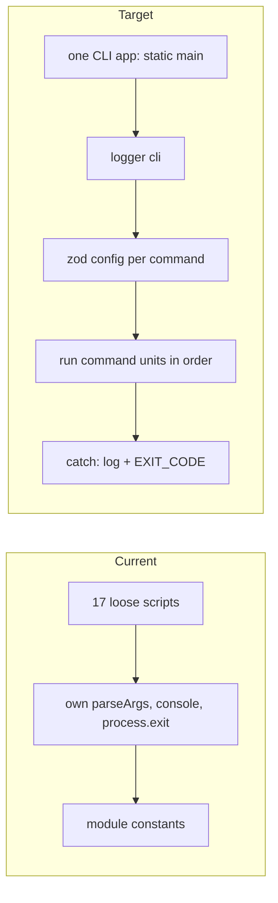

<!-- toon-meta
fmt: TOON
doc: docs/backlog/td-compile-sea-standalone.md
title: "Technical debt: tools/scripts outside the standalone pattern"
type: backlog
summary: "Technical debt record TD-TOOLS-01: all of tools/scripts becomes one CLI app that follows the ADR-013 entrypoint pattern."
ids[0]:
related[6]: docs/architecture/current-state.md,docs/backlog/README.md,docs/backlog/nest-standalone-refactor.md,docs/architecture/adr/ADR-013-nest-standalone-architecture.md,docs/requirements/10-node-sea-distribution.md,docs/backlog/td-dev-certs-prebuild.md
status: proposed
updated: 2026-11-09
-->

# Technical debt: tools/scripts outside the standalone pattern

[Home](../../README.md) | [Requirements](../requirements/README.md) | [Architecture](../architecture/overview.md) | [Standards](../standards/README.md) | [Roadmap](../roadmap/PROPOSAL.md) | [Traceability](../requirements/traceability.md) | [Backlog](README.md)

[Up](README.md)

## Navigation

- [Identification](#identification)
- [Definition](#definition)
- [Evidence](#evidence)
- [Impact](#impact)
- [Proposed resolution](#proposed-resolution)
- [Open decision](#open-decision)
- [Acceptance criteria](#acceptance-criteria)
- [Risk](#risk)
- [Out of scope](#out-of-scope)
- [References](#references)

---

## Identification

[Back to navigation](#navigation)

| Field | Value |
|---|---|
| Id | TD-TOOLS-01 |
| Title | `tools/scripts` does not follow the ADR-013 entrypoint pattern |
| Type | Technical debt, tooling |
| Status | Proposed. Not scheduled. |
| Detected | 2026-11-07, while closing the Nest standalone refactor branch |
| Scope | All 17 scripts in `tools/scripts/`. The first script to convert is `compile-sea.ts` (498 lines). |
| Rescoped | 2026-11-09, by the human: one CLI app instead of loose scripts. See [current state](../architecture/current-state.md#direction). |

The id `TD-TOOLS-01` labels this record only. It is not a requirement. The `AGENTS.md` rules forbid inventing requirements. The metadata standard lets only requirement files define ids, and its check accepts only `REQ-` and `AC-` ids. So the `ids` field of this page stays empty. The scheme is `TD-<area>-<number>`.

---

## Definition

[Back to navigation](#navigation)

The refactor moved the runtime entrypoints to one shape: a class with a single `static main`, and a fixed order of logger, config, execution, exception handling ([ADR-013](../architecture/adr/ADR-013-nest-standalone-architecture.md), see `apps/sea-runtime/src/main.ts`). The scripts under `tools/scripts/` were out of the refactor scope. They stay loose procedural files. `compile-sea.ts` is the largest example: 24 top-level functions, module-level state, direct `console` output and a `process.exit` in a trailing `.catch`.

The sibling scripts repeat the same smells. The debt has three parts:

- Shape. No class, no single `static main`, no stated order of phases, and no shared entrypoint. Each script is its own program.
- Inputs. Arguments go through `parseArgs`, `process.argv` and hand-written checks, not through one zod-validated object with defaults.
- Output and exit. Direct `console` calls and `process.exit` with literal codes. In `compile-sea.ts`, version checks, Nx lookups, rspack, web assets, vector assets, migration assets and the SEA config also share one file and one set of module constants.

The human decided the direction on 2026-11-09: all of `tools/scripts` becomes one CLI app that follows the ADR-013 entrypoint pattern. It is a direction, not a requirement.

---

## Evidence

[Back to navigation](#navigation)

Counts come from `rg -c` over each file and count matching lines, not call sites. A match inside a comment or a string also counts: not verified per match.

| File | Lines | `console.` | `process.exit` | `parseArgs` | `process.argv` |
|---|---|---|---|---|---|
| `tools/scripts/branch-name.ts` (moved to `apps/tools-cli`, file deleted) | 49 | 0 | 3 | 0 | 1 |
| `tools/scripts/compile-sea.ts` (moved to `apps/tools-cli`, file deleted) | 498 | 7 | 1 | 2 | 1 |
| `tools/scripts/db-parity.ts` (moved to `apps/tools-cli`, file deleted) | 150 | 3 | 2 | 0 | 2 |
| `tools/scripts/e2e-desktop.ts` | 85 | 3 | 1 | 0 | 0 |
| `tools/scripts/generate-certs.ts` (moved to `apps/tools-cli`, file deleted) | 34 | 5 | 1 | 2 | 0 |
| `tools/scripts/installer-build.ts` (moved to `apps/tools-cli`, file deleted) | 12 | 1 | 0 | 0 | 0 |
| `tools/scripts/installer-macos.ts` (moved to `apps/tools-cli`, file deleted) | 120 | 1 | 0 | 0 | 0 |
| `tools/scripts/pack-migrations.ts` (moved to `apps/tools-cli`, file deleted) | 158 | 2 | 1 | 0 | 2 |
| `tools/scripts/release-version-actions.ts` | 137 | 0 | 0 | 0 | 0 |
| `tools/scripts/smoke-dev.ts` | 202 | 4 | 1 | 0 | 0 |
| `tools/scripts/smoke-pg.ts` | 377 | 4 | 2 | 2 | 0 |
| `tools/scripts/smoke-sea.ts` (moved to `apps/tools-cli`, file deleted) | 834 | 4 | 1 | 2 | 0 |
| `tools/scripts/stage-sidecar.ts` (moved to `apps/tools-cli`, file deleted) | 20 | 1 | 0 | 0 | 0 |
| `tools/scripts/test-filter.ts` (moved to `apps/tools-cli`, file deleted) | 73 | 0 | 3 | 0 | 1 |
| `tools/scripts/trust-ca.ts` (moved to `apps/tools-cli`, file deleted) | 64 | 6 | 2 | 2 | 0 |
| `tools/scripts/verify-platform.ts` | 251 | 5 | 2 | 0 | 0 |
| `tools/scripts/version-check.ts` (moved to `apps/tools-cli`, file deleted) | 56 | 0 | 1 | 0 | 0 |
| Total | 3120 | 46 | 21 | 10 | 7 |

Totals: 46 matching lines of `console.` and 21 of `process.exit` across 13 and 13 files. Five files have their own `parseArgs` (`compile-sea.ts`, `generate-certs.ts`, `smoke-pg.ts`, `smoke-sea.ts`, `trust-ca.ts`); each match pair is the import plus one call. `process.argv` appears in 7 files. `tools/scripts/smoke-dev.ts` also fails type check, because no tsconfig includes it (see [current state](../architecture/current-state.md#gaps)).

### Evidence: compile-sea.ts

Line numbers are from `tools/scripts/compile-sea.ts`, re-checked with `rg` on 2026-11-09 for the console, exit, argument, import, state and filesystem rows. The domain line ranges are not re-checked. Re-check all of them before the slice starts.

| Smell | Line | Detail |
|---|---|---|
| Console output | 151, 352, 384, 407, 469, 492 | Six `console.log` calls. ADR-013 D2 sends human-readable output through the logger. |
| Console error | 496 | `console.error` in the trailing `.catch`. |
| Process exit | 497 | `process.exit(1)` with a magic number. ADR-013 D8 names exit codes as constants. |
| Argument parsing | 170, 449 | `parseArgs` over `process.argv.slice(2)`. The cross-build rules sit in `if` checks at 176 to 187, not in a schema. |
| Top-level await | 27, 29 | Two dynamic `import()` calls at module load. A missing build output fails before `main` runs. |
| Module-level state | 25, 63 to 74 | `root`, `workDir`, `servicesDir`, `bundlePath`, `servicesPath`, `configPath`, `manifestPath`, `vectorPinPath`, `vectorTablePath`, `vectorCacheDir` are shared constants read by every function. |
| Process env reads | 147, 155, 443 | `process.version`, `process.platform` and `process.arch` are read inside helpers. They are not config. |
| Filesystem effects in the entry | 477 to 480 | `rmSync` and `mkdirSync` run inside `main`, before staging. |
| Mixed domains | 113 to 151, 192 to 285, 292 to 337, 339 to 356, 358 to 388, 390 to 416, 418 to 446 | Version and engine, Nx and registry, rspack, web assets, vector assets, migration assets, SEA config and build. |
| One long `main` | 448 to 493 | 46 lines that run every phase in sequence. |

---

## Impact

[Back to navigation](#navigation)

- A reader finds a second structure in the repo. `main.ts` files follow ADR-013; the scripts do not.
- The scripts cannot be tested piece by piece. In `compile-sea.ts`, every function reads module constants.
- A failure prints through `console.error` or a literal `process.exit`, with no shared prefix and no shared exit code constant.
- The cross-build rules of `compile-sea.ts` are not visible as a contract. They live in `if` checks.
- Five scripts parse their own arguments, so no two share the same usage or error style.

---

## Proposed resolution

[Back to navigation](#navigation)

Move all of `tools/scripts` to one CLI app that follows the ADR-013 entrypoint pattern, without changing the output of any script. Each script becomes a command of that app.

- One class with one `static main`. It runs four phases in order: logger, config, execution, exception handling.
- Logger: `provideLogger({ target: 'cli' })` replaces every `console` call.
- Config: one zod object per command holds its inputs and defaults. Nothing else reads `process.argv`.
- Exit: a named `EXIT_CODE` constant set replaces the literal codes.
- First command: `compile-sea`. Split it by domain, one unit each: engine check, target resolution, service discovery, rspack bundle, web assets, vector assets, migration assets, SEA config and build. Paths become config values, not module constants. The cross-build checks at lines 176 to 187 move into the schema.
- Tests follow the test model in [current state](../architecture/current-state.md#direction): no unit or integration tests, one APP suite per app under `./tests/<app>/`. The CLI app gets its own APP suite.

Requirements that apply to `compile-sea.ts`, in [10-node-sea-distribution.md](../requirements/10-node-sea-distribution.md):

| Id | Why it applies |
|---|---|
| REQ-SEA-01 | `compile-sea.ts` bundles the single dispatcher. The bundle content does not change. |
| REQ-SEA-03 | The code cache rule for native and cross builds does not change. |
| REQ-SEA-04 | Migrations and the web output stay embedded as assets. |

### Progress

- 2026-11-09: `pack-migrations`, `compile-sea`, `installer-macos`, `installer-build` and `db-parity` are now `apps/tools-cli` commands and their scripts are deleted. `compile-sea` is split into `SeaPaths`, `SeaTargetService`, `NodeEngineService`, `SeaDependenciesService`, `SeaAssetsService` and `SeaBundlerService` under `apps/tools-cli/src/sea`; it takes the migration asset names from `MigrationPackService` and the pkg steps of `installer-build` come from `MacosPkgService`, with no spawn between commands. `tools-cli` depends on `db-migrations` (workspace) and `shared-core` exports `shared-core/pg`. Rspack, `tools/rspack/nest.config.ts` and `apps/sea-runtime/src/services.ts` load at run time outside the CLI bundle. `sea-runtime:package`, `desktop:package` and the `db-migrations` `parity` target run the built CLI and depend on `tools-cli:build`. Native SEA build, old against new: `dist/sea-package/` identical, the executable has the same size (the bytes differ), stdout and exit code equal, `smoke-sea.ts` passes 30 checks. Differences: a failure that threw (installer inputs) prints `tools-cli: <message>` instead of a stack trace; the `compile-sea` usage line and the pack-migrations hints name `tools-cli`; `--help` and `-h` print the command help and exit 0; the "build first" checks for `db-migrations` and `shared-core` output are gone, because `tools-cli:build` builds them. Not verified: the PostgreSQL path of `db-parity` against a live server (no Docker daemon; the connection-error paths match the old script), the non-macOS branch of `installer-build`, and cross builds.
- 2026-11-09: `generate-certs`, `stage-sidecar`, `test-filter`, `trust-ca` and `version-check` are now `apps/tools-cli` commands and their scripts are deleted. `package.json` (`dev:certs`, `dev:trust`, `release:check`, `test`), `apps/desktop` and the spawn strings of the smoke, verify and e2e scripts call the built CLI (`node apps/tools-cli/dist/main.js <command>`). `desktop:build`, `desktop:package` and `sea-runtime:package` depend on `tools-cli:build`. `tools-cli` depends on `shared-core`, which exports `shared-core/tls/generate` for `generate-certs` only. `release-version-actions.ts` stays a script: Nx loads it by path as a version-actions module (`nx.json`), so it must stay a loadable module with a default-exported class. Differences: a failure that threw (missing file) prints `tools-cli: <message>` instead of a stack trace; the usage line names `tools-cli <command>`; `--help` and `-h` print the command help and exit 0; help prints `tools-cli` instead of `main`.
- 2026-11-09: `smoke-sea` is now an `apps/tools-cli` command (`apps/tools-cli/src/commands/smoke-sea.command.ts`) and `tools/scripts/smoke-sea.ts` is deleted. The checks, their order, the messages and the exit codes are unchanged; the module-level state of the script is now fields of the command class and the checks are small private methods. `sea-runtime:package` ends with `node apps/tools-cli/dist/main.js smoke-sea` and already depends on `tools-cli:build`. Differences: an unexpected throw outside a check (for example an unknown option) prints `tools-cli: <message>` instead of a stack trace, exit 1; `--help` prints the command help; the temporary directory is removed in a `finally` instead of an `exit` handler.
- 2026-11-09: `apps/tools-cli` exists (Nest standalone, `nest-commander` 3.21.0, ADR-013 entrypoint). `branch-name` is the first command: `pnpm tools branch-name [<branch>]`, called by `pnpm release:branch`. `tools/scripts/branch-name.ts` is deleted. The output and exit codes are the same as the old script, with one difference: `--help` and `-h` print the command help and exit 0, where the old script rejected them as a branch name (exit 1). Usage errors from commander (an unknown command) exit 2. The other scripts have not moved.

---

## Open decision

[Back to navigation](#navigation)

Open, for the human. Not decided by this page.

| Decision | Options | Note |
|---|---|---|
| Container | `nest-commander`, or a plain class with `static main` | `nest-commander` is a candidate. Not verified: version, fit with the ADR-013 pattern and the SEA bundle. A linear flow does not need a container. |

---

## Acceptance criteria

[Back to navigation](#navigation)

Check these on a native build, before and after the change, on the same machine.

- [x] `services.json` under `dist/sea-package/` has the same SHA-256 before and after (2026-11-09: the whole `dist/sea-package/` tree is identical).
- [x] `pnpm nx run sea-runtime:package` exits 0. Its command chain includes `tools-cli compile-sea` and `smoke-sea` of the built CLI (`apps/sea-runtime/package.json`).
- [x] The smoke suites that read the SEA binary exit 0 (`tools-cli smoke-sea`: 30 checks passed).
- [x] The build prints no `console.log` or `console.error` call. `rg -n 'console\.' apps/tools-cli/src/sea apps/tools-cli/src/commands/compile-sea.command.ts` finds nothing.
- [x] `rg -n 'process\.argv|process\.exit' apps/tools-cli/src/sea apps/tools-cli/src/commands/compile-sea.command.ts` finds nothing. The repository root comes from `RepoRoot`, the one reader of `process.argv`.
- [ ] `rg -n 'console\.|process\.exit|parseArgs' tools/scripts` finds nothing outside the logger and the single entrypoint, once every script is converted.
- [ ] A cross build without `--executable` and a native build with `--executable` both fail with the same messages as before.
- [ ] The artifact name `<supervisor>-<triple>[.exe]` is unchanged, so `stage-sidecar.ts` and the installer read the same file.

---

## Risk

[Back to navigation](#navigation)

High-risk item 5, delivery or environment. `package`, `smoke-sea` and the installer consume the output of this script. A change in the artifact name, the asset set or `services.json` breaks them. The equivalence check in the acceptance criteria catches that.

---

## Out of scope

[Back to navigation](#navigation)

- Changes to the SEA bundle content, the asset names or the code cache rule.
- Any change of what a script reads or writes (inputs, outputs, artifact names).
- Cross builds. They stay unverified, as the `compile-sea.ts` header states.
- The choice of the test runner for the sea-runtime. See [current state](../architecture/current-state.md#open-decisions).

---

## References

[Back to navigation](#navigation)

- [Current state and direction](../architecture/current-state.md): the component map, the test direction and the gaps.
- [ADR-013](../architecture/adr/ADR-013-nest-standalone-architecture.md): the entrypoint pattern, D2 (logger), D4 (`provideLogger`), D8 (exit codes).
- [10-node-sea-distribution.md](../requirements/10-node-sea-distribution.md): REQ-SEA-01, REQ-SEA-03, REQ-SEA-04.
- [Backlog](README.md) and the [Nest standalone refactor follow-ups](nest-standalone-refactor.md#follow-ups).
