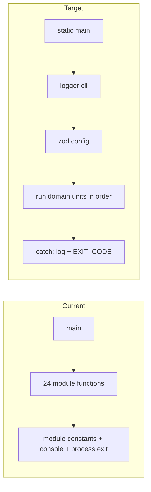

<!-- toon-meta
fmt: TOON
doc: docs/backlog/td-compile-sea-standalone.md
title: "Technical debt: compile-sea.ts outside the standalone pattern"
type: backlog
summary: "Technical debt record TD-TOOLS-01: compile-sea.ts is a 498-line procedural script that ADR-013 patterns do not yet cover."
ids[0]:
related[5]: docs/backlog/README.md,docs/backlog/nest-standalone-refactor.md,docs/architecture/adr/ADR-013-nest-standalone-architecture.md,docs/requirements/10-node-sea-distribution.md,docs/backlog/td-dev-certs-prebuild.md
status: proposed
updated: 2026-11-07
-->

# Technical debt: compile-sea.ts outside the standalone pattern

[Home](../../README.md) | [Requirements](../requirements/README.md) | [Architecture](../architecture/overview.md) | [Standards](../standards/README.md) | [Roadmap](../roadmap/PROPOSAL.md) | [Traceability](../requirements/traceability.md) | [Backlog](README.md)

[Up](README.md)

## Navigation

- [Identification](#identification)
- [Definition](#definition)
- [Evidence](#evidence)
- [Impact](#impact)
- [Proposed resolution](#proposed-resolution)
- [Open decision](#open-decision)
- [Acceptance criteria](#acceptance-criteria)
- [Risk](#risk)
- [Out of scope](#out-of-scope)
- [References](#references)

---

## Identification

[Back to navigation](#navigation)

| Field | Value |
|---|---|
| Id | TD-TOOLS-01 |
| Title | `tools/scripts/compile-sea.ts` does not follow the ADR-013 entrypoint pattern |
| Type | Technical debt, tooling |
| Status | Proposed. Not scheduled. |
| Detected | 2026-11-07, while closing the Nest standalone refactor branch |
| Scope | `tools/scripts/compile-sea.ts` (498 lines) only |

The id `TD-TOOLS-01` labels this record only. It is not a requirement. The `AGENTS.md` rules forbid inventing requirements. The metadata standard lets only requirement files define ids, and its check accepts only `REQ-` and `AC-` ids. So the `ids` field of this page stays empty. The scheme is `TD-<area>-<number>`.

---

## Definition

[Back to navigation](#navigation)

The refactor moved the runtime entrypoints to one shape: a class with a single `static main`, and a fixed order of logger, config, execution, exception handling ([ADR-013](../architecture/adr/ADR-013-nest-standalone-architecture.md), see `apps/sea-runtime/src/main.ts`). The build script `compile-sea.ts` was out of the refactor scope. It stays a procedural file: 24 top-level functions, module-level state, direct `console` output and a `process.exit` in a trailing `.catch`.

The debt has three parts:

- Shape. No class, no single `static main`, no stated order of phases.
- Inputs. Arguments go through `parseArgs` and hand-written checks, not through one zod-validated object with defaults.
- Mixed domains. Version checks, Nx lookups, rspack, web assets, vector assets, migration assets and the SEA config share one file and one set of module constants.

---

## Evidence

[Back to navigation](#navigation)

Line numbers are from `tools/scripts/compile-sea.ts` at the commit that adds this page. Re-check them before the slice starts.

| Smell | Line | Detail |
|---|---|---|
| Console output | 151, 352, 384, 407, 469, 492 | Six `console.log` calls. ADR-013 D2 sends human-readable output through the logger. |
| Console error | 496 | `console.error` in the trailing `.catch`. |
| Process exit | 497 | `process.exit(1)` with a magic number. ADR-013 D8 names exit codes as constants. |
| Argument parsing | 170, 449 | `parseArgs` over `process.argv.slice(2)`. The cross-build rules sit in `if` checks at 176 to 187, not in a schema. |
| Top-level await | 27, 29 | Two dynamic `import()` calls at module load. A missing build output fails before `main` runs. |
| Module-level state | 25, 63 to 74 | `root`, `workDir`, `servicesDir`, `bundlePath`, `servicesPath`, `configPath`, `manifestPath`, `vectorPinPath`, `vectorTablePath`, `vectorCacheDir` are shared constants read by every function. |
| Process env reads | 147, 155, 443 | `process.version`, `process.platform` and `process.arch` are read inside helpers. They are not config. |
| Filesystem effects in the entry | 477 to 480 | `rmSync` and `mkdirSync` run inside `main`, before staging. |
| Mixed domains | 113 to 151, 192 to 285, 292 to 337, 339 to 356, 358 to 388, 390 to 416, 418 to 446 | Version and engine, Nx and registry, rspack, web assets, vector assets, migration assets, SEA config and build. |
| One long `main` | 448 to 493 | 46 lines that run every phase in sequence. |

---

## Impact

[Back to navigation](#navigation)

- A reader finds a second structure in the repo. `main.ts` files follow ADR-013; the build script does not.
- The script cannot be tested piece by piece. Every function reads module constants.
- A failure prints through `console.error`, with no prefix and no shared exit code constant.
- The cross-build rules are not visible as a contract. They live in `if` checks.

---

## Proposed resolution

[Back to navigation](#navigation)

Move `compile-sea.ts` to the ADR-013 entrypoint pattern without changing its output.

- One class with one `static main`. It runs four phases in order: logger, config, execution, exception handling.
- Logger: `provideLogger({ target: 'cli' })` replaces every `console` call.
- Config: one zod object holds the supervisor name, `target` and `executable`. It sets defaults (native build) and moves the cross-build checks of lines 176 to 187 into the schema. Nothing else reads `process.argv`.
- Domains: split the file by domain, one unit each: engine check, target resolution, service discovery, rspack bundle, web assets, vector assets, migration assets, SEA config and build. Paths become config values, not module constants.
- Exit: a named `EXIT_CODE` constant replaces the literal `1` at line 497.

Requirements that apply, in [10-node-sea-distribution.md](../requirements/10-node-sea-distribution.md):

| Id | Why it applies |
|---|---|
| REQ-SEA-01 | `compile-sea.ts` bundles the single dispatcher. The bundle content does not change. |
| REQ-SEA-03 | The code cache rule for native and cross builds does not change. |
| REQ-SEA-04 | Migrations and the web output stay embedded as assets. |

---

## Open decision

[Back to navigation](#navigation)

Open, for the human. Not decided by this page.

| Option | Condition | Result |
|---|---|---|
| Full Nest standalone | Only if the domains become injectable services | A module, providers per domain and `createApplicationContext`, as in `apps/sea-runtime/src/main.ts`. |
| Simple class | If the flow stays linear, one phase after another | A plain class with `static main` and the same four phases. No Nest container. |

Nest standalone is justified only when the split gives services that need injection. A linear flow does not need a container.

---

## Acceptance criteria

[Back to navigation](#navigation)

Check these on a native build, before and after the change, on the same machine.

- [ ] `services.json` under `dist/sea-package/` has the same SHA-256 before and after.
- [ ] `pnpm nx run sea-runtime:package` exits 0. Its command chain includes `compile-sea.ts` and `smoke-sea.ts` (`apps/sea-runtime/package.json:69`).
- [ ] The smoke suites that read the SEA binary exit 0.
- [ ] The build prints no `console.log` or `console.error` call. `rg -n 'console\.' tools/scripts/compile-sea.ts` finds nothing in the changed code.
- [ ] `rg -n 'process\.argv|process\.exit' tools/scripts/compile-sea.ts` finds nothing.
- [ ] A cross build without `--executable` and a native build with `--executable` both fail with the same messages as before.
- [ ] The artifact name `<supervisor>-<triple>[.exe]` is unchanged, so `stage-sidecar.ts` and the installer read the same file.

---

## Risk

[Back to navigation](#navigation)

High-risk item 5, delivery or environment. `package`, `smoke-sea` and the installer consume the output of this script. A change in the artifact name, the asset set or `services.json` breaks them. The equivalence check in the acceptance criteria catches that.

---

## Out of scope

[Back to navigation](#navigation)

- Changes to `pack-migrations.ts`, `smoke-sea.ts`, `stage-sidecar.ts` or `installer-macos.ts`.
- Changes to the SEA bundle content, the asset names or the code cache rule.
- The other scripts under `tools/scripts/`.
- Cross builds. They stay unverified, as the script header states.

---

## References

[Back to navigation](#navigation)

- [ADR-013](../architecture/adr/ADR-013-nest-standalone-architecture.md): the entrypoint pattern, D2 (logger), D4 (`provideLogger`), D8 (exit codes).
- [10-node-sea-distribution.md](../requirements/10-node-sea-distribution.md): REQ-SEA-01, REQ-SEA-03, REQ-SEA-04.
- [Backlog](README.md) and the [Nest standalone refactor follow-ups](nest-standalone-refactor.md#follow-ups).
