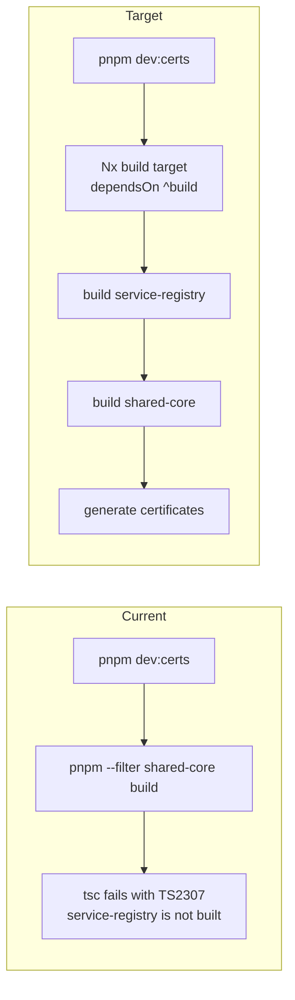

<!-- toon-meta
fmt: TOON
doc: docs/backlog/td-dev-certs-prebuild.md
title: "Technical debt: dev:certs prebuild gap"
type: backlog
summary: "Technical debt record TD-DEV-01: pnpm dev:certs builds shared-core but not service-registry, so a clean clone fails with TS2307."
ids[0]:
related[4]: docs/backlog/README.md,docs/backlog/nest-standalone-refactor.md,docs/requirements/11-nx-quality-testing.md,docs/architecture/adr/ADR-008-tls-trust-model.md
status: proposed
updated: 2026-11-06
-->

# Technical debt: dev:certs prebuild gap

[Home](../../README.md) | [Requirements](../requirements/README.md) | [Architecture](../architecture/overview.md) | [Standards](../standards/README.md) | [Roadmap](../roadmap/PROPOSAL.md) | [Traceability](../requirements/traceability.md) | [Backlog](README.md)

[Up](README.md)

## Navigation

- [Identification](#identification)
- [Definition](#definition)
- [Evidence](#evidence)
- [Impact](#impact)
- [Root cause](#root-cause)
- [Proposed resolution](#proposed-resolution)
- [Acceptance criteria](#acceptance-criteria)
- [Risk](#risk)
- [Out of scope](#out-of-scope)
- [References](#references)

---

## Identification

[Back to navigation](#navigation)

| Field | Value |
|---|---|
| Id | TD-DEV-01 |
| Title | `pnpm dev:certs` does not build all its workspace dependencies |
| Type | Technical debt, tooling |
| Status | Proposed. Not scheduled. |
| Detected | 2026-11-06, while checking the Nest standalone refactor branch |
| Scope | Root script `dev:certs` and the setup steps in the root `README.md` |

The id `TD-DEV-01` labels this record only. It is not a requirement. The `AGENTS.md` rules forbid inventing requirements. The metadata standard lets only requirement files define ids, and its check accepts only `REQ-` and `AC-` ids. So the `ids` field of this page stays empty. The scheme is `TD-<area>-<number>`.

---

## Definition

[Back to navigation](#navigation)

The root script builds `shared-core` with a `pnpm --filter` call. That call does not build the workspace packages that `shared-core` depends on. `shared-core` depends on `service-registry`. In a clean clone, `service-registry` has no `dist/` folder. The TypeScript build of `shared-core` cannot resolve it and fails.

The debt: a build runs through an ad hoc `pnpm --filter` call instead of the declared Nx `build` target. The Nx target would build the dependencies first.

---

## Evidence

[Back to navigation](#navigation)

- The root `package.json` defines `dev:certs` as `pnpm --filter shared-core build && node tools/scripts/generate-certs.ts`.
- `libs/shared-core/package.json` lists `"service-registry": "workspace:*"` under `dependencies`.
- In a clean worktree, `pnpm dev:certs` fails with `TS2307`. `tsc` cannot find the module `service-registry`.
- Running `pnpm --filter service-registry build` first removes the error.
- A clean worktree of `main` at `3126021` and a clean worktree of `bf553a8` gave the same result. The gap predates the Nest standalone refactor.
- After `service-registry` was built, `pnpm dev:all` worked end to end. The gateway answered `https://localhost:8443/api/health` with 200. Angular answered `http://localhost:4200` with 200.
- Steps 1 to 3 of the README setup (`pnpm install`, the config copy, `pnpm dev:certs`) and step 6 (`pnpm dev:all`) include no `service-registry` build.
- Not verified: a real TTY terminal and the VS Code task terminal.

---

## Impact

[Back to navigation](#navigation)

- A new developer cannot finish the README setup on a clean clone.
- The error names a missing module. It does not point to the missing build.
- The workaround is an undocumented manual step.
- The CA and the certificate are not created, so `pnpm dev:gateway` has no files to validate.

---

## Root cause

[Back to navigation](#navigation)

The `nx.json` file sets `"dependsOn": ["^build"]` in the `build` target defaults. This makes Nx build the workspace dependencies of a project before the project itself. The `pnpm --filter shared-core build` call bypasses Nx. It runs only the `build` script of one package. Nothing builds `service-registry` first.

---

## Proposed resolution

[Back to navigation](#navigation)

Run every build through the declared Nx targets. Do not chain `pnpm --filter` calls.

- Change `dev:certs` so the build step is the Nx `build` target of `shared-core`, for example `nx run shared-core:build`. The `^build` default then builds `service-registry` first.
- Keep the second step, `node tools/scripts/generate-certs.ts`, unchanged. It is a distinguishable operation, as REQ-ECO-01 allows.
- Do not add a new script alias such as `build:certs`.
- Review `dev:gateway` in the same change. It uses the same `pnpm --filter` form for `api-gateway`.

Requirements that apply, all in [11-nx-quality-testing.md](../requirements/11-nx-quality-testing.md):

| Id | Why it applies |
|---|---|
| REQ-ECO-01 | Root scripts invoke package operations through Nx. Dependencies and order come from `dependsOn`. |
| REQ-ECO-06 | `build` compiles `libs/shared-core` and the other projects by graph. |
| REQ-BUILD-02 | Nx models dependencies, outputs and cache. CI commands must be reproducible locally. |

---

## Acceptance criteria

[Back to navigation](#navigation)

Check these in a clean worktree. Use a fresh checkout with no `dist/` folders and no `.nx` cache.

- [ ] Steps 1 to 3 of the README setup, then `pnpm dev:all`, work with no extra manual build.
- [ ] The gateway answers `https://localhost:8443/api/health` with 200. Angular answers `http://localhost:4200` with 200.
- [ ] `dev:certs` runs its build through an Nx target. No `pnpm --filter` call builds a package.
- [ ] The generated files under `certs/` have the same content and format as before the change.
- [ ] `pnpm dev:certs` run twice keeps the existing CA, as `generate-certs.ts` documents.

---

## Risk

[Back to navigation](#navigation)

High-risk item 5, delivery or environment. The change edits a root script that every developer runs. A wrong Nx call could leave `dev:certs` unable to build. The acceptance check in a clean worktree catches that.

---

## Out of scope

[Back to navigation](#navigation)

- Changes to `tools/scripts/generate-certs.ts` or to the certificates it creates.
- Changes to `nx.json` target defaults.
- A change to the README steps, unless the Nx call needs one.
- The other ad hoc scripts in the root `package.json`, apart from the `dev:gateway` review above.

---

## References

[Back to navigation](#navigation)

- [11-nx-quality-testing.md](../requirements/11-nx-quality-testing.md): REQ-ECO-01, REQ-ECO-06, REQ-BUILD-02.
- [ADR-008](../architecture/adr/ADR-008-tls-trust-model.md): the TLS trust model that `dev:certs` implements.
- [Backlog](README.md) and the [Nest standalone refactor follow-ups](nest-standalone-refactor.md#follow-ups).
