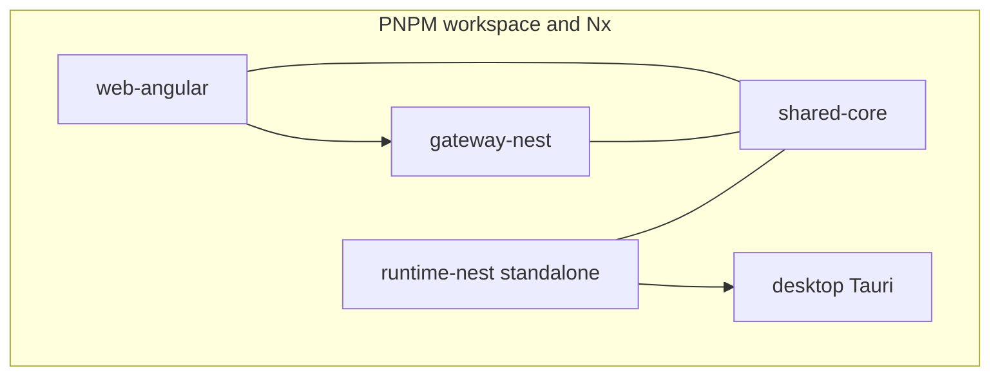
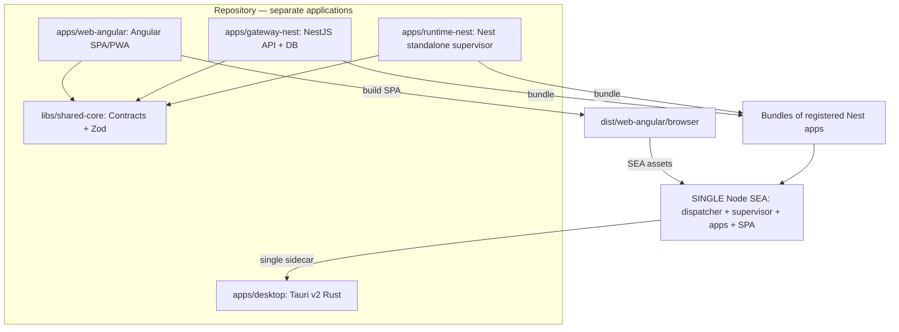
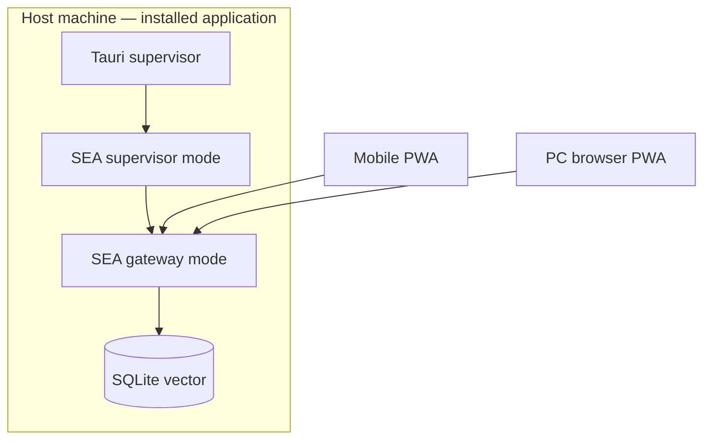

<!-- toon-meta
fmt: TOON
doc: docs/requirements/01-purpose-and-scope.md
title: Purpose and Scope
type: requirement
summary: "Defines the template purpose, scope, installed topology and out-of-scope items."
ids[0]:
related[2]: docs/requirements/README.md,docs/requirements/02-technology-baseline.md
status: current
updated: 2026-10-30
-->

# Purpose and Scope (SRS §1)

[Home](../../README.md) | [Requirements](README.md) | [Architecture](../architecture/overview.md) | [Standards](../standards/README.md) | [Roadmap](../roadmap/PROPOSAL.md) | [Traceability](traceability.md) | [Backlog](../backlog/README.md)

[Up](README.md) | [Next](02-technology-baseline.md)

This page states why the template exists and what it covers. It holds the document header and keyword conventions. Next: [technology baseline](02-technology-baseline.md).

## Navigation

- [At a glance](#at-a-glance)
- [Document conventions](#document-conventions)
- [1. Purpose and scope](#1-purpose-and-scope)
  - [1.1 Guiding principle: sibling applications in code, a single HTTP origin in production](#11-guiding-principle-sibling-applications-in-code-a-single-http-origin-in-production)
  - [1.2 Installed runtime topology](#12-installed-runtime-topology)
  - [1.3 Out of scope for the first delivery](#13-out-of-scope-for-the-first-delivery)

---

## At a glance

[Back to navigation](#navigation)

| Topic | Point |
|---|---|
| Purpose | Verifiable base template for LAN-first commercial apps |
| Code | Sibling apps in `apps/`; shared contracts in `libs/shared-core` |
| Runtime | One SEA per platform; one HTTPS origin on `8443` |
| Out of scope | Business apps, cloud, multi-tenancy, default LLM |
| In scope, last | Cross-platform CI, synchronized versioning, GitHub Releases |

---

## Document conventions

[Back to navigation](#navigation)

**LAN Solution Template — System Requirements Specification (SRS)**

| Field | Value |
|---|---|
| Project | `lan-solution-template` |
| Type | Commercial, cross-platform, LAN-first and offline-capable GitHub Template Repository |
| Document version | 1.6 — normative CI/CD sequence, reproducible ECOs and releases from a versioned SHA |
| Reference date | 2026-10-29 |
| Status | Bootstrap specification for an empty repository; implementation and acceptance contract |

> **Conventions.** This document uses **MUST / MUST NOT / SHOULD / MAY** with the meaning given in [RFC 2119](https://www.rfc-editor.org/rfc/rfc2119) and [RFC 8174](https://www.rfc-editor.org/rfc/rfc8174). Its organization follows [ISO/IEC/IEEE 29148:2018](https://www.iso.org/standard/72089.html), its quality attributes are inspired by [ISO/IEC 25010:2023](https://www.iso.org/standard/78176.html), and its application controls are drawn from [OWASP ASVS 5.0.0](https://owasp.org/projects/asvs). **These references are engineering guides, not a claim of certification or full compliance.**

---

## 1. Purpose and scope

[Back to navigation](#navigation)

Build a **verifiable and reusable base template** for commercial applications.

- The applications install on a host computer.
- They serve one Angular interface and a NestJS API to local network clients.
- They need no Internet services.

---

### 1.1 Guiding principle: sibling applications in code, a single HTTP origin in production

**Angular, the Nest gateway and the Nest Standalone supervisor MUST be sibling applications** inside `apps/`. They have independent sources, configuration and Nx targets. **NestJS MUST NOT contain Angular sources** nor start the Angular dev-server. **The union happens exclusively at build/distribution time.** A **single SEA per platform/architecture** packages the registered Nest entrypoints. It also packages their dependencies and the compiled Angular static assets. Do not produce a separate Node executable per application.

**Separate the executable file from the process:**

- One physical SEA file can run several times.
- Each run has its own Node runtime and DI container.
- The **only public HTTP entry point of the LAN** remains the HTTPS gateway.
- Other Nest processes may exist internally.
- The supervisor does not publish HTTP.

**Diagram interpretation:**

- Angular → gateway means HTTP use in development and compiled assets at build time.
- It does not mean source imports.
- The single assembled SEA ships to Tauri. `runtime-nest` is its default entry.
- `auth-ms` in later diagrams shows extensibility.
- Today it does not require a fictitious authentication service.

---

### 1.2 Installed runtime topology

- **A single Angular build.** The HTTPS gateway process serves it to the Tauri WebView.
- It also serves desktop browsers and mobile devices.
- No second local SPA exists in Tauri.
- **A single physical SEA.** Tauri starts it in supervisor mode.
- The supervisor relaunches that same file with a validated application identity.
- The baseline starts only `gateway-nest`.
- **Same origin in production.** `https://IP-or-hostname:8443/` hosts `/api/**` and the PWA.
- The PWA covers manifest, assets, service worker and Angular routes.
- **LAN-first:** without Internet the gateway, the SPA and local persistence MUST keep working. PWA clients without a connection to the gateway do **not** guarantee offline business operations.
- **Offline AI.** Local vector search is mandatory.
- Do not impose an LLM provider or cloud dependencies in the template.

---

### 1.3 Out of scope for the first delivery

Out of scope:

- Business applications
- Multi-tenancy
- Synchronization between disconnected clients
- Cloud hosting
- Fictitious Module Federation remotes
- Enterprise MDM provisioning
- Commercial code-signing certificates
- The choice of a default LLM

In scope, as the final phase: **cross-platform CI, synchronized versioning and GitHub Releases**.

They start only once the base of the applications is verified.
