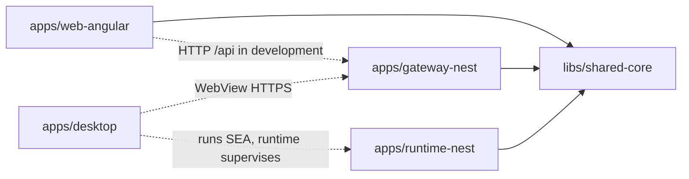

<!-- toon-meta
fmt: TOON
doc: docs/requirements/03-file-structure.md
title: File Structure
type: requirement
summary: Defines the expected repository layout and allowed code dependencies.
ids[5]: REQ-REP-01,REQ-REP-02,REQ-REP-03,REQ-REP-04,REQ-REP-05
related[3]: docs/requirements/README.md,docs/requirements/02-technology-baseline.md,docs/requirements/04-configuration.md
status: current
updated: 2026-10-30
-->

# File Structure (SRS §3)

[Home](../../README.md) | [Requirements](README.md) | [Architecture](../architecture/overview.md) | [Standards](../standards/README.md) | [Roadmap](../roadmap/PROPOSAL.md) | [Traceability](traceability.md) | [Backlog](../backlog/README.md)

[Previous](02-technology-baseline.md) | [Up](README.md) | [Next](04-configuration.md)

Repository layout and code dependencies. Next: [configuration](04-configuration.md).

## Navigation

- [At a glance](#at-a-glance)
- [3. Expected file structure (normative)](#3-expected-file-structure-normative)
  - [3.1 Allowed code dependencies](#31-allowed-code-dependencies)

---

## At a glance

[Back to navigation](#navigation)

| Topic | Point |
|---|---|
| Apps | `desktop`, `gateway-nest`, `runtime-nest`, `web-angular` under `apps/` |
| Shared | Contracts in `libs/shared-core`; no Angular or Nest imports |
| CI | Workflow comes last; calls root scripts only |

---

## 3. Expected file structure (normative)

[Back to navigation](#navigation)

```text
lan-solution-template/
├── .github/workflows/ci-cd.yml    # Final phase: CI + release
├── apps/
│   ├── desktop/                    # Tauri v2: src-tauri, supervision, tray
│   ├── gateway-nest/               # Nest: API, persistence, TLS, SEA serving
│   ├── runtime-nest/               # Nest Standalone: SEA process supervisor
│   └── web-angular/                # Angular standalone: SPA/PWA, dev proxy
├── libs/
│   └── shared-core/
│       └── src/
│           ├── validation/
│           └── index.ts
├── tools/
│   └── scripts/
│       └── compile-sea.ts
├── nx.json
├── pnpm-workspace.yaml
├── package.json
├── pnpm-lock.yaml                  # Reproducibility
├── tsconfig.base.json
└── README.md
```

- **REQ-REP-01.** The four projects in `apps/` **MUST** exist at the same level (`desktop`, `gateway-nest`, `runtime-nest`, `web-angular`). Angular source code **MUST NOT** live inside `gateway-nest/`. Compiled assets are likewise not committed under its source tree. Future Nest microservices **MUST** be sibling projects, not executable subfolders of the gateway.
- **REQ-REP-02.** `shared-core` may export Zod/TypeScript contracts. It **MUST NOT** import `@angular/*` or `@nestjs/*`. It **MUST NOT** contain Nest-specific server logic.
- **REQ-REP-03.** Internal folders (`src/`, `src-tauri/`, `public/`, `proxy.conf.*`, `project.json`, etc.) **MAY** be added according to official tooling. Do not read the tree above as a prohibition on generated files that are needed.
- **REQ-REP-04.** `.github/workflows/ci-cd.yml` **MUST** be implemented as the last phase. Do it after the local scripts and the reproducible build are complete. Its content **MUST NOT** duplicate internal Nx, Jest, Playwright or Tauri commands. Every project operation is invoked through scripts in the root `package.json`.
- **REQ-REP-05.** Contracts, commands, security boundaries, network topology and per-platform compilation **MUST** be documented.

### 3.1 Allowed code dependencies



| Interpretation | Meaning |
|---|---|
| Solid arrow | Allowed import into `shared-core` |
| Dotted arrow | Runtime interaction, not an import between applications |
| Moving `dist/web-angular` | **Nx task** dependency, not a source import |
| Packaging Nest entrypoints into the SEA | **Nx task** dependency, not a source import |
