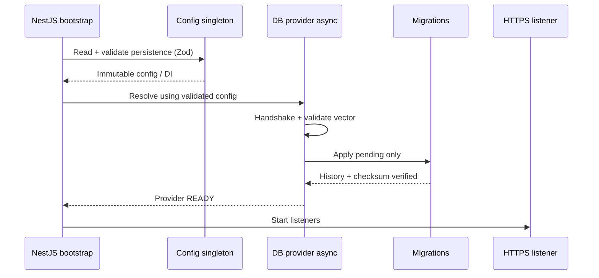

<!-- toon-meta
fmt: TOON
doc: docs/requirements/04-configuration.md
title: Configuration
type: requirement
summary: "Describes how configuration is validated, injected and gates persistence initialization."
ids[6]: REQ-CFG-01,REQ-CFG-02,REQ-CFG-03,REQ-CFG-04,REQ-CFG-05,REQ-CFG-06
related[3]: docs/requirements/README.md,docs/requirements/03-file-structure.md,docs/requirements/05-persistence.md
status: current
updated: 2026-10-30
-->

# Configuration (SRS §4)

[Home](../../README.md) | [Requirements](README.md) | [Architecture](../architecture/overview.md) | [Standards](../standards/README.md) | [Roadmap](../roadmap/PROPOSAL.md) | [Traceability](traceability.md) | [Backlog](../backlog/README.md)

[Previous](03-file-structure.md) | [Up](README.md) | [Next](05-persistence.md)

Configuration validation and injection. Next: [persistence](05-persistence.md).

## Navigation

- [At a glance](#at-a-glance)
- [4. Configuration and dependency between initializations](#4-configuration-and-dependency-between-initializations)

## At a glance

[Back to navigation](#navigation)

| Topic | Point |
|---|---|
| Source | Persistent config, validated with Zod 4 |
| Access | Immutable singleton through DI; one per process |
| Env | `.env` for development and CI only |
| Location | Real `config.json` under the resolved root |
| Order | Persistence starts after config validates |

## 4. Configuration and dependency between initializations

[Back to navigation](#navigation)

**REQ-CFG-01.** Application configuration in production **MUST** have four properties. It is persistent. Zod 4 validates it. Namespaces organize it. It is exposed as an **immutable singleton through NestJS DI**.

**REQ-CFG-02.** The rest of the application **MUST NOT** read configuration files directly or access unvalidated values. It **MUST** consume the singleton. Concrete reference: `https://github.com/virgenherrera/nest-base#namespaced-configuration-workflow`. Inspect the source code of the namespaced classes, their registration, freezing and injection. **Carry the conceptual pattern over to persisted configuration (do not require `.env`).** Do not copy dependencies incompatible with Nest 11. Do not assume it is a packaged library.

**REQ-CFG-03.** `.env` **MAY** be used in development and CI. It **MUST NOT** be mandatory on the installed host. CLI arguments **MUST** be validated. HTTP payloads **MUST** go through strict Zod schemas that reject unknown fields. Angular must not receive persisted server configuration secrets.

**REQ-CFG-04.** Persistence initialization **MUST** explicitly depend on the validated configuration. It uses the normal DI graph and asynchronous initialization (`DrizzleModule.forRootAsync` or an equivalent supported composition). An additional configuration/migrations orchestrator is **not** required. **The process supervisor is a distinct case.** It starts and watches Nest apps. It does not replace each app's own DI and lifecycle.

**REQ-CFG-05.** Data, logs, certificates, secrets and configuration **MUST** be stored outside the executable. They belong in the appropriate Windows, macOS or Linux directories. They **MUST NOT** depend on `~/.lan-template/` as a universal path. The install path holds only read-only defaults. The defaults contain no secrets. The paths library resolves the root once. The real `config.json` **MUST** reside under that root (human decision 11). The application installs where each OS expects it. In the SEA and the dev server, the code uses paths relative to that root. It **MUST NOT** use the current working directory as the anchor. The Windows install scope is pending [OQ16](../roadmap/PROPOSAL.md#open-questions). Directories **MUST** be created with `0700` permissions and secret files with `0600` on POSIX. On Windows, use an owner-only ACL (recipe not verified). Secrets **SHOULD** use secure system mechanisms when available.

**REQ-CFG-06.** The immutable configuration singleton is created **per process/DI container** (supervisor, gateway or microservice). It **MUST NOT** assume shared memory or a shared singleton between processes. Processes validate their namespace from the persisted configuration. They coordinate state exclusively through explicit contracts. The supervisor may validate the startup metadata. It must **not** carry secrets through CLI arguments.

