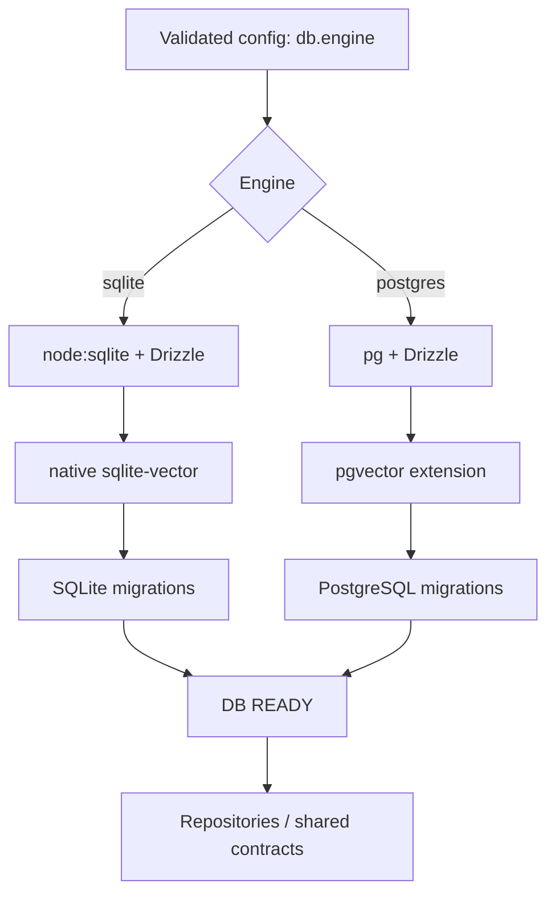

<!-- toon-meta
fmt: TOON
doc: docs/requirements/05-persistence.md
title: Persistence
type: requirement
summary: Defines persistence requirements for SQLite and PostgreSQL adapters and migrations.
ids[9]: REQ-DB-01,REQ-DB-02,REQ-DB-03,REQ-DB-04,REQ-DB-05,REQ-DB-06,REQ-DB-07,REQ-DB-08,REQ-DB-09
related[3]: docs/requirements/README.md,docs/requirements/04-configuration.md,docs/requirements/06-web-gateway-https-pwa.md
status: current
updated: 2026-10-30
-->

# Persistence (SRS §5)

[Home](../../README.md) | [Requirements](README.md) | [Architecture](../architecture/overview.md) | [Standards](../standards/README.md) | [Roadmap](../roadmap/PROPOSAL.md) | [Traceability](traceability.md) | [Backlog](../backlog/README.md)

[Previous](04-configuration.md) | [Up](README.md) | [Next](06-web-gateway-https-pwa.md)

Database adapters and startup order. Next: [web gateway, HTTPS and PWA](06-web-gateway-https-pwa.md).

## Navigation

- [At a glance](#at-a-glance)
- [5. Persistence, vectors and migrations](#5-persistence-vectors-and-migrations)

## At a glance

[Back to navigation](#navigation)

| Topic | Point |
|---|---|
| Adapters | SQLite (default) and PostgreSQL |
| Vectors | `sqlite-vector` and `pgvector` |
| Schemas | Own schemas and migrations per engine |
| Migrator | In-house, at startup; no `drizzle-kit` |
| Order | config → adapter → connection → vector → migrations → DB ready → gateway ready |

## 5. Persistence, vectors and migrations

[Back to navigation](#navigation)

**REQ-DB-01.** The gateway **MUST** provide two adapters through the Strategy Pattern:
- **Default:** SQLite (`node:sqlite` + `drizzle-orm/node-sqlite`) with native `sqlite-vector`.
- **Alternative:** PostgreSQL (`pg` + Drizzle) with `pgvector`.

**REQ-DB-02.** The selection **MUST** come from the validated configuration singleton. Domain consumers **MUST** depend on ports/contracts and **MUST NOT** import the chosen adapter directly.

**REQ-DB-03.** Each engine **MUST** maintain its own SQL schemas and migrations. Do not assume that `sqliteTable` and `pgTable` are interchangeable. Vector operations **MUST** offer a shared contract, with dialect-specific SQL where appropriate.

**REQ-DB-04.** `drizzle-kit` **MUST NOT** be installed or run in this template. Migrations **MUST** meet three conditions. They are versioned as SQL/TypeScript. The application packages them. They run automatically **during Nest initialization**, before readiness is published.

**REQ-DB-05.** The in-house migrator **MUST** do four things. It reads the persistent history (`version`, `checksum`, `applied_at`). It applies only pending migrations in order. It detects changes to migrations already applied. It fails explicitly on inconsistencies. It **MUST** define locking/concurrency and transactionality for each engine. Migrations **MUST NOT** be considered applied before they are confirmed.

**REQ-DB-06.** The startup dependency order **MUST** be: `validated config → resolve adapter → open connection/handshake → load/verify vector capability → verify/apply migrations → publish DB ready → publish gateway ready`.

**REQ-DB-07.** SQLite **SHOULD** enable `foreign_keys`, evaluate `WAL` and set an explicit durability policy. It **MUST** store `.db`, WAL and SHM outside the SEA.

**REQ-DB-08.** The vector adapter **MUST** demonstrate insertion and similarity query without Internet on SQLite and PostgreSQL. It **MUST NOT** silently fall back to non-vector searches when the extension is missing. On PostgreSQL, the permissions needed to install `pgvector` **MUST** be detected and diagnosed.

**REQ-DB-09.** The SQLite native library **MUST** exist as a real file before `loadExtension()`. If it is packaged as a SEA asset, it **MUST** meet three conditions. Extract it to a controlled location. Validate its integrity. Load only the variant matching the OS/architecture. It **MUST NOT** run arbitrary extensions supplied by clients.

