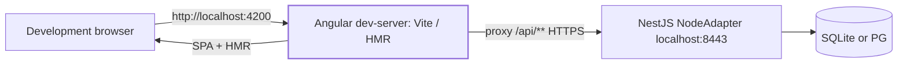
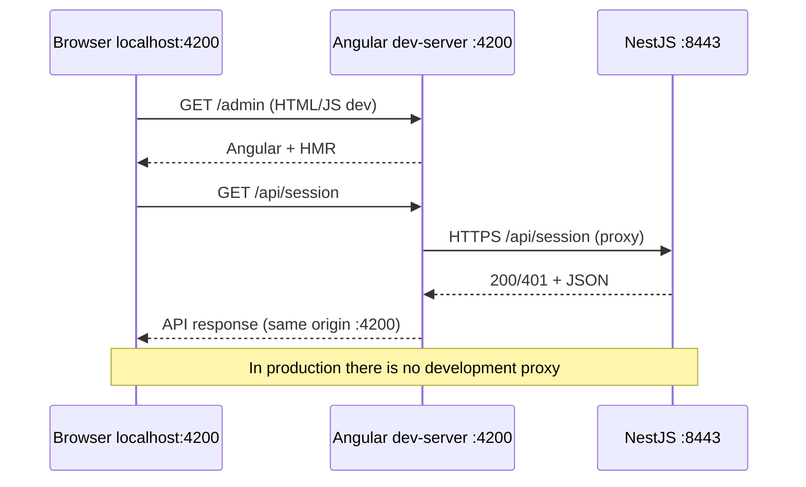
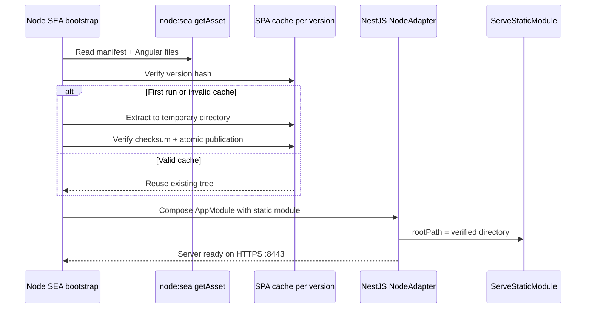
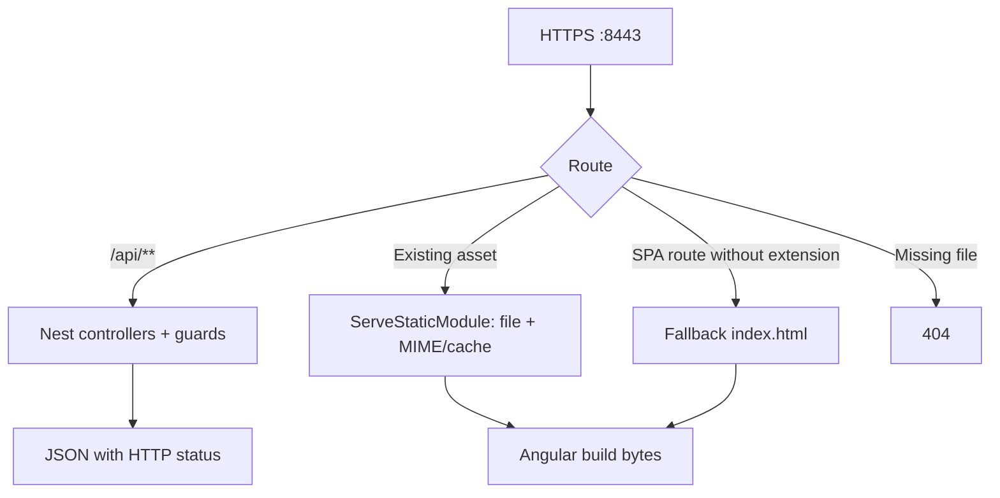
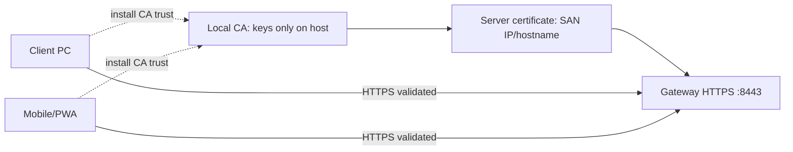
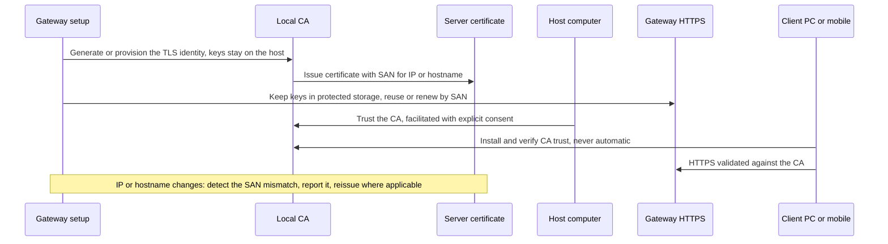
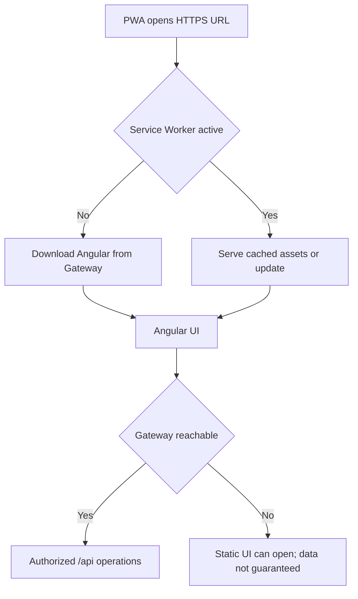

<!-- toon-meta
fmt: TOON
doc: docs/requirements/06-web-gateway-https-pwa.md
title: "Web Gateway, HTTPS and PWA"
type: requirement
summary: "Defines dev proxy, SEA static serving, LAN TLS and PWA caching requirements."
ids[20]: REQ-DEV-01,REQ-DEV-02,REQ-DEV-03,REQ-DEV-04,REQ-DEV-05,REQ-NET-01,REQ-NET-02,REQ-NET-03,REQ-NET-04,REQ-NET-05,REQ-NET-06,REQ-NET-07,REQ-NET-08,REQ-TLS-01,REQ-TLS-02,REQ-TLS-03,REQ-TLS-04,REQ-PWA-01,REQ-PWA-02,REQ-PWA-03
related[3]: docs/requirements/README.md,docs/requirements/05-persistence.md,docs/requirements/07-security.md
status: current
updated: 2026-10-30
-->

# Web Gateway, HTTPS and PWA (SRS §6)

[Home](../../README.md) | [Requirements](README.md) | [Architecture](../architecture/overview.md) | [Standards](../standards/README.md) | [Roadmap](../roadmap/PROPOSAL.md) | [Traceability](traceability.md) | [Backlog](../backlog/README.md)

[Previous](05-persistence.md) | [Up](README.md) | [Next](07-security.md)

This page covers the development proxy, SEA serving, LAN TLS and PWA caching. Next: [security](07-security.md).

## Navigation

- [At a glance](#at-a-glance)
- [6. Development, web packaging, LAN gateway, HTTPS and PWA](#6-development-web-packaging-lan-gateway-https-and-pwa)
  - [6.1 Development: independent apps + proxy (DX with HMR)](#61-development-independent-apps--proxy-dx-with-hmr)
  - [6.2 Production: a single SEA serves both compiled artifacts](#62-production-a-single-sea-serves-both-compiled-artifacts)
  - [6.3 Local LAN TLS, no cost and no Internet dependency](#63-local-lan-tls-no-cost-and-no-internet-dependency)
  - [6.4 PWA and caching strategy](#64-pwa-and-caching-strategy)

---

## At a glance

[Back to navigation](#navigation)

| Topic | Point | Section |
|---|---|---|
| Development | `ng serve` on `4200` proxies `/api/**` to Nest on `8443` | [6.1](#61-development-independent-apps--proxy-dx-with-hmr) |
| Production | One SEA serves the API and the compiled SPA on one origin | [6.2](#62-production-a-single-sea-serves-both-compiled-artifacts) |
| HTTP | Port `8080` redirects to HTTPS with `308` | [6.2](#62-production-a-single-sea-serves-both-compiled-artifacts) |
| LAN TLS | Local CA and gateway certificate; clients install CA trust | [6.3](#63-local-lan-tls-no-cost-and-no-internet-dependency) |
| PWA | Installable; `index.html` and service worker revalidate; hashed files are immutable | [6.4](#64-pwa-and-caching-strategy) |

---

## 6. Development, web packaging, LAN gateway, HTTPS and PWA

[Back to navigation](#navigation)

---

### 6.1 Development: independent apps + proxy (DX with HMR)

- **REQ-DEV-01.** `web-angular` **MUST** start its own `ng serve` (default `127.0.0.1:4200`) with HMR and incremental compilation. `api-gateway` **MUST** start independently on its API port (default HTTPS `127.0.0.1:8443`).
- **REQ-DEV-02.** Configure the **`proxyConfig` of the Angular dev-server** (`@angular/build:dev-server`, Vite-based). Use it to forward **`/api/**`** to the Nest gateway **without changing origin in the browser**. The proxy **MUST NOT** redirect SPA routes or HMR to Nest.
- **REQ-DEV-03.** The Angular application **MUST** call relative routes (`/api/...`) in development and production. It **MUST NOT** contain hardcoded LAN IPs/hosts or different API URLs in each component.
- **REQ-DEV-04.** For TLS development, the local CA/certificate **MUST** be trusted by the proxy process; `secure: false` **MUST NOT** be used as the template's final configuration. If a temporary development unlock exists, it must be explicitly documented as **insecure and not distributable**.
- **REQ-DEV-05.** `@nestjs/serve-static` **MUST NOT** be mounted on the development gateway; Angular is served exclusively by `ng serve`. SEA/Tauri is **not** required to iterate on Angular or Nest.





**Conceptual Angular proxy example.** The agent **MUST** adapt the format to the real builder and certify the result. Do not fix this sample as its own API:

```json
{
  "/api/**": {
    "target": "https://localhost:8443",
    "secure": true,
    "changeOrigin": true
  }
}
```

---

### 6.2 Production: a single SEA serves both compiled artifacts

- **REQ-NET-01.** NestJS **MUST** use `NodeAdapter` from `@nestjs/platform-node`, without Express or Fastify. The API and the SPA **MUST** share process and HTTPS origin in production. *(Premise `NodeAdapter` + `ServeStaticModule` without Express/Fastify: not verified.)*
- **REQ-NET-02.** **Only when `node:sea.isSea()` is `true`**, the Gateway **MUST** enable `ServeStaticModule`. Use `@nestjs/serve-static` **(>=12.1.1, a compatible pinned version)** with support for `@nestjs/platform-node >=12.3.1`. In a development run, it is not enabled.
- **REQ-NET-03.** `@nestjs/serve-static` needs **`rootPath` as a real directory**. `node:sea.getAsset()` does not by itself produce a browsable filesystem. Therefore, before creating the Nest context, the bootstrap **MUST** materialize the packaged Angular tree. The source is the SEA assets. The target is a **per-version/build-ID cache outside the executable**.
- **REQ-NET-04.** Materialization **MUST** be safe. Validate manifest + checksums. Prevent `../` traversal. Prevent overwriting unmanaged paths. Write to a temporary location and publish atomically. Handle concurrent extraction. Use minimal permissions. Clean up obsolete versions. If the tree already matches the manifest, reuse it without re-extracting.
- **REQ-NET-05.** After materialization, `ServeStaticModule.forRoot({ rootPath: <verified-directory> })` **MUST** be configured through Nest module composition done before `NestFactory.create()`. Do **not** instantiate the module afterwards as a dynamic step. Do not add a generic hook orchestrator either.
- **REQ-NET-06.** The HTTPS listener **MUST** use `8443` by default, configurable from the singleton; `0.0.0.0` LAN exposure is configured on the installed server and the API is served under `/api/**`. SPA, manifest, service worker and API use the same origin.
- **REQ-NET-07.** Requests to `/api/**` **MUST NOT** receive `index.html` as the SPA fallback. Valid Angular routes may receive the fallback. Missing files (`.js`, `.css`, `.wasm`, manifests, icons) **MUST** respond `404`, not HTML. Implement correct headers/MIME/cache.
- **REQ-NET-08.** A minimal HTTP listener on `8080` **MUST** redirect to HTTPS `:8443` using **308**. Do not serve data or authentication over HTTP. Validate the redirect target and avoid open redirects with a malicious `Host`.





---

### 6.3 Local LAN TLS, no cost and no Internet dependency

- **REQ-TLS-01.** The setup **MUST** generate/provision a TLS identity for **this gateway**, keep keys in protected persistent storage and reuse/renew according to SAN and identity. The certificate **identifies hostname/IP, never the port**; HTTPS is served only on the listeners the app opens.
- **REQ-TLS-02.** TLS trust on the host computer **SHOULD** be facilitated with explicit consent. Mobile devices and client PCs require installing/verifying trust of the corresponding CA/certificate. The system **MUST NOT** promise automatic trust between devices.
- **REQ-TLS-03.** The setup **MUST NOT** do four things. It never alters the HTTPS servers or configuration of other LAN devices. It never distributes private keys. It never uses `rejectUnauthorized=false`. It never disables certificate validation in production.
- **REQ-TLS-04.** If the IP/hostname changes, the system **MUST** do three things. It detects the SAN mismatch. It reports it clearly. It reissues the certificate where applicable. Document how to establish trust on iOS, Android, Windows and macOS, including PWA requirements.





---

### 6.4 PWA and caching strategy

- **REQ-PWA-01.** Angular **MUST** produce an installable PWA where the OS/browser allow it, with `manifest.webmanifest`, icons, a service worker and a trusted HTTPS context. It **MUST NOT** include HMR/debug in the distribution.
- **REQ-PWA-02.** The gateway **MUST** differentiate two cache classes. The cache of `index.html` and the service worker is revalidatable. Files with hash-based names are immutable. Keep version consistency between manifest, assets and service worker.
- **REQ-PWA-03.** Mobile devices/PCs **MUST** be able to open `https://IP-or-hostname:8443/` without public Internet. Do **not** require public DNS. Do not promise access to mutable data if the client lost its gateway connection.


