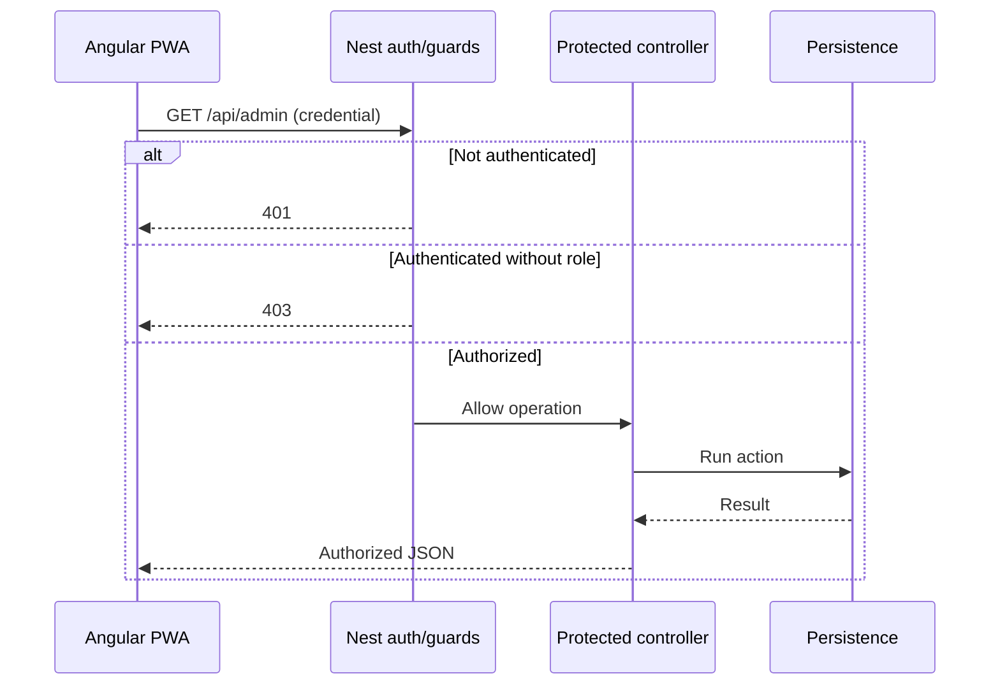

<!-- toon-meta
fmt: TOON
doc: docs/requirements/07-security.md
title: Security
type: requirement
summary: "Defines default security posture for authorization, privileges and secret handling."
ids[6]: REQ-SEC-01,REQ-SEC-02,REQ-SEC-03,REQ-SEC-04,REQ-SEC-05,REQ-SEC-06
related[3]: docs/requirements/README.md,docs/requirements/06-web-gateway-https-pwa.md,docs/requirements/08-web-angular.md
status: current
updated: 2026-10-30
-->

# Security (SRS §7)

[Home](../../README.md) | [Requirements](README.md) | [Architecture](../architecture/overview.md) | [Standards](../standards/README.md) | [Roadmap](../roadmap/PROPOSAL.md) | [Traceability](traceability.md) | [Backlog](../backlog/README.md)

[Previous](06-web-gateway-https-pwa.md) | [Up](README.md) | [Next](08-web-angular.md)

Default security posture. Next: [Angular web](08-web-angular.md).

## Navigation

- [At a glance](#at-a-glance)
- [7. Security by default](#7-security-by-default)

## At a glance

[Back to navigation](#navigation)

| Topic | Point |
|---|---|
| Trust | LAN untrusted; NestJS authorizes every protected operation |
| Roles | `public`, `employee`, `admin` |
| Seed | `dev-admin` in development only; none in production |
| Secrets | Out of logs, bundles and LAN clients |
| Tauri | Restricted IPC; no shell for the LAN frontend |

## 7. Security by default

[Back to navigation](#navigation)

**REQ-SEC-01.** Treat the LAN as untrusted. Every protected operation **MUST** be authenticated and authorized in NestJS. Angular guards and UI hiding **MUST NOT** be the only authorization control.

**REQ-SEC-02.** Provide a minimal micro-POC of the roles `public`, `employee` and `admin` (without creating permanent default credentials). In development only, startup **MAY** seed a self-destructing super user after migrations, if no real admin exists. The seed **MUST** use the same user-creation path as production, so no code path skips authentication. The account is named `dev-admin` (never `admin` or `root`). Its password is random, at least 15 characters, shown once and never fixed. The server **MUST** enforce expiry: the row carries `expires_at` and a bootstrap mark, authentication rejects an expired account, and a startup purge deletes it. The row is also deleted when the first real admin is created or after the first login with a forced password change. Production **MUST NOT** seed any account. The database is the only source of truth for identity and permissions (ASVS 5.0.0 6.3.2 and 6.4.1; citation not verified). Tests **MUST** demonstrate `401/403` where appropriate and authorized access where appropriate.

**REQ-SEC-03.** Angular chunks **SHOULD** be lazy-loaded per feature/role. They **MUST NOT** be assumed to protect data or secrets by hiding or preventing the download of a `.js` file. Secrets **MUST NOT** be embedded in browser bundles.

**REQ-SEC-04.** Keep the API and the frontend on the same origin whenever possible. Apply strict validation, size limits, defenses against authentication abuse and minimal permission configuration.

**REQ-SEC-05.** Tauri **MUST** restrict IPC commands and privileged capabilities. The LAN-served frontend **MUST NOT** receive shell/sidecar privileges by display alone in the Tauri WebView.

**REQ-SEC-06.** Certificates, keys and tokens **MUST NOT** be written to logs or embedded in the binary as fixed secrets. The TLS private key **MUST NOT** be distributed to LAN clients.

