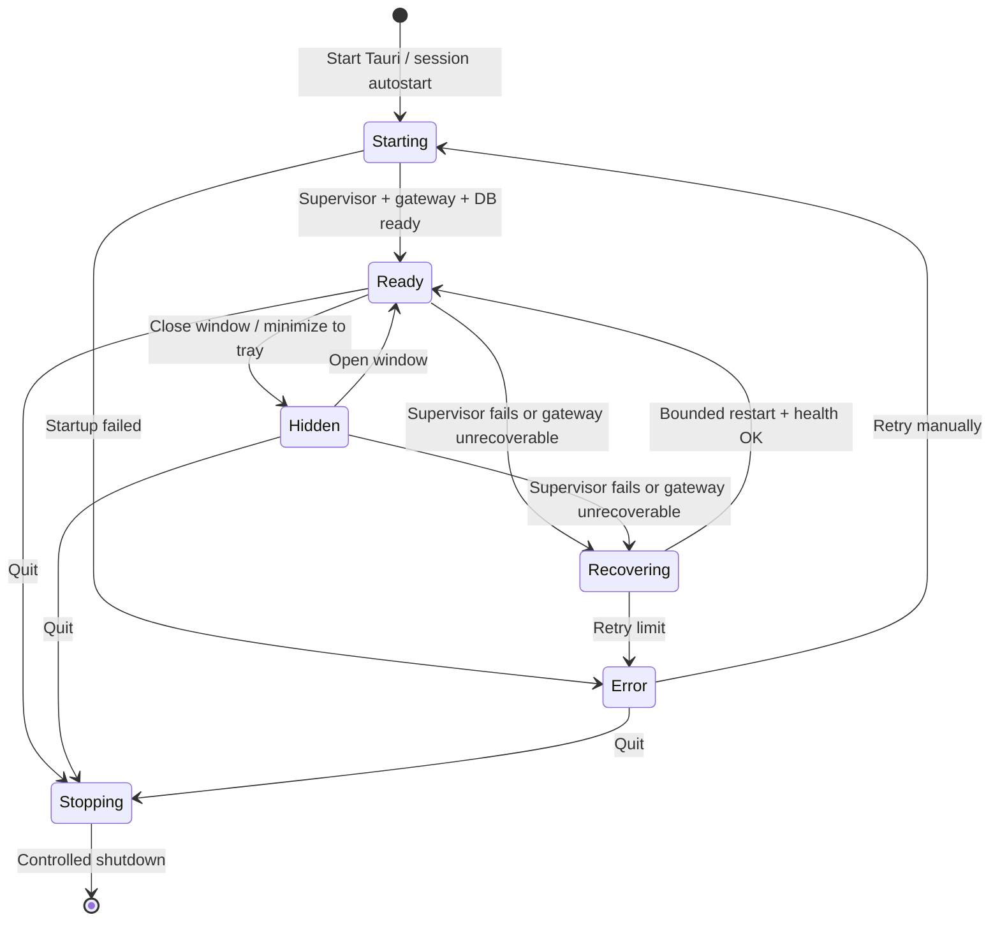
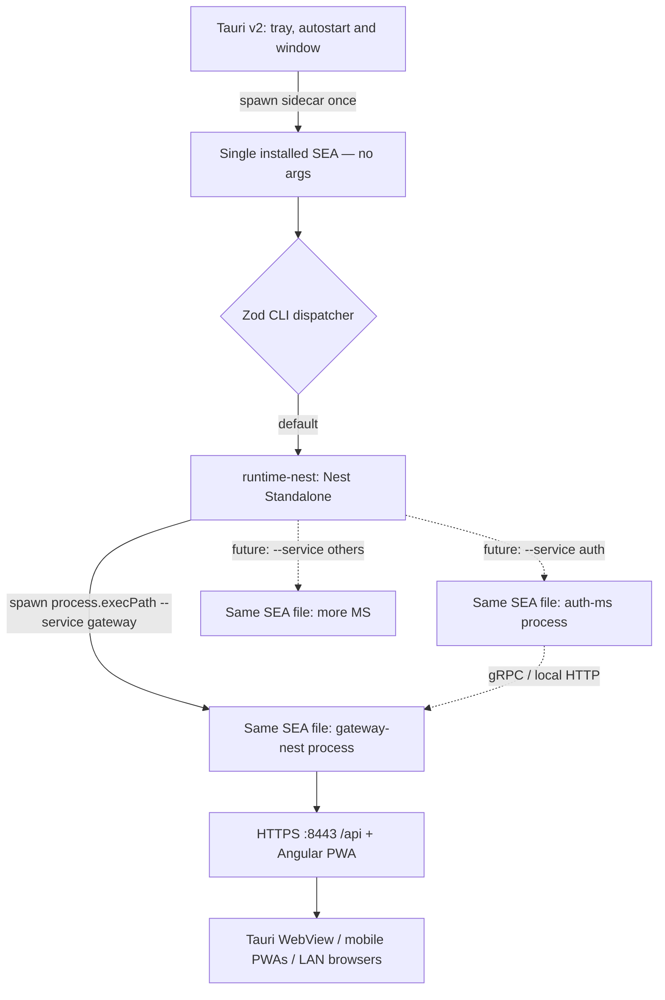
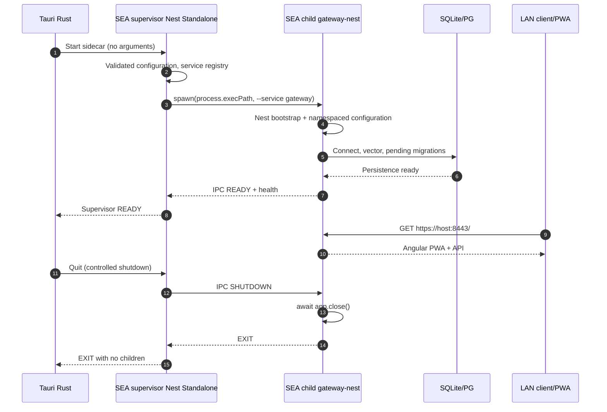
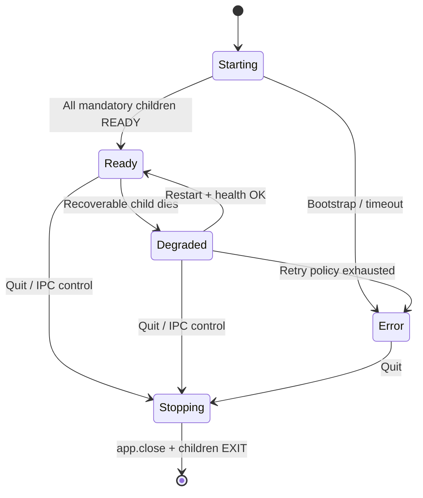

<!-- toon-meta
fmt: TOON
doc: docs/requirements/09-desktop-tauri.md
title: Desktop Tauri and processes
type: requirement
summary: Tauri desktop shell and multiprocess runtime rules for the SEA supervisor.
ids[14]: REQ-DESK-01,REQ-DESK-02,REQ-DESK-03,REQ-DESK-04,REQ-DESK-05,REQ-DESK-06,REQ-RUNTIME-01,REQ-RUNTIME-02,REQ-RUNTIME-03,REQ-RUNTIME-04,REQ-RUNTIME-05,REQ-RUNTIME-06,REQ-RUNTIME-07,REQ-RUNTIME-08
related[3]: docs/requirements/README.md,docs/requirements/08-web-angular.md,docs/requirements/10-node-sea-distribution.md
status: current
updated: 2026-10-30
-->

# 9. Desktop Tauri and processes

[Home](../../README.md) | [Requirements](README.md) | [Architecture](../architecture/overview.md) | [Standards](../standards/README.md) | [Roadmap](../roadmap/PROPOSAL.md) | [Traceability](traceability.md) | [Backlog](../backlog/README.md)

[Previous](08-web-angular.md) | [Up](README.md) | [Next](10-node-sea-distribution.md)

## Navigation

- [At a glance](#at-a-glance)
- [9. Desktop Tauri and processes](#9-desktop-tauri-and-processes)
  - [9.1 Multiprocess runtime — NestJS Standalone Application (normative)](#91-multiprocess-runtime--nestjs-standalone-application-normative)

---

## At a glance

[Back to navigation](#navigation)

| Topic | Point |
|---|---|
| Sidecar | Tauri v2 ships the Node SEA as one sidecar |
| Control | Tauri starts and stops the supervisor only; it manages Nest children |
| Tray | `starting`, `ready`, `error`; Quit stops everything |
| Launch | One SEA file relaunches per service with `--service <id>` |
| Network | Supervisor has no listeners; HTTPS gateway is the only HTTP entry |
| Next | [Node SEA distribution](10-node-sea-distribution.md) |

---

## 9. Desktop Tauri and processes

[Back to navigation](#navigation)

**REQ-DESK-01.** Tauri v2 **MUST** distribute the Node SEA through `bundle.externalBin` as a sidecar. Use binaries specific to each Windows/macOS/Linux `target triple`.

**REQ-DESK-02.** Tauri/Rust **MUST** start, monitor and stop **only the SEA supervisor process**. That supervisor **MUST** directly manage the Nest application processes. The WebView **MUST** show the **same Angular served from the gateway process**. It is not a second functional copy.

**REQ-DESK-03.** Integrate a System Tray with the states `starting/ready/error`. Add an action to open the interface. Add a **Quit** action for controlled termination. **Closing the window** **SHOULD** hide it to the tray without stopping the gateway. **Quit** **MUST** terminate the process and release resources.

**REQ-DESK-04.** Offer **autostart at OS session login**, preferably configurable by the user. **Do not** claim that this is a native service available before login.

**REQ-DESK-05.** Implement readiness/health-check and handling of an occupied port. Implement prevention of two instances per installation. Implement orphan child process handling, shutdown, and recovery from unexpected failure. **Tauri monitors the supervisor; the supervisor monitors each child.** Do not expose gateway and service secrets in process arguments visible to other users.

**REQ-DESK-06.** The host **MUST** remain operable from LAN clients even when the Tauri window is hidden. The supervisor and the gateway **MUST NOT** depend on the WebView staying open.

---

### 9.1 Multiprocess runtime — NestJS Standalone Application (normative)

**REQ-RUNTIME-01 — A single SEA file.** Build **exactly one SEA executable per OS/architecture** that embeds the dispatcher, the `runtime-nest` entrypoint, the `gateway-nest` entrypoint and, when they exist, those of other Nest projects. The Tauri installer **MUST** contain **a single physical instance of the SEA**, not a `node.exe` or a SEA per service. Installing Node on the host machine is not required.

**REQ-RUNTIME-02 — Supervisor without listeners.** `apps/runtime-nest/` **MUST** use `NestFactory.createApplicationContext(RuntimeModule)` and the native Nest providers (DI and lifecycle) to supervise children. It **MUST NOT** expose its own HTTP/gRPC/port; it is not a second gateway. `runtime-nest` is a real infrastructure app, not a fictitious business microservice.

**REQ-RUNTIME-03 — Re-entry of the same binary.** Tauri starts the SEA **without a service selector**, and it enters supervisor mode. The supervisor instance calls `child_process.spawn(process.execPath, ['--service', '<id>'], { shell: false, ... })` (or an equivalent API). This starts **the same physical executable** in app mode. A single dispatcher interprets `process.argv`. It validates `id` through Zod against a **closed service registry**. It runs only the corresponding packaged bootstrap. It **MUST NOT** try to use the SEA as an interpreter for foreign `.js` files. It **MUST NOT** depend on `node` from PATH, nor on `fork()`/`cluster.fork()` as a mandatory mechanism. The CLI selector **only identifies which bootstrap to launch**. It **never** grants authentication privileges or permissions to a service.

**REQ-RUNTIME-04 — Bootstrapping contracts.** Each Nest app **MUST** keep its own bootstrap and Nx build target. `gateway-nest` starts `NestFactory.create()` + `NodeAdapter`. A future `auth-ms` may use `createMicroservice()` (gRPC/TCP) or `create()` (HTTP). This does not change how Tauri distributes the product. Business applications **MUST NOT** directly import the source code of `runtime-nest`. Reusable contracts go to `libs/`.

**REQ-RUNTIME-05 — Readiness and health.** The supervisor **MUST** have a typed registry of enabled services, startup dependencies/priority when they exist, a readiness timeout, health, logs identified per service, and a bounded restart policy (*backoff* + maximum attempts). `runtime-nest` **MUST** report to Tauri an aggregate state `starting/ready/degraded/error/stopping`; the gateway **MUST NOT** announce readiness if mandatory processes that it depends on are not yet available. For the baseline only `gateway-nest` is enabled; it **MUST NOT** invent a test `auth-ms`.

**REQ-RUNTIME-06 — Cross-platform shutdown.** Use an explicit control channel, preferably **Node IPC over `stdio`**. Use it to order the child to run `app.close()` and wait for its termination. Then apply a timeout and forced termination. Also clean up descendants. Do not rely only on `SIGTERM` for a clean shutdown on **Windows**. The signal terminates the subprocess abruptly. The same sequence is triggered when Quit is chosen from Tauri. The system must tolerate an unexpected supervisor shutdown/crash without leaving orphan processes. It **MUST** verify the process tree on Windows, Linux and macOS.

**REQ-RUNTIME-07 — Persistence and limits.** Each process hosts its own DI and in-memory state. Persisted configuration and the DB must not be assumed to be shared-memory instances. Define a migration owner and locking on shared databases to prevent races. Internal services **SHOULD** listen on loopback or a local socket. An explicit, authenticated LAN requirement is the only exception. A single SEA allows *lockstep*, **not** independent deployment/versioning of microservices.

**REQ-RUNTIME-08 — Verifiable single binary.** An APP smoke test **MUST** run the real binary without arguments (supervisor). It must confirm that it relaunches the **same `process.execPath`** in gateway role. It must validate handshake/ready, HTTP/PWA, the death of a child, and bounded restart. It must also validate an unregistered-role error and orderly shutdown. It must validate the **absence of additional copies** of the runtime in the installer. These are not unit or isolated integration tests.

**Accepted trade-off:** duplication of executables/installers is reduced and per-process isolation is preserved. In exchange, each process keeps a Node runtime in memory. All embedded microservices share the release version. This is a local topology, not Kubernetes nor a deployment of independent services. **During development** `gateway-nest` **MAY** be started directly with watch/HMR behind the Angular proxy. Building the SEA or starting Tauri/supervisor is not required to iterate on the API.
