<!-- toon-meta
fmt: TOON
doc: docs/requirements/11-nx-quality-testing.md
title: "Nx, quality and testing"
type: requirement
summary: "Nx, quality and testing requirements: scripts, CI gates, test scopes and release versioning."
ids[78]: REQ-SEC-CI-01,REQ-SEC-CI-02,REQ-SEC-CI-03,REQ-SEC-CI-04,REQ-BUILD-01,REQ-BUILD-02,REQ-BUILD-03,REQ-BUILD-04,REQ-BUILD-05,REQ-TEST-01,REQ-TEST-02,REQ-TEST-03,REQ-TEST-04,REQ-TEST-05,REQ-TEST-06,REQ-TEST-07,REQ-TEST-08,REQ-TEST-09,REQ-TEST-10,REQ-ECO-01,REQ-ECO-02,REQ-ECO-03,REQ-ECO-04,REQ-ECO-05,REQ-ECO-06,REQ-ECO-07,REQ-REF-01,REQ-DEPS-01,REQ-DEPS-02,REQ-VERSION-01,REQ-VERSION-02,REQ-VERSION-03,REQ-CI-01,REQ-CI-02,REQ-CI-03,REQ-CI-04,REQ-CI-05,REQ-CI-06,REQ-CI-07,REQ-CI-08,REQ-CI-09,REQ-CI-10,AC-01,AC-02,AC-03,AC-04,AC-05,AC-06,AC-07,AC-08,AC-09,AC-10,AC-11,AC-12,AC-13,AC-14,AC-15,AC-16,AC-17,AC-18,AC-19,AC-20,AC-21,AC-22,AC-23,AC-24,AC-25,AC-26,AC-27,AC-28,AC-29,AC-30,AC-31,AC-32,AC-33,AC-34,AC-35,AC-36
related[3]: docs/requirements/README.md,docs/requirements/10-node-sea-distribution.md,docs/requirements/12-agent-delivery.md
status: current
updated: 2026-10-31
-->

# Nx, quality and testing (SRS §11)

[Home](../../README.md) | [Requirements](README.md) | [Architecture](../architecture/overview.md) | [Standards](../standards/README.md) | [Roadmap](../roadmap/PROPOSAL.md) | [Traceability](traceability.md) | [Backlog](../backlog/README.md)

[Previous](10-node-sea-distribution.md) | [Up](README.md) | [Next](12-agent-delivery.md)

## Navigation

- [At a glance](#at-a-glance)
- [11. Nx, quality and testing](#11-nx-quality-and-testing)
  - [11.0 Supply chain: fail safe from the start](#110-supply-chain-fail-safe-from-the-start)
  - [11.1 ECO contracts — monorepo scripts (normative)](#111-eco-contracts--monorepo-scripts-normative)
  - [11.2 Sibling repositories: intent references, not a dependency](#112-sibling-repositories-intent-references-not-a-dependency)
  - [11.3 Synchronized versions and semver from the PR branch](#113-synchronized-versions-and-semver-from-the-pr-branch)
  - [11.4 CI + GitHub Actions release: LAST phase](#114-ci--github-actions-release-last-phase)
    - [11.4.1 Normative pipeline: what CI runs and what CD runs](#1141-normative-pipeline-what-ci-runs-and-what-cd-runs)
      - [Diagram A — Complete mandatory sequence](#diagram-a--complete-mandatory-sequence)
      - [Diagram B — Timeline: PR, merge, version commit and release](#diagram-b--timeline-pr-merge-version-commit-and-release)
      - [Diagram C — Root ECOs and per-phase mapping](#diagram-c--root-ecos-and-per-phase-mapping)
  - [11.5 Minimum acceptance criteria of the template](#115-minimum-acceptance-criteria-of-the-template)
  - [11.6 Visual execution matrix per environment](#116-visual-execution-matrix-per-environment)

---

## At a glance

[Back to navigation](#navigation)

| Topic | Point | Section |
|---|---|---|
| Supply chain | `securityCheck` runs before the first build and fails closed | [11.0](#110-supply-chain-fail-safe-from-the-start) |
| Tests | One APP suite; `@ut` and `@int` are filters, not scripts | [11.0](#110-supply-chain-fail-safe-from-the-start) |
| ECO scripts | `build`, `test`, `package`, `securityCheck`; same names in root and packages | [11.1](#111-eco-contracts--monorepo-scripts-normative) |
| References | Sibling repos guide intent only; `bumpDependencies` and `test:doctor` stay TBD | [11.2](#112-sibling-repositories-intent-references-not-a-dependency) |
| Versions | One lockstep version; the PR branch prefix sets the bump | [11.3](#113-synchronized-versions-and-semver-from-the-pr-branch) |
| CI/CD | CI checks PRs; CD rebuilds the versioned SHA and publishes | [11.4](#114-ci--github-actions-release-last-phase) |
| Acceptance | AC-01 to AC-36 | [11.5](#115-minimum-acceptance-criteria-of-the-template) |
| Environments | Test each target OS on that OS | [11.6](#116-visual-execution-matrix-per-environment) |
| Next | [agent delivery](12-agent-delivery.md) |

---

## 11. Nx, quality and testing

[Back to navigation](#navigation)

---

### 11.0 Supply chain: fail safe from the start

**REQ-SEC-CI-01 — Early gate.** `securityCheck` **MUST** run before the first build. Run it again as a logical dependency of a standalone `pnpm test`. With pnpm, it **MUST** use an audit of **all** workspace dependencies (including dev/optional). The minimum threshold is `high`. No `high`/`critical` result without a formal remediation/decision may pass the pipeline. `pnpm audit --audit-level high` is the starting reference from `fullstack-base` (do not copy `securityFix: pnpm update` as an automatic repair).

**REQ-SEC-CI-02 — Fail-closed.** An audit query that fails because of a timeout, an unreachable registry/credentials or an incomplete result **MUST** stop CI and release. It **MUST NOT** use `--ignore-registry-errors`, `|| true`, `continue-on-error` or a stale cache as a "green audit". If an offline installation needs to operate, separate the install task from the security validation; do not report an offline audit without current data as passed. An audit before `install` over the lockfile **MAY** be added if it is shown that the pinned pnpm version supports it, and the audit after install always runs.

**REQ-SEC-CI-03 — Pre-build prevention.** `pnpm-workspace.yaml` **MUST** apply `minimumReleaseAge: 1440`, `allowBuilds` explicitly, `strictDepBuilds: true` and `dangerouslyAllowAllBuilds: false`. Verify their semantics in pnpm 12 first. It **MUST** forbid unauthorized install scripts by default. Review/pin the permitted ones for each real dependency. Do not import the allowlists of the sibling repo without inspection. Registry integrity/signatures **SHOULD** be verified if the registry offers that capability. Any bypass of the 24h window for urgent patches requires a documented and audited exception. The exception is never self-approved.

**REQ-SEC-CI-04 — Guarantee limit.** This gate protects against **known and published** vulnerabilities; it does **not** reliably detect zero-days not yet disclosed. Keep exact dependencies, a reproducible lockfile, minimal GitHub Actions permissions, secrets out of the PR, analysis of the Rust/Tauri tree and a release with hashes. Do not run `pnpm audit --fix`, `pnpm update` or silent dependency changes during CI. The optional Nx cache for CI **MUST NOT** accept results from untrusted PRs as sufficient evidence to publish a release; use trust boundaries and revalidate on the release SHA.

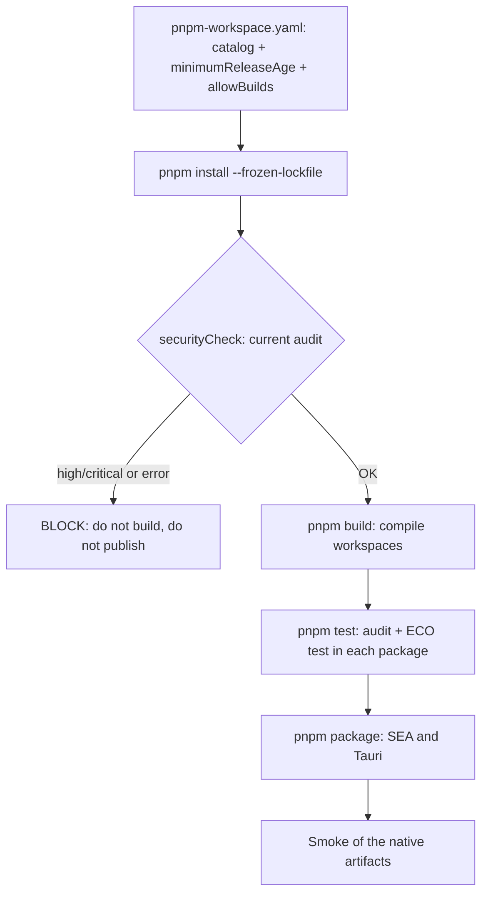

**REQ-BUILD-01.** Nx **MUST** run locally, without Nx Cloud. A local cache is mandatory; a remote cache for GitHub Actions **MAY** be added when a compatible, maintained plugin with secure artifact isolation exists. It **MUST NOT** assume that a package exists without verifying it.

**REQ-BUILD-02 — CI order and ECOs.** The public sequence of the root **MUST** be `install → securityCheck → build → test → package` (followed by CD only if the PR is merged). `test` **MUST** aggregate `test:static` + `test:dynamic` for each package, in that order per package; it does **NOT** run `package` nor replace `build`. Nx **MUST** model dependencies, outputs and cache without inventing aliases such as `build:sea`, `test:ut` or `pipeline:prebuild`. CI commands **MUST** be reproducible locally. `securityCheck` **MUST** finish successfully before the first build starts; it is a security barrier and not a parallel task. `test` revalidates security so that it also works standalone. `--nxBail` stops new tasks after a failure, but it is not equivalent to cancelling tasks that are already running. The global order does **NOT** imply serializing all workspaces: Nx **MAY** parallelize packages after the gate, respecting dependencies.

**REQ-BUILD-03.** **Mandatory** order modeled in Nx: `build` of `web-angular`, `sea-runtime`, `api-gateway` (and new declared services); the `package` of the SEA assembler consumes all their outputs, packages SPA + dispatcher + applications, and the `package` of `desktop` consumes the SEA and builds the installer. The `build` of the apps may run in parallel; **The `package` of the SEA MUST NOT start until all builds have finished successfully**. The targets are `build` and `package` in each project, without inventing alias scripts for each technology. Adding a microservice **MUST NOT** duplicate the Node executable.

**REQ-BUILD-04.** The `package` target of the assembler invokes `tools/scripts/compile-sea.ts`. That script **MUST** do five things. It locates the real `browser/` folder produced by the Angular builder. It does not assume a fixed path. It recursively enumerates publishable files. It generates a manifest with hashes. It prepares the SEA `assets`. It checks SPA/manifest/service worker. It **MUST** also validate three conditions. The declared Nest entrypoints exist. The role dispatcher includes them in **a single executable bundle**. The build is invalidated when any registered service is added/modified.

**REQ-BUILD-05.** The post-`package` verification of the artifact **MUST** verify that changing Angular invalidates the SEA and, by extension, the Tauri bundle, even if no line of Nest was modified. Backend-only changes **SHOULD NOT** force recompiling Angular if Nx can reuse its build.

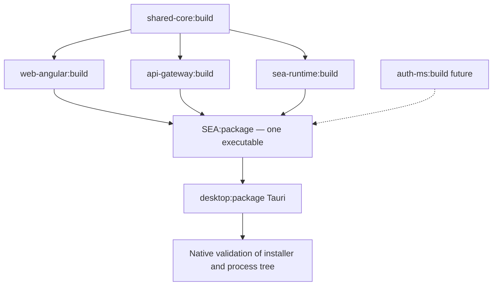

**REQ-TEST-01 — Non-negotiable policy.** The sibling repositories are learning background, **NOT** normative suite templates. It **MUST NOT** create dedicated suites, folders, test projects or runners. This covers **unit testing** and **integration testing**. It **MUST** write only two kinds of tests. One kind is **real application (APP/app-level)** tests. The other kind is **E2E tests of the installed product (real E2E)**. Very focused assertions are allowed. They must always go through the assembled application. Never instantiate domain classes in isolation. Never mock persistence, network or business contracts.

**REQ-TEST-02 — Classification, NOT unit/integration tests.** Each APP case **MAY** be classified with semantic tags `@ut`, `@int` or `@app`. However, **no tag changes the runner, the bootstrap or the fidelity of the environment**. `UT` is a selection of specific behaviors observable through the real app. `INT` selects interactions between real components. `APP` is the complete suite. The `@app` tag is optional: a test without tags is also part of APP. It **MUST NOT** confuse `@ut`/`@int` with authorization to write traditional unit/integration tests.

**REQ-TEST-03 — Scripts and filters.** The **only public entry point for test selection** is `test` with an optional filter. The forms are: `pnpm test` (all) or `pnpm test -- --filter @ut` / `pnpm test -- --filter @int`. `test:ut`, `test:int`, `test:unit` or isolated unit/integration suites **MUST NOT** exist. The filter **MUST** affect only the selection of dynamic APP tests. `securityCheck`, static checks, typecheck and bootstrap of real fixtures **MUST** keep running. A minimal argument adapter **MUST** translate the filter to Jest (`--testNamePattern`) and Playwright (`--grep`). Root and workspaces can reuse it. It **MUST** reject unknown or accidentally empty filters. Do not turn a filter with no matches into success. The agent **MUST** check the real syntax `pnpm test -- --filter ...` through CLI tests. Each package **MUST** declare `test`, `build` and `package`. When an operation really does not apply, use `echo 'not defined for this package'` and code `0`. However, it **MUST NOT** turn into a no-op a mandatory control that should exist. Gateway/web must have APP tests. Tauri must be packaged. The `test:static`/`test:dynamic` hooks are ECO stages, **not** different runners.

**REQ-TEST-04 — Gateway APP.** NestJS **MUST** be tested with **Jest + Supertest**. The tests start a real `INestApplication` and its real providers, configuration and test database. Use a temporary SQLite DB and a PostgreSQL test database where applicable. `supertest(app.getHttpServer())` verifies app-level HTTP contracts without requiring an exposed LAN port. Real TLS, redirect, web serving from memory (`--web ipc`) only in SEA and the process lifecycle **MUST** also be tested. Test them against the real executable/listeners. Do not pretend that the in-memory test covers the operating system or the network.

**REQ-TEST-05 — Angular APP.** Angular **MUST** be tested with **Playwright**, a real browser, real gateway endpoints and semantic DOM assertions. It **MUST** cover dev mode (`:4200` + proxy + HMR) and distributed mode (`:8443` served by SEA), public/employee/admin roles, API protections and effective absence of restricted components. It **MUST NOT** impose isolated component tests or cosmetic snapshots.

**REQ-TEST-06 — Persistence APP.** Exercise SQLite **and** PostgreSQL from the real app context. Cover initial migration, restart without re-running, pending migration and altered checksums. Cover initialization failure and genuine vector query. Fixtures **MUST** isolate the data of each run and clean up resources. Replacing the adapters with mocks to consider an APP test passed is prohibited.

**REQ-TEST-07 — Distributed SEA APP.** Run the **compiled SEA binary in supervisor mode** (not only the TS bundle). Check that it launches the gateway as a second process of the same physical file. Verify handshake, migrations, vectors, Angular assets, SPA fallback and correct `404`. Verify TLS, manifest/PWA, coordinated shutdown, restart upon child crash and the hash check of the in-memory web bundle (POC-1f: no extraction). This suite is **APP over a real artifact**, not yet native desktop E2E.

**REQ-TEST-08 — Real Tauri E2E.** The **`package`** step (once build and test are satisfied) **MUST** validate the distributable artifacts through a real SEA smoke and Tauri automation with **WebdriverIO + `@wdio/tauri-service`** when the platform supports it. Cover aggregated readiness, WebView, HTTPS, tray, single sidecar, shutdown, restarts and verifiable autostart. The commercial product **MUST NOT** include the WDIO plugin or the permissions exclusive to WDIO instrumentation. Complement with an **installer black-box smoke without instrumentation** (install, start, navigate, close, uninstall), automated or manual with explicit status. These tests correspond to the verification of **real packaging**, not to another `test:e2e` suite nor to a unit/integration test. Do not declare a platform green because of a validation that was not performed.

**REQ-TEST-09 — OS matrix.** It **MUST** build and verify the SEA/Tauri sidecar for every system/architecture officially declared as supported. It **MUST NOT** claim Windows/Linux compatibility because tests pass on macOS. A **VM** with a real operating system or a native runner serves to check installers. It also checks WebViews, autostart and tray. **Docker MAY** host PostgreSQL, gateway tests, Playwright and Linux smoke with Xvfb/WebKitGTK. However, it **MUST NOT** replace the validation of a native Windows/macOS installer and desktop. A Windows ARM VM **MUST NOT** be taken as proof equivalent to Windows x64.

**REQ-TEST-10 — Minimum initial scope.** Before introducing CI/CD, the template **MUST** deliver two things. These are repeatable local scripts and a results matrix per platform. The matrix values are `verified` / `pending` / `blocked`. It **SHOULD** automate the macOS host and at least one Linux environment. It **MAY** add a Windows VM or native runner. Do not introduce Kubernetes, Selenium Grid, device farms or fictitious CI infrastructure. The micro-POC does not need them.

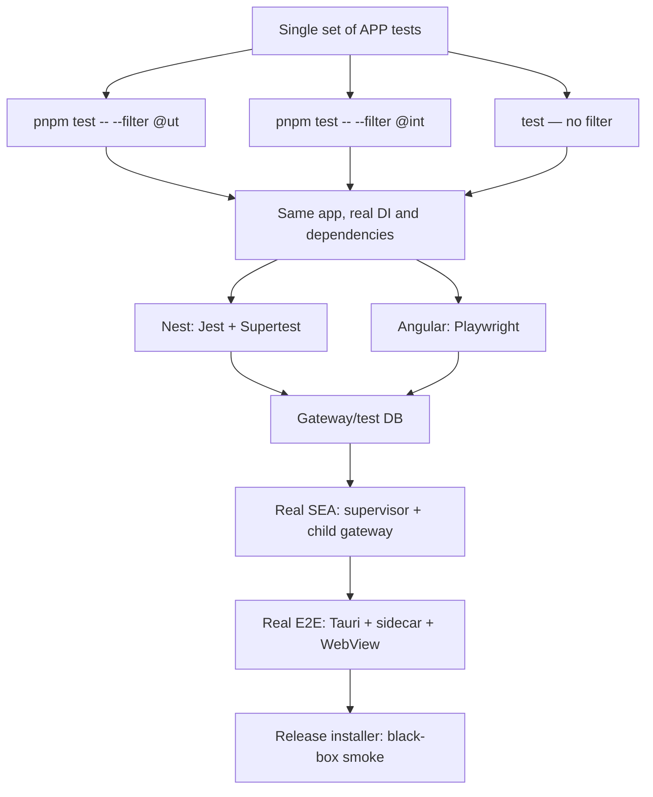

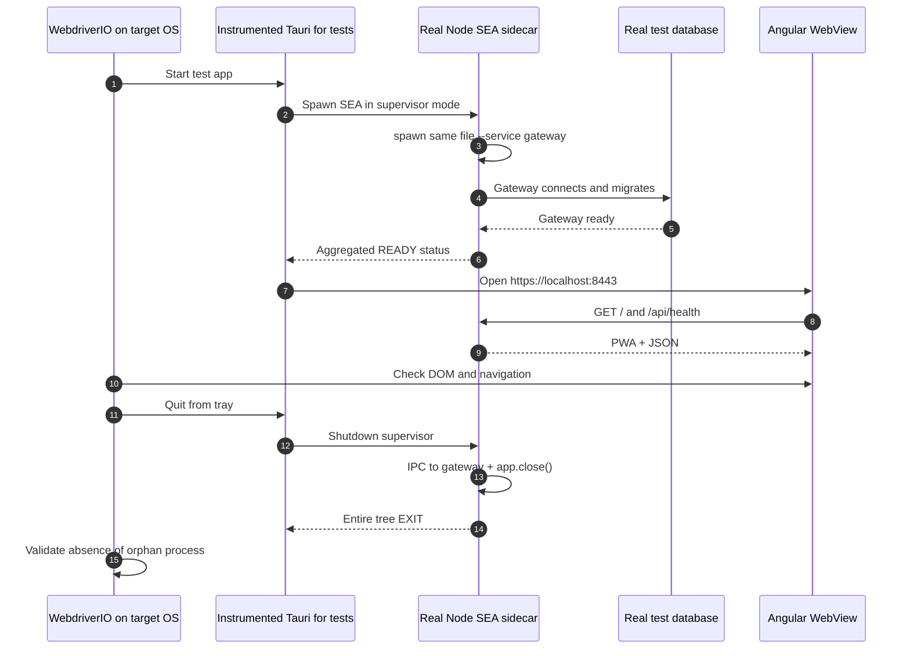

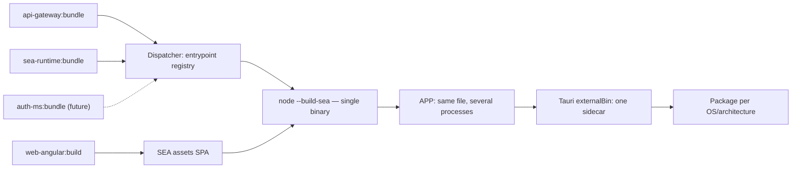

---

### 11.1 ECO contracts — monorepo scripts (normative)

**REQ-ECO-01 — Echoes, not aliases.** Public monorepo operations **MUST** have the same name in the root and in each package. The root scripts **MUST** invoke the equivalent operations of the packages through Nx. Dependencies and order are defined with `dependsOn`/outputs and not by duplicating scripts for each framework. The **same chain** must work locally, in CI and in a future technical-debt remediation tool. Do not invent `pipeline:*`, `build:sea`, `build:app`, `test:ut`, `test:int`, `test:e2e` or wrappers that duplicate logic. Technical scripts exist only when they perform a distinguishable operation.

| ECO contract | Mandatory semantics | Root | Workspace |
|---|---|---|---|
| `build` | **Compile** independent sources, without generating installers | Nx → all `build` | Angular/Nest/TS/Rust: relevant local build |
| `test` | **Aggregate** `test:static` + `test:dynamic` (APP) | First `securityCheck`; Nx → `test` of all | Invokes the package's `test:static` + `test:dynamic` |
| `test:static` | Lint, format, types and other static checks | Security first + Nx → `test:static` of all | Specific tools; without bypassing failures |
| `test:dynamic` | Only complete APP suites (no filter by default) | Nx → `test:dynamic` of all | Nest: Jest/Supertest; Angular: Playwright; infra: APP if applicable |
| `package` | **Post-build**: assemble SEA/sidecar/installers + verify artifacts | Nx → `package` targets, respecting `^build`/dependencies | SEA and Tauri package; libs without distribution explicit no-op |
| `securityCheck` | Supply-chain and dependency gate; early block | pnpm audit + Rust dependencies; fail-closed | Only where applicable; never pass through a skipped audit |
| `start:dev` | Dev Angular HMR + gateway watch, `/api` proxy | Launches sibling apps without Tauri/SEA | Each app implements its dev start if applicable |
| `start:prod` | Run the single SEA in supervisor mode | Starts executable per OS | Not mandatory in every package |

**REQ-ECO-02 — `test` of each package.** Every project under `apps/*` and `libs/*` **MUST** declare `test`; also `build` and `package` for uniformity. If no operation applies, permit only a no-op. It has the message `not defined for this package` and exit code `0`. The no-op **MUST NOT** hide missing `api-gateway` or `web-angular` tests nor pass mandatory static checks. A failed test or a validation that cannot run **MUST** end with a non-zero code.

**REQ-ECO-03 — Verifiable composition and order.** `pnpm test` at the root **MUST** complete `securityCheck` first. Only then propagate the **`test` target of ALL packages** through Nx. This includes those that declare an explicit no-op. The `test` of each package **MUST** run `test:static` and then `test:dynamic` if applicable. Do not add isolated unit/integration suites. `test:static` covers lint, format and typecheck. The global security controls run at the root before the fan-out. This prevents a package task from bypassing them in CI. The root ECOs `test:static` and `test:dynamic` **MAY** allow invoking those phases directly in all packages. This is for diagnostics. The root `test:static` **MUST** run `securityCheck` first. **Do not claim that all static tests of all packages finish before any dynamic test.** This applies if Nx runs different packages in parallel. The required order is per package. `test` **MUST NOT** launch `package` nor publish releases. The `build` is an independent operation run before `test` in the CI pipeline.

**REQ-ECO-04 — Filters, not scripts.** `pnpm test -- --filter @ut` and `pnpm test -- --filter @int` **MUST** run the same APP tests under the same real processes. They change only which cases are selected within `test:dynamic`. Filters are passed **explicitly**. Do not pass `--filter` directly to Nx (where it means selecting projects). Do not pass it to pnpm either (where it also has its own meaning). The CLI adapter may be a file in `tools/scripts/`. However, it **MUST NOT** become a second build/testing orchestrator. Without a filter, **all cases** run; with a filter without matches, explicit failure. Any unsupported argument fails with clear usage.

**REQ-ECO-05 — Native lint per project.** `test:static` requires lint, format and types per technology. However, it **MUST NOT** force a universal ESLint. Nest 12 scaffolds **Oxlint**. Angular uses `angular-eslint` for Angular rules and templates. Rust runs **Clippy + rustfmt**. The final choice must demonstrate coverage of the real code, including Angular templates. Optional repair scripts (`lintFix`, `formatFix`) **MAY** exist, outside the read-only CI tasks. Do not create different names for the same concept per framework.

**REQ-ECO-06 — `build` / `package` by graph.** `build` compiles `libs/shared-core`, `apps/web-angular`, `apps/api-gateway`, `apps/sea-runtime` and the projects that apply. The `package` of the SEA incorporates Node binaries and Angular assets **only after the builds**. The `package` of Tauri attaches the sidecar/installer **only after the SEA**. Its installer/OS verification runs without another public name for each phase. Do not duplicate arbitrary `build:*`/`package:*` for the same steps. The release takes exclusively verified packages from the versioned SHA.

**REQ-ECO-07 — Faithful external pipeline.** GitHub Actions is limited to setup/installation, `pnpm run securityCheck`, `pnpm run build`, `pnpm run test`, `pnpm run package`, publication and artifact transfer. `securityCheck` runs before `build` and **again inside `test`** because `test` must also be safe when invoked in isolation. This deliberate repetition does not authorize reusing an obsolete audit result nor skipping the gate. The implementation **MUST** show in the README the identical CLI sequence for local and CI, and check exit codes. Versioning/release operations **MUST** be exposed as root scripts, not copy Nx or Git logic into the YAML.

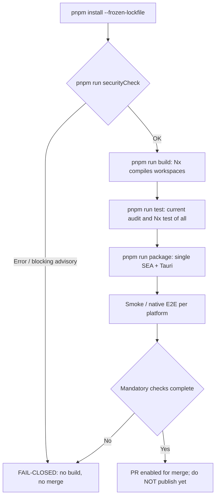

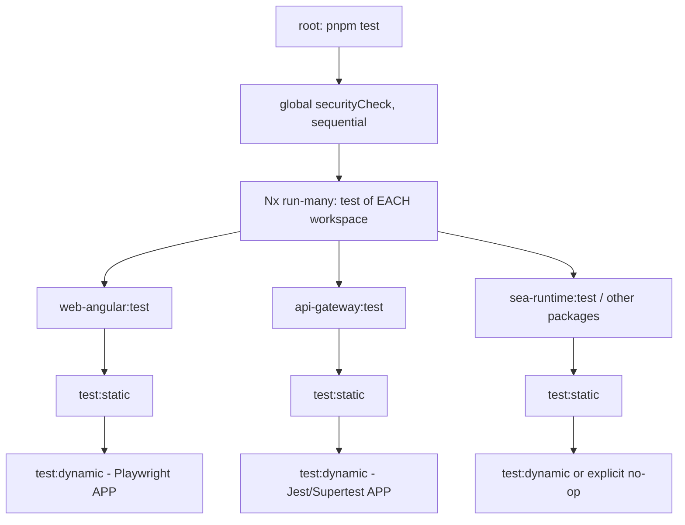

| Interpretation | Rule |
|---|---|
| Order | `test:static` precedes `test:dynamic` **within each workspace** |
| Parallel | Independent packages may be tested in parallel |
| `pnpm test` | Not a synonym for running only E2E; it aggregates static and dynamic tests |
| Filter | The `--filter @ut\|@int` filters affect exclusively the APP selection |
| Gates | They do not suppress the security gate nor the static checks |

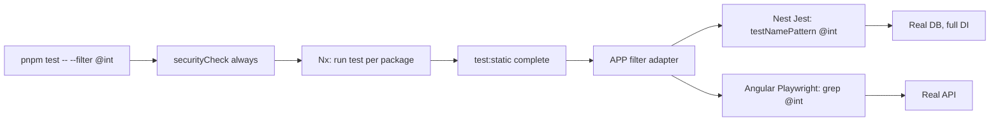

---

### 11.2 Sibling repositories: intent references, not a dependency

**REQ-REF-01.** Study these specific points before generating architecture or scripts:

| # | Reference | Guidance |
|---|---|---|
| 1 | **`nest-base` testing/coverage:** <https://github.com/virgenherrera/nest-base#testing--coverage> | Reuse the idea of observable pipeline and coverage. **Reject its unit and isolated integration suites**. |
| 2 | **`nest-base` namespaced configuration:** <https://github.com/virgenherrera/nest-base#namespaced-configuration-workflow> | Keep the typed classes, registration and injection by namespace. Keep single validation with Zod and the immutable singleton. Replace the `.env` source with persisted/validated CLI configuration where applicable. |
| 3 | **`nest-base` scripts/bump:** <https://github.com/virgenherrera/nest-base/blob/3153f90c72544263ae5a194e7f2864a9dda3cdd8/package.json#L45> | Adopt the naming convention and doctor, not the stack nor old test runners. |
| 4 | **`fullstack-base` scripts:** <https://github.com/virgenherrera/fullstack-base/blob/50afc753617d628e0d8c5bd7ed2521ceae9a4298/package.json#L41> | Adapt the root/workspace composition. Do not copy `test:unit` nor its original meaning of `test:e2e`. |
| 5 | **`fullstack-base` pnpm catalog:** <https://github.com/virgenherrera/fullstack-base/blob/50afc753617d628e0d8c5bd7ed2521ceae9a4298/pnpm-workspace.yaml> | Adopt a single version for Zod, Playwright, TypeScript and shared tools. Keep them in `catalog:` with `savePrefix: ''`. Adapt to `libs/*`. |
| 6 | **`fullstack-base` doctor:** <https://github.com/virgenherrera/fullstack-base/blob/50afc753617d628e0d8c5bd7ed2521ceae9a4298/.ncurc.json> | Reference for `npm-check-updates`/doctor. Versions of those repos do **not** constitute a valid baseline for this template. |

**REQ-DEPS-01 — Explicit TBD.** **`bumpDependencies` and `test:doctor` are NOT implemented in this delivery.** Leave only the contract/documentation and the references to the sibling repository. Do not install NCU nor generate an operational `.ncurc.json` to feign an absent capability. When `bumpDependencies` is enabled, `test:doctor` will be **mandatory**. It must work with `pnpm catalog:`, manifests, lockfile and real ECO scripts, with rollback on failure. This initial project need not automatically run technical-debt remediation.

**REQ-DEPS-02 — Prepare a stable interface.** The standardization of `build`/`test`/`package`/`securityCheck` and their phases `test:static`/`test:dynamic` **MUST** allow later implementing *upgrade* tools. This includes maintenance, debt correction and repeatable validation **without** duplicating the CI logic. Any future correction must pass the same security, build and APP gates as a PR. `securityFix` (if added later) **MUST NOT** run silently during CI nor approve changes without review.

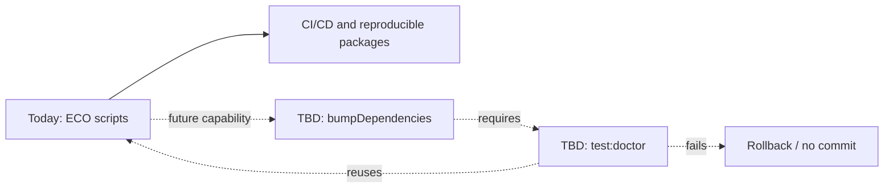

---

### 11.3 Synchronized versions and semver from the PR branch

**REQ-VERSION-01.** The template uses a **lockstep product version**, Angular-packages style. Define an Nx release group `projectsRelationship: "fixed"` for the publishable internal projects. Versions of `web-angular`, `api-gateway`, `shared-core`, `desktop` and Tauri manifests **MUST** agree in the distributed artifact. Do not require the **external dependencies** to have the same semver version. These are `@angular/*`, `@nestjs/*`, Drizzle, Zod and Tauri CLI. Their update will be done manually in the baseline. `bumpDependencies` is a future TBD automation.

**REQ-VERSION-02.** PR source branch convention, validated in CI:

| PR branch | SemVer bump | Example from `1.4.8` |
|---|---|---|
| `major/<slug>` | major | `2.0.0` |
| `minor/<slug>` | minor | `1.5.0` |
| `fix/<slug>` | patch | `1.4.9` |

For changes without a release (`docs/*`, `chore/*`) define an explicit exemption. Unknown branches **MUST** fail validation or require explicit classification. If several PRs merge before releasing, choose the highest impact (`major > minor > fix`) in a single publication. Or serialize releases per merge. The release process **MUST** prevent a concurrent merge from producing duplicate tags.

**REQ-VERSION-03.** `release:version` **MUST** update internal versions and `tauri.conf.json` / `Cargo.toml`. Use the verified mechanisms of the tooling. The pipeline **MUST** validate all internal version references and generate a reproducible changelog. Nx Release does not update Rust manifests automatically except through a deliberate and verified integration.

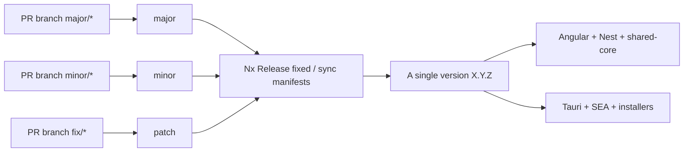

---

### 11.4 CI + GitHub Actions release: LAST phase

**REQ-CI-01 — Mandatory PR CI.** On `pull_request` to the main branch, GitHub Actions **MUST** run `securityCheck` as an early fail-closed gate, then `build`, `test` (static + APP), `package` (SEA, Tauri and real distribution smoke) and the release controls when applicable. The workflow only invokes **root `package.json` scripts** for project operations; the necessary checkout/setup/cache/artifacts actions are permitted (do not turn YAML into another build system). The target matrix is **Windows, Linux and macOS only**, on runners of the target system. No Linux Docker as a substitute for Windows/macOS.

**REQ-CI-02 — Gate before merge.** `main` **SHOULD** require PR checks and not merge while they fail. Any unverified platform must be declared `pending/blocked`, not shown as green. APP tests must not depend on mocks to cover real DB, auth or assets. In CI each environment must resolve real prerequisites of Tauri and SQLite vector. Do not claim platform support without running the corresponding artifact test.

**REQ-CI-03 — Release on merge.** When a `pull_request` is closed with `merged == true`, retrieve `head.ref` and validate `major/*|minor/*|fix/*`. Check that the merge entered the admitted target branch. Run the release flow from **the trusted merged code**. Never run unmerged PR code with write credentials. Protect `contents:write` permissions exclusively for the jobs that version, tag and publish. Avoid `pull_request_target` running scripts from forks without review.

**REQ-CI-04 — No `amend` to the merged commit.** It **MUST NOT** rewrite (`git commit --amend`/force-push) the SHA that the checks approved. If `main` allows authorized version automation, create **a new release commit** after applying SemVer. Re-run verifications and tag that SHA. If branch protection prevents writing to `main`, use an automated **release PR/version plan**. It needs normal approval. Publish after its merge. Do not request a silent bypass.

**REQ-CI-05 — Publish artifacts of the versioned SHA, not of the PR.** After the version bump and its commit, build from that exact SHA. Build the SEA executables and the Tauri installers for the declared OS/architectures. Include compiled Angular, migrations/assets and the definitive version. It **MUST NOT** publish PR binaries with a version earlier than that of the tag. Run install / startup / shutdown smoke per OS before uploading to GitHub Release. Publish SHA-256 hashes, artifact provenance when the provider supports it and unambiguous OS/arch names.

**REQ-CI-06 — Idempotency and concurrency.** Serialize the release of the target branch; repeating a job for the same SHA/tag **MUST NOT** duplicate releases nor increment the version again. A failure on any mandatory platform **MUST** prevent publishing the release as complete; do not leave a tag pointing to binaries that were never generated without explicitly marking it as draft/blocked.

**REQ-CI-07 — Only invoke root npm scripts.** `ci-cd.yml` must delegate to `pnpm run securityCheck`, `pnpm run build`, `pnpm run test` and `pnpm run package`. It must also delegate the strictly necessary release commands exposed at the root. Do not copy `nx`, `jest`, `ng`, `cargo`, `ncu` or `postject` commands directly into the workflow. Operating system setup and artifact upload/download may use official GitHub Actions.

---

### 11.4.1 Normative pipeline: what CI runs and what CD runs

**REQ-CI-08 — The boundary is the merge, not `package`.** **CI** validates PRs without publishing permissions: `install → securityCheck → build → test → package → artifact smoke/E2E → PR checks`. **CD** starts **only** when the PR is verified as merged into `main`. The release PR also counts when it is accepted. The steps are: `determine bump → apply lockstep version → new commit → rebuild and revalidate the versioned SHA on a native matrix → sign/notarize when applicable → tag → GitHub Release`. The binaries compiled during CI are **verification artifacts**, not the definitive installers. The root **MUST** be the only project-operations interface that the workflow invokes.

**REQ-CI-09 — Gates, order and zero tolerance.** `securityCheck` is a **sequential barrier prior to any build**. A failure on a mandatory platform **MUST** block merge/release. The failure can come from `install`, `securityCheck`, `build`, `test`, `package` or native smoke. `test` re-runs `securityCheck` as part of its independent contract. Do not confuse `--nxBail` with an instant cancellation of tasks that have already started. The composite exit code **MUST** be verified. GitHub Actions **MUST** declare `needs` to order dependent stages. This prevents later jobs from starting after a required failure.

**REQ-CI-10 — CD rebuilds, it does not recycle unversioned binaries.** The bump is applied to the already merged code through a root release ECO script. Once the new commit is created (or the release PR merged), the native matrix **MUST** check out that SHA and repeat `install → securityCheck → build → test → package`; then validate checksums, sidecar, start/stop, embedded version and installer smoke. **Only then** create the tag `vX.Y.Z` pointing to the versioned SHA and publish the artifacts produced in that run. Signing/notarization is per platform when applicable and if credentials are available; do not declare artifacts signed if they are not.

#### Diagram A — Complete mandatory sequence

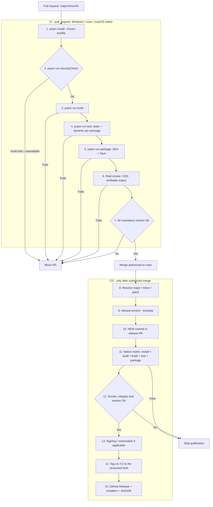

#### Diagram B — Timeline: PR, merge, version commit and release

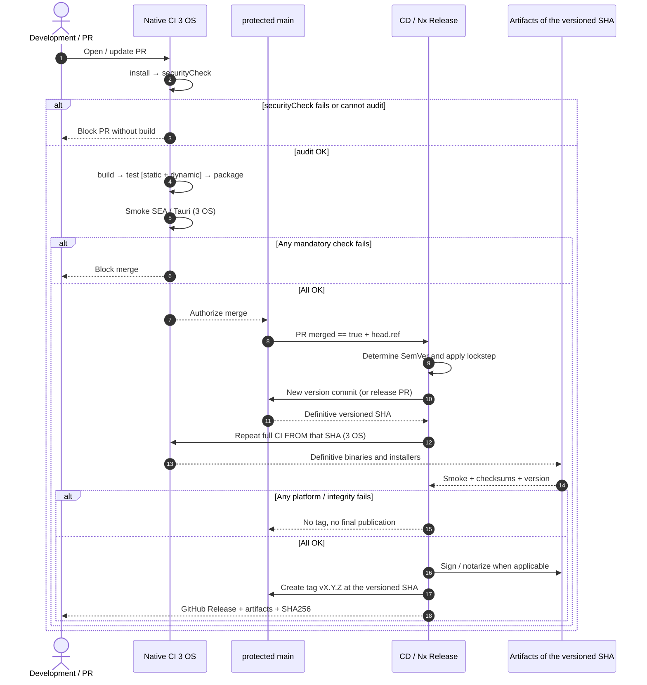

#### Diagram C — Root ECOs and per-phase mapping

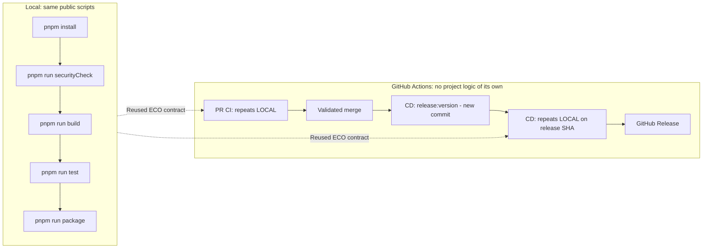

| CI/CD barrier | Rule |
|---|---|
| Merge | The merge does **NOT** automatically publish the PR artifacts |
| CD | CD publishes only binaries rebuilt from the revision that holds the synchronized version |
| TBD | `test:doctor` and `bumpDependencies` remain **TBD**; not part of the current pipeline |

---

### 11.5 Minimum acceptance criteria of the template

| ID | Verifiable behavior |
|---|---|
| AC-01 | Installation from an empty repository with pinned versions and reproducible `pnpm install --frozen-lockfile` |
| AC-02 | `securityCheck` fails before the build on high/critical advisories or registry failure; `pnpm test` aggregates `test:static` + `test:dynamic` over all projects |
| AC-03 | Tauri starts a SEA supervisor; it starts the gateway in another process using the same file; closing the window keeps both, Quit terminates the tree |
| AC-04 | From another LAN device the UI/manifest loads through `https://IP:8443`, **after** establishing TLS trust; Angular and API share origin |
| AC-05 | `http://IP:8080/` returns `308` to the correct secure origin |
| AC-06 | API denies unauthorized access; frontend only renders enabled routes; Playwright verifies it |
| AC-07 | Invalid configuration and incompatible database produce fail-fast before announcing readiness |
| AC-08 | SQLite runs incremental migrations and real vector search from the SEA binary |
| AC-09 | PostgreSQL supports the same contractual operations, with dialect-specific migrations |
| AC-10 | Cutting off the Internet does not prevent accessing the gateway, Angular nor performing local persistence/vector operations |
| AC-11 | The host needs neither `node_modules` nor a Node installation; the installer contains **a single physical SEA** per platform even though it runs several processes |
| AC-12 | SPA assets are updated without breaking the service worker nor serving a mix of versions |
| AC-13 | `apps/web-angular` and `apps/api-gateway` compile independently and do not import source code from each other |
| AC-14 | In dev, `localhost:4200` serves the SPA and forwards `/api/**` to Nest through a proxy; Nest does not serve Angular and HMR works |
| AC-15 | `web-angular:build` and bundles of `sea-runtime`/`api-gateway` precede **a single** SEA; Angular changes or changes in any registered service invalidate the packaging |
| AC-16 | In SEA, the gateway serves the web bundle from memory, received over IPC with each sha256 verified; nothing is extracted to disk (replaces the `ServeStaticModule` cache of POC-1f) |
| AC-17 | `/api/does-not-exist` does not return `index.html`; Angular routes use fallback; a missing `.js` returns 404 |
| AC-18 | The frontend of the Tauri WebView is identical to the one available on mobile/PC from the gateway; `sea-runtime` does not host a second SPA nor a public port |
| AC-19 | There are no isolated unit/integration suites nor `test:ut`/`test:int` scripts: `pnpm test -- --filter @ut` filters the same APP without skipping static checks |
| AC-20 | Native E2E runs real Tauri + SEA sidecar and verifies lifecycle; WDIO instrumentation does not exist in the commercial installer |
| AC-21 | Each platform declared supported has native/VM verification and a traceable result; passing macOS does not imply Windows/Linux |
| AC-22 | `nest-base` and `fullstack-base` are used as references, without porting `test:unit` nor integration suites |
| AC-23 | Each package declares `build`, `test`, `package`; no-ops are explicit and never hide obligations; CI invokes root ECOs only |
| AC-24 | pnpm catalogs with exact versions and minimumReleaseAge/allowBuilds protections; `bumpDependencies` + `test:doctor` remain TBD, without active scripts nor dependencies |
| AC-25 | SemVer lockstep synchronizes Angular, Nest, shared-core, Tauri and the distributed version; branch naming classifies major/minor/fix |
| AC-26 | PR runs full CI on Windows/Linux/macOS; a valid merge generates a new release commit/PR, not an amend |
| AC-27 | GitHub Release points to the versioned SHA and attaches verified installers and checksums; safe and idempotent failure |
| AC-28 | Running SEA without arguments starts `sea-runtime` as Nest Standalone; only `api-gateway` is initially enabled |
| AC-29 | Supervisor invokes the same `process.execPath` in gateway role; unknown roles are rejected; there are no duplicated Node binaries |
| AC-30 | Closing the product requests `app.close()` via IPC to the children and checks absence of orphans on Windows, macOS and Linux |
| AC-31 | Future addition of `apps/auth-ms` requires only registering its bootstrap, dependencies and Nx target, without adding a Tauri sidecar |
| AC-32 | `pnpm run securityCheck` blocks builds if audit records high/critical or the query fails; it does not ignore errors; it covers devDependencies and the Rust tree according to its tooling |
| AC-33 | `pnpm build` compiles, `pnpm test` runs `test` of **all** packages with static → dynamic order per package, and `pnpm package` creates/verifies SEA/Tauri; same operations on macOS/Windows/Linux |
| AC-34 | `pnpm test -- --filter @int` passes the filter to Jest/Playwright without altering the Nx graph nor the APP bootstrap, and a filter with no matches fails |
| AC-35 | CI/CD diagrams and README show exactly: install → security → build → test (static + dynamic) → package → smoke; `securityCheck` fails before the first build |
| AC-36 | The PR produces only verifiable artifacts; CD creates a new version/commit, repeats the full CI from the versioned SHA and only afterwards creates the tag and publishes binaries |

Note: AC-17 uses the path `/api/does-not-exist`. SRS v1.6 writes `/api/no-existe`. The requirement is the same.

---

### 11.6 Visual execution matrix per environment

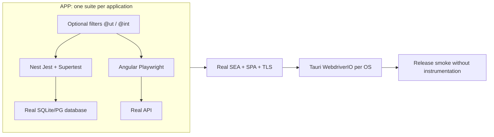

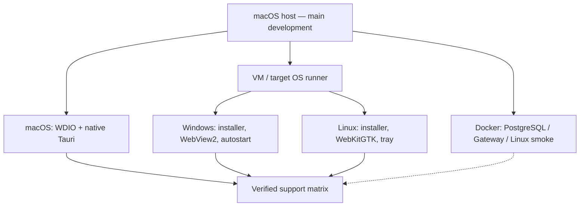

**Publication criterion:** one can work mainly on macOS. But **each target operating system MUST be tested on that OS** before claiming production support. The matrix may remain partial while the repository is a micro-POC. This holds if the agent declares the limitations.
