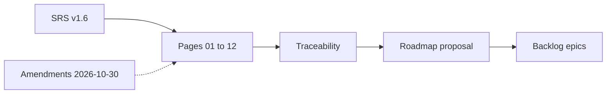

<!-- toon-meta
fmt: TOON
doc: docs/requirements/README.md
title: Requirements
type: index
summary: Index of the SRS split into requirement pages with REQ and AC counts.
ids[0]:
related[0]:
status: current
updated: 2026-10-30
-->

# Requirements

[Home](../../README.md) | [Requirements](README.md) | [Architecture](../architecture/overview.md) | [Standards](../standards/README.md) | [Roadmap](../roadmap/PROPOSAL.md) | [Traceability](traceability.md) | [Backlog](../backlog/README.md)

## Navigation

- [At a glance](#at-a-glance)
- [Reading order](#reading-order)
- [Related pages](#related-pages)

## At a glance

[Back to navigation](#navigation)

One page per SRS section. Pick a page below.

| You want to | Go to |
|---|---|
| Read a requirement | [Reading order](#reading-order) |
| Find the POC of an id | [Traceability](traceability.md) |
| See edits to the v1.6 text | [Amendments 2026-10-30](amendments-2026-10-30.md) |
| See decisions and their state | [ADR index](../roadmap/PROPOSAL.md#adr-index) |
| Open an epic | [Backlog](../backlog/README.md) |

## Reading order

[Back to navigation](#navigation)

REQ and AC columns count the ids each page defines.

| Page | Topic | SRS section | REQ ids | AC ids |
|---|---|---|---|---|
| [01-purpose-and-scope.md](01-purpose-and-scope.md) | Purpose and scope | 1 | 0 | 0 |
| [02-technology-baseline.md](02-technology-baseline.md) | Technology baseline and reproducibility | 2 | 12 | 0 |
| [03-file-structure.md](03-file-structure.md) | File structure | 3 | 5 | 0 |
| [04-configuration.md](04-configuration.md) | Configuration | 4 | 6 | 0 |
| [05-persistence.md](05-persistence.md) | Persistence, vectors and migrations | 5 | 9 | 0 |
| [06-web-gateway-https-pwa.md](06-web-gateway-https-pwa.md) | Dev, web packaging, LAN gateway, HTTPS and PWA | 6 | 20 | 0 |
| [07-security.md](07-security.md) | Default security | 7 | 6 | 0 |
| [08-web-angular.md](08-web-angular.md) | Angular web | 8 | 4 | 0 |
| [09-desktop-tauri.md](09-desktop-tauri.md) | Desktop Tauri and processes | 9 | 14 | 0 |
| [10-node-sea-distribution.md](10-node-sea-distribution.md) | Node SEA and distribution | 10 | 6 | 0 |
| [11-nx-quality-testing.md](11-nx-quality-testing.md) | Nx, quality and testing | 11 | 42 | 36 |
| [12-agent-delivery.md](12-agent-delivery.md) | Delivery instructions for the agent | 12 | 0 | 0 |
| **Total** | | | 124 | 36 |

## Related pages

[Back to navigation](#navigation)

| Page | Role |
|---|---|
| [Amendments 2026-10-30](amendments-2026-10-30.md) | Changes applied to the v1.6 text |
| [Traceability](traceability.md) | Maps each REQ and AC id to its file and POC |
| [Architecture](../architecture/overview.md) | Overview |
| [Standards](../standards/README.md) | Doc standards |
