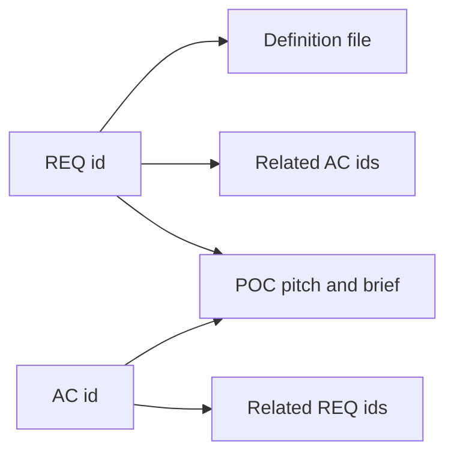

<!-- toon-meta
fmt: TOON
doc: docs/requirements/traceability.md
title: Traceability
type: traceability
summary: Maps each REQ and AC id to its POC and acceptance criterion.
related[5]: docs/results/POC-08-Result.md,docs/architecture/platform-matrix.md,docs/requirements/README.md,docs/requirements/amendments-2026-10-30.md,docs/requirements/amendments-2026-11-02.md
status: current
updated: 2026-11-04
-->

# Traceability

[Home](../../README.md) | [Requirements](README.md) | [Architecture](../architecture/overview.md) | [Standards](../standards/README.md) | [Roadmap](../roadmap/PROPOSAL.md) | [Traceability](traceability.md) | [Backlog](../backlog/README.md)

[Previous](amendments-2026-11-02.md) | [Up](README.md)

## Navigation

- [At a glance](#at-a-glance)
- [How to read](#how-to-read)
- [Requirement to POC](#requirement-to-poc)
- [Acceptance criteria to requirement](#acceptance-criteria-to-requirement)
- [POC-8 status on macOS](#poc-8-status-on-macos)
- [Unmapped ids](#unmapped-ids)

---

## At a glance

[Back to navigation](#navigation)

Which POC covers each id. Briefs: [Backlog](../backlog/README.md).

| You want | Go to |
|---|---|
| The POC of a requirement | [Requirement to POC](#requirement-to-poc) |
| The requirements of a POC from an AC | [Acceptance criteria to requirement](#acceptance-criteria-to-requirement) |
| What POC-8 verified on macOS | [POC-8 status on macOS](#poc-8-status-on-macos) |
| Ids with no POC | [Unmapped ids](#unmapped-ids) |

---

## How to read

[Back to navigation](#navigation)

Nothing here adds or changes a requirement.

| Topic | Rule |
|---|---|
| POC mapping source | SRS coverage matrix and pitches in [PROPOSAL.md](../roadmap/PROPOSAL.md#srs-coverage-matrix) |
| Definitions | A REQ id links to the page that defines it. Every AC id is defined in [11-nx-quality-testing.md](11-nx-quality-testing.md#115-minimum-acceptance-criteria-of-the-template) |
| `Related AC` and `Related REQ` | Relate items that share a POC. Not a one-to-one derivation. Not verified beyond that shared POC. |
| POC cell | Links to its pitch in PROPOSAL.md and its brief in `docs/backlog/` |

---

## Requirement to POC

[Back to navigation](#navigation)

| REQ id | Related AC | POC |
|---|---|---|
| [REQ-STACK-01](02-technology-baseline.md) | AC-01, AC-02, AC-13, AC-19, AC-22, AC-23, AC-24, AC-32, AC-33, AC-34 | [POC-1][p-poc-1] / [brief][b-README-epics] |
| [REQ-STACK-02](02-technology-baseline.md) | AC-01, AC-02, AC-13, AC-19, AC-22, AC-23, AC-24, AC-32, AC-33, AC-34 | [POC-1][p-poc-1] / [brief][b-README-epics] |
| [REQ-STACK-03](02-technology-baseline.md) | AC-01, AC-02, AC-13, AC-19, AC-22, AC-23, AC-24, AC-32, AC-33, AC-34 | [POC-1][p-poc-1] / [brief][b-README-epics] |
| [REQ-STACK-04](02-technology-baseline.md) | AC-01, AC-02, AC-13, AC-19, AC-22, AC-23, AC-24, AC-32, AC-33, AC-34 | [POC-1][p-poc-1] / [brief][b-README-epics] |
| [REQ-STACK-05](02-technology-baseline.md) | AC-01, AC-02, AC-13, AC-19, AC-22, AC-23, AC-24, AC-32, AC-33, AC-34 | [POC-1][p-poc-1] / [brief][b-README-epics] |
| [REQ-STACK-06](02-technology-baseline.md) | AC-01, AC-02, AC-13, AC-19, AC-22, AC-23, AC-24, AC-32, AC-33, AC-34 | [POC-1][p-poc-1] / [brief][b-README-epics] |
| [REQ-STACK-07](02-technology-baseline.md) | AC-07, AC-08, AC-10 | [POC-3][p-poc-3] / [brief][b-poc-3-config-sqlite-vector] ; [DBM][b-dbm-drizzle-migrations] / [brief][b-dbm-drizzle-migrations] |
| [REQ-STACK-08](02-technology-baseline.md) | AC-01, AC-02, AC-13, AC-19, AC-22, AC-23, AC-24, AC-32, AC-33, AC-34 | [POC-1][p-poc-1] / [brief][b-README-epics] |
| [REQ-STACK-09](02-technology-baseline.md) | AC-07, AC-08, AC-10 | [POC-3][p-poc-3] / [brief][b-poc-3-config-sqlite-vector] |
| [REQ-STACK-10](02-technology-baseline.md) | AC-09 | [POC-6 (built on branch)][p-poc-6] / [brief][b-poc-6-postgresql-adapter-parity] |
| [REQ-SUPPLY-01](02-technology-baseline.md) | AC-01, AC-02, AC-13, AC-19, AC-22, AC-23, AC-24, AC-32, AC-33, AC-34 | [POC-1][p-poc-1] / [brief][b-README-epics] |
| [REQ-SUPPLY-02](02-technology-baseline.md) | AC-01, AC-02, AC-13, AC-19, AC-22, AC-23, AC-24, AC-32, AC-33, AC-34 | [POC-1][p-poc-1] / [brief][b-README-epics] |
| [REQ-REP-01](03-file-structure.md) | AC-01, AC-02, AC-13, AC-19, AC-22, AC-23, AC-24, AC-32, AC-33, AC-34 | [POC-1][p-poc-1] / [brief][b-README-epics] |
| [REQ-REP-02](03-file-structure.md) | AC-01, AC-02, AC-13, AC-19, AC-22, AC-23, AC-24, AC-32, AC-33, AC-34 | [POC-1][p-poc-1] / [brief][b-README-epics] |
| [REQ-REP-03](03-file-structure.md) | AC-01, AC-02, AC-13, AC-19, AC-22, AC-23, AC-24, AC-32, AC-33, AC-34 | [POC-1][p-poc-1] / [brief][b-README-epics] |
| [REQ-REP-04](03-file-structure.md) | AC-01, AC-02, AC-13, AC-19, AC-22, AC-23, AC-24, AC-32, AC-33, AC-34 | [POC-1][p-poc-1] / [brief][b-README-epics] |
| [REQ-REP-05](03-file-structure.md) | AC-01, AC-02, AC-13, AC-19, AC-22, AC-23, AC-24, AC-32, AC-33, AC-34 | [POC-1][p-poc-1] / [brief][b-README-epics] |
| [REQ-CFG-01](04-configuration.md) | AC-07, AC-08, AC-10 | [POC-3][p-poc-3] / [brief][b-poc-3-config-sqlite-vector] |
| [REQ-CFG-02](04-configuration.md) | AC-07, AC-08, AC-10 | [POC-3][p-poc-3] / [brief][b-poc-3-config-sqlite-vector] |
| [REQ-CFG-03](04-configuration.md) | AC-06, AC-07, AC-08, AC-10 | [POC-3][p-poc-3] / [brief][b-poc-3-config-sqlite-vector] ; [POC-7][p-poc-7] / [brief][b-poc-7-auth-roles] |
| [REQ-CFG-04](04-configuration.md) | AC-07, AC-08, AC-10 | [POC-3][p-poc-3] / [brief][b-poc-3-config-sqlite-vector] |
| [REQ-CFG-05](04-configuration.md) | AC-07, AC-08, AC-10 | [POC-3][p-poc-3] / [brief][b-poc-3-config-sqlite-vector] |
| [REQ-CFG-06](04-configuration.md) | AC-07, AC-08, AC-10 | [POC-3][p-poc-3] / [brief][b-poc-3-config-sqlite-vector] |
| [REQ-DB-01](05-persistence.md) | AC-07, AC-08, AC-09, AC-10 | [POC-3][p-poc-3] / [brief][b-poc-3-config-sqlite-vector] ; [POC-6 (built on branch)][p-poc-6] / [brief][b-poc-6-postgresql-adapter-parity] |
| [REQ-DB-02](05-persistence.md) | AC-07, AC-08, AC-09, AC-10 | [POC-3][p-poc-3] / [brief][b-poc-3-config-sqlite-vector] ; [POC-6 (built on branch)][p-poc-6] / [brief][b-poc-6-postgresql-adapter-parity] |
| [REQ-DB-03](05-persistence.md) | AC-07, AC-08, AC-09, AC-10 | [POC-3][p-poc-3] / [brief][b-poc-3-config-sqlite-vector] ; [POC-6 (built on branch)][p-poc-6] / [brief][b-poc-6-postgresql-adapter-parity] |
| [REQ-DB-04](05-persistence.md) | AC-07, AC-08, AC-10 | [POC-3][p-poc-3] / [brief][b-poc-3-config-sqlite-vector] ; [DBM][b-dbm-drizzle-migrations] / [brief][b-dbm-drizzle-migrations] |
| [REQ-DB-05](05-persistence.md) | AC-07, AC-08, AC-09, AC-10 | [POC-3][p-poc-3] / [brief][b-poc-3-config-sqlite-vector] ; [POC-6 (built on branch)][p-poc-6] / [brief][b-poc-6-postgresql-adapter-parity] ; [DBM][b-dbm-drizzle-migrations] / [brief][b-dbm-drizzle-migrations] |
| [REQ-DB-06](05-persistence.md) | AC-07, AC-08, AC-10 | [POC-3][p-poc-3] / [brief][b-poc-3-config-sqlite-vector] ; [DBM schema gate][b-dbm-schema-gate] / [brief][b-dbm-schema-gate], slices DBM-j to DBM-m, [ADR-005][b-ADR-005-live-schema-validation] |
| [REQ-DB-07](05-persistence.md) | AC-07, AC-08, AC-10 | [POC-3][p-poc-3] / [brief][b-poc-3-config-sqlite-vector] |
| [REQ-DB-08](05-persistence.md) | AC-07, AC-08, AC-09, AC-10 | [POC-3][p-poc-3] / [brief][b-poc-3-config-sqlite-vector] ; [POC-6 (built on branch)][p-poc-6] / [brief][b-poc-6-postgresql-adapter-parity] |
| [REQ-DB-09](05-persistence.md) | AC-07, AC-08, AC-10 | [POC-3][p-poc-3] / [brief][b-poc-3-config-sqlite-vector] |
| [REQ-DB-10](05-persistence.md) (approved 2026-11-02) | AC-07, AC-08, AC-10 | [DBM schema gate][b-dbm-schema-gate] / [brief][b-dbm-schema-gate], slices DBM-j to DBM-m, [ADR-005][b-ADR-005-live-schema-validation] |
| [REQ-DEV-01](06-web-gateway-https-pwa.md) | AC-04, AC-05, AC-12, AC-14, AC-15, AC-16, AC-17 | [POC-4][p-poc-4] / [brief][b-poc-4-https-gateway-angular-pwa] |
| [REQ-DEV-02](06-web-gateway-https-pwa.md) | AC-04, AC-05, AC-12, AC-14, AC-15, AC-16, AC-17 | [POC-4][p-poc-4] / [brief][b-poc-4-https-gateway-angular-pwa] |
| [REQ-DEV-03](06-web-gateway-https-pwa.md) | AC-04, AC-05, AC-12, AC-14, AC-15, AC-16, AC-17 | [POC-4][p-poc-4] / [brief][b-poc-4-https-gateway-angular-pwa] |
| [REQ-DEV-04](06-web-gateway-https-pwa.md) | AC-04, AC-05, AC-12, AC-14, AC-15, AC-16, AC-17 | [POC-4][p-poc-4] / [brief][b-poc-4-https-gateway-angular-pwa] |
| [REQ-DEV-05](06-web-gateway-https-pwa.md) | AC-04, AC-05, AC-12, AC-14, AC-15, AC-16, AC-17 | [POC-4][p-poc-4] / [brief][b-poc-4-https-gateway-angular-pwa] |
| [REQ-NET-01](06-web-gateway-https-pwa.md) | AC-04, AC-05, AC-11, AC-12, AC-14, AC-15, AC-16, AC-17, AC-28, AC-29, AC-30, AC-31 | [POC-2][p-poc-2] / [brief][b-poc-2-single-sea-runtime-supervisor] ; [POC-4][p-poc-4] / [brief][b-poc-4-https-gateway-angular-pwa] |
| [REQ-NET-02](06-web-gateway-https-pwa.md) | AC-04, AC-05, AC-12, AC-14, AC-15, AC-16, AC-17 | [POC-4][p-poc-4] / [brief][b-poc-4-https-gateway-angular-pwa] |
| [REQ-NET-03](06-web-gateway-https-pwa.md) | AC-04, AC-05, AC-12, AC-14, AC-15, AC-16, AC-17 | [POC-4][p-poc-4] / [brief][b-poc-4-https-gateway-angular-pwa] |
| [REQ-NET-04](06-web-gateway-https-pwa.md) | AC-04, AC-05, AC-12, AC-14, AC-15, AC-16, AC-17 | [POC-4][p-poc-4] / [brief][b-poc-4-https-gateway-angular-pwa] |
| [REQ-NET-05](06-web-gateway-https-pwa.md) | AC-04, AC-05, AC-12, AC-14, AC-15, AC-16, AC-17 | [POC-4][p-poc-4] / [brief][b-poc-4-https-gateway-angular-pwa] |
| [REQ-NET-06](06-web-gateway-https-pwa.md) | AC-04, AC-05, AC-12, AC-14, AC-15, AC-16, AC-17 | [POC-4][p-poc-4] / [brief][b-poc-4-https-gateway-angular-pwa] |
| [REQ-NET-07](06-web-gateway-https-pwa.md) | AC-04, AC-05, AC-12, AC-14, AC-15, AC-16, AC-17 | [POC-4][p-poc-4] / [brief][b-poc-4-https-gateway-angular-pwa] |
| [REQ-NET-08](06-web-gateway-https-pwa.md) | AC-04, AC-05, AC-12, AC-14, AC-15, AC-16, AC-17 | [POC-4][p-poc-4] / [brief][b-poc-4-https-gateway-angular-pwa] |
| [REQ-TLS-01](06-web-gateway-https-pwa.md) | AC-04, AC-05, AC-12, AC-14, AC-15, AC-16, AC-17 | [POC-4][p-poc-4] / [brief][b-poc-4-https-gateway-angular-pwa] |
| [REQ-TLS-02](06-web-gateway-https-pwa.md) | AC-03, AC-04, AC-05, AC-12, AC-14, AC-15, AC-16, AC-17, AC-18, AC-20, AC-30 | [POC-4][p-poc-4] / [brief][b-poc-4-https-gateway-angular-pwa] ; [POC-5][p-poc-5] / [brief][b-poc-5-tauri-sidecar-desktop-shell] |
| [REQ-TLS-03](06-web-gateway-https-pwa.md) | AC-04, AC-05, AC-12, AC-14, AC-15, AC-16, AC-17 | [POC-4][p-poc-4] / [brief][b-poc-4-https-gateway-angular-pwa] |
| [REQ-TLS-04](06-web-gateway-https-pwa.md) | AC-04, AC-05, AC-12, AC-14, AC-15, AC-16, AC-17 | [POC-4][p-poc-4] / [brief][b-poc-4-https-gateway-angular-pwa] |
| [REQ-PWA-01](06-web-gateway-https-pwa.md) | AC-04, AC-05, AC-12, AC-14, AC-15, AC-16, AC-17 | [POC-4][p-poc-4] / [brief][b-poc-4-https-gateway-angular-pwa] |
| [REQ-PWA-02](06-web-gateway-https-pwa.md) | AC-04, AC-05, AC-12, AC-14, AC-15, AC-16, AC-17 | [POC-4][p-poc-4] / [brief][b-poc-4-https-gateway-angular-pwa] |
| [REQ-PWA-03](06-web-gateway-https-pwa.md) | AC-04, AC-05, AC-12, AC-14, AC-15, AC-16, AC-17 | [POC-4][p-poc-4] / [brief][b-poc-4-https-gateway-angular-pwa] |
| [REQ-SEC-01](07-security.md) | AC-06 | [POC-7][p-poc-7] / [brief][b-poc-7-auth-roles] |
| [REQ-SEC-02](07-security.md) | AC-06 | [POC-7][p-poc-7] / [brief][b-poc-7-auth-roles] |
| [REQ-SEC-03](07-security.md) | AC-06 | [POC-7][p-poc-7] / [brief][b-poc-7-auth-roles] |
| [REQ-SEC-04](07-security.md) | AC-06 | [POC-7][p-poc-7] / [brief][b-poc-7-auth-roles] |
| [REQ-SEC-05](07-security.md) | AC-03, AC-18, AC-20, AC-30 | [POC-5][p-poc-5] / [brief][b-poc-5-tauri-sidecar-desktop-shell] |
| [REQ-SEC-06](07-security.md) | AC-06, AC-07, AC-08, AC-10 | [POC-3][p-poc-3] / [brief][b-poc-3-config-sqlite-vector] ; [POC-7][p-poc-7] / [brief][b-poc-7-auth-roles] |
| [REQ-WEB-01](08-web-angular.md) | AC-04, AC-05, AC-12, AC-14, AC-15, AC-16, AC-17 | [POC-4][p-poc-4] / [brief][b-poc-4-https-gateway-angular-pwa] |
| [REQ-WEB-02](08-web-angular.md) | AC-06 | [POC-7][p-poc-7] / [brief][b-poc-7-auth-roles] |
| [REQ-WEB-03](08-web-angular.md) | AC-06 | [POC-7][p-poc-7] / [brief][b-poc-7-auth-roles] |
| [REQ-WEB-04](08-web-angular.md) | AC-04, AC-05, AC-06, AC-12, AC-14, AC-15, AC-16, AC-17 | [POC-4][p-poc-4] / [brief][b-poc-4-https-gateway-angular-pwa] ; [POC-7][p-poc-7] / [brief][b-poc-7-auth-roles] |
| [REQ-DESK-01](09-desktop-tauri.md) | AC-03, AC-18, AC-20, AC-30 | [POC-5][p-poc-5] / [brief][b-poc-5-tauri-sidecar-desktop-shell] |
| [REQ-DESK-02](09-desktop-tauri.md) | AC-03, AC-18, AC-20, AC-30 | [POC-5][p-poc-5] / [brief][b-poc-5-tauri-sidecar-desktop-shell] |
| [REQ-DESK-03](09-desktop-tauri.md) | AC-03, AC-18, AC-20, AC-30 | [POC-5][p-poc-5] / [brief][b-poc-5-tauri-sidecar-desktop-shell] |
| [REQ-DESK-04](09-desktop-tauri.md) | AC-03, AC-18, AC-20, AC-30 | [POC-5][p-poc-5] / [brief][b-poc-5-tauri-sidecar-desktop-shell] |
| [REQ-DESK-05](09-desktop-tauri.md) | AC-03, AC-18, AC-20, AC-30 | [POC-5][p-poc-5] / [brief][b-poc-5-tauri-sidecar-desktop-shell] |
| [REQ-DESK-06](09-desktop-tauri.md) | AC-03, AC-18, AC-20, AC-30 | [POC-5][p-poc-5] / [brief][b-poc-5-tauri-sidecar-desktop-shell] |
| [REQ-RUNTIME-01](09-desktop-tauri.md) | AC-11, AC-28, AC-29, AC-30, AC-31 | [POC-2][p-poc-2] / [brief][b-poc-2-single-sea-runtime-supervisor] |
| [REQ-RUNTIME-02](09-desktop-tauri.md) | AC-11, AC-28, AC-29, AC-30, AC-31 | [POC-2][p-poc-2] / [brief][b-poc-2-single-sea-runtime-supervisor] |
| [REQ-RUNTIME-03](09-desktop-tauri.md) | AC-11, AC-28, AC-29, AC-30, AC-31 | [POC-2][p-poc-2] / [brief][b-poc-2-single-sea-runtime-supervisor] |
| [REQ-RUNTIME-04](09-desktop-tauri.md) | AC-11, AC-28, AC-29, AC-30, AC-31 | [POC-2][p-poc-2] / [brief][b-poc-2-single-sea-runtime-supervisor] |
| [REQ-RUNTIME-05](09-desktop-tauri.md) | AC-11, AC-28, AC-29, AC-30, AC-31 | [POC-2][p-poc-2] / [brief][b-poc-2-single-sea-runtime-supervisor] |
| [REQ-RUNTIME-06](09-desktop-tauri.md) | AC-11, AC-28, AC-29, AC-30, AC-31 | [POC-2][p-poc-2] / [brief][b-poc-2-single-sea-runtime-supervisor] |
| [REQ-RUNTIME-07](09-desktop-tauri.md) | AC-07, AC-08, AC-10, AC-11, AC-28, AC-29, AC-30, AC-31 | [POC-2][p-poc-2] / [brief][b-poc-2-single-sea-runtime-supervisor] ; [POC-3][p-poc-3] / [brief][b-poc-3-config-sqlite-vector] |
| [REQ-RUNTIME-08](09-desktop-tauri.md) | AC-11, AC-28, AC-29, AC-30, AC-31 | [POC-2][p-poc-2] / [brief][b-poc-2-single-sea-runtime-supervisor] |
| [REQ-SEA-01](10-node-sea-distribution.md) | AC-04, AC-05, AC-11, AC-12, AC-14, AC-15, AC-16, AC-17, AC-28, AC-29, AC-30, AC-31 | [POC-2][p-poc-2] / [brief][b-poc-2-single-sea-runtime-supervisor] ; [POC-4][p-poc-4] / [brief][b-poc-4-https-gateway-angular-pwa] |
| [REQ-SEA-02](10-node-sea-distribution.md) | AC-04, AC-05, AC-11, AC-12, AC-14, AC-15, AC-16, AC-17, AC-28, AC-29, AC-30, AC-31 | [POC-2][p-poc-2] / [brief][b-poc-2-single-sea-runtime-supervisor] ; [POC-4][p-poc-4] / [brief][b-poc-4-https-gateway-angular-pwa] |
| [REQ-SEA-03](10-node-sea-distribution.md) | AC-04, AC-05, AC-11, AC-12, AC-14, AC-15, AC-16, AC-17, AC-28, AC-29, AC-30, AC-31 | [POC-2][p-poc-2] / [brief][b-poc-2-single-sea-runtime-supervisor] ; [POC-4][p-poc-4] / [brief][b-poc-4-https-gateway-angular-pwa] |
| [REQ-SEA-04](10-node-sea-distribution.md) | AC-04, AC-05, AC-11, AC-12, AC-14, AC-15, AC-16, AC-17, AC-28, AC-29, AC-30, AC-31 | [POC-2][p-poc-2] / [brief][b-poc-2-single-sea-runtime-supervisor] ; [POC-4][p-poc-4] / [brief][b-poc-4-https-gateway-angular-pwa] |
| [REQ-SEA-05](10-node-sea-distribution.md) | AC-04, AC-05, AC-07, AC-08, AC-10, AC-11, AC-12, AC-14, AC-15, AC-16, AC-17, AC-28, AC-29, AC-30, AC-31 | [POC-2][p-poc-2] / [brief][b-poc-2-single-sea-runtime-supervisor] ; [POC-3][p-poc-3] / [brief][b-poc-3-config-sqlite-vector] ; [POC-4][p-poc-4] / [brief][b-poc-4-https-gateway-angular-pwa] |
| [REQ-SEA-06](10-node-sea-distribution.md) | AC-21, AC-25, AC-33 | [POC-8][p-poc-8] / [brief][b-poc-8-msi-matrix-versioning] |
| [REQ-SEC-CI-01](11-nx-quality-testing.md) | AC-01, AC-02, AC-13, AC-19, AC-22, AC-23, AC-24, AC-26, AC-27, AC-32, AC-33, AC-34, AC-35, AC-36 | [POC-1][p-poc-1] / [brief][b-README-epics] ; [POC-9][p-poc-9] / [brief][b-poc-9-ci-cd-releases] |
| [REQ-SEC-CI-02](11-nx-quality-testing.md) | AC-01, AC-02, AC-13, AC-19, AC-22, AC-23, AC-24, AC-26, AC-27, AC-32, AC-33, AC-34, AC-35, AC-36 | [POC-1][p-poc-1] / [brief][b-README-epics] ; [POC-9][p-poc-9] / [brief][b-poc-9-ci-cd-releases] |
| [REQ-SEC-CI-03](11-nx-quality-testing.md) | AC-01, AC-02, AC-13, AC-19, AC-22, AC-23, AC-24, AC-26, AC-27, AC-32, AC-33, AC-34, AC-35, AC-36 | [POC-1][p-poc-1] / [brief][b-README-epics] ; [POC-9][p-poc-9] / [brief][b-poc-9-ci-cd-releases] |
| [REQ-SEC-CI-04](11-nx-quality-testing.md) | AC-01, AC-02, AC-13, AC-19, AC-22, AC-23, AC-24, AC-26, AC-27, AC-32, AC-33, AC-34, AC-35, AC-36 | [POC-1][p-poc-1] / [brief][b-README-epics] ; [POC-9][p-poc-9] / [brief][b-poc-9-ci-cd-releases] |
| [REQ-BUILD-01](11-nx-quality-testing.md) | AC-01, AC-02, AC-13, AC-19, AC-22, AC-23, AC-24, AC-32, AC-33, AC-34 | [POC-1][p-poc-1] / [brief][b-README-epics] |
| [REQ-BUILD-02](11-nx-quality-testing.md) | AC-01, AC-02, AC-13, AC-19, AC-22, AC-23, AC-24, AC-32, AC-33, AC-34 | [POC-1][p-poc-1] / [brief][b-README-epics] |
| [REQ-BUILD-03](11-nx-quality-testing.md) | AC-01, AC-02, AC-13, AC-19, AC-22, AC-23, AC-24, AC-32, AC-33, AC-34 | [POC-1][p-poc-1] / [brief][b-README-epics] |
| [REQ-BUILD-04](11-nx-quality-testing.md) | AC-01, AC-02, AC-13, AC-19, AC-22, AC-23, AC-24, AC-32, AC-33, AC-34 | [POC-1][p-poc-1] / [brief][b-README-epics] |
| [REQ-BUILD-05](11-nx-quality-testing.md) | AC-01, AC-02, AC-13, AC-19, AC-22, AC-23, AC-24, AC-32, AC-33, AC-34 | [POC-1][p-poc-1] / [brief][b-README-epics] |
| [REQ-TEST-01](11-nx-quality-testing.md) | AC-19 | [All POCs (test policy)][p-method] / [backlog index][b-README] |
| [REQ-TEST-02](11-nx-quality-testing.md) | AC-01, AC-02, AC-13, AC-19, AC-22, AC-23, AC-24, AC-32, AC-33, AC-34 | [POC-1][p-poc-1] / [brief][b-README-epics] |
| [REQ-TEST-03](11-nx-quality-testing.md) | AC-01, AC-02, AC-13, AC-19, AC-22, AC-23, AC-24, AC-32, AC-33, AC-34 | [POC-1][p-poc-1] / [brief][b-README-epics] |
| [REQ-TEST-04](11-nx-quality-testing.md) | AC-07, AC-08, AC-10 | [POC-3][p-poc-3] / [brief][b-poc-3-config-sqlite-vector] |
| [REQ-TEST-05](11-nx-quality-testing.md) | AC-04, AC-05, AC-06, AC-12, AC-14, AC-15, AC-16, AC-17 | [POC-4][p-poc-4] / [brief][b-poc-4-https-gateway-angular-pwa] ; [POC-7][p-poc-7] / [brief][b-poc-7-auth-roles] |
| [REQ-TEST-06](11-nx-quality-testing.md) | AC-07, AC-08, AC-09, AC-10 | [POC-3][p-poc-3] / [brief][b-poc-3-config-sqlite-vector] ; [POC-6 (built on branch)][p-poc-6] / [brief][b-poc-6-postgresql-adapter-parity] |
| [REQ-TEST-07](11-nx-quality-testing.md) | AC-11, AC-28, AC-29, AC-30, AC-31 | [POC-2][p-poc-2] / [brief][b-poc-2-single-sea-runtime-supervisor] |
| [REQ-TEST-08](11-nx-quality-testing.md) | AC-03, AC-18, AC-20, AC-30 | [POC-5][p-poc-5] / [brief][b-poc-5-tauri-sidecar-desktop-shell] |
| [REQ-TEST-09](11-nx-quality-testing.md) | AC-03, AC-18, AC-20, AC-21, AC-25, AC-30, AC-33 | [POC-5][p-poc-5] / [brief][b-poc-5-tauri-sidecar-desktop-shell] ; [POC-8][p-poc-8] / [brief][b-poc-8-msi-matrix-versioning] |
| [REQ-TEST-10](11-nx-quality-testing.md) | AC-21, AC-25, AC-33 | [POC-8][p-poc-8] / [brief][b-poc-8-msi-matrix-versioning] |
| [REQ-ECO-01](11-nx-quality-testing.md) | AC-01, AC-02, AC-13, AC-19, AC-22, AC-23, AC-24, AC-32, AC-33, AC-34 | [POC-1][p-poc-1] / [brief][b-README-epics] |
| [REQ-ECO-02](11-nx-quality-testing.md) | AC-01, AC-02, AC-13, AC-19, AC-22, AC-23, AC-24, AC-32, AC-33, AC-34 | [POC-1][p-poc-1] / [brief][b-README-epics] |
| [REQ-ECO-03](11-nx-quality-testing.md) | AC-01, AC-02, AC-13, AC-19, AC-22, AC-23, AC-24, AC-32, AC-33, AC-34 | [POC-1][p-poc-1] / [brief][b-README-epics] |
| [REQ-ECO-04](11-nx-quality-testing.md) | AC-01, AC-02, AC-13, AC-19, AC-22, AC-23, AC-24, AC-32, AC-33, AC-34 | [POC-1][p-poc-1] / [brief][b-README-epics] |
| [REQ-ECO-05](11-nx-quality-testing.md) | AC-01, AC-02, AC-13, AC-19, AC-22, AC-23, AC-24, AC-32, AC-33, AC-34 | [POC-1][p-poc-1] / [brief][b-README-epics] |
| [REQ-ECO-06](11-nx-quality-testing.md) | AC-01, AC-02, AC-03, AC-13, AC-18, AC-19, AC-20, AC-22, AC-23, AC-24, AC-30, AC-32, AC-33, AC-34 | [POC-1][p-poc-1] / [brief][b-README-epics] ; [POC-5][p-poc-5] / [brief][b-poc-5-tauri-sidecar-desktop-shell] |
| [REQ-ECO-07](11-nx-quality-testing.md) | AC-01, AC-02, AC-13, AC-19, AC-22, AC-23, AC-24, AC-26, AC-27, AC-32, AC-33, AC-34, AC-35, AC-36 | [POC-1][p-poc-1] / [brief][b-README-epics] ; [POC-9][p-poc-9] / [brief][b-poc-9-ci-cd-releases] |
| [REQ-REF-01](11-nx-quality-testing.md) | AC-01, AC-02, AC-13, AC-19, AC-22, AC-23, AC-24, AC-32, AC-33, AC-34 | [POC-1][p-poc-1] / [brief][b-README-epics] |
| [REQ-DEPS-01](11-nx-quality-testing.md) | AC-01, AC-02, AC-13, AC-19, AC-22, AC-23, AC-24, AC-32, AC-33, AC-34 | [POC-1][p-poc-1] / [brief][b-README-epics] |
| [REQ-DEPS-02](11-nx-quality-testing.md) | AC-01, AC-02, AC-13, AC-19, AC-22, AC-23, AC-24, AC-26, AC-27, AC-32, AC-33, AC-34, AC-35, AC-36 | [POC-1][p-poc-1] / [brief][b-README-epics] ; [POC-9][p-poc-9] / [brief][b-poc-9-ci-cd-releases] |
| [REQ-VERSION-01](11-nx-quality-testing.md) | AC-21, AC-25, AC-33 | [POC-8][p-poc-8] / [brief][b-poc-8-msi-matrix-versioning] |
| [REQ-VERSION-02](11-nx-quality-testing.md) | AC-21, AC-25, AC-33 | [POC-8][p-poc-8] / [brief][b-poc-8-msi-matrix-versioning] |
| [REQ-VERSION-03](11-nx-quality-testing.md) | AC-21, AC-25, AC-33 | [POC-8][p-poc-8] / [brief][b-poc-8-msi-matrix-versioning] |
| [REQ-CI-01](11-nx-quality-testing.md) | AC-02, AC-26, AC-27, AC-32, AC-35, AC-36 | [POC-9][p-poc-9] / [brief][b-poc-9-ci-cd-releases] |
| [REQ-CI-02](11-nx-quality-testing.md) | AC-02, AC-26, AC-27, AC-32, AC-35, AC-36 | [POC-9][p-poc-9] / [brief][b-poc-9-ci-cd-releases] |
| [REQ-CI-03](11-nx-quality-testing.md) | AC-02, AC-26, AC-27, AC-32, AC-35, AC-36 | [POC-9][p-poc-9] / [brief][b-poc-9-ci-cd-releases] |
| [REQ-CI-04](11-nx-quality-testing.md) | AC-02, AC-26, AC-27, AC-32, AC-35, AC-36 | [POC-9][p-poc-9] / [brief][b-poc-9-ci-cd-releases] |
| [REQ-CI-05](11-nx-quality-testing.md) | AC-02, AC-26, AC-27, AC-32, AC-35, AC-36 | [POC-9][p-poc-9] / [brief][b-poc-9-ci-cd-releases] |
| [REQ-CI-06](11-nx-quality-testing.md) | AC-02, AC-26, AC-27, AC-32, AC-35, AC-36 | [POC-9][p-poc-9] / [brief][b-poc-9-ci-cd-releases] |
| [REQ-CI-07](11-nx-quality-testing.md) | AC-02, AC-26, AC-27, AC-32, AC-35, AC-36 | [POC-9][p-poc-9] / [brief][b-poc-9-ci-cd-releases] |
| [REQ-CI-08](11-nx-quality-testing.md) | AC-02, AC-26, AC-27, AC-32, AC-35, AC-36 | [POC-9][p-poc-9] / [brief][b-poc-9-ci-cd-releases] |
| [REQ-CI-09](11-nx-quality-testing.md) | AC-02, AC-26, AC-27, AC-32, AC-35, AC-36 | [POC-9][p-poc-9] / [brief][b-poc-9-ci-cd-releases] |
| [REQ-CI-10](11-nx-quality-testing.md) | AC-02, AC-26, AC-27, AC-32, AC-35, AC-36 | [POC-9][p-poc-9] / [brief][b-poc-9-ci-cd-releases] |

---

## Acceptance criteria to requirement

[Back to navigation](#navigation)

| AC id | Related REQ | POC |
|---|---|---|
| [AC-01](11-nx-quality-testing.md) | REQ-STACK-01, REQ-STACK-02, REQ-STACK-03, REQ-STACK-04, REQ-STACK-05, REQ-STACK-06, REQ-STACK-08, REQ-SUPPLY-01, REQ-SUPPLY-02, REQ-REP-01, REQ-REP-02, REQ-REP-03, REQ-REP-04, REQ-REP-05, REQ-SEC-CI-01, REQ-SEC-CI-02, REQ-SEC-CI-03, REQ-SEC-CI-04, REQ-BUILD-01, REQ-BUILD-02, REQ-BUILD-03, REQ-BUILD-04, REQ-BUILD-05, REQ-TEST-02, REQ-TEST-03, REQ-ECO-01, REQ-ECO-02, REQ-ECO-03, REQ-ECO-04, REQ-ECO-05, REQ-ECO-06, REQ-ECO-07, REQ-REF-01, REQ-DEPS-01, REQ-DEPS-02 | [POC-1][p-poc-1] / [brief][b-README-epics] |
| [AC-02](11-nx-quality-testing.md) | REQ-STACK-01, REQ-STACK-02, REQ-STACK-03, REQ-STACK-04, REQ-STACK-05, REQ-STACK-06, REQ-STACK-08, REQ-SUPPLY-01, REQ-SUPPLY-02, REQ-REP-01, REQ-REP-02, REQ-REP-03, REQ-REP-04, REQ-REP-05, REQ-SEC-CI-01, REQ-SEC-CI-02, REQ-SEC-CI-03, REQ-SEC-CI-04, REQ-BUILD-01, REQ-BUILD-02, REQ-BUILD-03, REQ-BUILD-04, REQ-BUILD-05, REQ-TEST-02, REQ-TEST-03, REQ-ECO-01, REQ-ECO-02, REQ-ECO-03, REQ-ECO-04, REQ-ECO-05, REQ-ECO-06, REQ-ECO-07, REQ-REF-01, REQ-DEPS-01, REQ-DEPS-02, REQ-CI-01, REQ-CI-02, REQ-CI-03, REQ-CI-04, REQ-CI-05, REQ-CI-06, REQ-CI-07, REQ-CI-08, REQ-CI-09, REQ-CI-10 | [POC-1][p-poc-1] / [brief][b-README-epics] ; [POC-9][p-poc-9] / [brief][b-poc-9-ci-cd-releases] |
| [AC-03](11-nx-quality-testing.md) | REQ-TLS-02, REQ-SEC-05, REQ-DESK-01, REQ-DESK-02, REQ-DESK-03, REQ-DESK-04, REQ-DESK-05, REQ-DESK-06, REQ-TEST-08, REQ-TEST-09, REQ-ECO-06 | [POC-5][p-poc-5] / [brief][b-poc-5-tauri-sidecar-desktop-shell] |
| [AC-04](11-nx-quality-testing.md) | REQ-DEV-01, REQ-DEV-02, REQ-DEV-03, REQ-DEV-04, REQ-DEV-05, REQ-NET-01, REQ-NET-02, REQ-NET-03, REQ-NET-04, REQ-NET-05, REQ-NET-06, REQ-NET-07, REQ-NET-08, REQ-TLS-01, REQ-TLS-02, REQ-TLS-03, REQ-TLS-04, REQ-PWA-01, REQ-PWA-02, REQ-PWA-03, REQ-WEB-01, REQ-WEB-04, REQ-SEA-01, REQ-SEA-02, REQ-SEA-03, REQ-SEA-04, REQ-SEA-05, REQ-TEST-05 | [POC-4][p-poc-4] / [brief][b-poc-4-https-gateway-angular-pwa] |
| [AC-05](11-nx-quality-testing.md) | REQ-DEV-01, REQ-DEV-02, REQ-DEV-03, REQ-DEV-04, REQ-DEV-05, REQ-NET-01, REQ-NET-02, REQ-NET-03, REQ-NET-04, REQ-NET-05, REQ-NET-06, REQ-NET-07, REQ-NET-08, REQ-TLS-01, REQ-TLS-02, REQ-TLS-03, REQ-TLS-04, REQ-PWA-01, REQ-PWA-02, REQ-PWA-03, REQ-WEB-01, REQ-WEB-04, REQ-SEA-01, REQ-SEA-02, REQ-SEA-03, REQ-SEA-04, REQ-SEA-05, REQ-TEST-05 | [POC-4][p-poc-4] / [brief][b-poc-4-https-gateway-angular-pwa] |
| [AC-06](11-nx-quality-testing.md) | REQ-CFG-03, REQ-SEC-01, REQ-SEC-02, REQ-SEC-03, REQ-SEC-04, REQ-SEC-06, REQ-WEB-02, REQ-WEB-03, REQ-WEB-04, REQ-TEST-05 | [POC-7][p-poc-7] / [brief][b-poc-7-auth-roles] |
| [AC-07](11-nx-quality-testing.md) | REQ-STACK-07, REQ-STACK-09, REQ-CFG-01, REQ-CFG-02, REQ-CFG-03, REQ-CFG-04, REQ-CFG-05, REQ-CFG-06, REQ-DB-01, REQ-DB-02, REQ-DB-03, REQ-DB-04, REQ-DB-05, REQ-DB-06, REQ-DB-07, REQ-DB-08, REQ-DB-09, REQ-SEC-06, REQ-RUNTIME-07, REQ-SEA-05, REQ-TEST-04, REQ-TEST-06 | [POC-3][p-poc-3] / [brief][b-poc-3-config-sqlite-vector] |
| [AC-08](11-nx-quality-testing.md) | REQ-STACK-07, REQ-STACK-09, REQ-CFG-01, REQ-CFG-02, REQ-CFG-03, REQ-CFG-04, REQ-CFG-05, REQ-CFG-06, REQ-DB-01, REQ-DB-02, REQ-DB-03, REQ-DB-04, REQ-DB-05, REQ-DB-06, REQ-DB-07, REQ-DB-08, REQ-DB-09, REQ-SEC-06, REQ-RUNTIME-07, REQ-SEA-05, REQ-TEST-04, REQ-TEST-06 | [POC-3][p-poc-3] / [brief][b-poc-3-config-sqlite-vector] |
| [AC-09](11-nx-quality-testing.md) | REQ-STACK-10, REQ-DB-01, REQ-DB-02, REQ-DB-03, REQ-DB-05, REQ-DB-08, REQ-TEST-06 | [POC-6 (built on branch)][p-poc-6] / [brief][b-poc-6-postgresql-adapter-parity] |
| [AC-10](11-nx-quality-testing.md) | REQ-STACK-07, REQ-STACK-09, REQ-CFG-01, REQ-CFG-02, REQ-CFG-03, REQ-CFG-04, REQ-CFG-05, REQ-CFG-06, REQ-DB-01, REQ-DB-02, REQ-DB-03, REQ-DB-04, REQ-DB-05, REQ-DB-06, REQ-DB-07, REQ-DB-08, REQ-DB-09, REQ-SEC-06, REQ-RUNTIME-07, REQ-SEA-05, REQ-TEST-04, REQ-TEST-06 | [POC-3][p-poc-3] / [brief][b-poc-3-config-sqlite-vector] |
| [AC-11](11-nx-quality-testing.md) | REQ-NET-01, REQ-RUNTIME-01, REQ-RUNTIME-02, REQ-RUNTIME-03, REQ-RUNTIME-04, REQ-RUNTIME-05, REQ-RUNTIME-06, REQ-RUNTIME-07, REQ-RUNTIME-08, REQ-SEA-01, REQ-SEA-02, REQ-SEA-03, REQ-SEA-04, REQ-SEA-05, REQ-TEST-07 | [POC-2][p-poc-2] / [brief][b-poc-2-single-sea-runtime-supervisor] |
| [AC-12](11-nx-quality-testing.md) | REQ-DEV-01, REQ-DEV-02, REQ-DEV-03, REQ-DEV-04, REQ-DEV-05, REQ-NET-01, REQ-NET-02, REQ-NET-03, REQ-NET-04, REQ-NET-05, REQ-NET-06, REQ-NET-07, REQ-NET-08, REQ-TLS-01, REQ-TLS-02, REQ-TLS-03, REQ-TLS-04, REQ-PWA-01, REQ-PWA-02, REQ-PWA-03, REQ-WEB-01, REQ-WEB-04, REQ-SEA-01, REQ-SEA-02, REQ-SEA-03, REQ-SEA-04, REQ-SEA-05, REQ-TEST-05 | [POC-4][p-poc-4] / [brief][b-poc-4-https-gateway-angular-pwa] |
| [AC-13](11-nx-quality-testing.md) | REQ-STACK-01, REQ-STACK-02, REQ-STACK-03, REQ-STACK-04, REQ-STACK-05, REQ-STACK-06, REQ-STACK-08, REQ-SUPPLY-01, REQ-SUPPLY-02, REQ-REP-01, REQ-REP-02, REQ-REP-03, REQ-REP-04, REQ-REP-05, REQ-SEC-CI-01, REQ-SEC-CI-02, REQ-SEC-CI-03, REQ-SEC-CI-04, REQ-BUILD-01, REQ-BUILD-02, REQ-BUILD-03, REQ-BUILD-04, REQ-BUILD-05, REQ-TEST-02, REQ-TEST-03, REQ-ECO-01, REQ-ECO-02, REQ-ECO-03, REQ-ECO-04, REQ-ECO-05, REQ-ECO-06, REQ-ECO-07, REQ-REF-01, REQ-DEPS-01, REQ-DEPS-02 | [POC-1][p-poc-1] / [brief][b-README-epics] |
| [AC-14](11-nx-quality-testing.md) | REQ-DEV-01, REQ-DEV-02, REQ-DEV-03, REQ-DEV-04, REQ-DEV-05, REQ-NET-01, REQ-NET-02, REQ-NET-03, REQ-NET-04, REQ-NET-05, REQ-NET-06, REQ-NET-07, REQ-NET-08, REQ-TLS-01, REQ-TLS-02, REQ-TLS-03, REQ-TLS-04, REQ-PWA-01, REQ-PWA-02, REQ-PWA-03, REQ-WEB-01, REQ-WEB-04, REQ-SEA-01, REQ-SEA-02, REQ-SEA-03, REQ-SEA-04, REQ-SEA-05, REQ-TEST-05 | [POC-4][p-poc-4] / [brief][b-poc-4-https-gateway-angular-pwa] |
| [AC-15](11-nx-quality-testing.md) | REQ-DEV-01, REQ-DEV-02, REQ-DEV-03, REQ-DEV-04, REQ-DEV-05, REQ-NET-01, REQ-NET-02, REQ-NET-03, REQ-NET-04, REQ-NET-05, REQ-NET-06, REQ-NET-07, REQ-NET-08, REQ-TLS-01, REQ-TLS-02, REQ-TLS-03, REQ-TLS-04, REQ-PWA-01, REQ-PWA-02, REQ-PWA-03, REQ-WEB-01, REQ-WEB-04, REQ-SEA-01, REQ-SEA-02, REQ-SEA-03, REQ-SEA-04, REQ-SEA-05, REQ-TEST-05 | [POC-4][p-poc-4] / [brief][b-poc-4-https-gateway-angular-pwa] |
| [AC-16](11-nx-quality-testing.md) | REQ-DEV-01, REQ-DEV-02, REQ-DEV-03, REQ-DEV-04, REQ-DEV-05, REQ-NET-01, REQ-NET-02, REQ-NET-03, REQ-NET-04, REQ-NET-05, REQ-NET-06, REQ-NET-07, REQ-NET-08, REQ-TLS-01, REQ-TLS-02, REQ-TLS-03, REQ-TLS-04, REQ-PWA-01, REQ-PWA-02, REQ-PWA-03, REQ-WEB-01, REQ-WEB-04, REQ-SEA-01, REQ-SEA-02, REQ-SEA-03, REQ-SEA-04, REQ-SEA-05, REQ-TEST-05 | [POC-4][p-poc-4] / [brief][b-poc-4-https-gateway-angular-pwa] |
| [AC-17](11-nx-quality-testing.md) | REQ-DEV-01, REQ-DEV-02, REQ-DEV-03, REQ-DEV-04, REQ-DEV-05, REQ-NET-01, REQ-NET-02, REQ-NET-03, REQ-NET-04, REQ-NET-05, REQ-NET-06, REQ-NET-07, REQ-NET-08, REQ-TLS-01, REQ-TLS-02, REQ-TLS-03, REQ-TLS-04, REQ-PWA-01, REQ-PWA-02, REQ-PWA-03, REQ-WEB-01, REQ-WEB-04, REQ-SEA-01, REQ-SEA-02, REQ-SEA-03, REQ-SEA-04, REQ-SEA-05, REQ-TEST-05 | [POC-4][p-poc-4] / [brief][b-poc-4-https-gateway-angular-pwa] |
| [AC-18](11-nx-quality-testing.md) | REQ-TLS-02, REQ-SEC-05, REQ-DESK-01, REQ-DESK-02, REQ-DESK-03, REQ-DESK-04, REQ-DESK-05, REQ-DESK-06, REQ-TEST-08, REQ-TEST-09, REQ-ECO-06 | [POC-5][p-poc-5] / [brief][b-poc-5-tauri-sidecar-desktop-shell] |
| [AC-19](11-nx-quality-testing.md) | REQ-TEST-01, REQ-STACK-01, REQ-STACK-02, REQ-STACK-03, REQ-STACK-04, REQ-STACK-05, REQ-STACK-06, REQ-STACK-08, REQ-SUPPLY-01, REQ-SUPPLY-02, REQ-REP-01, REQ-REP-02, REQ-REP-03, REQ-REP-04, REQ-REP-05, REQ-SEC-CI-01, REQ-SEC-CI-02, REQ-SEC-CI-03, REQ-SEC-CI-04, REQ-BUILD-01, REQ-BUILD-02, REQ-BUILD-03, REQ-BUILD-04, REQ-BUILD-05, REQ-TEST-02, REQ-TEST-03, REQ-ECO-01, REQ-ECO-02, REQ-ECO-03, REQ-ECO-04, REQ-ECO-05, REQ-ECO-06, REQ-ECO-07, REQ-REF-01, REQ-DEPS-01, REQ-DEPS-02 | [POC-1][p-poc-1] / [brief][b-README-epics] |
| [AC-20](11-nx-quality-testing.md) | REQ-TLS-02, REQ-SEC-05, REQ-DESK-01, REQ-DESK-02, REQ-DESK-03, REQ-DESK-04, REQ-DESK-05, REQ-DESK-06, REQ-TEST-08, REQ-TEST-09, REQ-ECO-06 | [POC-5][p-poc-5] / [brief][b-poc-5-tauri-sidecar-desktop-shell] |
| [AC-21](11-nx-quality-testing.md) | REQ-SEA-06, REQ-TEST-09, REQ-TEST-10, REQ-VERSION-01, REQ-VERSION-02, REQ-VERSION-03 | [POC-8][p-poc-8] / [brief][b-poc-8-msi-matrix-versioning] |
| [AC-22](11-nx-quality-testing.md) | REQ-STACK-01, REQ-STACK-02, REQ-STACK-03, REQ-STACK-04, REQ-STACK-05, REQ-STACK-06, REQ-STACK-08, REQ-SUPPLY-01, REQ-SUPPLY-02, REQ-REP-01, REQ-REP-02, REQ-REP-03, REQ-REP-04, REQ-REP-05, REQ-SEC-CI-01, REQ-SEC-CI-02, REQ-SEC-CI-03, REQ-SEC-CI-04, REQ-BUILD-01, REQ-BUILD-02, REQ-BUILD-03, REQ-BUILD-04, REQ-BUILD-05, REQ-TEST-02, REQ-TEST-03, REQ-ECO-01, REQ-ECO-02, REQ-ECO-03, REQ-ECO-04, REQ-ECO-05, REQ-ECO-06, REQ-ECO-07, REQ-REF-01, REQ-DEPS-01, REQ-DEPS-02 | [POC-1][p-poc-1] / [brief][b-README-epics] |
| [AC-23](11-nx-quality-testing.md) | REQ-STACK-01, REQ-STACK-02, REQ-STACK-03, REQ-STACK-04, REQ-STACK-05, REQ-STACK-06, REQ-STACK-08, REQ-SUPPLY-01, REQ-SUPPLY-02, REQ-REP-01, REQ-REP-02, REQ-REP-03, REQ-REP-04, REQ-REP-05, REQ-SEC-CI-01, REQ-SEC-CI-02, REQ-SEC-CI-03, REQ-SEC-CI-04, REQ-BUILD-01, REQ-BUILD-02, REQ-BUILD-03, REQ-BUILD-04, REQ-BUILD-05, REQ-TEST-02, REQ-TEST-03, REQ-ECO-01, REQ-ECO-02, REQ-ECO-03, REQ-ECO-04, REQ-ECO-05, REQ-ECO-06, REQ-ECO-07, REQ-REF-01, REQ-DEPS-01, REQ-DEPS-02 | [POC-1][p-poc-1] / [brief][b-README-epics] |
| [AC-24](11-nx-quality-testing.md) | REQ-STACK-01, REQ-STACK-02, REQ-STACK-03, REQ-STACK-04, REQ-STACK-05, REQ-STACK-06, REQ-STACK-08, REQ-SUPPLY-01, REQ-SUPPLY-02, REQ-REP-01, REQ-REP-02, REQ-REP-03, REQ-REP-04, REQ-REP-05, REQ-SEC-CI-01, REQ-SEC-CI-02, REQ-SEC-CI-03, REQ-SEC-CI-04, REQ-BUILD-01, REQ-BUILD-02, REQ-BUILD-03, REQ-BUILD-04, REQ-BUILD-05, REQ-TEST-02, REQ-TEST-03, REQ-ECO-01, REQ-ECO-02, REQ-ECO-03, REQ-ECO-04, REQ-ECO-05, REQ-ECO-06, REQ-ECO-07, REQ-REF-01, REQ-DEPS-01, REQ-DEPS-02 | [POC-1][p-poc-1] / [brief][b-README-epics] |
| [AC-25](11-nx-quality-testing.md) | REQ-SEA-06, REQ-TEST-09, REQ-TEST-10, REQ-VERSION-01, REQ-VERSION-02, REQ-VERSION-03 | [POC-8][p-poc-8] / [brief][b-poc-8-msi-matrix-versioning] |
| [AC-26](11-nx-quality-testing.md) | REQ-SEC-CI-01, REQ-SEC-CI-02, REQ-SEC-CI-03, REQ-SEC-CI-04, REQ-ECO-07, REQ-DEPS-02, REQ-CI-01, REQ-CI-02, REQ-CI-03, REQ-CI-04, REQ-CI-05, REQ-CI-06, REQ-CI-07, REQ-CI-08, REQ-CI-09, REQ-CI-10 | [POC-9][p-poc-9] / [brief][b-poc-9-ci-cd-releases] |
| [AC-27](11-nx-quality-testing.md) | REQ-SEC-CI-01, REQ-SEC-CI-02, REQ-SEC-CI-03, REQ-SEC-CI-04, REQ-ECO-07, REQ-DEPS-02, REQ-CI-01, REQ-CI-02, REQ-CI-03, REQ-CI-04, REQ-CI-05, REQ-CI-06, REQ-CI-07, REQ-CI-08, REQ-CI-09, REQ-CI-10 | [POC-9][p-poc-9] / [brief][b-poc-9-ci-cd-releases] |
| [AC-28](11-nx-quality-testing.md) | REQ-NET-01, REQ-RUNTIME-01, REQ-RUNTIME-02, REQ-RUNTIME-03, REQ-RUNTIME-04, REQ-RUNTIME-05, REQ-RUNTIME-06, REQ-RUNTIME-07, REQ-RUNTIME-08, REQ-SEA-01, REQ-SEA-02, REQ-SEA-03, REQ-SEA-04, REQ-SEA-05, REQ-TEST-07 | [POC-2][p-poc-2] / [brief][b-poc-2-single-sea-runtime-supervisor] |
| [AC-29](11-nx-quality-testing.md) | REQ-NET-01, REQ-RUNTIME-01, REQ-RUNTIME-02, REQ-RUNTIME-03, REQ-RUNTIME-04, REQ-RUNTIME-05, REQ-RUNTIME-06, REQ-RUNTIME-07, REQ-RUNTIME-08, REQ-SEA-01, REQ-SEA-02, REQ-SEA-03, REQ-SEA-04, REQ-SEA-05, REQ-TEST-07 | [POC-2][p-poc-2] / [brief][b-poc-2-single-sea-runtime-supervisor] |
| [AC-30](11-nx-quality-testing.md) | REQ-NET-01, REQ-TLS-02, REQ-SEC-05, REQ-DESK-01, REQ-DESK-02, REQ-DESK-03, REQ-DESK-04, REQ-DESK-05, REQ-DESK-06, REQ-RUNTIME-01, REQ-RUNTIME-02, REQ-RUNTIME-03, REQ-RUNTIME-04, REQ-RUNTIME-05, REQ-RUNTIME-06, REQ-RUNTIME-07, REQ-RUNTIME-08, REQ-SEA-01, REQ-SEA-02, REQ-SEA-03, REQ-SEA-04, REQ-SEA-05, REQ-TEST-07, REQ-TEST-08, REQ-TEST-09, REQ-ECO-06 | [POC-2][p-poc-2] / [brief][b-poc-2-single-sea-runtime-supervisor] ; [POC-5][p-poc-5] / [brief][b-poc-5-tauri-sidecar-desktop-shell] |
| [AC-31](11-nx-quality-testing.md) | REQ-NET-01, REQ-RUNTIME-01, REQ-RUNTIME-02, REQ-RUNTIME-03, REQ-RUNTIME-04, REQ-RUNTIME-05, REQ-RUNTIME-06, REQ-RUNTIME-07, REQ-RUNTIME-08, REQ-SEA-01, REQ-SEA-02, REQ-SEA-03, REQ-SEA-04, REQ-SEA-05, REQ-TEST-07 | [POC-2][p-poc-2] / [brief][b-poc-2-single-sea-runtime-supervisor] |
| [AC-32](11-nx-quality-testing.md) | REQ-STACK-01, REQ-STACK-02, REQ-STACK-03, REQ-STACK-04, REQ-STACK-05, REQ-STACK-06, REQ-STACK-08, REQ-SUPPLY-01, REQ-SUPPLY-02, REQ-REP-01, REQ-REP-02, REQ-REP-03, REQ-REP-04, REQ-REP-05, REQ-SEC-CI-01, REQ-SEC-CI-02, REQ-SEC-CI-03, REQ-SEC-CI-04, REQ-BUILD-01, REQ-BUILD-02, REQ-BUILD-03, REQ-BUILD-04, REQ-BUILD-05, REQ-TEST-02, REQ-TEST-03, REQ-ECO-01, REQ-ECO-02, REQ-ECO-03, REQ-ECO-04, REQ-ECO-05, REQ-ECO-06, REQ-ECO-07, REQ-REF-01, REQ-DEPS-01, REQ-DEPS-02, REQ-CI-01, REQ-CI-02, REQ-CI-03, REQ-CI-04, REQ-CI-05, REQ-CI-06, REQ-CI-07, REQ-CI-08, REQ-CI-09, REQ-CI-10 | [POC-1][p-poc-1] / [brief][b-README-epics] ; [POC-9][p-poc-9] / [brief][b-poc-9-ci-cd-releases] |
| [AC-33](11-nx-quality-testing.md) | REQ-STACK-01, REQ-STACK-02, REQ-STACK-03, REQ-STACK-04, REQ-STACK-05, REQ-STACK-06, REQ-STACK-08, REQ-SUPPLY-01, REQ-SUPPLY-02, REQ-REP-01, REQ-REP-02, REQ-REP-03, REQ-REP-04, REQ-REP-05, REQ-SEA-06, REQ-SEC-CI-01, REQ-SEC-CI-02, REQ-SEC-CI-03, REQ-SEC-CI-04, REQ-BUILD-01, REQ-BUILD-02, REQ-BUILD-03, REQ-BUILD-04, REQ-BUILD-05, REQ-TEST-02, REQ-TEST-03, REQ-TEST-09, REQ-TEST-10, REQ-ECO-01, REQ-ECO-02, REQ-ECO-03, REQ-ECO-04, REQ-ECO-05, REQ-ECO-06, REQ-ECO-07, REQ-REF-01, REQ-DEPS-01, REQ-DEPS-02, REQ-VERSION-01, REQ-VERSION-02, REQ-VERSION-03 | [POC-1][p-poc-1] / [brief][b-README-epics] ; [POC-8][p-poc-8] / [brief][b-poc-8-msi-matrix-versioning] |
| [AC-34](11-nx-quality-testing.md) | REQ-STACK-01, REQ-STACK-02, REQ-STACK-03, REQ-STACK-04, REQ-STACK-05, REQ-STACK-06, REQ-STACK-08, REQ-SUPPLY-01, REQ-SUPPLY-02, REQ-REP-01, REQ-REP-02, REQ-REP-03, REQ-REP-04, REQ-REP-05, REQ-SEC-CI-01, REQ-SEC-CI-02, REQ-SEC-CI-03, REQ-SEC-CI-04, REQ-BUILD-01, REQ-BUILD-02, REQ-BUILD-03, REQ-BUILD-04, REQ-BUILD-05, REQ-TEST-02, REQ-TEST-03, REQ-ECO-01, REQ-ECO-02, REQ-ECO-03, REQ-ECO-04, REQ-ECO-05, REQ-ECO-06, REQ-ECO-07, REQ-REF-01, REQ-DEPS-01, REQ-DEPS-02 | [POC-1][p-poc-1] / [brief][b-README-epics] |
| [AC-35](11-nx-quality-testing.md) | REQ-SEC-CI-01, REQ-SEC-CI-02, REQ-SEC-CI-03, REQ-SEC-CI-04, REQ-ECO-07, REQ-DEPS-02, REQ-CI-01, REQ-CI-02, REQ-CI-03, REQ-CI-04, REQ-CI-05, REQ-CI-06, REQ-CI-07, REQ-CI-08, REQ-CI-09, REQ-CI-10 | [POC-9][p-poc-9] / [brief][b-poc-9-ci-cd-releases] |
| [AC-36](11-nx-quality-testing.md) | REQ-SEC-CI-01, REQ-SEC-CI-02, REQ-SEC-CI-03, REQ-SEC-CI-04, REQ-ECO-07, REQ-DEPS-02, REQ-CI-01, REQ-CI-02, REQ-CI-03, REQ-CI-04, REQ-CI-05, REQ-CI-06, REQ-CI-07, REQ-CI-08, REQ-CI-09, REQ-CI-10 | [POC-9][p-poc-9] / [brief][b-poc-9-ci-cd-releases] |

---

## POC-8 status on macOS

[Back to navigation](#navigation)

The mapping above says which POC covers an id. It does not say how far the POC went. For POC-8 the answer is partial: the human cut it to macOS on 2026-11-04. Source: [POC-08-Result](../results/POC-08-Result.md). Nothing below was run on Windows, Linux or macOS x64.

| Id | Status | Verified on macOS arm64 | Missing |
|---|---|---|---|
| [REQ-VERSION-01](11-nx-quality-testing.md) | partial | The Nx Release group `lockstep` holds eight projects, `projectsRelationship: "fixed"`. One version in 11 places (`pnpm release:check` exit 0). | A release run in CI. [POC-9](../backlog/poc-9-ci-cd-releases.md) is on hold. |
| [REQ-VERSION-02](11-nx-quality-testing.md) | partial | The `branch-name` command of `apps/tools-cli` maps the table and the exemption for `docs/` and `chore/`, and rejects every other name (independent verifier, 2 blockers fixed). | The CI check of branch names, the highest-impact choice for several merged PRs, the duplicate-tag guard. Confirm that `main` should fail. |
| [REQ-VERSION-03](11-nx-quality-testing.md) | partial | `release:version` writes `package.json`, `Cargo.toml`, `Cargo.lock` (the `app` entry) and `tauri.conf.json`; `release:check` validates them; `release:changelog --dry-run` exit 0. | The check wired into a pipeline. A failure inside the Nx flush (a full disk) is not covered. |
| [REQ-SEA-06](10-node-sea-distribution.md) | partial (the rule only) | The rule "validate per platform" applied on macOS arm64 with `tools-cli verify-platform` (6 checks, exit 0). | Every other platform and architecture. |
| [AC-21](11-nx-quality-testing.md) | partial | The macOS arm64 row of the [platform matrix](../architecture/platform-matrix.md) is `verified`. | Windows x64 is `blocked`; Linux and macOS x64 are `pending`. A macOS pass never changes another row. |
| [AC-25](11-nx-quality-testing.md) | partial | The versioning commands above, on macOS. | The release flow on a merged PR, and CI. |
| [AC-33](11-nx-quality-testing.md) | partial | The macOS arm64 checks above, and the installer built and inspected. | The installer installed and uninstalled for real (the recipe is in the [result](../results/POC-08-Result.md#recipe-for-the-human)), and the other platforms. |

---

## Unmapped ids

[Back to navigation](#navigation)

None.

[p-poc-1]: ../roadmap/PROPOSAL.md#poc-1-toolchain-viability-and-workspace-skeleton
[b-README-epics]: ../backlog/README.md#epics
[p-poc-3]: ../roadmap/PROPOSAL.md#poc-3-config-and-sqlite-vector-persistence-inside-the-sea
[b-poc-3-config-sqlite-vector]: ../backlog/poc-3-config-sqlite-vector.md
[b-dbm-drizzle-migrations]: ../backlog/dbm-drizzle-migrations.md
[p-poc-6]: ../roadmap/PROPOSAL.md#poc-6-postgresql-adapter-parity-built-on-branch
[b-poc-6-postgresql-adapter-parity]: ../backlog/poc-6-postgresql-adapter-parity.md
[p-poc-7]: ../roadmap/PROPOSAL.md#poc-7-auth-and-roles
[b-poc-7-auth-roles]: ../backlog/poc-7-auth-roles.md
[b-dbm-schema-gate]: ../backlog/dbm-schema-gate.md
[b-ADR-005-live-schema-validation]: ../architecture/adr/ADR-005-live-schema-validation.md
[p-poc-4]: ../roadmap/PROPOSAL.md#poc-4-https-gateway-serving-the-angular-pwa
[b-poc-4-https-gateway-angular-pwa]: ../backlog/poc-4-https-gateway-angular-pwa.md
[p-poc-2]: ../roadmap/PROPOSAL.md#poc-2-single-sea-and-runtime-supervisor
[b-poc-2-single-sea-runtime-supervisor]: ../backlog/poc-2-single-sea-runtime-supervisor.md
[p-poc-5]: ../roadmap/PROPOSAL.md#poc-5-tauri-desktop-shell-with-sea-sidecar
[b-poc-5-tauri-sidecar-desktop-shell]: ../backlog/poc-5-tauri-sidecar-desktop-shell.md
[p-poc-8]: ../roadmap/PROPOSAL.md#poc-8-msi-credential-dialog-platform-matrix-and-lockstep-versioning
[b-poc-8-msi-matrix-versioning]: ../backlog/poc-8-msi-matrix-versioning.md
[p-poc-9]: ../roadmap/PROPOSAL.md#poc-9-github-actions-cicd-and-releases-hold
[b-poc-9-ci-cd-releases]: ../backlog/poc-9-ci-cd-releases.md
[p-method]: ../roadmap/PROPOSAL.md#method
[b-README]: ../backlog/README.md
