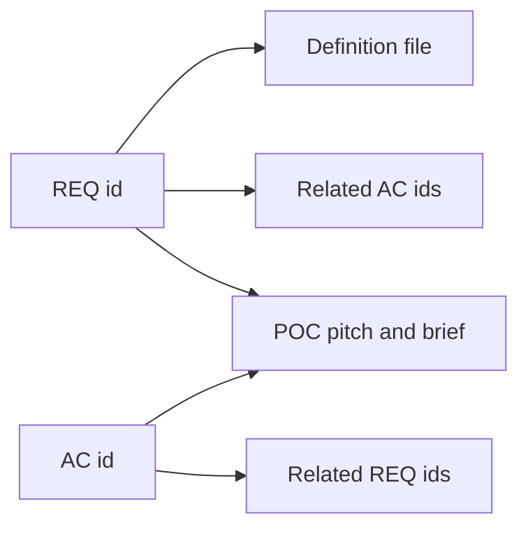

<!-- toon-meta
fmt: TOON
doc: docs/requirements/traceability.md
title: Traceability
type: traceability
summary: Maps each REQ and AC id to its POC and acceptance criterion.
related[2]: docs/requirements/README.md,docs/requirements/amendments-2026-10-30.md
status: current
updated: 2026-10-30
-->

# Traceability

[Home](../../README.md) | [Requirements](README.md) | [Architecture](../architecture/overview.md) | [Standards](../standards/README.md) | [Roadmap](../roadmap/PROPOSAL.md) | [Traceability](traceability.md) | [Backlog](../backlog/README.md)

[Previous](amendments-2026-10-30.md) | [Up](README.md)

## Navigation

- [At a glance](#at-a-glance)
- [How to read](#how-to-read)
- [Requirement to POC](#requirement-to-poc)
- [Acceptance criteria to requirement](#acceptance-criteria-to-requirement)
- [Unmapped ids](#unmapped-ids)

---

## At a glance

[Back to navigation](#navigation)

Which POC covers each id. Briefs: [Backlog](../backlog/README.md).

| You want | Go to |
|---|---|
| The POC of a requirement | [Requirement to POC](#requirement-to-poc) |
| The requirements of a POC from an AC | [Acceptance criteria to requirement](#acceptance-criteria-to-requirement) |
| Ids with no POC | [Unmapped ids](#unmapped-ids) |

---

## How to read

[Back to navigation](#navigation)

Nothing here adds or changes a requirement.

| Topic | Rule |
|---|---|
| POC mapping source | SRS coverage matrix and pitches in [PROPOSAL.md](../roadmap/PROPOSAL.md#srs-coverage-matrix) |
| `Source` column | PROPOSAL.md line numbers (`L<n>`, at most 3 shown) |
| `Related AC` and `Related REQ` | Relate items that share a POC. Not a one-to-one derivation. Not verified beyond that shared POC. |
| `Test` | Stays `TBD`: no application code or test exists in the documentation phase |
| POC cell | Links to its pitch in PROPOSAL.md and its brief in `docs/backlog/` |

---

## Requirement to POC

[Back to navigation](#navigation)

| REQ id | Definition | Related AC | POC | Source | Test |
|---|---|---|---|---|---|
| [REQ-STACK-01](02-technology-baseline.md) | [02-technology-baseline.md](02-technology-baseline.md) | [AC-01](11-nx-quality-testing.md), [AC-02](11-nx-quality-testing.md), [AC-13](11-nx-quality-testing.md), [AC-19](11-nx-quality-testing.md), [AC-22](11-nx-quality-testing.md), [AC-23](11-nx-quality-testing.md), [AC-24](11-nx-quality-testing.md), [AC-32](11-nx-quality-testing.md), [AC-33](11-nx-quality-testing.md), [AC-34](11-nx-quality-testing.md) | [POC-1](../roadmap/PROPOSAL.md#poc-1-toolchain-viability-and-workspace-skeleton) / [brief](../backlog/poc-1-toolchain-workspace-skeleton.md) | L147, L430 | TBD |
| [REQ-STACK-02](02-technology-baseline.md) | [02-technology-baseline.md](02-technology-baseline.md) | [AC-01](11-nx-quality-testing.md), [AC-02](11-nx-quality-testing.md), [AC-13](11-nx-quality-testing.md), [AC-19](11-nx-quality-testing.md), [AC-22](11-nx-quality-testing.md), [AC-23](11-nx-quality-testing.md), [AC-24](11-nx-quality-testing.md), [AC-32](11-nx-quality-testing.md), [AC-33](11-nx-quality-testing.md), [AC-34](11-nx-quality-testing.md) | [POC-1](../roadmap/PROPOSAL.md#poc-1-toolchain-viability-and-workspace-skeleton) / [brief](../backlog/poc-1-toolchain-workspace-skeleton.md) | L430 | TBD |
| [REQ-STACK-03](02-technology-baseline.md) | [02-technology-baseline.md](02-technology-baseline.md) | [AC-01](11-nx-quality-testing.md), [AC-02](11-nx-quality-testing.md), [AC-13](11-nx-quality-testing.md), [AC-19](11-nx-quality-testing.md), [AC-22](11-nx-quality-testing.md), [AC-23](11-nx-quality-testing.md), [AC-24](11-nx-quality-testing.md), [AC-32](11-nx-quality-testing.md), [AC-33](11-nx-quality-testing.md), [AC-34](11-nx-quality-testing.md) | [POC-1](../roadmap/PROPOSAL.md#poc-1-toolchain-viability-and-workspace-skeleton) / [brief](../backlog/poc-1-toolchain-workspace-skeleton.md) | L430 | TBD |
| [REQ-STACK-04](02-technology-baseline.md) | [02-technology-baseline.md](02-technology-baseline.md) | [AC-01](11-nx-quality-testing.md), [AC-02](11-nx-quality-testing.md), [AC-13](11-nx-quality-testing.md), [AC-19](11-nx-quality-testing.md), [AC-22](11-nx-quality-testing.md), [AC-23](11-nx-quality-testing.md), [AC-24](11-nx-quality-testing.md), [AC-32](11-nx-quality-testing.md), [AC-33](11-nx-quality-testing.md), [AC-34](11-nx-quality-testing.md) | [POC-1](../roadmap/PROPOSAL.md#poc-1-toolchain-viability-and-workspace-skeleton) / [brief](../backlog/poc-1-toolchain-workspace-skeleton.md) | L430 | TBD |
| [REQ-STACK-05](02-technology-baseline.md) | [02-technology-baseline.md](02-technology-baseline.md) | [AC-01](11-nx-quality-testing.md), [AC-02](11-nx-quality-testing.md), [AC-13](11-nx-quality-testing.md), [AC-19](11-nx-quality-testing.md), [AC-22](11-nx-quality-testing.md), [AC-23](11-nx-quality-testing.md), [AC-24](11-nx-quality-testing.md), [AC-32](11-nx-quality-testing.md), [AC-33](11-nx-quality-testing.md), [AC-34](11-nx-quality-testing.md) | [POC-1](../roadmap/PROPOSAL.md#poc-1-toolchain-viability-and-workspace-skeleton) / [brief](../backlog/poc-1-toolchain-workspace-skeleton.md) | L430 | TBD |
| [REQ-STACK-06](02-technology-baseline.md) | [02-technology-baseline.md](02-technology-baseline.md) | [AC-01](11-nx-quality-testing.md), [AC-02](11-nx-quality-testing.md), [AC-13](11-nx-quality-testing.md), [AC-19](11-nx-quality-testing.md), [AC-22](11-nx-quality-testing.md), [AC-23](11-nx-quality-testing.md), [AC-24](11-nx-quality-testing.md), [AC-32](11-nx-quality-testing.md), [AC-33](11-nx-quality-testing.md), [AC-34](11-nx-quality-testing.md) | [POC-1](../roadmap/PROPOSAL.md#poc-1-toolchain-viability-and-workspace-skeleton) / [brief](../backlog/poc-1-toolchain-workspace-skeleton.md) | L430 | TBD |
| [REQ-STACK-07](02-technology-baseline.md) | [02-technology-baseline.md](02-technology-baseline.md) | [AC-07](11-nx-quality-testing.md), [AC-08](11-nx-quality-testing.md), [AC-10](11-nx-quality-testing.md) | [POC-3](../roadmap/PROPOSAL.md#poc-3-config-and-sqlite-vector-persistence-inside-the-sea) / [brief](../backlog/poc-3-config-sqlite-vector.md) | L430 | TBD |
| [REQ-STACK-08](02-technology-baseline.md) | [02-technology-baseline.md](02-technology-baseline.md) | [AC-01](11-nx-quality-testing.md), [AC-02](11-nx-quality-testing.md), [AC-13](11-nx-quality-testing.md), [AC-19](11-nx-quality-testing.md), [AC-22](11-nx-quality-testing.md), [AC-23](11-nx-quality-testing.md), [AC-24](11-nx-quality-testing.md), [AC-32](11-nx-quality-testing.md), [AC-33](11-nx-quality-testing.md), [AC-34](11-nx-quality-testing.md) | [POC-1](../roadmap/PROPOSAL.md#poc-1-toolchain-viability-and-workspace-skeleton) / [brief](../backlog/poc-1-toolchain-workspace-skeleton.md) | L430 | TBD |
| [REQ-STACK-09](02-technology-baseline.md) | [02-technology-baseline.md](02-technology-baseline.md) | [AC-07](11-nx-quality-testing.md), [AC-08](11-nx-quality-testing.md), [AC-10](11-nx-quality-testing.md) | [POC-3](../roadmap/PROPOSAL.md#poc-3-config-and-sqlite-vector-persistence-inside-the-sea) / [brief](../backlog/poc-3-config-sqlite-vector.md) | L430 | TBD |
| [REQ-STACK-10](02-technology-baseline.md) | [02-technology-baseline.md](02-technology-baseline.md) | [AC-09](11-nx-quality-testing.md) | [Backlog (POC-6)](../roadmap/PROPOSAL.md#poc-6-postgresql-adapter-parity-backlog) / [brief](../backlog/poc-6-postgresql-adapter-parity.md) | L430 | TBD |
| [REQ-SUPPLY-01](02-technology-baseline.md) | [02-technology-baseline.md](02-technology-baseline.md) | [AC-01](11-nx-quality-testing.md), [AC-02](11-nx-quality-testing.md), [AC-13](11-nx-quality-testing.md), [AC-19](11-nx-quality-testing.md), [AC-22](11-nx-quality-testing.md), [AC-23](11-nx-quality-testing.md), [AC-24](11-nx-quality-testing.md), [AC-32](11-nx-quality-testing.md), [AC-33](11-nx-quality-testing.md), [AC-34](11-nx-quality-testing.md) | [POC-1](../roadmap/PROPOSAL.md#poc-1-toolchain-viability-and-workspace-skeleton) / [brief](../backlog/poc-1-toolchain-workspace-skeleton.md) | L141, L430 | TBD |
| [REQ-SUPPLY-02](02-technology-baseline.md) | [02-technology-baseline.md](02-technology-baseline.md) | [AC-01](11-nx-quality-testing.md), [AC-02](11-nx-quality-testing.md), [AC-13](11-nx-quality-testing.md), [AC-19](11-nx-quality-testing.md), [AC-22](11-nx-quality-testing.md), [AC-23](11-nx-quality-testing.md), [AC-24](11-nx-quality-testing.md), [AC-32](11-nx-quality-testing.md), [AC-33](11-nx-quality-testing.md), [AC-34](11-nx-quality-testing.md) | [POC-1](../roadmap/PROPOSAL.md#poc-1-toolchain-viability-and-workspace-skeleton) / [brief](../backlog/poc-1-toolchain-workspace-skeleton.md) | L430 | TBD |
| [REQ-REP-01](03-file-structure.md) | [03-file-structure.md](03-file-structure.md) | [AC-01](11-nx-quality-testing.md), [AC-02](11-nx-quality-testing.md), [AC-13](11-nx-quality-testing.md), [AC-19](11-nx-quality-testing.md), [AC-22](11-nx-quality-testing.md), [AC-23](11-nx-quality-testing.md), [AC-24](11-nx-quality-testing.md), [AC-32](11-nx-quality-testing.md), [AC-33](11-nx-quality-testing.md), [AC-34](11-nx-quality-testing.md) | [POC-0](../roadmap/PROPOSAL.md#poc-0-repo-bootstrap) / [brief](../backlog/poc-0-repo-bootstrap.md) ; [POC-1](../roadmap/PROPOSAL.md#poc-1-toolchain-viability-and-workspace-skeleton) / [brief](../backlog/poc-1-toolchain-workspace-skeleton.md) | L143, L431 | TBD |
| [REQ-REP-02](03-file-structure.md) | [03-file-structure.md](03-file-structure.md) | [AC-01](11-nx-quality-testing.md), [AC-02](11-nx-quality-testing.md), [AC-13](11-nx-quality-testing.md), [AC-19](11-nx-quality-testing.md), [AC-22](11-nx-quality-testing.md), [AC-23](11-nx-quality-testing.md), [AC-24](11-nx-quality-testing.md), [AC-32](11-nx-quality-testing.md), [AC-33](11-nx-quality-testing.md), [AC-34](11-nx-quality-testing.md) | [POC-0](../roadmap/PROPOSAL.md#poc-0-repo-bootstrap) / [brief](../backlog/poc-0-repo-bootstrap.md) ; [POC-1](../roadmap/PROPOSAL.md#poc-1-toolchain-viability-and-workspace-skeleton) / [brief](../backlog/poc-1-toolchain-workspace-skeleton.md) | L143, L431 | TBD |
| [REQ-REP-03](03-file-structure.md) | [03-file-structure.md](03-file-structure.md) | [AC-01](11-nx-quality-testing.md), [AC-02](11-nx-quality-testing.md), [AC-13](11-nx-quality-testing.md), [AC-19](11-nx-quality-testing.md), [AC-22](11-nx-quality-testing.md), [AC-23](11-nx-quality-testing.md), [AC-24](11-nx-quality-testing.md), [AC-32](11-nx-quality-testing.md), [AC-33](11-nx-quality-testing.md), [AC-34](11-nx-quality-testing.md) | [POC-0](../roadmap/PROPOSAL.md#poc-0-repo-bootstrap) / [brief](../backlog/poc-0-repo-bootstrap.md) ; [POC-1](../roadmap/PROPOSAL.md#poc-1-toolchain-viability-and-workspace-skeleton) / [brief](../backlog/poc-1-toolchain-workspace-skeleton.md) | L143, L431 | TBD |
| [REQ-REP-04](03-file-structure.md) | [03-file-structure.md](03-file-structure.md) | [AC-01](11-nx-quality-testing.md), [AC-02](11-nx-quality-testing.md), [AC-13](11-nx-quality-testing.md), [AC-19](11-nx-quality-testing.md), [AC-22](11-nx-quality-testing.md), [AC-23](11-nx-quality-testing.md), [AC-24](11-nx-quality-testing.md), [AC-32](11-nx-quality-testing.md), [AC-33](11-nx-quality-testing.md), [AC-34](11-nx-quality-testing.md) | [POC-0](../roadmap/PROPOSAL.md#poc-0-repo-bootstrap) / [brief](../backlog/poc-0-repo-bootstrap.md) ; [POC-1](../roadmap/PROPOSAL.md#poc-1-toolchain-viability-and-workspace-skeleton) / [brief](../backlog/poc-1-toolchain-workspace-skeleton.md) | L431 | TBD |
| [REQ-REP-05](03-file-structure.md) | [03-file-structure.md](03-file-structure.md) | [AC-01](11-nx-quality-testing.md), [AC-02](11-nx-quality-testing.md), [AC-13](11-nx-quality-testing.md), [AC-19](11-nx-quality-testing.md), [AC-22](11-nx-quality-testing.md), [AC-23](11-nx-quality-testing.md), [AC-24](11-nx-quality-testing.md), [AC-32](11-nx-quality-testing.md), [AC-33](11-nx-quality-testing.md), [AC-34](11-nx-quality-testing.md) | [POC-0](../roadmap/PROPOSAL.md#poc-0-repo-bootstrap) / [brief](../backlog/poc-0-repo-bootstrap.md) ; [POC-1](../roadmap/PROPOSAL.md#poc-1-toolchain-viability-and-workspace-skeleton) / [brief](../backlog/poc-1-toolchain-workspace-skeleton.md) | L129, L431 | TBD |
| [REQ-CFG-01](04-configuration.md) | [04-configuration.md](04-configuration.md) | [AC-07](11-nx-quality-testing.md), [AC-08](11-nx-quality-testing.md), [AC-10](11-nx-quality-testing.md) | [POC-3](../roadmap/PROPOSAL.md#poc-3-config-and-sqlite-vector-persistence-inside-the-sea) / [brief](../backlog/poc-3-config-sqlite-vector.md) | L191, L219, L432 | TBD |
| [REQ-CFG-02](04-configuration.md) | [04-configuration.md](04-configuration.md) | [AC-07](11-nx-quality-testing.md), [AC-08](11-nx-quality-testing.md), [AC-10](11-nx-quality-testing.md) | [POC-3](../roadmap/PROPOSAL.md#poc-3-config-and-sqlite-vector-persistence-inside-the-sea) / [brief](../backlog/poc-3-config-sqlite-vector.md) | L191, L219, L432 | TBD |
| [REQ-CFG-03](04-configuration.md) | [04-configuration.md](04-configuration.md) | [AC-06](11-nx-quality-testing.md), [AC-07](11-nx-quality-testing.md), [AC-08](11-nx-quality-testing.md), [AC-10](11-nx-quality-testing.md) | [POC-3](../roadmap/PROPOSAL.md#poc-3-config-and-sqlite-vector-persistence-inside-the-sea) / [brief](../backlog/poc-3-config-sqlite-vector.md) ; [POC-7](../roadmap/PROPOSAL.md#poc-7-auth-and-roles) / [brief](../backlog/poc-7-auth-roles.md) | L219, L311, L432 | TBD |
| [REQ-CFG-04](04-configuration.md) | [04-configuration.md](04-configuration.md) | [AC-07](11-nx-quality-testing.md), [AC-08](11-nx-quality-testing.md), [AC-10](11-nx-quality-testing.md) | [POC-3](../roadmap/PROPOSAL.md#poc-3-config-and-sqlite-vector-persistence-inside-the-sea) / [brief](../backlog/poc-3-config-sqlite-vector.md) | L191, L219, L432 | TBD |
| [REQ-CFG-05](04-configuration.md) | [04-configuration.md](04-configuration.md) | [AC-07](11-nx-quality-testing.md), [AC-08](11-nx-quality-testing.md), [AC-10](11-nx-quality-testing.md) | [POC-3](../roadmap/PROPOSAL.md#poc-3-config-and-sqlite-vector-persistence-inside-the-sea) / [brief](../backlog/poc-3-config-sqlite-vector.md) | L195, L198, L219 ... | TBD |
| [REQ-CFG-06](04-configuration.md) | [04-configuration.md](04-configuration.md) | [AC-07](11-nx-quality-testing.md), [AC-08](11-nx-quality-testing.md), [AC-10](11-nx-quality-testing.md) | [POC-3](../roadmap/PROPOSAL.md#poc-3-config-and-sqlite-vector-persistence-inside-the-sea) / [brief](../backlog/poc-3-config-sqlite-vector.md) | L191, L217, L219 ... | TBD |
| [REQ-DB-01](05-persistence.md) | [05-persistence.md](05-persistence.md) | [AC-07](11-nx-quality-testing.md), [AC-08](11-nx-quality-testing.md), [AC-09](11-nx-quality-testing.md), [AC-10](11-nx-quality-testing.md) | [POC-3](../roadmap/PROPOSAL.md#poc-3-config-and-sqlite-vector-persistence-inside-the-sea) / [brief](../backlog/poc-3-config-sqlite-vector.md) ; [Backlog (POC-6)](../roadmap/PROPOSAL.md#poc-6-postgresql-adapter-parity-backlog) / [brief](../backlog/poc-6-postgresql-adapter-parity.md) | L199, L219, L286 ... | TBD |
| [REQ-DB-02](05-persistence.md) | [05-persistence.md](05-persistence.md) | [AC-07](11-nx-quality-testing.md), [AC-08](11-nx-quality-testing.md), [AC-09](11-nx-quality-testing.md), [AC-10](11-nx-quality-testing.md) | [POC-3](../roadmap/PROPOSAL.md#poc-3-config-and-sqlite-vector-persistence-inside-the-sea) / [brief](../backlog/poc-3-config-sqlite-vector.md) ; [Backlog (POC-6)](../roadmap/PROPOSAL.md#poc-6-postgresql-adapter-parity-backlog) / [brief](../backlog/poc-6-postgresql-adapter-parity.md) | L199, L219, L286 ... | TBD |
| [REQ-DB-03](05-persistence.md) | [05-persistence.md](05-persistence.md) | [AC-07](11-nx-quality-testing.md), [AC-08](11-nx-quality-testing.md), [AC-09](11-nx-quality-testing.md), [AC-10](11-nx-quality-testing.md) | [POC-3](../roadmap/PROPOSAL.md#poc-3-config-and-sqlite-vector-persistence-inside-the-sea) / [brief](../backlog/poc-3-config-sqlite-vector.md) ; [Backlog (POC-6)](../roadmap/PROPOSAL.md#poc-6-postgresql-adapter-parity-backlog) / [brief](../backlog/poc-6-postgresql-adapter-parity.md) | L219, L286, L433 ... | TBD |
| [REQ-DB-04](05-persistence.md) | [05-persistence.md](05-persistence.md) | [AC-07](11-nx-quality-testing.md), [AC-08](11-nx-quality-testing.md), [AC-10](11-nx-quality-testing.md) | [POC-3](../roadmap/PROPOSAL.md#poc-3-config-and-sqlite-vector-persistence-inside-the-sea) / [brief](../backlog/poc-3-config-sqlite-vector.md) | L207, L219, L433 | TBD |
| [REQ-DB-05](05-persistence.md) | [05-persistence.md](05-persistence.md) | [AC-07](11-nx-quality-testing.md), [AC-08](11-nx-quality-testing.md), [AC-09](11-nx-quality-testing.md), [AC-10](11-nx-quality-testing.md) | [POC-3](../roadmap/PROPOSAL.md#poc-3-config-and-sqlite-vector-persistence-inside-the-sea) / [brief](../backlog/poc-3-config-sqlite-vector.md) ; [Backlog (POC-6)](../roadmap/PROPOSAL.md#poc-6-postgresql-adapter-parity-backlog) / [brief](../backlog/poc-6-postgresql-adapter-parity.md) | L207, L219, L286 ... | TBD |
| [REQ-DB-06](05-persistence.md) | [05-persistence.md](05-persistence.md) | [AC-07](11-nx-quality-testing.md), [AC-08](11-nx-quality-testing.md), [AC-10](11-nx-quality-testing.md) | [POC-3](../roadmap/PROPOSAL.md#poc-3-config-and-sqlite-vector-persistence-inside-the-sea) / [brief](../backlog/poc-3-config-sqlite-vector.md) | L208, L219, L433 | TBD |
| [REQ-DB-07](05-persistence.md) | [05-persistence.md](05-persistence.md) | [AC-07](11-nx-quality-testing.md), [AC-08](11-nx-quality-testing.md), [AC-10](11-nx-quality-testing.md) | [POC-3](../roadmap/PROPOSAL.md#poc-3-config-and-sqlite-vector-persistence-inside-the-sea) / [brief](../backlog/poc-3-config-sqlite-vector.md) | L209, L219, L433 | TBD |
| [REQ-DB-08](05-persistence.md) | [05-persistence.md](05-persistence.md) | [AC-07](11-nx-quality-testing.md), [AC-08](11-nx-quality-testing.md), [AC-09](11-nx-quality-testing.md), [AC-10](11-nx-quality-testing.md) | [POC-3](../roadmap/PROPOSAL.md#poc-3-config-and-sqlite-vector-persistence-inside-the-sea) / [brief](../backlog/poc-3-config-sqlite-vector.md) ; [Backlog (POC-6)](../roadmap/PROPOSAL.md#poc-6-postgresql-adapter-parity-backlog) / [brief](../backlog/poc-6-postgresql-adapter-parity.md) | L210, L217, L219 ... | TBD |
| [REQ-DB-09](05-persistence.md) | [05-persistence.md](05-persistence.md) | [AC-07](11-nx-quality-testing.md), [AC-08](11-nx-quality-testing.md), [AC-10](11-nx-quality-testing.md) | [POC-3](../roadmap/PROPOSAL.md#poc-3-config-and-sqlite-vector-persistence-inside-the-sea) / [brief](../backlog/poc-3-config-sqlite-vector.md) | L188, L206, L219 ... | TBD |
| [REQ-DEV-01](06-web-gateway-https-pwa.md) | [06-web-gateway-https-pwa.md](06-web-gateway-https-pwa.md) | [AC-04](11-nx-quality-testing.md), [AC-05](11-nx-quality-testing.md), [AC-12](11-nx-quality-testing.md), [AC-14](11-nx-quality-testing.md), [AC-15](11-nx-quality-testing.md), [AC-16](11-nx-quality-testing.md), [AC-17](11-nx-quality-testing.md) | [POC-4](../roadmap/PROPOSAL.md#poc-4-https-gateway-serving-the-angular-pwa) / [brief](../backlog/poc-4-https-gateway-angular-pwa.md) | L227, L231, L251 ... | TBD |
| [REQ-DEV-02](06-web-gateway-https-pwa.md) | [06-web-gateway-https-pwa.md](06-web-gateway-https-pwa.md) | [AC-04](11-nx-quality-testing.md), [AC-05](11-nx-quality-testing.md), [AC-12](11-nx-quality-testing.md), [AC-14](11-nx-quality-testing.md), [AC-15](11-nx-quality-testing.md), [AC-16](11-nx-quality-testing.md), [AC-17](11-nx-quality-testing.md) | [POC-4](../roadmap/PROPOSAL.md#poc-4-https-gateway-serving-the-angular-pwa) / [brief](../backlog/poc-4-https-gateway-angular-pwa.md) | L227, L231, L251 ... | TBD |
| [REQ-DEV-03](06-web-gateway-https-pwa.md) | [06-web-gateway-https-pwa.md](06-web-gateway-https-pwa.md) | [AC-04](11-nx-quality-testing.md), [AC-05](11-nx-quality-testing.md), [AC-12](11-nx-quality-testing.md), [AC-14](11-nx-quality-testing.md), [AC-15](11-nx-quality-testing.md), [AC-16](11-nx-quality-testing.md), [AC-17](11-nx-quality-testing.md) | [POC-4](../roadmap/PROPOSAL.md#poc-4-https-gateway-serving-the-angular-pwa) / [brief](../backlog/poc-4-https-gateway-angular-pwa.md) | L227, L231, L251 ... | TBD |
| [REQ-DEV-04](06-web-gateway-https-pwa.md) | [06-web-gateway-https-pwa.md](06-web-gateway-https-pwa.md) | [AC-04](11-nx-quality-testing.md), [AC-05](11-nx-quality-testing.md), [AC-12](11-nx-quality-testing.md), [AC-14](11-nx-quality-testing.md), [AC-15](11-nx-quality-testing.md), [AC-16](11-nx-quality-testing.md), [AC-17](11-nx-quality-testing.md) | [POC-4](../roadmap/PROPOSAL.md#poc-4-https-gateway-serving-the-angular-pwa) / [brief](../backlog/poc-4-https-gateway-angular-pwa.md) | L227, L231, L251 ... | TBD |
| [REQ-DEV-05](06-web-gateway-https-pwa.md) | [06-web-gateway-https-pwa.md](06-web-gateway-https-pwa.md) | [AC-04](11-nx-quality-testing.md), [AC-05](11-nx-quality-testing.md), [AC-12](11-nx-quality-testing.md), [AC-14](11-nx-quality-testing.md), [AC-15](11-nx-quality-testing.md), [AC-16](11-nx-quality-testing.md), [AC-17](11-nx-quality-testing.md) | [POC-4](../roadmap/PROPOSAL.md#poc-4-https-gateway-serving-the-angular-pwa) / [brief](../backlog/poc-4-https-gateway-angular-pwa.md) | L227, L251, L434 | TBD |
| [REQ-NET-01](06-web-gateway-https-pwa.md) | [06-web-gateway-https-pwa.md](06-web-gateway-https-pwa.md) | [AC-04](11-nx-quality-testing.md), [AC-05](11-nx-quality-testing.md), [AC-11](11-nx-quality-testing.md), [AC-12](11-nx-quality-testing.md), [AC-14](11-nx-quality-testing.md), [AC-15](11-nx-quality-testing.md), [AC-16](11-nx-quality-testing.md), [AC-17](11-nx-quality-testing.md), [AC-28](11-nx-quality-testing.md), [AC-29](11-nx-quality-testing.md), [AC-30](11-nx-quality-testing.md), [AC-31](11-nx-quality-testing.md) | [POC-2](../roadmap/PROPOSAL.md#poc-2-single-sea-and-runtime-supervisor) / [brief](../backlog/poc-2-single-sea-runtime-supervisor.md) ; [POC-4](../roadmap/PROPOSAL.md#poc-4-https-gateway-serving-the-angular-pwa) / [brief](../backlog/poc-4-https-gateway-angular-pwa.md) | L169, L251, L434 | TBD |
| [REQ-NET-02](06-web-gateway-https-pwa.md) | [06-web-gateway-https-pwa.md](06-web-gateway-https-pwa.md) | [AC-04](11-nx-quality-testing.md), [AC-05](11-nx-quality-testing.md), [AC-12](11-nx-quality-testing.md), [AC-14](11-nx-quality-testing.md), [AC-15](11-nx-quality-testing.md), [AC-16](11-nx-quality-testing.md), [AC-17](11-nx-quality-testing.md) | [POC-4](../roadmap/PROPOSAL.md#poc-4-https-gateway-serving-the-angular-pwa) / [brief](../backlog/poc-4-https-gateway-angular-pwa.md) | L240, L251, L434 | TBD |
| [REQ-NET-03](06-web-gateway-https-pwa.md) | [06-web-gateway-https-pwa.md](06-web-gateway-https-pwa.md) | [AC-04](11-nx-quality-testing.md), [AC-05](11-nx-quality-testing.md), [AC-12](11-nx-quality-testing.md), [AC-14](11-nx-quality-testing.md), [AC-15](11-nx-quality-testing.md), [AC-16](11-nx-quality-testing.md), [AC-17](11-nx-quality-testing.md) | [POC-4](../roadmap/PROPOSAL.md#poc-4-https-gateway-serving-the-angular-pwa) / [brief](../backlog/poc-4-https-gateway-angular-pwa.md) | L239, L251, L434 | TBD |
| [REQ-NET-04](06-web-gateway-https-pwa.md) | [06-web-gateway-https-pwa.md](06-web-gateway-https-pwa.md) | [AC-04](11-nx-quality-testing.md), [AC-05](11-nx-quality-testing.md), [AC-12](11-nx-quality-testing.md), [AC-14](11-nx-quality-testing.md), [AC-15](11-nx-quality-testing.md), [AC-16](11-nx-quality-testing.md), [AC-17](11-nx-quality-testing.md) | [POC-4](../roadmap/PROPOSAL.md#poc-4-https-gateway-serving-the-angular-pwa) / [brief](../backlog/poc-4-https-gateway-angular-pwa.md) | L239, L251, L434 | TBD |
| [REQ-NET-05](06-web-gateway-https-pwa.md) | [06-web-gateway-https-pwa.md](06-web-gateway-https-pwa.md) | [AC-04](11-nx-quality-testing.md), [AC-05](11-nx-quality-testing.md), [AC-12](11-nx-quality-testing.md), [AC-14](11-nx-quality-testing.md), [AC-15](11-nx-quality-testing.md), [AC-16](11-nx-quality-testing.md), [AC-17](11-nx-quality-testing.md) | [POC-4](../roadmap/PROPOSAL.md#poc-4-https-gateway-serving-the-angular-pwa) / [brief](../backlog/poc-4-https-gateway-angular-pwa.md) | L240, L251, L434 | TBD |
| [REQ-NET-06](06-web-gateway-https-pwa.md) | [06-web-gateway-https-pwa.md](06-web-gateway-https-pwa.md) | [AC-04](11-nx-quality-testing.md), [AC-05](11-nx-quality-testing.md), [AC-12](11-nx-quality-testing.md), [AC-14](11-nx-quality-testing.md), [AC-15](11-nx-quality-testing.md), [AC-16](11-nx-quality-testing.md), [AC-17](11-nx-quality-testing.md) | [POC-4](../roadmap/PROPOSAL.md#poc-4-https-gateway-serving-the-angular-pwa) / [brief](../backlog/poc-4-https-gateway-angular-pwa.md) | L238, L251, L434 | TBD |
| [REQ-NET-07](06-web-gateway-https-pwa.md) | [06-web-gateway-https-pwa.md](06-web-gateway-https-pwa.md) | [AC-04](11-nx-quality-testing.md), [AC-05](11-nx-quality-testing.md), [AC-12](11-nx-quality-testing.md), [AC-14](11-nx-quality-testing.md), [AC-15](11-nx-quality-testing.md), [AC-16](11-nx-quality-testing.md), [AC-17](11-nx-quality-testing.md) | [POC-4](../roadmap/PROPOSAL.md#poc-4-https-gateway-serving-the-angular-pwa) / [brief](../backlog/poc-4-https-gateway-angular-pwa.md) | L241, L251, L434 | TBD |
| [REQ-NET-08](06-web-gateway-https-pwa.md) | [06-web-gateway-https-pwa.md](06-web-gateway-https-pwa.md) | [AC-04](11-nx-quality-testing.md), [AC-05](11-nx-quality-testing.md), [AC-12](11-nx-quality-testing.md), [AC-14](11-nx-quality-testing.md), [AC-15](11-nx-quality-testing.md), [AC-16](11-nx-quality-testing.md), [AC-17](11-nx-quality-testing.md) | [POC-4](../roadmap/PROPOSAL.md#poc-4-https-gateway-serving-the-angular-pwa) / [brief](../backlog/poc-4-https-gateway-angular-pwa.md) | L238, L251, L434 | TBD |
| [REQ-TLS-01](06-web-gateway-https-pwa.md) | [06-web-gateway-https-pwa.md](06-web-gateway-https-pwa.md) | [AC-04](11-nx-quality-testing.md), [AC-05](11-nx-quality-testing.md), [AC-12](11-nx-quality-testing.md), [AC-14](11-nx-quality-testing.md), [AC-15](11-nx-quality-testing.md), [AC-16](11-nx-quality-testing.md), [AC-17](11-nx-quality-testing.md) | [POC-4](../roadmap/PROPOSAL.md#poc-4-https-gateway-serving-the-angular-pwa) / [brief](../backlog/poc-4-https-gateway-angular-pwa.md) | L232, L251, L434 | TBD |
| [REQ-TLS-02](06-web-gateway-https-pwa.md) | [06-web-gateway-https-pwa.md](06-web-gateway-https-pwa.md) | [AC-03](11-nx-quality-testing.md), [AC-04](11-nx-quality-testing.md), [AC-05](11-nx-quality-testing.md), [AC-12](11-nx-quality-testing.md), [AC-14](11-nx-quality-testing.md), [AC-15](11-nx-quality-testing.md), [AC-16](11-nx-quality-testing.md), [AC-17](11-nx-quality-testing.md), [AC-18](11-nx-quality-testing.md), [AC-20](11-nx-quality-testing.md), [AC-30](11-nx-quality-testing.md) | [POC-4](../roadmap/PROPOSAL.md#poc-4-https-gateway-serving-the-angular-pwa) / [brief](../backlog/poc-4-https-gateway-angular-pwa.md) ; [POC-5](../roadmap/PROPOSAL.md#poc-5-tauri-desktop-shell-with-sea-sidecar) / [brief](../backlog/poc-5-tauri-sidecar-desktop-shell.md) | L237, L245, L251 ... | TBD |
| [REQ-TLS-03](06-web-gateway-https-pwa.md) | [06-web-gateway-https-pwa.md](06-web-gateway-https-pwa.md) | [AC-04](11-nx-quality-testing.md), [AC-05](11-nx-quality-testing.md), [AC-12](11-nx-quality-testing.md), [AC-14](11-nx-quality-testing.md), [AC-15](11-nx-quality-testing.md), [AC-16](11-nx-quality-testing.md), [AC-17](11-nx-quality-testing.md) | [POC-4](../roadmap/PROPOSAL.md#poc-4-https-gateway-serving-the-angular-pwa) / [brief](../backlog/poc-4-https-gateway-angular-pwa.md) | L249, L251, L434 | TBD |
| [REQ-TLS-04](06-web-gateway-https-pwa.md) | [06-web-gateway-https-pwa.md](06-web-gateway-https-pwa.md) | [AC-04](11-nx-quality-testing.md), [AC-05](11-nx-quality-testing.md), [AC-12](11-nx-quality-testing.md), [AC-14](11-nx-quality-testing.md), [AC-15](11-nx-quality-testing.md), [AC-16](11-nx-quality-testing.md), [AC-17](11-nx-quality-testing.md) | [POC-4](../roadmap/PROPOSAL.md#poc-4-https-gateway-serving-the-angular-pwa) / [brief](../backlog/poc-4-https-gateway-angular-pwa.md) | L232, L251, L434 | TBD |
| [REQ-PWA-01](06-web-gateway-https-pwa.md) | [06-web-gateway-https-pwa.md](06-web-gateway-https-pwa.md) | [AC-04](11-nx-quality-testing.md), [AC-05](11-nx-quality-testing.md), [AC-12](11-nx-quality-testing.md), [AC-14](11-nx-quality-testing.md), [AC-15](11-nx-quality-testing.md), [AC-16](11-nx-quality-testing.md), [AC-17](11-nx-quality-testing.md) | [POC-4](../roadmap/PROPOSAL.md#poc-4-https-gateway-serving-the-angular-pwa) / [brief](../backlog/poc-4-https-gateway-angular-pwa.md) | L230, L251, L434 | TBD |
| [REQ-PWA-02](06-web-gateway-https-pwa.md) | [06-web-gateway-https-pwa.md](06-web-gateway-https-pwa.md) | [AC-04](11-nx-quality-testing.md), [AC-05](11-nx-quality-testing.md), [AC-12](11-nx-quality-testing.md), [AC-14](11-nx-quality-testing.md), [AC-15](11-nx-quality-testing.md), [AC-16](11-nx-quality-testing.md), [AC-17](11-nx-quality-testing.md) | [POC-4](../roadmap/PROPOSAL.md#poc-4-https-gateway-serving-the-angular-pwa) / [brief](../backlog/poc-4-https-gateway-angular-pwa.md) | L242, L251, L434 | TBD |
| [REQ-PWA-03](06-web-gateway-https-pwa.md) | [06-web-gateway-https-pwa.md](06-web-gateway-https-pwa.md) | [AC-04](11-nx-quality-testing.md), [AC-05](11-nx-quality-testing.md), [AC-12](11-nx-quality-testing.md), [AC-14](11-nx-quality-testing.md), [AC-15](11-nx-quality-testing.md), [AC-16](11-nx-quality-testing.md), [AC-17](11-nx-quality-testing.md) | [POC-4](../roadmap/PROPOSAL.md#poc-4-https-gateway-serving-the-angular-pwa) / [brief](../backlog/poc-4-https-gateway-angular-pwa.md) | L251, L434 | TBD |
| [REQ-SEC-01](07-security.md) | [07-security.md](07-security.md) | [AC-06](11-nx-quality-testing.md) | [POC-7](../roadmap/PROPOSAL.md#poc-7-auth-and-roles) / [brief](../backlog/poc-7-auth-roles.md) | L296, L308, L319 ... | TBD |
| [REQ-SEC-02](07-security.md) | [07-security.md](07-security.md) | [AC-06](11-nx-quality-testing.md) | [POC-7](../roadmap/PROPOSAL.md#poc-7-auth-and-roles) / [brief](../backlog/poc-7-auth-roles.md) | L296, L305, L307 ... | TBD |
| [REQ-SEC-03](07-security.md) | [07-security.md](07-security.md) | [AC-06](11-nx-quality-testing.md) | [POC-7](../roadmap/PROPOSAL.md#poc-7-auth-and-roles) / [brief](../backlog/poc-7-auth-roles.md) | L310, L317, L319 ... | TBD |
| [REQ-SEC-04](07-security.md) | [07-security.md](07-security.md) | [AC-06](11-nx-quality-testing.md) | [POC-7](../roadmap/PROPOSAL.md#poc-7-auth-and-roles) / [brief](../backlog/poc-7-auth-roles.md) | L311, L319, L435 | TBD |
| [REQ-SEC-05](07-security.md) | [07-security.md](07-security.md) | [AC-03](11-nx-quality-testing.md), [AC-18](11-nx-quality-testing.md), [AC-20](11-nx-quality-testing.md), [AC-30](11-nx-quality-testing.md) | [POC-5](../roadmap/PROPOSAL.md#poc-5-tauri-desktop-shell-with-sea-sidecar) / [brief](../backlog/poc-5-tauri-sidecar-desktop-shell.md) | L266, L278, L435 | TBD |
| [REQ-SEC-06](07-security.md) | [07-security.md](07-security.md) | [AC-06](11-nx-quality-testing.md), [AC-07](11-nx-quality-testing.md), [AC-08](11-nx-quality-testing.md), [AC-10](11-nx-quality-testing.md) | [POC-3](../roadmap/PROPOSAL.md#poc-3-config-and-sqlite-vector-persistence-inside-the-sea) / [brief](../backlog/poc-3-config-sqlite-vector.md) ; [POC-7](../roadmap/PROPOSAL.md#poc-7-auth-and-roles) / [brief](../backlog/poc-7-auth-roles.md) | L219, L319, L435 | TBD |
| [REQ-WEB-01](08-web-angular.md) | [08-web-angular.md](08-web-angular.md) | [AC-04](11-nx-quality-testing.md), [AC-05](11-nx-quality-testing.md), [AC-12](11-nx-quality-testing.md), [AC-14](11-nx-quality-testing.md), [AC-15](11-nx-quality-testing.md), [AC-16](11-nx-quality-testing.md), [AC-17](11-nx-quality-testing.md) | [POC-4](../roadmap/PROPOSAL.md#poc-4-https-gateway-serving-the-angular-pwa) / [brief](../backlog/poc-4-https-gateway-angular-pwa.md) | L230, L251, L436 | TBD |
| [REQ-WEB-02](08-web-angular.md) | [08-web-angular.md](08-web-angular.md) | [AC-06](11-nx-quality-testing.md) | [POC-7](../roadmap/PROPOSAL.md#poc-7-auth-and-roles) / [brief](../backlog/poc-7-auth-roles.md) | L309, L319, L436 | TBD |
| [REQ-WEB-03](08-web-angular.md) | [08-web-angular.md](08-web-angular.md) | [AC-06](11-nx-quality-testing.md) | [POC-7](../roadmap/PROPOSAL.md#poc-7-auth-and-roles) / [brief](../backlog/poc-7-auth-roles.md) | L310, L319, L436 | TBD |
| [REQ-WEB-04](08-web-angular.md) | [08-web-angular.md](08-web-angular.md) | [AC-04](11-nx-quality-testing.md), [AC-05](11-nx-quality-testing.md), [AC-06](11-nx-quality-testing.md), [AC-12](11-nx-quality-testing.md), [AC-14](11-nx-quality-testing.md), [AC-15](11-nx-quality-testing.md), [AC-16](11-nx-quality-testing.md), [AC-17](11-nx-quality-testing.md) | [POC-4](../roadmap/PROPOSAL.md#poc-4-https-gateway-serving-the-angular-pwa) / [brief](../backlog/poc-4-https-gateway-angular-pwa.md) ; [POC-7](../roadmap/PROPOSAL.md#poc-7-auth-and-roles) / [brief](../backlog/poc-7-auth-roles.md) | L249, L319, L436 | TBD |
| [REQ-DESK-01](09-desktop-tauri.md) | [09-desktop-tauri.md](09-desktop-tauri.md) | [AC-03](11-nx-quality-testing.md), [AC-18](11-nx-quality-testing.md), [AC-20](11-nx-quality-testing.md), [AC-30](11-nx-quality-testing.md) | [POC-5](../roadmap/PROPOSAL.md#poc-5-tauri-desktop-shell-with-sea-sidecar) / [brief](../backlog/poc-5-tauri-sidecar-desktop-shell.md) | L262, L278, L437 | TBD |
| [REQ-DESK-02](09-desktop-tauri.md) | [09-desktop-tauri.md](09-desktop-tauri.md) | [AC-03](11-nx-quality-testing.md), [AC-18](11-nx-quality-testing.md), [AC-20](11-nx-quality-testing.md), [AC-30](11-nx-quality-testing.md) | [POC-5](../roadmap/PROPOSAL.md#poc-5-tauri-desktop-shell-with-sea-sidecar) / [brief](../backlog/poc-5-tauri-sidecar-desktop-shell.md) | L259, L263, L278 ... | TBD |
| [REQ-DESK-03](09-desktop-tauri.md) | [09-desktop-tauri.md](09-desktop-tauri.md) | [AC-03](11-nx-quality-testing.md), [AC-18](11-nx-quality-testing.md), [AC-20](11-nx-quality-testing.md), [AC-30](11-nx-quality-testing.md) | [POC-5](../roadmap/PROPOSAL.md#poc-5-tauri-desktop-shell-with-sea-sidecar) / [brief](../backlog/poc-5-tauri-sidecar-desktop-shell.md) | L264, L278, L437 | TBD |
| [REQ-DESK-04](09-desktop-tauri.md) | [09-desktop-tauri.md](09-desktop-tauri.md) | [AC-03](11-nx-quality-testing.md), [AC-18](11-nx-quality-testing.md), [AC-20](11-nx-quality-testing.md), [AC-30](11-nx-quality-testing.md) | [POC-5](../roadmap/PROPOSAL.md#poc-5-tauri-desktop-shell-with-sea-sidecar) / [brief](../backlog/poc-5-tauri-sidecar-desktop-shell.md) | L265, L276, L278 ... | TBD |
| [REQ-DESK-05](09-desktop-tauri.md) | [09-desktop-tauri.md](09-desktop-tauri.md) | [AC-03](11-nx-quality-testing.md), [AC-18](11-nx-quality-testing.md), [AC-20](11-nx-quality-testing.md), [AC-30](11-nx-quality-testing.md) | [POC-5](../roadmap/PROPOSAL.md#poc-5-tauri-desktop-shell-with-sea-sidecar) / [brief](../backlog/poc-5-tauri-sidecar-desktop-shell.md) | L265, L278, L437 | TBD |
| [REQ-DESK-06](09-desktop-tauri.md) | [09-desktop-tauri.md](09-desktop-tauri.md) | [AC-03](11-nx-quality-testing.md), [AC-18](11-nx-quality-testing.md), [AC-20](11-nx-quality-testing.md), [AC-30](11-nx-quality-testing.md) | [POC-5](../roadmap/PROPOSAL.md#poc-5-tauri-desktop-shell-with-sea-sidecar) / [brief](../backlog/poc-5-tauri-sidecar-desktop-shell.md) | L259, L278, L437 | TBD |
| [REQ-RUNTIME-01](09-desktop-tauri.md) | [09-desktop-tauri.md](09-desktop-tauri.md) | [AC-11](11-nx-quality-testing.md), [AC-28](11-nx-quality-testing.md), [AC-29](11-nx-quality-testing.md), [AC-30](11-nx-quality-testing.md), [AC-31](11-nx-quality-testing.md) | [POC-2](../roadmap/PROPOSAL.md#poc-2-single-sea-and-runtime-supervisor) / [brief](../backlog/poc-2-single-sea-runtime-supervisor.md) | L162, L180, L437 | TBD |
| [REQ-RUNTIME-02](09-desktop-tauri.md) | [09-desktop-tauri.md](09-desktop-tauri.md) | [AC-11](11-nx-quality-testing.md), [AC-28](11-nx-quality-testing.md), [AC-29](11-nx-quality-testing.md), [AC-30](11-nx-quality-testing.md), [AC-31](11-nx-quality-testing.md) | [POC-2](../roadmap/PROPOSAL.md#poc-2-single-sea-and-runtime-supervisor) / [brief](../backlog/poc-2-single-sea-runtime-supervisor.md) | L167, L180, L437 | TBD |
| [REQ-RUNTIME-03](09-desktop-tauri.md) | [09-desktop-tauri.md](09-desktop-tauri.md) | [AC-11](11-nx-quality-testing.md), [AC-28](11-nx-quality-testing.md), [AC-29](11-nx-quality-testing.md), [AC-30](11-nx-quality-testing.md), [AC-31](11-nx-quality-testing.md) | [POC-2](../roadmap/PROPOSAL.md#poc-2-single-sea-and-runtime-supervisor) / [brief](../backlog/poc-2-single-sea-runtime-supervisor.md) | L162, L166, L180 ... | TBD |
| [REQ-RUNTIME-04](09-desktop-tauri.md) | [09-desktop-tauri.md](09-desktop-tauri.md) | [AC-11](11-nx-quality-testing.md), [AC-28](11-nx-quality-testing.md), [AC-29](11-nx-quality-testing.md), [AC-30](11-nx-quality-testing.md), [AC-31](11-nx-quality-testing.md) | [POC-2](../roadmap/PROPOSAL.md#poc-2-single-sea-and-runtime-supervisor) / [brief](../backlog/poc-2-single-sea-runtime-supervisor.md) | L178, L180, L437 | TBD |
| [REQ-RUNTIME-05](09-desktop-tauri.md) | [09-desktop-tauri.md](09-desktop-tauri.md) | [AC-11](11-nx-quality-testing.md), [AC-28](11-nx-quality-testing.md), [AC-29](11-nx-quality-testing.md), [AC-30](11-nx-quality-testing.md), [AC-31](11-nx-quality-testing.md) | [POC-2](../roadmap/PROPOSAL.md#poc-2-single-sea-and-runtime-supervisor) / [brief](../backlog/poc-2-single-sea-runtime-supervisor.md) | L171, L180, L437 | TBD |
| [REQ-RUNTIME-06](09-desktop-tauri.md) | [09-desktop-tauri.md](09-desktop-tauri.md) | [AC-11](11-nx-quality-testing.md), [AC-28](11-nx-quality-testing.md), [AC-29](11-nx-quality-testing.md), [AC-30](11-nx-quality-testing.md), [AC-31](11-nx-quality-testing.md) | [POC-2](../roadmap/PROPOSAL.md#poc-2-single-sea-and-runtime-supervisor) / [brief](../backlog/poc-2-single-sea-runtime-supervisor.md) | L170, L180, L437 | TBD |
| [REQ-RUNTIME-07](09-desktop-tauri.md) | [09-desktop-tauri.md](09-desktop-tauri.md) | [AC-07](11-nx-quality-testing.md), [AC-08](11-nx-quality-testing.md), [AC-10](11-nx-quality-testing.md), [AC-11](11-nx-quality-testing.md), [AC-28](11-nx-quality-testing.md), [AC-29](11-nx-quality-testing.md), [AC-30](11-nx-quality-testing.md), [AC-31](11-nx-quality-testing.md) | [POC-2](../roadmap/PROPOSAL.md#poc-2-single-sea-and-runtime-supervisor) / [brief](../backlog/poc-2-single-sea-runtime-supervisor.md) ; [POC-3](../roadmap/PROPOSAL.md#poc-3-config-and-sqlite-vector-persistence-inside-the-sea) / [brief](../backlog/poc-3-config-sqlite-vector.md) | L180, L216, L437 | TBD |
| [REQ-RUNTIME-08](09-desktop-tauri.md) | [09-desktop-tauri.md](09-desktop-tauri.md) | [AC-11](11-nx-quality-testing.md), [AC-28](11-nx-quality-testing.md), [AC-29](11-nx-quality-testing.md), [AC-30](11-nx-quality-testing.md), [AC-31](11-nx-quality-testing.md) | [POC-2](../roadmap/PROPOSAL.md#poc-2-single-sea-and-runtime-supervisor) / [brief](../backlog/poc-2-single-sea-runtime-supervisor.md) | L172, L180, L437 | TBD |
| [REQ-SEA-01](10-node-sea-distribution.md) | [10-node-sea-distribution.md](10-node-sea-distribution.md) | [AC-04](11-nx-quality-testing.md), [AC-05](11-nx-quality-testing.md), [AC-11](11-nx-quality-testing.md), [AC-12](11-nx-quality-testing.md), [AC-14](11-nx-quality-testing.md), [AC-15](11-nx-quality-testing.md), [AC-16](11-nx-quality-testing.md), [AC-17](11-nx-quality-testing.md), [AC-28](11-nx-quality-testing.md), [AC-29](11-nx-quality-testing.md), [AC-30](11-nx-quality-testing.md), [AC-31](11-nx-quality-testing.md) | [POC-2](../roadmap/PROPOSAL.md#poc-2-single-sea-and-runtime-supervisor) / [brief](../backlog/poc-2-single-sea-runtime-supervisor.md) ; [POC-4](../roadmap/PROPOSAL.md#poc-4-https-gateway-serving-the-angular-pwa) / [brief](../backlog/poc-4-https-gateway-angular-pwa.md) | L162, L165, L180 ... | TBD |
| [REQ-SEA-02](10-node-sea-distribution.md) | [10-node-sea-distribution.md](10-node-sea-distribution.md) | [AC-04](11-nx-quality-testing.md), [AC-05](11-nx-quality-testing.md), [AC-11](11-nx-quality-testing.md), [AC-12](11-nx-quality-testing.md), [AC-14](11-nx-quality-testing.md), [AC-15](11-nx-quality-testing.md), [AC-16](11-nx-quality-testing.md), [AC-17](11-nx-quality-testing.md), [AC-28](11-nx-quality-testing.md), [AC-29](11-nx-quality-testing.md), [AC-30](11-nx-quality-testing.md), [AC-31](11-nx-quality-testing.md) | [POC-2](../roadmap/PROPOSAL.md#poc-2-single-sea-and-runtime-supervisor) / [brief](../backlog/poc-2-single-sea-runtime-supervisor.md) ; [POC-4](../roadmap/PROPOSAL.md#poc-4-https-gateway-serving-the-angular-pwa) / [brief](../backlog/poc-4-https-gateway-angular-pwa.md) | L165, L180, L438 | TBD |
| [REQ-SEA-03](10-node-sea-distribution.md) | [10-node-sea-distribution.md](10-node-sea-distribution.md) | [AC-04](11-nx-quality-testing.md), [AC-05](11-nx-quality-testing.md), [AC-11](11-nx-quality-testing.md), [AC-12](11-nx-quality-testing.md), [AC-14](11-nx-quality-testing.md), [AC-15](11-nx-quality-testing.md), [AC-16](11-nx-quality-testing.md), [AC-17](11-nx-quality-testing.md), [AC-28](11-nx-quality-testing.md), [AC-29](11-nx-quality-testing.md), [AC-30](11-nx-quality-testing.md), [AC-31](11-nx-quality-testing.md) | [POC-2](../roadmap/PROPOSAL.md#poc-2-single-sea-and-runtime-supervisor) / [brief](../backlog/poc-2-single-sea-runtime-supervisor.md) ; [POC-4](../roadmap/PROPOSAL.md#poc-4-https-gateway-serving-the-angular-pwa) / [brief](../backlog/poc-4-https-gateway-angular-pwa.md) | L165, L180, L438 | TBD |
| [REQ-SEA-04](10-node-sea-distribution.md) | [10-node-sea-distribution.md](10-node-sea-distribution.md) | [AC-04](11-nx-quality-testing.md), [AC-05](11-nx-quality-testing.md), [AC-11](11-nx-quality-testing.md), [AC-12](11-nx-quality-testing.md), [AC-14](11-nx-quality-testing.md), [AC-15](11-nx-quality-testing.md), [AC-16](11-nx-quality-testing.md), [AC-17](11-nx-quality-testing.md), [AC-28](11-nx-quality-testing.md), [AC-29](11-nx-quality-testing.md), [AC-30](11-nx-quality-testing.md), [AC-31](11-nx-quality-testing.md) | [POC-2](../roadmap/PROPOSAL.md#poc-2-single-sea-and-runtime-supervisor) / [brief](../backlog/poc-2-single-sea-runtime-supervisor.md) ; [POC-4](../roadmap/PROPOSAL.md#poc-4-https-gateway-serving-the-angular-pwa) / [brief](../backlog/poc-4-https-gateway-angular-pwa.md) | L239, L438 | TBD |
| [REQ-SEA-05](10-node-sea-distribution.md) | [10-node-sea-distribution.md](10-node-sea-distribution.md) | [AC-04](11-nx-quality-testing.md), [AC-05](11-nx-quality-testing.md), [AC-07](11-nx-quality-testing.md), [AC-08](11-nx-quality-testing.md), [AC-10](11-nx-quality-testing.md), [AC-11](11-nx-quality-testing.md), [AC-12](11-nx-quality-testing.md), [AC-14](11-nx-quality-testing.md), [AC-15](11-nx-quality-testing.md), [AC-16](11-nx-quality-testing.md), [AC-17](11-nx-quality-testing.md), [AC-28](11-nx-quality-testing.md), [AC-29](11-nx-quality-testing.md), [AC-30](11-nx-quality-testing.md), [AC-31](11-nx-quality-testing.md) | [POC-2](../roadmap/PROPOSAL.md#poc-2-single-sea-and-runtime-supervisor) / [brief](../backlog/poc-2-single-sea-runtime-supervisor.md) ; [POC-3](../roadmap/PROPOSAL.md#poc-3-config-and-sqlite-vector-persistence-inside-the-sea) / [brief](../backlog/poc-3-config-sqlite-vector.md) ; [POC-4](../roadmap/PROPOSAL.md#poc-4-https-gateway-serving-the-angular-pwa) / [brief](../backlog/poc-4-https-gateway-angular-pwa.md) | L195, L209, L438 | TBD |
| [REQ-SEA-06](10-node-sea-distribution.md) | [10-node-sea-distribution.md](10-node-sea-distribution.md) | [AC-21](11-nx-quality-testing.md), [AC-25](11-nx-quality-testing.md), [AC-33](11-nx-quality-testing.md) | [POC-8](../roadmap/PROPOSAL.md#poc-8-msi-credential-dialog-platform-matrix-and-lockstep-versioning) / [brief](../backlog/poc-8-msi-matrix-versioning.md) | L438 | TBD |
| [REQ-SEC-CI-01](11-nx-quality-testing.md) | [11-nx-quality-testing.md](11-nx-quality-testing.md) | [AC-01](11-nx-quality-testing.md), [AC-02](11-nx-quality-testing.md), [AC-13](11-nx-quality-testing.md), [AC-19](11-nx-quality-testing.md), [AC-22](11-nx-quality-testing.md), [AC-23](11-nx-quality-testing.md), [AC-24](11-nx-quality-testing.md), [AC-26](11-nx-quality-testing.md), [AC-27](11-nx-quality-testing.md), [AC-32](11-nx-quality-testing.md), [AC-33](11-nx-quality-testing.md), [AC-34](11-nx-quality-testing.md), [AC-35](11-nx-quality-testing.md), [AC-36](11-nx-quality-testing.md) | [POC-1](../roadmap/PROPOSAL.md#poc-1-toolchain-viability-and-workspace-skeleton) / [brief](../backlog/poc-1-toolchain-workspace-skeleton.md) ; [POC-9](../roadmap/PROPOSAL.md#poc-9-github-actions-cicd-and-releases-hold) / [brief](../backlog/poc-9-ci-cd-releases.md) | L145, L365, L439 | TBD |
| [REQ-SEC-CI-02](11-nx-quality-testing.md) | [11-nx-quality-testing.md](11-nx-quality-testing.md) | [AC-01](11-nx-quality-testing.md), [AC-02](11-nx-quality-testing.md), [AC-13](11-nx-quality-testing.md), [AC-19](11-nx-quality-testing.md), [AC-22](11-nx-quality-testing.md), [AC-23](11-nx-quality-testing.md), [AC-24](11-nx-quality-testing.md), [AC-26](11-nx-quality-testing.md), [AC-27](11-nx-quality-testing.md), [AC-32](11-nx-quality-testing.md), [AC-33](11-nx-quality-testing.md), [AC-34](11-nx-quality-testing.md), [AC-35](11-nx-quality-testing.md), [AC-36](11-nx-quality-testing.md) | [POC-1](../roadmap/PROPOSAL.md#poc-1-toolchain-viability-and-workspace-skeleton) / [brief](../backlog/poc-1-toolchain-workspace-skeleton.md) ; [POC-9](../roadmap/PROPOSAL.md#poc-9-github-actions-cicd-and-releases-hold) / [brief](../backlog/poc-9-ci-cd-releases.md) | L145, L365, L439 | TBD |
| [REQ-SEC-CI-03](11-nx-quality-testing.md) | [11-nx-quality-testing.md](11-nx-quality-testing.md) | [AC-01](11-nx-quality-testing.md), [AC-02](11-nx-quality-testing.md), [AC-13](11-nx-quality-testing.md), [AC-19](11-nx-quality-testing.md), [AC-22](11-nx-quality-testing.md), [AC-23](11-nx-quality-testing.md), [AC-24](11-nx-quality-testing.md), [AC-26](11-nx-quality-testing.md), [AC-27](11-nx-quality-testing.md), [AC-32](11-nx-quality-testing.md), [AC-33](11-nx-quality-testing.md), [AC-34](11-nx-quality-testing.md), [AC-35](11-nx-quality-testing.md), [AC-36](11-nx-quality-testing.md) | [POC-1](../roadmap/PROPOSAL.md#poc-1-toolchain-viability-and-workspace-skeleton) / [brief](../backlog/poc-1-toolchain-workspace-skeleton.md) ; [POC-9](../roadmap/PROPOSAL.md#poc-9-github-actions-cicd-and-releases-hold) / [brief](../backlog/poc-9-ci-cd-releases.md) | L141, L365, L439 | TBD |
| [REQ-SEC-CI-04](11-nx-quality-testing.md) | [11-nx-quality-testing.md](11-nx-quality-testing.md) | [AC-01](11-nx-quality-testing.md), [AC-02](11-nx-quality-testing.md), [AC-13](11-nx-quality-testing.md), [AC-19](11-nx-quality-testing.md), [AC-22](11-nx-quality-testing.md), [AC-23](11-nx-quality-testing.md), [AC-24](11-nx-quality-testing.md), [AC-26](11-nx-quality-testing.md), [AC-27](11-nx-quality-testing.md), [AC-32](11-nx-quality-testing.md), [AC-33](11-nx-quality-testing.md), [AC-34](11-nx-quality-testing.md), [AC-35](11-nx-quality-testing.md), [AC-36](11-nx-quality-testing.md) | [POC-1](../roadmap/PROPOSAL.md#poc-1-toolchain-viability-and-workspace-skeleton) / [brief](../backlog/poc-1-toolchain-workspace-skeleton.md) ; [POC-9](../roadmap/PROPOSAL.md#poc-9-github-actions-cicd-and-releases-hold) / [brief](../backlog/poc-9-ci-cd-releases.md) | L356, L365, L439 | TBD |
| [REQ-BUILD-01](11-nx-quality-testing.md) | [11-nx-quality-testing.md](11-nx-quality-testing.md) | [AC-01](11-nx-quality-testing.md), [AC-02](11-nx-quality-testing.md), [AC-13](11-nx-quality-testing.md), [AC-19](11-nx-quality-testing.md), [AC-22](11-nx-quality-testing.md), [AC-23](11-nx-quality-testing.md), [AC-24](11-nx-quality-testing.md), [AC-32](11-nx-quality-testing.md), [AC-33](11-nx-quality-testing.md), [AC-34](11-nx-quality-testing.md) | [POC-1](../roadmap/PROPOSAL.md#poc-1-toolchain-viability-and-workspace-skeleton) / [brief](../backlog/poc-1-toolchain-workspace-skeleton.md) | L139 | TBD |
| [REQ-BUILD-02](11-nx-quality-testing.md) | [11-nx-quality-testing.md](11-nx-quality-testing.md) | [AC-01](11-nx-quality-testing.md), [AC-02](11-nx-quality-testing.md), [AC-13](11-nx-quality-testing.md), [AC-19](11-nx-quality-testing.md), [AC-22](11-nx-quality-testing.md), [AC-23](11-nx-quality-testing.md), [AC-24](11-nx-quality-testing.md), [AC-32](11-nx-quality-testing.md), [AC-33](11-nx-quality-testing.md), [AC-34](11-nx-quality-testing.md) | [POC-1](../roadmap/PROPOSAL.md#poc-1-toolchain-viability-and-workspace-skeleton) / [brief](../backlog/poc-1-toolchain-workspace-skeleton.md) | L155 | TBD |
| [REQ-BUILD-03](11-nx-quality-testing.md) | [11-nx-quality-testing.md](11-nx-quality-testing.md) | [AC-01](11-nx-quality-testing.md), [AC-02](11-nx-quality-testing.md), [AC-13](11-nx-quality-testing.md), [AC-19](11-nx-quality-testing.md), [AC-22](11-nx-quality-testing.md), [AC-23](11-nx-quality-testing.md), [AC-24](11-nx-quality-testing.md), [AC-32](11-nx-quality-testing.md), [AC-33](11-nx-quality-testing.md), [AC-34](11-nx-quality-testing.md) | [POC-1](../roadmap/PROPOSAL.md#poc-1-toolchain-viability-and-workspace-skeleton) / [brief](../backlog/poc-1-toolchain-workspace-skeleton.md) | L155 | TBD |
| [REQ-BUILD-04](11-nx-quality-testing.md) | [11-nx-quality-testing.md](11-nx-quality-testing.md) | [AC-01](11-nx-quality-testing.md), [AC-02](11-nx-quality-testing.md), [AC-13](11-nx-quality-testing.md), [AC-19](11-nx-quality-testing.md), [AC-22](11-nx-quality-testing.md), [AC-23](11-nx-quality-testing.md), [AC-24](11-nx-quality-testing.md), [AC-32](11-nx-quality-testing.md), [AC-33](11-nx-quality-testing.md), [AC-34](11-nx-quality-testing.md) | [POC-1](../roadmap/PROPOSAL.md#poc-1-toolchain-viability-and-workspace-skeleton) / [brief](../backlog/poc-1-toolchain-workspace-skeleton.md) | L155 | TBD |
| [REQ-BUILD-05](11-nx-quality-testing.md) | [11-nx-quality-testing.md](11-nx-quality-testing.md) | [AC-01](11-nx-quality-testing.md), [AC-02](11-nx-quality-testing.md), [AC-13](11-nx-quality-testing.md), [AC-19](11-nx-quality-testing.md), [AC-22](11-nx-quality-testing.md), [AC-23](11-nx-quality-testing.md), [AC-24](11-nx-quality-testing.md), [AC-32](11-nx-quality-testing.md), [AC-33](11-nx-quality-testing.md), [AC-34](11-nx-quality-testing.md) | [POC-1](../roadmap/PROPOSAL.md#poc-1-toolchain-viability-and-workspace-skeleton) / [brief](../backlog/poc-1-toolchain-workspace-skeleton.md) | L155 | TBD |
| [REQ-TEST-01](11-nx-quality-testing.md) | [11-nx-quality-testing.md](11-nx-quality-testing.md) | [AC-19](11-nx-quality-testing.md) | [All POCs (test policy)](../roadmap/PROPOSAL.md#method) / [backlog index](../backlog/README.md) | L74, L380 | TBD |
| [REQ-TEST-02](11-nx-quality-testing.md) | [11-nx-quality-testing.md](11-nx-quality-testing.md) | [AC-01](11-nx-quality-testing.md), [AC-02](11-nx-quality-testing.md), [AC-13](11-nx-quality-testing.md), [AC-19](11-nx-quality-testing.md), [AC-22](11-nx-quality-testing.md), [AC-23](11-nx-quality-testing.md), [AC-24](11-nx-quality-testing.md), [AC-32](11-nx-quality-testing.md), [AC-33](11-nx-quality-testing.md), [AC-34](11-nx-quality-testing.md) | [POC-1](../roadmap/PROPOSAL.md#poc-1-toolchain-viability-and-workspace-skeleton) / [brief](../backlog/poc-1-toolchain-workspace-skeleton.md) | L155 | TBD |
| [REQ-TEST-03](11-nx-quality-testing.md) | [11-nx-quality-testing.md](11-nx-quality-testing.md) | [AC-01](11-nx-quality-testing.md), [AC-02](11-nx-quality-testing.md), [AC-13](11-nx-quality-testing.md), [AC-19](11-nx-quality-testing.md), [AC-22](11-nx-quality-testing.md), [AC-23](11-nx-quality-testing.md), [AC-24](11-nx-quality-testing.md), [AC-32](11-nx-quality-testing.md), [AC-33](11-nx-quality-testing.md), [AC-34](11-nx-quality-testing.md) | [POC-1](../roadmap/PROPOSAL.md#poc-1-toolchain-viability-and-workspace-skeleton) / [brief](../backlog/poc-1-toolchain-workspace-skeleton.md) | L146 | TBD |
| [REQ-TEST-04](11-nx-quality-testing.md) | [11-nx-quality-testing.md](11-nx-quality-testing.md) | [AC-07](11-nx-quality-testing.md), [AC-08](11-nx-quality-testing.md), [AC-10](11-nx-quality-testing.md) | [POC-3](../roadmap/PROPOSAL.md#poc-3-config-and-sqlite-vector-persistence-inside-the-sea) / [brief](../backlog/poc-3-config-sqlite-vector.md) | L217 | TBD |
| [REQ-TEST-05](11-nx-quality-testing.md) | [11-nx-quality-testing.md](11-nx-quality-testing.md) | [AC-04](11-nx-quality-testing.md), [AC-05](11-nx-quality-testing.md), [AC-06](11-nx-quality-testing.md), [AC-12](11-nx-quality-testing.md), [AC-14](11-nx-quality-testing.md), [AC-15](11-nx-quality-testing.md), [AC-16](11-nx-quality-testing.md), [AC-17](11-nx-quality-testing.md) | [POC-4](../roadmap/PROPOSAL.md#poc-4-https-gateway-serving-the-angular-pwa) / [brief](../backlog/poc-4-https-gateway-angular-pwa.md) ; [POC-7](../roadmap/PROPOSAL.md#poc-7-auth-and-roles) / [brief](../backlog/poc-7-auth-roles.md) | L251, L312, L319 | TBD |
| [REQ-TEST-06](11-nx-quality-testing.md) | [11-nx-quality-testing.md](11-nx-quality-testing.md) | [AC-07](11-nx-quality-testing.md), [AC-08](11-nx-quality-testing.md), [AC-09](11-nx-quality-testing.md), [AC-10](11-nx-quality-testing.md) | [POC-3](../roadmap/PROPOSAL.md#poc-3-config-and-sqlite-vector-persistence-inside-the-sea) / [brief](../backlog/poc-3-config-sqlite-vector.md) ; [Backlog (POC-6)](../roadmap/PROPOSAL.md#poc-6-postgresql-adapter-parity-backlog) / [brief](../backlog/poc-6-postgresql-adapter-parity.md) | L219, L288, L289 ... | TBD |
| [REQ-TEST-07](11-nx-quality-testing.md) | [11-nx-quality-testing.md](11-nx-quality-testing.md) | [AC-11](11-nx-quality-testing.md), [AC-28](11-nx-quality-testing.md), [AC-29](11-nx-quality-testing.md), [AC-30](11-nx-quality-testing.md), [AC-31](11-nx-quality-testing.md) | [POC-2](../roadmap/PROPOSAL.md#poc-2-single-sea-and-runtime-supervisor) / [brief](../backlog/poc-2-single-sea-runtime-supervisor.md) | L180 | TBD |
| [REQ-TEST-08](11-nx-quality-testing.md) | [11-nx-quality-testing.md](11-nx-quality-testing.md) | [AC-03](11-nx-quality-testing.md), [AC-18](11-nx-quality-testing.md), [AC-20](11-nx-quality-testing.md), [AC-30](11-nx-quality-testing.md) | [POC-5](../roadmap/PROPOSAL.md#poc-5-tauri-desktop-shell-with-sea-sidecar) / [brief](../backlog/poc-5-tauri-sidecar-desktop-shell.md) | L270, L278 | TBD |
| [REQ-TEST-09](11-nx-quality-testing.md) | [11-nx-quality-testing.md](11-nx-quality-testing.md) | [AC-03](11-nx-quality-testing.md), [AC-18](11-nx-quality-testing.md), [AC-20](11-nx-quality-testing.md), [AC-21](11-nx-quality-testing.md), [AC-25](11-nx-quality-testing.md), [AC-30](11-nx-quality-testing.md), [AC-33](11-nx-quality-testing.md) | [POC-5](../roadmap/PROPOSAL.md#poc-5-tauri-desktop-shell-with-sea-sidecar) / [brief](../backlog/poc-5-tauri-sidecar-desktop-shell.md) ; [POC-8](../roadmap/PROPOSAL.md#poc-8-msi-credential-dialog-platform-matrix-and-lockstep-versioning) / [brief](../backlog/poc-8-msi-matrix-versioning.md) | L276, L326, L338 ... | TBD |
| [REQ-TEST-10](11-nx-quality-testing.md) | [11-nx-quality-testing.md](11-nx-quality-testing.md) | [AC-21](11-nx-quality-testing.md), [AC-25](11-nx-quality-testing.md), [AC-33](11-nx-quality-testing.md) | [POC-8](../roadmap/PROPOSAL.md#poc-8-msi-credential-dialog-platform-matrix-and-lockstep-versioning) / [brief](../backlog/poc-8-msi-matrix-versioning.md) | L330, L340, L439 | TBD |
| [REQ-ECO-01](11-nx-quality-testing.md) | [11-nx-quality-testing.md](11-nx-quality-testing.md) | [AC-01](11-nx-quality-testing.md), [AC-02](11-nx-quality-testing.md), [AC-13](11-nx-quality-testing.md), [AC-19](11-nx-quality-testing.md), [AC-22](11-nx-quality-testing.md), [AC-23](11-nx-quality-testing.md), [AC-24](11-nx-quality-testing.md), [AC-32](11-nx-quality-testing.md), [AC-33](11-nx-quality-testing.md), [AC-34](11-nx-quality-testing.md) | [POC-1](../roadmap/PROPOSAL.md#poc-1-toolchain-viability-and-workspace-skeleton) / [brief](../backlog/poc-1-toolchain-workspace-skeleton.md) | L144, L155, L439 | TBD |
| [REQ-ECO-02](11-nx-quality-testing.md) | [11-nx-quality-testing.md](11-nx-quality-testing.md) | [AC-01](11-nx-quality-testing.md), [AC-02](11-nx-quality-testing.md), [AC-13](11-nx-quality-testing.md), [AC-19](11-nx-quality-testing.md), [AC-22](11-nx-quality-testing.md), [AC-23](11-nx-quality-testing.md), [AC-24](11-nx-quality-testing.md), [AC-32](11-nx-quality-testing.md), [AC-33](11-nx-quality-testing.md), [AC-34](11-nx-quality-testing.md) | [POC-1](../roadmap/PROPOSAL.md#poc-1-toolchain-viability-and-workspace-skeleton) / [brief](../backlog/poc-1-toolchain-workspace-skeleton.md) | L144, L155, L439 | TBD |
| [REQ-ECO-03](11-nx-quality-testing.md) | [11-nx-quality-testing.md](11-nx-quality-testing.md) | [AC-01](11-nx-quality-testing.md), [AC-02](11-nx-quality-testing.md), [AC-13](11-nx-quality-testing.md), [AC-19](11-nx-quality-testing.md), [AC-22](11-nx-quality-testing.md), [AC-23](11-nx-quality-testing.md), [AC-24](11-nx-quality-testing.md), [AC-32](11-nx-quality-testing.md), [AC-33](11-nx-quality-testing.md), [AC-34](11-nx-quality-testing.md) | [POC-1](../roadmap/PROPOSAL.md#poc-1-toolchain-viability-and-workspace-skeleton) / [brief](../backlog/poc-1-toolchain-workspace-skeleton.md) | L439 | TBD |
| [REQ-ECO-04](11-nx-quality-testing.md) | [11-nx-quality-testing.md](11-nx-quality-testing.md) | [AC-01](11-nx-quality-testing.md), [AC-02](11-nx-quality-testing.md), [AC-13](11-nx-quality-testing.md), [AC-19](11-nx-quality-testing.md), [AC-22](11-nx-quality-testing.md), [AC-23](11-nx-quality-testing.md), [AC-24](11-nx-quality-testing.md), [AC-32](11-nx-quality-testing.md), [AC-33](11-nx-quality-testing.md), [AC-34](11-nx-quality-testing.md) | [POC-1](../roadmap/PROPOSAL.md#poc-1-toolchain-viability-and-workspace-skeleton) / [brief](../backlog/poc-1-toolchain-workspace-skeleton.md) | L146, L439 | TBD |
| [REQ-ECO-05](11-nx-quality-testing.md) | [11-nx-quality-testing.md](11-nx-quality-testing.md) | [AC-01](11-nx-quality-testing.md), [AC-02](11-nx-quality-testing.md), [AC-13](11-nx-quality-testing.md), [AC-19](11-nx-quality-testing.md), [AC-22](11-nx-quality-testing.md), [AC-23](11-nx-quality-testing.md), [AC-24](11-nx-quality-testing.md), [AC-32](11-nx-quality-testing.md), [AC-33](11-nx-quality-testing.md), [AC-34](11-nx-quality-testing.md) | [POC-1](../roadmap/PROPOSAL.md#poc-1-toolchain-viability-and-workspace-skeleton) / [brief](../backlog/poc-1-toolchain-workspace-skeleton.md) | L150, L439 | TBD |
| [REQ-ECO-06](11-nx-quality-testing.md) | [11-nx-quality-testing.md](11-nx-quality-testing.md) | [AC-01](11-nx-quality-testing.md), [AC-02](11-nx-quality-testing.md), [AC-03](11-nx-quality-testing.md), [AC-13](11-nx-quality-testing.md), [AC-18](11-nx-quality-testing.md), [AC-19](11-nx-quality-testing.md), [AC-20](11-nx-quality-testing.md), [AC-22](11-nx-quality-testing.md), [AC-23](11-nx-quality-testing.md), [AC-24](11-nx-quality-testing.md), [AC-30](11-nx-quality-testing.md), [AC-32](11-nx-quality-testing.md), [AC-33](11-nx-quality-testing.md), [AC-34](11-nx-quality-testing.md) | [POC-1](../roadmap/PROPOSAL.md#poc-1-toolchain-viability-and-workspace-skeleton) / [brief](../backlog/poc-1-toolchain-workspace-skeleton.md) ; [POC-5](../roadmap/PROPOSAL.md#poc-5-tauri-desktop-shell-with-sea-sidecar) / [brief](../backlog/poc-5-tauri-sidecar-desktop-shell.md) | L278, L439 | TBD |
| [REQ-ECO-07](11-nx-quality-testing.md) | [11-nx-quality-testing.md](11-nx-quality-testing.md) | [AC-01](11-nx-quality-testing.md), [AC-02](11-nx-quality-testing.md), [AC-13](11-nx-quality-testing.md), [AC-19](11-nx-quality-testing.md), [AC-22](11-nx-quality-testing.md), [AC-23](11-nx-quality-testing.md), [AC-24](11-nx-quality-testing.md), [AC-26](11-nx-quality-testing.md), [AC-27](11-nx-quality-testing.md), [AC-32](11-nx-quality-testing.md), [AC-33](11-nx-quality-testing.md), [AC-34](11-nx-quality-testing.md), [AC-35](11-nx-quality-testing.md), [AC-36](11-nx-quality-testing.md) | [POC-1](../roadmap/PROPOSAL.md#poc-1-toolchain-viability-and-workspace-skeleton) / [brief](../backlog/poc-1-toolchain-workspace-skeleton.md) ; [POC-9](../roadmap/PROPOSAL.md#poc-9-github-actions-cicd-and-releases-hold) / [brief](../backlog/poc-9-ci-cd-releases.md) | L352, L439 | TBD |
| [REQ-REF-01](11-nx-quality-testing.md) | [11-nx-quality-testing.md](11-nx-quality-testing.md) | [AC-01](11-nx-quality-testing.md), [AC-02](11-nx-quality-testing.md), [AC-13](11-nx-quality-testing.md), [AC-19](11-nx-quality-testing.md), [AC-22](11-nx-quality-testing.md), [AC-23](11-nx-quality-testing.md), [AC-24](11-nx-quality-testing.md), [AC-32](11-nx-quality-testing.md), [AC-33](11-nx-quality-testing.md), [AC-34](11-nx-quality-testing.md) | [POC-1](../roadmap/PROPOSAL.md#poc-1-toolchain-viability-and-workspace-skeleton) / [brief](../backlog/poc-1-toolchain-workspace-skeleton.md) | L155 | TBD |
| [REQ-DEPS-01](11-nx-quality-testing.md) | [11-nx-quality-testing.md](11-nx-quality-testing.md) | [AC-01](11-nx-quality-testing.md), [AC-02](11-nx-quality-testing.md), [AC-13](11-nx-quality-testing.md), [AC-19](11-nx-quality-testing.md), [AC-22](11-nx-quality-testing.md), [AC-23](11-nx-quality-testing.md), [AC-24](11-nx-quality-testing.md), [AC-32](11-nx-quality-testing.md), [AC-33](11-nx-quality-testing.md), [AC-34](11-nx-quality-testing.md) | [POC-1](../roadmap/PROPOSAL.md#poc-1-toolchain-viability-and-workspace-skeleton) / [brief](../backlog/poc-1-toolchain-workspace-skeleton.md) | L153, L439 | TBD |
| [REQ-DEPS-02](11-nx-quality-testing.md) | [11-nx-quality-testing.md](11-nx-quality-testing.md) | [AC-01](11-nx-quality-testing.md), [AC-02](11-nx-quality-testing.md), [AC-13](11-nx-quality-testing.md), [AC-19](11-nx-quality-testing.md), [AC-22](11-nx-quality-testing.md), [AC-23](11-nx-quality-testing.md), [AC-24](11-nx-quality-testing.md), [AC-26](11-nx-quality-testing.md), [AC-27](11-nx-quality-testing.md), [AC-32](11-nx-quality-testing.md), [AC-33](11-nx-quality-testing.md), [AC-34](11-nx-quality-testing.md), [AC-35](11-nx-quality-testing.md), [AC-36](11-nx-quality-testing.md) | [POC-1](../roadmap/PROPOSAL.md#poc-1-toolchain-viability-and-workspace-skeleton) / [brief](../backlog/poc-1-toolchain-workspace-skeleton.md) ; [POC-9](../roadmap/PROPOSAL.md#poc-9-github-actions-cicd-and-releases-hold) / [brief](../backlog/poc-9-ci-cd-releases.md) | L363, L439 | TBD |
| [REQ-VERSION-01](11-nx-quality-testing.md) | [11-nx-quality-testing.md](11-nx-quality-testing.md) | [AC-21](11-nx-quality-testing.md), [AC-25](11-nx-quality-testing.md), [AC-33](11-nx-quality-testing.md) | [POC-8](../roadmap/PROPOSAL.md#poc-8-msi-credential-dialog-platform-matrix-and-lockstep-versioning) / [brief](../backlog/poc-8-msi-matrix-versioning.md) | L331, L340, L439 | TBD |
| [REQ-VERSION-02](11-nx-quality-testing.md) | [11-nx-quality-testing.md](11-nx-quality-testing.md) | [AC-21](11-nx-quality-testing.md), [AC-25](11-nx-quality-testing.md), [AC-33](11-nx-quality-testing.md) | [POC-8](../roadmap/PROPOSAL.md#poc-8-msi-credential-dialog-platform-matrix-and-lockstep-versioning) / [brief](../backlog/poc-8-msi-matrix-versioning.md) | L332, L340, L439 | TBD |
| [REQ-VERSION-03](11-nx-quality-testing.md) | [11-nx-quality-testing.md](11-nx-quality-testing.md) | [AC-21](11-nx-quality-testing.md), [AC-25](11-nx-quality-testing.md), [AC-33](11-nx-quality-testing.md) | [POC-8](../roadmap/PROPOSAL.md#poc-8-msi-credential-dialog-platform-matrix-and-lockstep-versioning) / [brief](../backlog/poc-8-msi-matrix-versioning.md) | L331, L340, L439 | TBD |
| [REQ-CI-01](11-nx-quality-testing.md) | [11-nx-quality-testing.md](11-nx-quality-testing.md) | [AC-02](11-nx-quality-testing.md), [AC-26](11-nx-quality-testing.md), [AC-27](11-nx-quality-testing.md), [AC-32](11-nx-quality-testing.md), [AC-35](11-nx-quality-testing.md), [AC-36](11-nx-quality-testing.md) | [POC-9](../roadmap/PROPOSAL.md#poc-9-github-actions-cicd-and-releases-hold) / [brief](../backlog/poc-9-ci-cd-releases.md) | L353, L365, L439 | TBD |
| [REQ-CI-02](11-nx-quality-testing.md) | [11-nx-quality-testing.md](11-nx-quality-testing.md) | [AC-02](11-nx-quality-testing.md), [AC-26](11-nx-quality-testing.md), [AC-27](11-nx-quality-testing.md), [AC-32](11-nx-quality-testing.md), [AC-35](11-nx-quality-testing.md), [AC-36](11-nx-quality-testing.md) | [POC-9](../roadmap/PROPOSAL.md#poc-9-github-actions-cicd-and-releases-hold) / [brief](../backlog/poc-9-ci-cd-releases.md) | L364, L365, L439 | TBD |
| [REQ-CI-03](11-nx-quality-testing.md) | [11-nx-quality-testing.md](11-nx-quality-testing.md) | [AC-02](11-nx-quality-testing.md), [AC-26](11-nx-quality-testing.md), [AC-27](11-nx-quality-testing.md), [AC-32](11-nx-quality-testing.md), [AC-35](11-nx-quality-testing.md), [AC-36](11-nx-quality-testing.md) | [POC-9](../roadmap/PROPOSAL.md#poc-9-github-actions-cicd-and-releases-hold) / [brief](../backlog/poc-9-ci-cd-releases.md) | L356, L365, L439 | TBD |
| [REQ-CI-04](11-nx-quality-testing.md) | [11-nx-quality-testing.md](11-nx-quality-testing.md) | [AC-02](11-nx-quality-testing.md), [AC-26](11-nx-quality-testing.md), [AC-27](11-nx-quality-testing.md), [AC-32](11-nx-quality-testing.md), [AC-35](11-nx-quality-testing.md), [AC-36](11-nx-quality-testing.md) | [POC-9](../roadmap/PROPOSAL.md#poc-9-github-actions-cicd-and-releases-hold) / [brief](../backlog/poc-9-ci-cd-releases.md) | L119, L354, L365 ... | TBD |
| [REQ-CI-05](11-nx-quality-testing.md) | [11-nx-quality-testing.md](11-nx-quality-testing.md) | [AC-02](11-nx-quality-testing.md), [AC-26](11-nx-quality-testing.md), [AC-27](11-nx-quality-testing.md), [AC-32](11-nx-quality-testing.md), [AC-35](11-nx-quality-testing.md), [AC-36](11-nx-quality-testing.md) | [POC-9](../roadmap/PROPOSAL.md#poc-9-github-actions-cicd-and-releases-hold) / [brief](../backlog/poc-9-ci-cd-releases.md) | L354, L365, L439 | TBD |
| [REQ-CI-06](11-nx-quality-testing.md) | [11-nx-quality-testing.md](11-nx-quality-testing.md) | [AC-02](11-nx-quality-testing.md), [AC-26](11-nx-quality-testing.md), [AC-27](11-nx-quality-testing.md), [AC-32](11-nx-quality-testing.md), [AC-35](11-nx-quality-testing.md), [AC-36](11-nx-quality-testing.md) | [POC-9](../roadmap/PROPOSAL.md#poc-9-github-actions-cicd-and-releases-hold) / [brief](../backlog/poc-9-ci-cd-releases.md) | L355, L364, L365 ... | TBD |
| [REQ-CI-07](11-nx-quality-testing.md) | [11-nx-quality-testing.md](11-nx-quality-testing.md) | [AC-02](11-nx-quality-testing.md), [AC-26](11-nx-quality-testing.md), [AC-27](11-nx-quality-testing.md), [AC-32](11-nx-quality-testing.md), [AC-35](11-nx-quality-testing.md), [AC-36](11-nx-quality-testing.md) | [POC-9](../roadmap/PROPOSAL.md#poc-9-github-actions-cicd-and-releases-hold) / [brief](../backlog/poc-9-ci-cd-releases.md) | L352, L365, L439 | TBD |
| [REQ-CI-08](11-nx-quality-testing.md) | [11-nx-quality-testing.md](11-nx-quality-testing.md) | [AC-02](11-nx-quality-testing.md), [AC-26](11-nx-quality-testing.md), [AC-27](11-nx-quality-testing.md), [AC-32](11-nx-quality-testing.md), [AC-35](11-nx-quality-testing.md), [AC-36](11-nx-quality-testing.md) | [POC-9](../roadmap/PROPOSAL.md#poc-9-github-actions-cicd-and-releases-hold) / [brief](../backlog/poc-9-ci-cd-releases.md) | L365, L439 | TBD |
| [REQ-CI-09](11-nx-quality-testing.md) | [11-nx-quality-testing.md](11-nx-quality-testing.md) | [AC-02](11-nx-quality-testing.md), [AC-26](11-nx-quality-testing.md), [AC-27](11-nx-quality-testing.md), [AC-32](11-nx-quality-testing.md), [AC-35](11-nx-quality-testing.md), [AC-36](11-nx-quality-testing.md) | [POC-9](../roadmap/PROPOSAL.md#poc-9-github-actions-cicd-and-releases-hold) / [brief](../backlog/poc-9-ci-cd-releases.md) | L353, L365, L439 | TBD |
| [REQ-CI-10](11-nx-quality-testing.md) | [11-nx-quality-testing.md](11-nx-quality-testing.md) | [AC-02](11-nx-quality-testing.md), [AC-26](11-nx-quality-testing.md), [AC-27](11-nx-quality-testing.md), [AC-32](11-nx-quality-testing.md), [AC-35](11-nx-quality-testing.md), [AC-36](11-nx-quality-testing.md) | [POC-9](../roadmap/PROPOSAL.md#poc-9-github-actions-cicd-and-releases-hold) / [brief](../backlog/poc-9-ci-cd-releases.md) | L354, L365, L439 | TBD |

---

## Acceptance criteria to requirement

[Back to navigation](#navigation)

| AC id | Definition | Related REQ | POC | Source |
|---|---|---|---|---|
| [AC-01](11-nx-quality-testing.md) | [11-nx-quality-testing.md](11-nx-quality-testing.md) | [REQ-STACK-01](02-technology-baseline.md), [REQ-STACK-02](02-technology-baseline.md), [REQ-STACK-03](02-technology-baseline.md), [REQ-STACK-04](02-technology-baseline.md), [REQ-STACK-05](02-technology-baseline.md), [REQ-STACK-06](02-technology-baseline.md), [REQ-STACK-08](02-technology-baseline.md), [REQ-SUPPLY-01](02-technology-baseline.md), [REQ-SUPPLY-02](02-technology-baseline.md), [REQ-REP-01](03-file-structure.md), [REQ-REP-02](03-file-structure.md), [REQ-REP-03](03-file-structure.md), [REQ-REP-04](03-file-structure.md), [REQ-REP-05](03-file-structure.md), [REQ-SEC-CI-01](11-nx-quality-testing.md), [REQ-SEC-CI-02](11-nx-quality-testing.md), [REQ-SEC-CI-03](11-nx-quality-testing.md), [REQ-SEC-CI-04](11-nx-quality-testing.md), [REQ-BUILD-01](11-nx-quality-testing.md), [REQ-BUILD-02](11-nx-quality-testing.md), [REQ-BUILD-03](11-nx-quality-testing.md), [REQ-BUILD-04](11-nx-quality-testing.md), [REQ-BUILD-05](11-nx-quality-testing.md), [REQ-TEST-02](11-nx-quality-testing.md), [REQ-TEST-03](11-nx-quality-testing.md), [REQ-ECO-01](11-nx-quality-testing.md), [REQ-ECO-02](11-nx-quality-testing.md), [REQ-ECO-03](11-nx-quality-testing.md), [REQ-ECO-04](11-nx-quality-testing.md), [REQ-ECO-05](11-nx-quality-testing.md), [REQ-ECO-06](11-nx-quality-testing.md), [REQ-ECO-07](11-nx-quality-testing.md), [REQ-REF-01](11-nx-quality-testing.md), [REQ-DEPS-01](11-nx-quality-testing.md), [REQ-DEPS-02](11-nx-quality-testing.md) | [POC-1](../roadmap/PROPOSAL.md#poc-1-toolchain-viability-and-workspace-skeleton) / [brief](../backlog/poc-1-toolchain-workspace-skeleton.md) | L447 |
| [AC-02](11-nx-quality-testing.md) | [11-nx-quality-testing.md](11-nx-quality-testing.md) | [REQ-STACK-01](02-technology-baseline.md), [REQ-STACK-02](02-technology-baseline.md), [REQ-STACK-03](02-technology-baseline.md), [REQ-STACK-04](02-technology-baseline.md), [REQ-STACK-05](02-technology-baseline.md), [REQ-STACK-06](02-technology-baseline.md), [REQ-STACK-08](02-technology-baseline.md), [REQ-SUPPLY-01](02-technology-baseline.md), [REQ-SUPPLY-02](02-technology-baseline.md), [REQ-REP-01](03-file-structure.md), [REQ-REP-02](03-file-structure.md), [REQ-REP-03](03-file-structure.md), [REQ-REP-04](03-file-structure.md), [REQ-REP-05](03-file-structure.md), [REQ-SEC-CI-01](11-nx-quality-testing.md), [REQ-SEC-CI-02](11-nx-quality-testing.md), [REQ-SEC-CI-03](11-nx-quality-testing.md), [REQ-SEC-CI-04](11-nx-quality-testing.md), [REQ-BUILD-01](11-nx-quality-testing.md), [REQ-BUILD-02](11-nx-quality-testing.md), [REQ-BUILD-03](11-nx-quality-testing.md), [REQ-BUILD-04](11-nx-quality-testing.md), [REQ-BUILD-05](11-nx-quality-testing.md), [REQ-TEST-02](11-nx-quality-testing.md), [REQ-TEST-03](11-nx-quality-testing.md), [REQ-ECO-01](11-nx-quality-testing.md), [REQ-ECO-02](11-nx-quality-testing.md), [REQ-ECO-03](11-nx-quality-testing.md), [REQ-ECO-04](11-nx-quality-testing.md), [REQ-ECO-05](11-nx-quality-testing.md), [REQ-ECO-06](11-nx-quality-testing.md), [REQ-ECO-07](11-nx-quality-testing.md), [REQ-REF-01](11-nx-quality-testing.md), [REQ-DEPS-01](11-nx-quality-testing.md), [REQ-DEPS-02](11-nx-quality-testing.md), [REQ-CI-01](11-nx-quality-testing.md), [REQ-CI-02](11-nx-quality-testing.md), [REQ-CI-03](11-nx-quality-testing.md), [REQ-CI-04](11-nx-quality-testing.md), [REQ-CI-05](11-nx-quality-testing.md), [REQ-CI-06](11-nx-quality-testing.md), [REQ-CI-07](11-nx-quality-testing.md), [REQ-CI-08](11-nx-quality-testing.md), [REQ-CI-09](11-nx-quality-testing.md), [REQ-CI-10](11-nx-quality-testing.md) | [POC-1](../roadmap/PROPOSAL.md#poc-1-toolchain-viability-and-workspace-skeleton) / [brief](../backlog/poc-1-toolchain-workspace-skeleton.md) ; [POC-9](../roadmap/PROPOSAL.md#poc-9-github-actions-cicd-and-releases-hold) / [brief](../backlog/poc-9-ci-cd-releases.md) | L448 |
| [AC-03](11-nx-quality-testing.md) | [11-nx-quality-testing.md](11-nx-quality-testing.md) | [REQ-TLS-02](06-web-gateway-https-pwa.md), [REQ-SEC-05](07-security.md), [REQ-DESK-01](09-desktop-tauri.md), [REQ-DESK-02](09-desktop-tauri.md), [REQ-DESK-03](09-desktop-tauri.md), [REQ-DESK-04](09-desktop-tauri.md), [REQ-DESK-05](09-desktop-tauri.md), [REQ-DESK-06](09-desktop-tauri.md), [REQ-TEST-08](11-nx-quality-testing.md), [REQ-TEST-09](11-nx-quality-testing.md), [REQ-ECO-06](11-nx-quality-testing.md) | [POC-5](../roadmap/PROPOSAL.md#poc-5-tauri-desktop-shell-with-sea-sidecar) / [brief](../backlog/poc-5-tauri-sidecar-desktop-shell.md) | L449 |
| [AC-04](11-nx-quality-testing.md) | [11-nx-quality-testing.md](11-nx-quality-testing.md) | [REQ-DEV-01](06-web-gateway-https-pwa.md), [REQ-DEV-02](06-web-gateway-https-pwa.md), [REQ-DEV-03](06-web-gateway-https-pwa.md), [REQ-DEV-04](06-web-gateway-https-pwa.md), [REQ-DEV-05](06-web-gateway-https-pwa.md), [REQ-NET-01](06-web-gateway-https-pwa.md), [REQ-NET-02](06-web-gateway-https-pwa.md), [REQ-NET-03](06-web-gateway-https-pwa.md), [REQ-NET-04](06-web-gateway-https-pwa.md), [REQ-NET-05](06-web-gateway-https-pwa.md), [REQ-NET-06](06-web-gateway-https-pwa.md), [REQ-NET-07](06-web-gateway-https-pwa.md), [REQ-NET-08](06-web-gateway-https-pwa.md), [REQ-TLS-01](06-web-gateway-https-pwa.md), [REQ-TLS-02](06-web-gateway-https-pwa.md), [REQ-TLS-03](06-web-gateway-https-pwa.md), [REQ-TLS-04](06-web-gateway-https-pwa.md), [REQ-PWA-01](06-web-gateway-https-pwa.md), [REQ-PWA-02](06-web-gateway-https-pwa.md), [REQ-PWA-03](06-web-gateway-https-pwa.md), [REQ-WEB-01](08-web-angular.md), [REQ-WEB-04](08-web-angular.md), [REQ-SEA-01](10-node-sea-distribution.md), [REQ-SEA-02](10-node-sea-distribution.md), [REQ-SEA-03](10-node-sea-distribution.md), [REQ-SEA-04](10-node-sea-distribution.md), [REQ-SEA-05](10-node-sea-distribution.md), [REQ-TEST-05](11-nx-quality-testing.md) | [POC-4](../roadmap/PROPOSAL.md#poc-4-https-gateway-serving-the-angular-pwa) / [brief](../backlog/poc-4-https-gateway-angular-pwa.md) | L450 |
| [AC-05](11-nx-quality-testing.md) | [11-nx-quality-testing.md](11-nx-quality-testing.md) | [REQ-DEV-01](06-web-gateway-https-pwa.md), [REQ-DEV-02](06-web-gateway-https-pwa.md), [REQ-DEV-03](06-web-gateway-https-pwa.md), [REQ-DEV-04](06-web-gateway-https-pwa.md), [REQ-DEV-05](06-web-gateway-https-pwa.md), [REQ-NET-01](06-web-gateway-https-pwa.md), [REQ-NET-02](06-web-gateway-https-pwa.md), [REQ-NET-03](06-web-gateway-https-pwa.md), [REQ-NET-04](06-web-gateway-https-pwa.md), [REQ-NET-05](06-web-gateway-https-pwa.md), [REQ-NET-06](06-web-gateway-https-pwa.md), [REQ-NET-07](06-web-gateway-https-pwa.md), [REQ-NET-08](06-web-gateway-https-pwa.md), [REQ-TLS-01](06-web-gateway-https-pwa.md), [REQ-TLS-02](06-web-gateway-https-pwa.md), [REQ-TLS-03](06-web-gateway-https-pwa.md), [REQ-TLS-04](06-web-gateway-https-pwa.md), [REQ-PWA-01](06-web-gateway-https-pwa.md), [REQ-PWA-02](06-web-gateway-https-pwa.md), [REQ-PWA-03](06-web-gateway-https-pwa.md), [REQ-WEB-01](08-web-angular.md), [REQ-WEB-04](08-web-angular.md), [REQ-SEA-01](10-node-sea-distribution.md), [REQ-SEA-02](10-node-sea-distribution.md), [REQ-SEA-03](10-node-sea-distribution.md), [REQ-SEA-04](10-node-sea-distribution.md), [REQ-SEA-05](10-node-sea-distribution.md), [REQ-TEST-05](11-nx-quality-testing.md) | [POC-4](../roadmap/PROPOSAL.md#poc-4-https-gateway-serving-the-angular-pwa) / [brief](../backlog/poc-4-https-gateway-angular-pwa.md) | L451 |
| [AC-06](11-nx-quality-testing.md) | [11-nx-quality-testing.md](11-nx-quality-testing.md) | [REQ-CFG-03](04-configuration.md), [REQ-SEC-01](07-security.md), [REQ-SEC-02](07-security.md), [REQ-SEC-03](07-security.md), [REQ-SEC-04](07-security.md), [REQ-SEC-06](07-security.md), [REQ-WEB-02](08-web-angular.md), [REQ-WEB-03](08-web-angular.md), [REQ-WEB-04](08-web-angular.md), [REQ-TEST-05](11-nx-quality-testing.md) | [POC-7](../roadmap/PROPOSAL.md#poc-7-auth-and-roles) / [brief](../backlog/poc-7-auth-roles.md) | L452 |
| [AC-07](11-nx-quality-testing.md) | [11-nx-quality-testing.md](11-nx-quality-testing.md) | [REQ-STACK-07](02-technology-baseline.md), [REQ-STACK-09](02-technology-baseline.md), [REQ-CFG-01](04-configuration.md), [REQ-CFG-02](04-configuration.md), [REQ-CFG-03](04-configuration.md), [REQ-CFG-04](04-configuration.md), [REQ-CFG-05](04-configuration.md), [REQ-CFG-06](04-configuration.md), [REQ-DB-01](05-persistence.md), [REQ-DB-02](05-persistence.md), [REQ-DB-03](05-persistence.md), [REQ-DB-04](05-persistence.md), [REQ-DB-05](05-persistence.md), [REQ-DB-06](05-persistence.md), [REQ-DB-07](05-persistence.md), [REQ-DB-08](05-persistence.md), [REQ-DB-09](05-persistence.md), [REQ-SEC-06](07-security.md), [REQ-RUNTIME-07](09-desktop-tauri.md), [REQ-SEA-05](10-node-sea-distribution.md), [REQ-TEST-04](11-nx-quality-testing.md), [REQ-TEST-06](11-nx-quality-testing.md) | [POC-3](../roadmap/PROPOSAL.md#poc-3-config-and-sqlite-vector-persistence-inside-the-sea) / [brief](../backlog/poc-3-config-sqlite-vector.md) | L453 |
| [AC-08](11-nx-quality-testing.md) | [11-nx-quality-testing.md](11-nx-quality-testing.md) | [REQ-STACK-07](02-technology-baseline.md), [REQ-STACK-09](02-technology-baseline.md), [REQ-CFG-01](04-configuration.md), [REQ-CFG-02](04-configuration.md), [REQ-CFG-03](04-configuration.md), [REQ-CFG-04](04-configuration.md), [REQ-CFG-05](04-configuration.md), [REQ-CFG-06](04-configuration.md), [REQ-DB-01](05-persistence.md), [REQ-DB-02](05-persistence.md), [REQ-DB-03](05-persistence.md), [REQ-DB-04](05-persistence.md), [REQ-DB-05](05-persistence.md), [REQ-DB-06](05-persistence.md), [REQ-DB-07](05-persistence.md), [REQ-DB-08](05-persistence.md), [REQ-DB-09](05-persistence.md), [REQ-SEC-06](07-security.md), [REQ-RUNTIME-07](09-desktop-tauri.md), [REQ-SEA-05](10-node-sea-distribution.md), [REQ-TEST-04](11-nx-quality-testing.md), [REQ-TEST-06](11-nx-quality-testing.md) | [POC-3](../roadmap/PROPOSAL.md#poc-3-config-and-sqlite-vector-persistence-inside-the-sea) / [brief](../backlog/poc-3-config-sqlite-vector.md) | L454 |
| [AC-09](11-nx-quality-testing.md) | [11-nx-quality-testing.md](11-nx-quality-testing.md) | [REQ-STACK-10](02-technology-baseline.md), [REQ-DB-01](05-persistence.md), [REQ-DB-02](05-persistence.md), [REQ-DB-03](05-persistence.md), [REQ-DB-05](05-persistence.md), [REQ-DB-08](05-persistence.md), [REQ-TEST-06](11-nx-quality-testing.md) | [Backlog (POC-6)](../roadmap/PROPOSAL.md#poc-6-postgresql-adapter-parity-backlog) / [brief](../backlog/poc-6-postgresql-adapter-parity.md) | L455 |
| [AC-10](11-nx-quality-testing.md) | [11-nx-quality-testing.md](11-nx-quality-testing.md) | [REQ-STACK-07](02-technology-baseline.md), [REQ-STACK-09](02-technology-baseline.md), [REQ-CFG-01](04-configuration.md), [REQ-CFG-02](04-configuration.md), [REQ-CFG-03](04-configuration.md), [REQ-CFG-04](04-configuration.md), [REQ-CFG-05](04-configuration.md), [REQ-CFG-06](04-configuration.md), [REQ-DB-01](05-persistence.md), [REQ-DB-02](05-persistence.md), [REQ-DB-03](05-persistence.md), [REQ-DB-04](05-persistence.md), [REQ-DB-05](05-persistence.md), [REQ-DB-06](05-persistence.md), [REQ-DB-07](05-persistence.md), [REQ-DB-08](05-persistence.md), [REQ-DB-09](05-persistence.md), [REQ-SEC-06](07-security.md), [REQ-RUNTIME-07](09-desktop-tauri.md), [REQ-SEA-05](10-node-sea-distribution.md), [REQ-TEST-04](11-nx-quality-testing.md), [REQ-TEST-06](11-nx-quality-testing.md) | [POC-3](../roadmap/PROPOSAL.md#poc-3-config-and-sqlite-vector-persistence-inside-the-sea) / [brief](../backlog/poc-3-config-sqlite-vector.md) | L456 |
| [AC-11](11-nx-quality-testing.md) | [11-nx-quality-testing.md](11-nx-quality-testing.md) | [REQ-NET-01](06-web-gateway-https-pwa.md), [REQ-RUNTIME-01](09-desktop-tauri.md), [REQ-RUNTIME-02](09-desktop-tauri.md), [REQ-RUNTIME-03](09-desktop-tauri.md), [REQ-RUNTIME-04](09-desktop-tauri.md), [REQ-RUNTIME-05](09-desktop-tauri.md), [REQ-RUNTIME-06](09-desktop-tauri.md), [REQ-RUNTIME-07](09-desktop-tauri.md), [REQ-RUNTIME-08](09-desktop-tauri.md), [REQ-SEA-01](10-node-sea-distribution.md), [REQ-SEA-02](10-node-sea-distribution.md), [REQ-SEA-03](10-node-sea-distribution.md), [REQ-SEA-04](10-node-sea-distribution.md), [REQ-SEA-05](10-node-sea-distribution.md), [REQ-TEST-07](11-nx-quality-testing.md) | [POC-2](../roadmap/PROPOSAL.md#poc-2-single-sea-and-runtime-supervisor) / [brief](../backlog/poc-2-single-sea-runtime-supervisor.md) | L457 |
| [AC-12](11-nx-quality-testing.md) | [11-nx-quality-testing.md](11-nx-quality-testing.md) | [REQ-DEV-01](06-web-gateway-https-pwa.md), [REQ-DEV-02](06-web-gateway-https-pwa.md), [REQ-DEV-03](06-web-gateway-https-pwa.md), [REQ-DEV-04](06-web-gateway-https-pwa.md), [REQ-DEV-05](06-web-gateway-https-pwa.md), [REQ-NET-01](06-web-gateway-https-pwa.md), [REQ-NET-02](06-web-gateway-https-pwa.md), [REQ-NET-03](06-web-gateway-https-pwa.md), [REQ-NET-04](06-web-gateway-https-pwa.md), [REQ-NET-05](06-web-gateway-https-pwa.md), [REQ-NET-06](06-web-gateway-https-pwa.md), [REQ-NET-07](06-web-gateway-https-pwa.md), [REQ-NET-08](06-web-gateway-https-pwa.md), [REQ-TLS-01](06-web-gateway-https-pwa.md), [REQ-TLS-02](06-web-gateway-https-pwa.md), [REQ-TLS-03](06-web-gateway-https-pwa.md), [REQ-TLS-04](06-web-gateway-https-pwa.md), [REQ-PWA-01](06-web-gateway-https-pwa.md), [REQ-PWA-02](06-web-gateway-https-pwa.md), [REQ-PWA-03](06-web-gateway-https-pwa.md), [REQ-WEB-01](08-web-angular.md), [REQ-WEB-04](08-web-angular.md), [REQ-SEA-01](10-node-sea-distribution.md), [REQ-SEA-02](10-node-sea-distribution.md), [REQ-SEA-03](10-node-sea-distribution.md), [REQ-SEA-04](10-node-sea-distribution.md), [REQ-SEA-05](10-node-sea-distribution.md), [REQ-TEST-05](11-nx-quality-testing.md) | [POC-4](../roadmap/PROPOSAL.md#poc-4-https-gateway-serving-the-angular-pwa) / [brief](../backlog/poc-4-https-gateway-angular-pwa.md) | L458 |
| [AC-13](11-nx-quality-testing.md) | [11-nx-quality-testing.md](11-nx-quality-testing.md) | [REQ-STACK-01](02-technology-baseline.md), [REQ-STACK-02](02-technology-baseline.md), [REQ-STACK-03](02-technology-baseline.md), [REQ-STACK-04](02-technology-baseline.md), [REQ-STACK-05](02-technology-baseline.md), [REQ-STACK-06](02-technology-baseline.md), [REQ-STACK-08](02-technology-baseline.md), [REQ-SUPPLY-01](02-technology-baseline.md), [REQ-SUPPLY-02](02-technology-baseline.md), [REQ-REP-01](03-file-structure.md), [REQ-REP-02](03-file-structure.md), [REQ-REP-03](03-file-structure.md), [REQ-REP-04](03-file-structure.md), [REQ-REP-05](03-file-structure.md), [REQ-SEC-CI-01](11-nx-quality-testing.md), [REQ-SEC-CI-02](11-nx-quality-testing.md), [REQ-SEC-CI-03](11-nx-quality-testing.md), [REQ-SEC-CI-04](11-nx-quality-testing.md), [REQ-BUILD-01](11-nx-quality-testing.md), [REQ-BUILD-02](11-nx-quality-testing.md), [REQ-BUILD-03](11-nx-quality-testing.md), [REQ-BUILD-04](11-nx-quality-testing.md), [REQ-BUILD-05](11-nx-quality-testing.md), [REQ-TEST-02](11-nx-quality-testing.md), [REQ-TEST-03](11-nx-quality-testing.md), [REQ-ECO-01](11-nx-quality-testing.md), [REQ-ECO-02](11-nx-quality-testing.md), [REQ-ECO-03](11-nx-quality-testing.md), [REQ-ECO-04](11-nx-quality-testing.md), [REQ-ECO-05](11-nx-quality-testing.md), [REQ-ECO-06](11-nx-quality-testing.md), [REQ-ECO-07](11-nx-quality-testing.md), [REQ-REF-01](11-nx-quality-testing.md), [REQ-DEPS-01](11-nx-quality-testing.md), [REQ-DEPS-02](11-nx-quality-testing.md) | [POC-1](../roadmap/PROPOSAL.md#poc-1-toolchain-viability-and-workspace-skeleton) / [brief](../backlog/poc-1-toolchain-workspace-skeleton.md) | L459 |
| [AC-14](11-nx-quality-testing.md) | [11-nx-quality-testing.md](11-nx-quality-testing.md) | [REQ-DEV-01](06-web-gateway-https-pwa.md), [REQ-DEV-02](06-web-gateway-https-pwa.md), [REQ-DEV-03](06-web-gateway-https-pwa.md), [REQ-DEV-04](06-web-gateway-https-pwa.md), [REQ-DEV-05](06-web-gateway-https-pwa.md), [REQ-NET-01](06-web-gateway-https-pwa.md), [REQ-NET-02](06-web-gateway-https-pwa.md), [REQ-NET-03](06-web-gateway-https-pwa.md), [REQ-NET-04](06-web-gateway-https-pwa.md), [REQ-NET-05](06-web-gateway-https-pwa.md), [REQ-NET-06](06-web-gateway-https-pwa.md), [REQ-NET-07](06-web-gateway-https-pwa.md), [REQ-NET-08](06-web-gateway-https-pwa.md), [REQ-TLS-01](06-web-gateway-https-pwa.md), [REQ-TLS-02](06-web-gateway-https-pwa.md), [REQ-TLS-03](06-web-gateway-https-pwa.md), [REQ-TLS-04](06-web-gateway-https-pwa.md), [REQ-PWA-01](06-web-gateway-https-pwa.md), [REQ-PWA-02](06-web-gateway-https-pwa.md), [REQ-PWA-03](06-web-gateway-https-pwa.md), [REQ-WEB-01](08-web-angular.md), [REQ-WEB-04](08-web-angular.md), [REQ-SEA-01](10-node-sea-distribution.md), [REQ-SEA-02](10-node-sea-distribution.md), [REQ-SEA-03](10-node-sea-distribution.md), [REQ-SEA-04](10-node-sea-distribution.md), [REQ-SEA-05](10-node-sea-distribution.md), [REQ-TEST-05](11-nx-quality-testing.md) | [POC-4](../roadmap/PROPOSAL.md#poc-4-https-gateway-serving-the-angular-pwa) / [brief](../backlog/poc-4-https-gateway-angular-pwa.md) | L460 |
| [AC-15](11-nx-quality-testing.md) | [11-nx-quality-testing.md](11-nx-quality-testing.md) | [REQ-DEV-01](06-web-gateway-https-pwa.md), [REQ-DEV-02](06-web-gateway-https-pwa.md), [REQ-DEV-03](06-web-gateway-https-pwa.md), [REQ-DEV-04](06-web-gateway-https-pwa.md), [REQ-DEV-05](06-web-gateway-https-pwa.md), [REQ-NET-01](06-web-gateway-https-pwa.md), [REQ-NET-02](06-web-gateway-https-pwa.md), [REQ-NET-03](06-web-gateway-https-pwa.md), [REQ-NET-04](06-web-gateway-https-pwa.md), [REQ-NET-05](06-web-gateway-https-pwa.md), [REQ-NET-06](06-web-gateway-https-pwa.md), [REQ-NET-07](06-web-gateway-https-pwa.md), [REQ-NET-08](06-web-gateway-https-pwa.md), [REQ-TLS-01](06-web-gateway-https-pwa.md), [REQ-TLS-02](06-web-gateway-https-pwa.md), [REQ-TLS-03](06-web-gateway-https-pwa.md), [REQ-TLS-04](06-web-gateway-https-pwa.md), [REQ-PWA-01](06-web-gateway-https-pwa.md), [REQ-PWA-02](06-web-gateway-https-pwa.md), [REQ-PWA-03](06-web-gateway-https-pwa.md), [REQ-WEB-01](08-web-angular.md), [REQ-WEB-04](08-web-angular.md), [REQ-SEA-01](10-node-sea-distribution.md), [REQ-SEA-02](10-node-sea-distribution.md), [REQ-SEA-03](10-node-sea-distribution.md), [REQ-SEA-04](10-node-sea-distribution.md), [REQ-SEA-05](10-node-sea-distribution.md), [REQ-TEST-05](11-nx-quality-testing.md) | [POC-4](../roadmap/PROPOSAL.md#poc-4-https-gateway-serving-the-angular-pwa) / [brief](../backlog/poc-4-https-gateway-angular-pwa.md) | L461 |
| [AC-16](11-nx-quality-testing.md) | [11-nx-quality-testing.md](11-nx-quality-testing.md) | [REQ-DEV-01](06-web-gateway-https-pwa.md), [REQ-DEV-02](06-web-gateway-https-pwa.md), [REQ-DEV-03](06-web-gateway-https-pwa.md), [REQ-DEV-04](06-web-gateway-https-pwa.md), [REQ-DEV-05](06-web-gateway-https-pwa.md), [REQ-NET-01](06-web-gateway-https-pwa.md), [REQ-NET-02](06-web-gateway-https-pwa.md), [REQ-NET-03](06-web-gateway-https-pwa.md), [REQ-NET-04](06-web-gateway-https-pwa.md), [REQ-NET-05](06-web-gateway-https-pwa.md), [REQ-NET-06](06-web-gateway-https-pwa.md), [REQ-NET-07](06-web-gateway-https-pwa.md), [REQ-NET-08](06-web-gateway-https-pwa.md), [REQ-TLS-01](06-web-gateway-https-pwa.md), [REQ-TLS-02](06-web-gateway-https-pwa.md), [REQ-TLS-03](06-web-gateway-https-pwa.md), [REQ-TLS-04](06-web-gateway-https-pwa.md), [REQ-PWA-01](06-web-gateway-https-pwa.md), [REQ-PWA-02](06-web-gateway-https-pwa.md), [REQ-PWA-03](06-web-gateway-https-pwa.md), [REQ-WEB-01](08-web-angular.md), [REQ-WEB-04](08-web-angular.md), [REQ-SEA-01](10-node-sea-distribution.md), [REQ-SEA-02](10-node-sea-distribution.md), [REQ-SEA-03](10-node-sea-distribution.md), [REQ-SEA-04](10-node-sea-distribution.md), [REQ-SEA-05](10-node-sea-distribution.md), [REQ-TEST-05](11-nx-quality-testing.md) | [POC-4](../roadmap/PROPOSAL.md#poc-4-https-gateway-serving-the-angular-pwa) / [brief](../backlog/poc-4-https-gateway-angular-pwa.md) | L462 |
| [AC-17](11-nx-quality-testing.md) | [11-nx-quality-testing.md](11-nx-quality-testing.md) | [REQ-DEV-01](06-web-gateway-https-pwa.md), [REQ-DEV-02](06-web-gateway-https-pwa.md), [REQ-DEV-03](06-web-gateway-https-pwa.md), [REQ-DEV-04](06-web-gateway-https-pwa.md), [REQ-DEV-05](06-web-gateway-https-pwa.md), [REQ-NET-01](06-web-gateway-https-pwa.md), [REQ-NET-02](06-web-gateway-https-pwa.md), [REQ-NET-03](06-web-gateway-https-pwa.md), [REQ-NET-04](06-web-gateway-https-pwa.md), [REQ-NET-05](06-web-gateway-https-pwa.md), [REQ-NET-06](06-web-gateway-https-pwa.md), [REQ-NET-07](06-web-gateway-https-pwa.md), [REQ-NET-08](06-web-gateway-https-pwa.md), [REQ-TLS-01](06-web-gateway-https-pwa.md), [REQ-TLS-02](06-web-gateway-https-pwa.md), [REQ-TLS-03](06-web-gateway-https-pwa.md), [REQ-TLS-04](06-web-gateway-https-pwa.md), [REQ-PWA-01](06-web-gateway-https-pwa.md), [REQ-PWA-02](06-web-gateway-https-pwa.md), [REQ-PWA-03](06-web-gateway-https-pwa.md), [REQ-WEB-01](08-web-angular.md), [REQ-WEB-04](08-web-angular.md), [REQ-SEA-01](10-node-sea-distribution.md), [REQ-SEA-02](10-node-sea-distribution.md), [REQ-SEA-03](10-node-sea-distribution.md), [REQ-SEA-04](10-node-sea-distribution.md), [REQ-SEA-05](10-node-sea-distribution.md), [REQ-TEST-05](11-nx-quality-testing.md) | [POC-4](../roadmap/PROPOSAL.md#poc-4-https-gateway-serving-the-angular-pwa) / [brief](../backlog/poc-4-https-gateway-angular-pwa.md) | L463 |
| [AC-18](11-nx-quality-testing.md) | [11-nx-quality-testing.md](11-nx-quality-testing.md) | [REQ-TLS-02](06-web-gateway-https-pwa.md), [REQ-SEC-05](07-security.md), [REQ-DESK-01](09-desktop-tauri.md), [REQ-DESK-02](09-desktop-tauri.md), [REQ-DESK-03](09-desktop-tauri.md), [REQ-DESK-04](09-desktop-tauri.md), [REQ-DESK-05](09-desktop-tauri.md), [REQ-DESK-06](09-desktop-tauri.md), [REQ-TEST-08](11-nx-quality-testing.md), [REQ-TEST-09](11-nx-quality-testing.md), [REQ-ECO-06](11-nx-quality-testing.md) | [POC-5](../roadmap/PROPOSAL.md#poc-5-tauri-desktop-shell-with-sea-sidecar) / [brief](../backlog/poc-5-tauri-sidecar-desktop-shell.md) | L464 |
| [AC-19](11-nx-quality-testing.md) | [11-nx-quality-testing.md](11-nx-quality-testing.md) | [REQ-TEST-01](11-nx-quality-testing.md), [REQ-STACK-01](02-technology-baseline.md), [REQ-STACK-02](02-technology-baseline.md), [REQ-STACK-03](02-technology-baseline.md), [REQ-STACK-04](02-technology-baseline.md), [REQ-STACK-05](02-technology-baseline.md), [REQ-STACK-06](02-technology-baseline.md), [REQ-STACK-08](02-technology-baseline.md), [REQ-SUPPLY-01](02-technology-baseline.md), [REQ-SUPPLY-02](02-technology-baseline.md), [REQ-REP-01](03-file-structure.md), [REQ-REP-02](03-file-structure.md), [REQ-REP-03](03-file-structure.md), [REQ-REP-04](03-file-structure.md), [REQ-REP-05](03-file-structure.md), [REQ-SEC-CI-01](11-nx-quality-testing.md), [REQ-SEC-CI-02](11-nx-quality-testing.md), [REQ-SEC-CI-03](11-nx-quality-testing.md), [REQ-SEC-CI-04](11-nx-quality-testing.md), [REQ-BUILD-01](11-nx-quality-testing.md), [REQ-BUILD-02](11-nx-quality-testing.md), [REQ-BUILD-03](11-nx-quality-testing.md), [REQ-BUILD-04](11-nx-quality-testing.md), [REQ-BUILD-05](11-nx-quality-testing.md), [REQ-TEST-02](11-nx-quality-testing.md), [REQ-TEST-03](11-nx-quality-testing.md), [REQ-ECO-01](11-nx-quality-testing.md), [REQ-ECO-02](11-nx-quality-testing.md), [REQ-ECO-03](11-nx-quality-testing.md), [REQ-ECO-04](11-nx-quality-testing.md), [REQ-ECO-05](11-nx-quality-testing.md), [REQ-ECO-06](11-nx-quality-testing.md), [REQ-ECO-07](11-nx-quality-testing.md), [REQ-REF-01](11-nx-quality-testing.md), [REQ-DEPS-01](11-nx-quality-testing.md), [REQ-DEPS-02](11-nx-quality-testing.md) | [POC-1](../roadmap/PROPOSAL.md#poc-1-toolchain-viability-and-workspace-skeleton) / [brief](../backlog/poc-1-toolchain-workspace-skeleton.md) | L447 |
| [AC-20](11-nx-quality-testing.md) | [11-nx-quality-testing.md](11-nx-quality-testing.md) | [REQ-TLS-02](06-web-gateway-https-pwa.md), [REQ-SEC-05](07-security.md), [REQ-DESK-01](09-desktop-tauri.md), [REQ-DESK-02](09-desktop-tauri.md), [REQ-DESK-03](09-desktop-tauri.md), [REQ-DESK-04](09-desktop-tauri.md), [REQ-DESK-05](09-desktop-tauri.md), [REQ-DESK-06](09-desktop-tauri.md), [REQ-TEST-08](11-nx-quality-testing.md), [REQ-TEST-09](11-nx-quality-testing.md), [REQ-ECO-06](11-nx-quality-testing.md) | [POC-5](../roadmap/PROPOSAL.md#poc-5-tauri-desktop-shell-with-sea-sidecar) / [brief](../backlog/poc-5-tauri-sidecar-desktop-shell.md) | L448 |
| [AC-21](11-nx-quality-testing.md) | [11-nx-quality-testing.md](11-nx-quality-testing.md) | [REQ-SEA-06](10-node-sea-distribution.md), [REQ-TEST-09](11-nx-quality-testing.md), [REQ-TEST-10](11-nx-quality-testing.md), [REQ-VERSION-01](11-nx-quality-testing.md), [REQ-VERSION-02](11-nx-quality-testing.md), [REQ-VERSION-03](11-nx-quality-testing.md) | [POC-8](../roadmap/PROPOSAL.md#poc-8-msi-credential-dialog-platform-matrix-and-lockstep-versioning) / [brief](../backlog/poc-8-msi-matrix-versioning.md) | L449 |
| [AC-22](11-nx-quality-testing.md) | [11-nx-quality-testing.md](11-nx-quality-testing.md) | [REQ-STACK-01](02-technology-baseline.md), [REQ-STACK-02](02-technology-baseline.md), [REQ-STACK-03](02-technology-baseline.md), [REQ-STACK-04](02-technology-baseline.md), [REQ-STACK-05](02-technology-baseline.md), [REQ-STACK-06](02-technology-baseline.md), [REQ-STACK-08](02-technology-baseline.md), [REQ-SUPPLY-01](02-technology-baseline.md), [REQ-SUPPLY-02](02-technology-baseline.md), [REQ-REP-01](03-file-structure.md), [REQ-REP-02](03-file-structure.md), [REQ-REP-03](03-file-structure.md), [REQ-REP-04](03-file-structure.md), [REQ-REP-05](03-file-structure.md), [REQ-SEC-CI-01](11-nx-quality-testing.md), [REQ-SEC-CI-02](11-nx-quality-testing.md), [REQ-SEC-CI-03](11-nx-quality-testing.md), [REQ-SEC-CI-04](11-nx-quality-testing.md), [REQ-BUILD-01](11-nx-quality-testing.md), [REQ-BUILD-02](11-nx-quality-testing.md), [REQ-BUILD-03](11-nx-quality-testing.md), [REQ-BUILD-04](11-nx-quality-testing.md), [REQ-BUILD-05](11-nx-quality-testing.md), [REQ-TEST-02](11-nx-quality-testing.md), [REQ-TEST-03](11-nx-quality-testing.md), [REQ-ECO-01](11-nx-quality-testing.md), [REQ-ECO-02](11-nx-quality-testing.md), [REQ-ECO-03](11-nx-quality-testing.md), [REQ-ECO-04](11-nx-quality-testing.md), [REQ-ECO-05](11-nx-quality-testing.md), [REQ-ECO-06](11-nx-quality-testing.md), [REQ-ECO-07](11-nx-quality-testing.md), [REQ-REF-01](11-nx-quality-testing.md), [REQ-DEPS-01](11-nx-quality-testing.md), [REQ-DEPS-02](11-nx-quality-testing.md) | [POC-1](../roadmap/PROPOSAL.md#poc-1-toolchain-viability-and-workspace-skeleton) / [brief](../backlog/poc-1-toolchain-workspace-skeleton.md) | L450 |
| [AC-23](11-nx-quality-testing.md) | [11-nx-quality-testing.md](11-nx-quality-testing.md) | [REQ-STACK-01](02-technology-baseline.md), [REQ-STACK-02](02-technology-baseline.md), [REQ-STACK-03](02-technology-baseline.md), [REQ-STACK-04](02-technology-baseline.md), [REQ-STACK-05](02-technology-baseline.md), [REQ-STACK-06](02-technology-baseline.md), [REQ-STACK-08](02-technology-baseline.md), [REQ-SUPPLY-01](02-technology-baseline.md), [REQ-SUPPLY-02](02-technology-baseline.md), [REQ-REP-01](03-file-structure.md), [REQ-REP-02](03-file-structure.md), [REQ-REP-03](03-file-structure.md), [REQ-REP-04](03-file-structure.md), [REQ-REP-05](03-file-structure.md), [REQ-SEC-CI-01](11-nx-quality-testing.md), [REQ-SEC-CI-02](11-nx-quality-testing.md), [REQ-SEC-CI-03](11-nx-quality-testing.md), [REQ-SEC-CI-04](11-nx-quality-testing.md), [REQ-BUILD-01](11-nx-quality-testing.md), [REQ-BUILD-02](11-nx-quality-testing.md), [REQ-BUILD-03](11-nx-quality-testing.md), [REQ-BUILD-04](11-nx-quality-testing.md), [REQ-BUILD-05](11-nx-quality-testing.md), [REQ-TEST-02](11-nx-quality-testing.md), [REQ-TEST-03](11-nx-quality-testing.md), [REQ-ECO-01](11-nx-quality-testing.md), [REQ-ECO-02](11-nx-quality-testing.md), [REQ-ECO-03](11-nx-quality-testing.md), [REQ-ECO-04](11-nx-quality-testing.md), [REQ-ECO-05](11-nx-quality-testing.md), [REQ-ECO-06](11-nx-quality-testing.md), [REQ-ECO-07](11-nx-quality-testing.md), [REQ-REF-01](11-nx-quality-testing.md), [REQ-DEPS-01](11-nx-quality-testing.md), [REQ-DEPS-02](11-nx-quality-testing.md) | [POC-1](../roadmap/PROPOSAL.md#poc-1-toolchain-viability-and-workspace-skeleton) / [brief](../backlog/poc-1-toolchain-workspace-skeleton.md) | L451 |
| [AC-24](11-nx-quality-testing.md) | [11-nx-quality-testing.md](11-nx-quality-testing.md) | [REQ-STACK-01](02-technology-baseline.md), [REQ-STACK-02](02-technology-baseline.md), [REQ-STACK-03](02-technology-baseline.md), [REQ-STACK-04](02-technology-baseline.md), [REQ-STACK-05](02-technology-baseline.md), [REQ-STACK-06](02-technology-baseline.md), [REQ-STACK-08](02-technology-baseline.md), [REQ-SUPPLY-01](02-technology-baseline.md), [REQ-SUPPLY-02](02-technology-baseline.md), [REQ-REP-01](03-file-structure.md), [REQ-REP-02](03-file-structure.md), [REQ-REP-03](03-file-structure.md), [REQ-REP-04](03-file-structure.md), [REQ-REP-05](03-file-structure.md), [REQ-SEC-CI-01](11-nx-quality-testing.md), [REQ-SEC-CI-02](11-nx-quality-testing.md), [REQ-SEC-CI-03](11-nx-quality-testing.md), [REQ-SEC-CI-04](11-nx-quality-testing.md), [REQ-BUILD-01](11-nx-quality-testing.md), [REQ-BUILD-02](11-nx-quality-testing.md), [REQ-BUILD-03](11-nx-quality-testing.md), [REQ-BUILD-04](11-nx-quality-testing.md), [REQ-BUILD-05](11-nx-quality-testing.md), [REQ-TEST-02](11-nx-quality-testing.md), [REQ-TEST-03](11-nx-quality-testing.md), [REQ-ECO-01](11-nx-quality-testing.md), [REQ-ECO-02](11-nx-quality-testing.md), [REQ-ECO-03](11-nx-quality-testing.md), [REQ-ECO-04](11-nx-quality-testing.md), [REQ-ECO-05](11-nx-quality-testing.md), [REQ-ECO-06](11-nx-quality-testing.md), [REQ-ECO-07](11-nx-quality-testing.md), [REQ-REF-01](11-nx-quality-testing.md), [REQ-DEPS-01](11-nx-quality-testing.md), [REQ-DEPS-02](11-nx-quality-testing.md) | [POC-1](../roadmap/PROPOSAL.md#poc-1-toolchain-viability-and-workspace-skeleton) / [brief](../backlog/poc-1-toolchain-workspace-skeleton.md) | L452 |
| [AC-25](11-nx-quality-testing.md) | [11-nx-quality-testing.md](11-nx-quality-testing.md) | [REQ-SEA-06](10-node-sea-distribution.md), [REQ-TEST-09](11-nx-quality-testing.md), [REQ-TEST-10](11-nx-quality-testing.md), [REQ-VERSION-01](11-nx-quality-testing.md), [REQ-VERSION-02](11-nx-quality-testing.md), [REQ-VERSION-03](11-nx-quality-testing.md) | [POC-8](../roadmap/PROPOSAL.md#poc-8-msi-credential-dialog-platform-matrix-and-lockstep-versioning) / [brief](../backlog/poc-8-msi-matrix-versioning.md) | L453 |
| [AC-26](11-nx-quality-testing.md) | [11-nx-quality-testing.md](11-nx-quality-testing.md) | [REQ-SEC-CI-01](11-nx-quality-testing.md), [REQ-SEC-CI-02](11-nx-quality-testing.md), [REQ-SEC-CI-03](11-nx-quality-testing.md), [REQ-SEC-CI-04](11-nx-quality-testing.md), [REQ-ECO-07](11-nx-quality-testing.md), [REQ-DEPS-02](11-nx-quality-testing.md), [REQ-CI-01](11-nx-quality-testing.md), [REQ-CI-02](11-nx-quality-testing.md), [REQ-CI-03](11-nx-quality-testing.md), [REQ-CI-04](11-nx-quality-testing.md), [REQ-CI-05](11-nx-quality-testing.md), [REQ-CI-06](11-nx-quality-testing.md), [REQ-CI-07](11-nx-quality-testing.md), [REQ-CI-08](11-nx-quality-testing.md), [REQ-CI-09](11-nx-quality-testing.md), [REQ-CI-10](11-nx-quality-testing.md) | [POC-9](../roadmap/PROPOSAL.md#poc-9-github-actions-cicd-and-releases-hold) / [brief](../backlog/poc-9-ci-cd-releases.md) | L454 |
| [AC-27](11-nx-quality-testing.md) | [11-nx-quality-testing.md](11-nx-quality-testing.md) | [REQ-SEC-CI-01](11-nx-quality-testing.md), [REQ-SEC-CI-02](11-nx-quality-testing.md), [REQ-SEC-CI-03](11-nx-quality-testing.md), [REQ-SEC-CI-04](11-nx-quality-testing.md), [REQ-ECO-07](11-nx-quality-testing.md), [REQ-DEPS-02](11-nx-quality-testing.md), [REQ-CI-01](11-nx-quality-testing.md), [REQ-CI-02](11-nx-quality-testing.md), [REQ-CI-03](11-nx-quality-testing.md), [REQ-CI-04](11-nx-quality-testing.md), [REQ-CI-05](11-nx-quality-testing.md), [REQ-CI-06](11-nx-quality-testing.md), [REQ-CI-07](11-nx-quality-testing.md), [REQ-CI-08](11-nx-quality-testing.md), [REQ-CI-09](11-nx-quality-testing.md), [REQ-CI-10](11-nx-quality-testing.md) | [POC-9](../roadmap/PROPOSAL.md#poc-9-github-actions-cicd-and-releases-hold) / [brief](../backlog/poc-9-ci-cd-releases.md) | L455 |
| [AC-28](11-nx-quality-testing.md) | [11-nx-quality-testing.md](11-nx-quality-testing.md) | [REQ-NET-01](06-web-gateway-https-pwa.md), [REQ-RUNTIME-01](09-desktop-tauri.md), [REQ-RUNTIME-02](09-desktop-tauri.md), [REQ-RUNTIME-03](09-desktop-tauri.md), [REQ-RUNTIME-04](09-desktop-tauri.md), [REQ-RUNTIME-05](09-desktop-tauri.md), [REQ-RUNTIME-06](09-desktop-tauri.md), [REQ-RUNTIME-07](09-desktop-tauri.md), [REQ-RUNTIME-08](09-desktop-tauri.md), [REQ-SEA-01](10-node-sea-distribution.md), [REQ-SEA-02](10-node-sea-distribution.md), [REQ-SEA-03](10-node-sea-distribution.md), [REQ-SEA-04](10-node-sea-distribution.md), [REQ-SEA-05](10-node-sea-distribution.md), [REQ-TEST-07](11-nx-quality-testing.md) | [POC-2](../roadmap/PROPOSAL.md#poc-2-single-sea-and-runtime-supervisor) / [brief](../backlog/poc-2-single-sea-runtime-supervisor.md) | L456 |
| [AC-29](11-nx-quality-testing.md) | [11-nx-quality-testing.md](11-nx-quality-testing.md) | [REQ-NET-01](06-web-gateway-https-pwa.md), [REQ-RUNTIME-01](09-desktop-tauri.md), [REQ-RUNTIME-02](09-desktop-tauri.md), [REQ-RUNTIME-03](09-desktop-tauri.md), [REQ-RUNTIME-04](09-desktop-tauri.md), [REQ-RUNTIME-05](09-desktop-tauri.md), [REQ-RUNTIME-06](09-desktop-tauri.md), [REQ-RUNTIME-07](09-desktop-tauri.md), [REQ-RUNTIME-08](09-desktop-tauri.md), [REQ-SEA-01](10-node-sea-distribution.md), [REQ-SEA-02](10-node-sea-distribution.md), [REQ-SEA-03](10-node-sea-distribution.md), [REQ-SEA-04](10-node-sea-distribution.md), [REQ-SEA-05](10-node-sea-distribution.md), [REQ-TEST-07](11-nx-quality-testing.md) | [POC-2](../roadmap/PROPOSAL.md#poc-2-single-sea-and-runtime-supervisor) / [brief](../backlog/poc-2-single-sea-runtime-supervisor.md) | L457 |
| [AC-30](11-nx-quality-testing.md) | [11-nx-quality-testing.md](11-nx-quality-testing.md) | [REQ-NET-01](06-web-gateway-https-pwa.md), [REQ-TLS-02](06-web-gateway-https-pwa.md), [REQ-SEC-05](07-security.md), [REQ-DESK-01](09-desktop-tauri.md), [REQ-DESK-02](09-desktop-tauri.md), [REQ-DESK-03](09-desktop-tauri.md), [REQ-DESK-04](09-desktop-tauri.md), [REQ-DESK-05](09-desktop-tauri.md), [REQ-DESK-06](09-desktop-tauri.md), [REQ-RUNTIME-01](09-desktop-tauri.md), [REQ-RUNTIME-02](09-desktop-tauri.md), [REQ-RUNTIME-03](09-desktop-tauri.md), [REQ-RUNTIME-04](09-desktop-tauri.md), [REQ-RUNTIME-05](09-desktop-tauri.md), [REQ-RUNTIME-06](09-desktop-tauri.md), [REQ-RUNTIME-07](09-desktop-tauri.md), [REQ-RUNTIME-08](09-desktop-tauri.md), [REQ-SEA-01](10-node-sea-distribution.md), [REQ-SEA-02](10-node-sea-distribution.md), [REQ-SEA-03](10-node-sea-distribution.md), [REQ-SEA-04](10-node-sea-distribution.md), [REQ-SEA-05](10-node-sea-distribution.md), [REQ-TEST-07](11-nx-quality-testing.md), [REQ-TEST-08](11-nx-quality-testing.md), [REQ-TEST-09](11-nx-quality-testing.md), [REQ-ECO-06](11-nx-quality-testing.md) | [POC-2](../roadmap/PROPOSAL.md#poc-2-single-sea-and-runtime-supervisor) / [brief](../backlog/poc-2-single-sea-runtime-supervisor.md) ; [POC-5](../roadmap/PROPOSAL.md#poc-5-tauri-desktop-shell-with-sea-sidecar) / [brief](../backlog/poc-5-tauri-sidecar-desktop-shell.md) | L458 |
| [AC-31](11-nx-quality-testing.md) | [11-nx-quality-testing.md](11-nx-quality-testing.md) | [REQ-NET-01](06-web-gateway-https-pwa.md), [REQ-RUNTIME-01](09-desktop-tauri.md), [REQ-RUNTIME-02](09-desktop-tauri.md), [REQ-RUNTIME-03](09-desktop-tauri.md), [REQ-RUNTIME-04](09-desktop-tauri.md), [REQ-RUNTIME-05](09-desktop-tauri.md), [REQ-RUNTIME-06](09-desktop-tauri.md), [REQ-RUNTIME-07](09-desktop-tauri.md), [REQ-RUNTIME-08](09-desktop-tauri.md), [REQ-SEA-01](10-node-sea-distribution.md), [REQ-SEA-02](10-node-sea-distribution.md), [REQ-SEA-03](10-node-sea-distribution.md), [REQ-SEA-04](10-node-sea-distribution.md), [REQ-SEA-05](10-node-sea-distribution.md), [REQ-TEST-07](11-nx-quality-testing.md) | [POC-2](../roadmap/PROPOSAL.md#poc-2-single-sea-and-runtime-supervisor) / [brief](../backlog/poc-2-single-sea-runtime-supervisor.md) | L459 |
| [AC-32](11-nx-quality-testing.md) | [11-nx-quality-testing.md](11-nx-quality-testing.md) | [REQ-STACK-01](02-technology-baseline.md), [REQ-STACK-02](02-technology-baseline.md), [REQ-STACK-03](02-technology-baseline.md), [REQ-STACK-04](02-technology-baseline.md), [REQ-STACK-05](02-technology-baseline.md), [REQ-STACK-06](02-technology-baseline.md), [REQ-STACK-08](02-technology-baseline.md), [REQ-SUPPLY-01](02-technology-baseline.md), [REQ-SUPPLY-02](02-technology-baseline.md), [REQ-REP-01](03-file-structure.md), [REQ-REP-02](03-file-structure.md), [REQ-REP-03](03-file-structure.md), [REQ-REP-04](03-file-structure.md), [REQ-REP-05](03-file-structure.md), [REQ-SEC-CI-01](11-nx-quality-testing.md), [REQ-SEC-CI-02](11-nx-quality-testing.md), [REQ-SEC-CI-03](11-nx-quality-testing.md), [REQ-SEC-CI-04](11-nx-quality-testing.md), [REQ-BUILD-01](11-nx-quality-testing.md), [REQ-BUILD-02](11-nx-quality-testing.md), [REQ-BUILD-03](11-nx-quality-testing.md), [REQ-BUILD-04](11-nx-quality-testing.md), [REQ-BUILD-05](11-nx-quality-testing.md), [REQ-TEST-02](11-nx-quality-testing.md), [REQ-TEST-03](11-nx-quality-testing.md), [REQ-ECO-01](11-nx-quality-testing.md), [REQ-ECO-02](11-nx-quality-testing.md), [REQ-ECO-03](11-nx-quality-testing.md), [REQ-ECO-04](11-nx-quality-testing.md), [REQ-ECO-05](11-nx-quality-testing.md), [REQ-ECO-06](11-nx-quality-testing.md), [REQ-ECO-07](11-nx-quality-testing.md), [REQ-REF-01](11-nx-quality-testing.md), [REQ-DEPS-01](11-nx-quality-testing.md), [REQ-DEPS-02](11-nx-quality-testing.md), [REQ-CI-01](11-nx-quality-testing.md), [REQ-CI-02](11-nx-quality-testing.md), [REQ-CI-03](11-nx-quality-testing.md), [REQ-CI-04](11-nx-quality-testing.md), [REQ-CI-05](11-nx-quality-testing.md), [REQ-CI-06](11-nx-quality-testing.md), [REQ-CI-07](11-nx-quality-testing.md), [REQ-CI-08](11-nx-quality-testing.md), [REQ-CI-09](11-nx-quality-testing.md), [REQ-CI-10](11-nx-quality-testing.md) | [POC-1](../roadmap/PROPOSAL.md#poc-1-toolchain-viability-and-workspace-skeleton) / [brief](../backlog/poc-1-toolchain-workspace-skeleton.md) ; [POC-9](../roadmap/PROPOSAL.md#poc-9-github-actions-cicd-and-releases-hold) / [brief](../backlog/poc-9-ci-cd-releases.md) | L460 |
| [AC-33](11-nx-quality-testing.md) | [11-nx-quality-testing.md](11-nx-quality-testing.md) | [REQ-STACK-01](02-technology-baseline.md), [REQ-STACK-02](02-technology-baseline.md), [REQ-STACK-03](02-technology-baseline.md), [REQ-STACK-04](02-technology-baseline.md), [REQ-STACK-05](02-technology-baseline.md), [REQ-STACK-06](02-technology-baseline.md), [REQ-STACK-08](02-technology-baseline.md), [REQ-SUPPLY-01](02-technology-baseline.md), [REQ-SUPPLY-02](02-technology-baseline.md), [REQ-REP-01](03-file-structure.md), [REQ-REP-02](03-file-structure.md), [REQ-REP-03](03-file-structure.md), [REQ-REP-04](03-file-structure.md), [REQ-REP-05](03-file-structure.md), [REQ-SEA-06](10-node-sea-distribution.md), [REQ-SEC-CI-01](11-nx-quality-testing.md), [REQ-SEC-CI-02](11-nx-quality-testing.md), [REQ-SEC-CI-03](11-nx-quality-testing.md), [REQ-SEC-CI-04](11-nx-quality-testing.md), [REQ-BUILD-01](11-nx-quality-testing.md), [REQ-BUILD-02](11-nx-quality-testing.md), [REQ-BUILD-03](11-nx-quality-testing.md), [REQ-BUILD-04](11-nx-quality-testing.md), [REQ-BUILD-05](11-nx-quality-testing.md), [REQ-TEST-02](11-nx-quality-testing.md), [REQ-TEST-03](11-nx-quality-testing.md), [REQ-TEST-09](11-nx-quality-testing.md), [REQ-TEST-10](11-nx-quality-testing.md), [REQ-ECO-01](11-nx-quality-testing.md), [REQ-ECO-02](11-nx-quality-testing.md), [REQ-ECO-03](11-nx-quality-testing.md), [REQ-ECO-04](11-nx-quality-testing.md), [REQ-ECO-05](11-nx-quality-testing.md), [REQ-ECO-06](11-nx-quality-testing.md), [REQ-ECO-07](11-nx-quality-testing.md), [REQ-REF-01](11-nx-quality-testing.md), [REQ-DEPS-01](11-nx-quality-testing.md), [REQ-DEPS-02](11-nx-quality-testing.md), [REQ-VERSION-01](11-nx-quality-testing.md), [REQ-VERSION-02](11-nx-quality-testing.md), [REQ-VERSION-03](11-nx-quality-testing.md) | [POC-1](../roadmap/PROPOSAL.md#poc-1-toolchain-viability-and-workspace-skeleton) / [brief](../backlog/poc-1-toolchain-workspace-skeleton.md) ; [POC-8](../roadmap/PROPOSAL.md#poc-8-msi-credential-dialog-platform-matrix-and-lockstep-versioning) / [brief](../backlog/poc-8-msi-matrix-versioning.md) | L461 |
| [AC-34](11-nx-quality-testing.md) | [11-nx-quality-testing.md](11-nx-quality-testing.md) | [REQ-STACK-01](02-technology-baseline.md), [REQ-STACK-02](02-technology-baseline.md), [REQ-STACK-03](02-technology-baseline.md), [REQ-STACK-04](02-technology-baseline.md), [REQ-STACK-05](02-technology-baseline.md), [REQ-STACK-06](02-technology-baseline.md), [REQ-STACK-08](02-technology-baseline.md), [REQ-SUPPLY-01](02-technology-baseline.md), [REQ-SUPPLY-02](02-technology-baseline.md), [REQ-REP-01](03-file-structure.md), [REQ-REP-02](03-file-structure.md), [REQ-REP-03](03-file-structure.md), [REQ-REP-04](03-file-structure.md), [REQ-REP-05](03-file-structure.md), [REQ-SEC-CI-01](11-nx-quality-testing.md), [REQ-SEC-CI-02](11-nx-quality-testing.md), [REQ-SEC-CI-03](11-nx-quality-testing.md), [REQ-SEC-CI-04](11-nx-quality-testing.md), [REQ-BUILD-01](11-nx-quality-testing.md), [REQ-BUILD-02](11-nx-quality-testing.md), [REQ-BUILD-03](11-nx-quality-testing.md), [REQ-BUILD-04](11-nx-quality-testing.md), [REQ-BUILD-05](11-nx-quality-testing.md), [REQ-TEST-02](11-nx-quality-testing.md), [REQ-TEST-03](11-nx-quality-testing.md), [REQ-ECO-01](11-nx-quality-testing.md), [REQ-ECO-02](11-nx-quality-testing.md), [REQ-ECO-03](11-nx-quality-testing.md), [REQ-ECO-04](11-nx-quality-testing.md), [REQ-ECO-05](11-nx-quality-testing.md), [REQ-ECO-06](11-nx-quality-testing.md), [REQ-ECO-07](11-nx-quality-testing.md), [REQ-REF-01](11-nx-quality-testing.md), [REQ-DEPS-01](11-nx-quality-testing.md), [REQ-DEPS-02](11-nx-quality-testing.md) | [POC-1](../roadmap/PROPOSAL.md#poc-1-toolchain-viability-and-workspace-skeleton) / [brief](../backlog/poc-1-toolchain-workspace-skeleton.md) | L462 |
| [AC-35](11-nx-quality-testing.md) | [11-nx-quality-testing.md](11-nx-quality-testing.md) | [REQ-SEC-CI-01](11-nx-quality-testing.md), [REQ-SEC-CI-02](11-nx-quality-testing.md), [REQ-SEC-CI-03](11-nx-quality-testing.md), [REQ-SEC-CI-04](11-nx-quality-testing.md), [REQ-ECO-07](11-nx-quality-testing.md), [REQ-DEPS-02](11-nx-quality-testing.md), [REQ-CI-01](11-nx-quality-testing.md), [REQ-CI-02](11-nx-quality-testing.md), [REQ-CI-03](11-nx-quality-testing.md), [REQ-CI-04](11-nx-quality-testing.md), [REQ-CI-05](11-nx-quality-testing.md), [REQ-CI-06](11-nx-quality-testing.md), [REQ-CI-07](11-nx-quality-testing.md), [REQ-CI-08](11-nx-quality-testing.md), [REQ-CI-09](11-nx-quality-testing.md), [REQ-CI-10](11-nx-quality-testing.md) | [POC-9](../roadmap/PROPOSAL.md#poc-9-github-actions-cicd-and-releases-hold) / [brief](../backlog/poc-9-ci-cd-releases.md) | L463 |
| [AC-36](11-nx-quality-testing.md) | [11-nx-quality-testing.md](11-nx-quality-testing.md) | [REQ-SEC-CI-01](11-nx-quality-testing.md), [REQ-SEC-CI-02](11-nx-quality-testing.md), [REQ-SEC-CI-03](11-nx-quality-testing.md), [REQ-SEC-CI-04](11-nx-quality-testing.md), [REQ-ECO-07](11-nx-quality-testing.md), [REQ-DEPS-02](11-nx-quality-testing.md), [REQ-CI-01](11-nx-quality-testing.md), [REQ-CI-02](11-nx-quality-testing.md), [REQ-CI-03](11-nx-quality-testing.md), [REQ-CI-04](11-nx-quality-testing.md), [REQ-CI-05](11-nx-quality-testing.md), [REQ-CI-06](11-nx-quality-testing.md), [REQ-CI-07](11-nx-quality-testing.md), [REQ-CI-08](11-nx-quality-testing.md), [REQ-CI-09](11-nx-quality-testing.md), [REQ-CI-10](11-nx-quality-testing.md) | [POC-9](../roadmap/PROPOSAL.md#poc-9-github-actions-cicd-and-releases-hold) / [brief](../backlog/poc-9-ci-cd-releases.md) | L464 |

---

## Unmapped ids

[Back to navigation](#navigation)

None.
