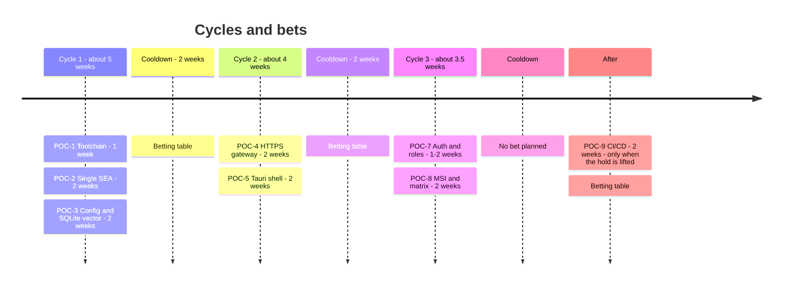
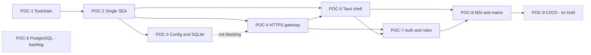
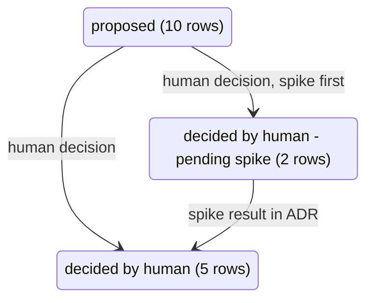
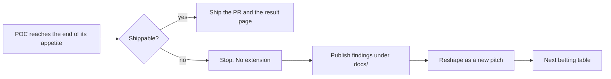
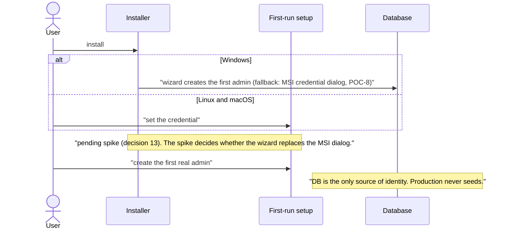

<!-- toon-meta
fmt: TOON
doc: docs/roadmap/PROPOSAL.md
title: "Roadmap Proposal: lan-solution-template (SRS v1.6)"
type: roadmap
summary: "Roadmap proposal with cycles, POC pitches, coverage matrix and open questions."
related[2]: README.md,docs/backlog/README.md
status: proposed
updated: 2026-10-31
-->

# Roadmap Proposal: lan-solution-template (SRS v1.6)

[Home](../../README.md) | [Requirements](../requirements/README.md) | [Architecture](../architecture/overview.md) | [Standards](../standards/README.md) | [Roadmap](PROPOSAL.md) | [Traceability](../requirements/traceability.md) | [Backlog](../backlog/README.md)

Status: PROPOSAL v2, revised with 17 human decisions (see Decision Log). Not approved. No remote action ran from this work. Origin and push state: not verified.
Source: `lan-solution-template-SRS-v1.6.md` (sections 1-13). The REQ-* and AC-* IDs come from the SRS. The FR/NFR, R-*, A-*, Q-* and D-* IDs come from extraction files. Those files are outside this repo (see [Context](#context)). Items not found in the SRS carry the tag `ASSUMPTION`.

## Navigation

- [At a glance](#at-a-glance)
- [Context](#context)
- [ADR index](#adr-index)
- [Method](#method)
- [Cycles and bets](#cycles-and-bets)
- [Pitches](#pitches)
  - [POC-1: Toolchain viability and workspace skeleton](#poc-1-toolchain-viability-and-workspace-skeleton)
  - [POC-2: Single SEA and runtime supervisor](#poc-2-single-sea-and-runtime-supervisor)
  - [POC-3: Config and SQLite vector persistence inside the SEA](#poc-3-config-and-sqlite-vector-persistence-inside-the-sea)
  - [POC-4: HTTPS gateway serving the Angular PWA](#poc-4-https-gateway-serving-the-angular-pwa)
  - [POC-5: Tauri desktop shell with SEA sidecar](#poc-5-tauri-desktop-shell-with-sea-sidecar)
  - [POC-6: PostgreSQL adapter parity (BACKLOG)](#poc-6-postgresql-adapter-parity-backlog)
  - [POC-7: Auth and roles](#poc-7-auth-and-roles)
  - [POC-8: MSI credential dialog, platform matrix and lockstep versioning](#poc-8-msi-credential-dialog-platform-matrix-and-lockstep-versioning)
  - [POC-9: GitHub Actions CI/CD and releases (HOLD)](#poc-9-github-actions-cicd-and-releases-hold)
- [No-gos](#no-gos)
- [SRS coverage matrix](#srs-coverage-matrix)
- [Open questions](#open-questions)
- [Backlog](#backlog)
- [Assumptions](#assumptions)
- [Decision Log](#decision-log)

---

## At a glance

[Back to navigation](#navigation)

Why this page exists: it orders the SRS v1.6 POCs and logs 17 human decisions. Next: the betting table picks the bets of cycle 1.

| Topic | Fact | Section |
|---|---|---|
| Status | Proposal v2. Not approved. No remote action ran. | [Decision Log](#decision-log) |
| Method | Shape Up. 6 weeks of build, then 2 weeks of cooldown. | [Method](#method) |
| Bets | 3 cycles. 8 active POCs (POC-9 on hold) and POC-6 in the backlog. | [Cycles and bets](#cycles-and-bets) |
| ADR index | 14 rows: 10 approved, 1 proposed, 3 pending spike. | [ADR index](#adr-index) |
| Open questions | 17 rows. None blocks. | [Open questions](#open-questions) |
| Coverage | 13 SRS sections and 36 acceptance criteria map to POCs. | [SRS coverage matrix](#srs-coverage-matrix) |

**Cycles and bets** (appetite per POC, from the table in [Cycles and bets](#cycles-and-bets))

**Dependencies** (dashed edge = not blocking; dashed box = not in a cycle)

**States of open questions** (counts from the Open questions table)

---

## Context

[Back to navigation](#navigation)

The SRS v1.6 defines a LAN-first template that works offline. It has these parts:

- Angular 22 PWA (`apps/web-angular`).
- NestJS gateway (`apps/api-gateway`).
- Nest standalone supervisor (`apps/sea-runtime`).
- Tauri v2 desktop shell (`apps/desktop`).
- `libs/shared-core`.

One Node SEA per OS/arch ships everything (REQ-RUNTIME-01, FR-02). Persistence uses SQLite (default) or PostgreSQL. Both support vector search (REQ-DB-01).

Main risks from the SRS:

- Many very new versions. Their existence is not verified (R-02, R11).
- The single-SEA design (R-04, R2).
- The sqlite-vector native extension (R-03).
- Drizzle `1.0.0-rc.5` (R-01, R-07). A stable Drizzle tag is preferred. The POC uses `1.0.0-rc.5` only as a fallback (decision 10).
- Cross-OS process-tree shutdown (R1, R-04).
- The native 3-OS CI matrix (R-01 of 11.4.1).

D-07 puts CI/CD last. D-03 asks for the smallest integrated micro-POCs. This proposal turns both into eight active POCs and one backlog item (POC-6, PostgreSQL). POC-9 (CI/CD and releases) is on HOLD.

A-01 is not in the SRS.

---

## ADR index

[Back to navigation](#navigation)

Each row summarizes one architecture decision record (ADR, Nygard format). ADRs 001-007 are the per-POC results; later ones continue the numbering.

| Topic | Decision | Source | State |
|---|---|---|---|
| Repo and branch | Origin is the GitHub repo, docs live only in `docs/`, and the branch is `main`. | 1, 2, 3 | approved |
| Targets | We target the operating systems and versions that Tauri 2 supports. Node follows the pin in REQ-STACK-01. | 4, 15 | approved |
| Autostart | Autostart is opt-in and off by default. The user enables it with a checkbox in the tray menu (OQ12). | OQ12 | approved |
| MSI scope | The MSI is a per-machine draft. A spike on WiX and Tauri capabilities decides the scope (OQ16). | OQ16 | proposed |
| HOLD scope | The HOLD covers only CI/CD and releases in POC-9; local work continues (OQ6). | 9, human | approved |
| Auth and first admin | The user creates the first real admin in a setup wizard. The database is the only identity source. | 12, 13 | pending spike |
| Auth and first admin | Development seeds a self-destructing `dev-admin` data row, and production never seeds. POC-7 implements the seeding. The design is approved; ASVS citations stay `not verified`. | 12 | approved |
| Auth and first admin | The database is the source of truth. The user creates the first admin in the setup wizard. The POC-5 spike defines the wizard path. The MSI credential dialog is the fallback. | 5, 13 | pending spike |
| Config and paths | A paths library resolves one root. The code uses paths relative to that root. This holds in the SEA and the dev server. | 11 | approved |
| TLS and keys | TLS follows the `dotnet dev-certs` style. The CA key stays outside the database, encrypted in `dataDir`. | 7, 14 | pending spike |
| Database | SQLite plus vector is the engine for now; PostgreSQL waits in the backlog. | 8 | approved |
| Database | We install the current stable Drizzle tag first and use `1.0.0-rc.5` only if it fails. | 10 | approved |
| Release | Release automation is on HOLD until all POCs are ready. | 9 | approved |
| Toolchain | Version substitutions in POC-1 (S1 to S5) are recorded in [ADR-001](../architecture/adr/ADR-001-version-substitutions.md). | 1e, human | approved |

The [Decision Log](#decision-log) keeps each decision as recorded.

---

## Method

[Back to navigation](#navigation)

Method: Shape Up.

- Cycle: 6 weeks of build, then 2 weeks of cooldown.
- Batch: small = 1-2 weeks. Big = one full cycle.
- Appetite is a fixed time budget. Scope changes. The date does not.
- Circuit breaker: the team does NOT extend a POC past its appetite.
  - A POC that is not shippable stops. The team publishes its findings under `docs/`.
  - The team then reshapes it as a new pitch for the next betting table.
- Ordering: uncertainty first. Prove the riskiest unknown earliest, within dependency limits.
- The betting table before each cycle decides the bets again. Nothing carries over automatically.
- Deliverable per POC: a PR. Its branch prefix follows REQ-VERSION-02 (`major/`, `minor/`, `fix/`). The prefixes `docs/` and `chore/` are exempt. A POC result page under `docs/` is also a deliverable. The page labels each item implemented, verified, blocked-by-environment or out-of-scope (SRS 12.4, D-04, NFR-TRUTH-01). It names the verified OS.
- Before the CI POC exists, PR evidence is a log. The log lists the root ECO commands run locally (REQ-TEST-10, D-02).
- Test policy for all POCs: APP-level and real E2E tests only. No unit or integration suites (REQ-TEST-01, AC-19).
- Every remote action needs explicit human approval: push, open PR, `gh`. Renaming `master` to `main` is a local action (decision 3).
- POC-9 is on HOLD until all other POCs are ready (decision 9).

**Circuit breaker flow**

---

## Cycles and bets

[Back to navigation](#navigation)

| Cycle | POCs | Length | Then |
|---|---|---|---|
| 1 | POC-1, POC-2, POC-3 | ~5 weeks (1 + 2 + 2) | 2-week cooldown, betting table |
| 2 | POC-4, POC-5 | ~4 weeks (2 + 2) | 2-week cooldown, betting table |
| 3 | POC-7, POC-8 | ~3.5 weeks (1-2 + 2) | cooldown |
| After | POC-9 (only when HOLD is lifted) | ~2 weeks + small | betting table |

| POC | Title | Appetite | Batch | Depends on | Branch |
|---|---|---|---|---|---|
| POC-1 | Toolchain viability + OS matrix + workspace skeleton, delivered as slices 1a to 1e (see [POC-1 Slices](#poc-1-slices)) | 1 week (slice appetites are ASSUMPTION) | small | none | `minor/poc-01a-monorepo`, `minor/poc-01b-nest` (carries 1b and 1c), `minor/poc-01d-angular-link`, `minor/poc-01e-hardening` |
| POC-2 | Single SEA + runtime supervisor | 2 weeks | big | POC-1 | `minor/poc-02b-dispatcher-registry` to `minor/poc-02g-real-binary-smoke`, plus `docs/poc-02a-launcher-cwd` and `docs/poc-02h-result-adr` (see [POC-2 Slices](#poc-2-slices)) |
| POC-3 | Config (`config.json`) + SQLite vector inside SEA | 2 weeks | big | POC-2 | `minor/poc-03-sqlite-vector` |
| POC-4 | HTTPS gateway (dev-certs-style TLS) serving Angular PWA + dev loop | 2 weeks | big | POC-2 (POC-3 not blocking) | `minor/poc-04-https-spa` |
| POC-5 | Tauri desktop shell with SEA sidecar + CA install + first-run setup | 2 weeks | big | POC-2, POC-4 | `minor/poc-05-tauri-sidecar` |
| POC-6 | PostgreSQL adapter parity | n/a | n/a | n/a | BACKLOG (see [Backlog](#backlog)) |
| POC-7 | Auth (user:password) + roles + protected UI | 1-2 weeks | small | POC-4, POC-5 | `minor/poc-07-auth-roles` |
| POC-8 | MSI credential dialog + native platform matrix + lockstep versioning | 2 weeks | big | POC-5, POC-7 | `chore/poc-08-matrix-versioning` |
| POC-9 | CI/CD GitHub Actions + Releases | 2 weeks | big | POC-8 | HOLD: `chore/poc-09-ci-cd` |

ASSUMPTION: the appetites are estimates for one developer plus AI agents. The betting table may change them.

POC-1 stays one bet of 1 week. It is delivered as five sequential slices, each with its own branch and result page (see [POC-1 Slices](#poc-1-slices)). The slice appetites are ASSUMPTION and sum to about 6 working days (1 + 1 + 2 + 1 + 1), roughly one day over the 1-week bet if a week is 5 working days. The 1-week total is not changed here; the betting table decides.

Ordering rationale:

- POC-2 (single SEA, same-binary re-entry, process shutdown) has the highest uncertainty (R2, R1, R-04). It follows the toolchain check.
- POC-3 follows. The native extension inside the SEA is the next unknown (R-03, R-06 of 11.5).
- CI/CD is last.

---

## Pitches

[Back to navigation](#navigation)

### POC-1: Toolchain viability and workspace skeleton

[Back to navigation](#navigation)

- **Problem**: The SRS pins very new versions (table below). Their existence and compatibility are not verified (R-02, R11, R-08). The `drizzle-orm 1.0.0-rc.5` pin is a risk (R-01, R-07). POC-3 tests the stable tag first (decision 10). This POC does not change the SRS pin.

| Node | pnpm | NestJS | Angular | Zod | drizzle-orm | Tauri | sqlite-vector |
|---|---|---|---|---|---|---|---|
| >=26.13 <27 | >=12.16.1 | 12.3.2 | >=22.2.5 | >=4.6.7 | 1.0.0-rc.5 | >=2.12.5 | 1.1.2 |
- **Appetite**: 1 week, small batch. Delivered as five slices (see [POC-1 Slices](#poc-1-slices)).
- **Solution sketch**:
  - Every project file is produced by its official CLI through `pnpm dlx` (`nx`, `@nestjs/cli`, `@angular/cli`, `@tauri-apps/cli`), never hand-written. A manual edit is allowed only where no CLI exists and is listed in the result page.
  - Verify that every pinned version exists and works with the others (NFR-15, NFR-VER-01). Pin Nx after discovery (NFR-08, REQ-BUILD-01).
  - Create a pnpm workspace with a catalog. `savePrefix` is empty. Versions are exact. `pnpm-lock.yaml` is committed (NFR-11, NFR-12).
  - Set `minimumReleaseAge` 1440, `allowBuilds`, and `strictDepBuilds` true (REQ-SUPPLY-01, REQ-SEC-CI-03). Verify the pnpm 12 semantics (R-08, R6).
  - Use Nx locally. Do not use Nx Cloud.
  - Create the skeletons: `apps/web-angular`, `apps/api-gateway`, `apps/sea-runtime`, `apps/desktop`, `libs/shared-core` (REQ-REP-01..03).
  - Add root ECO scripts with explicit no-ops (REQ-ECO-01, REQ-ECO-02).
  - Make `securityCheck` fail closed (REQ-SEC-CI-01, REQ-SEC-CI-02).
  - Add a test filter adapter stub (REQ-TEST-03, REQ-ECO-04).
  - OS matrix (decision 4): the supported OS is what the Tauri 2 prerequisites page lists. POC-1 reads that page and records the list in its result. Node follows the pin in REQ-STACK-01.
  - Reconcile it with the SRS pin `>=26.13.0 <27` (REQ-STACK-01). Record whether the pin is an LTS line or needs an SRS change.
  - Node 26 has been LTS since 2026-10-28 (nodejs/Release `schedule.json`). A QC agent checked it on 2026-10-30.
  - Compatibility of the rest of the stack with Node 26 remains not verified. Re-check the schedule at POC-1 start.
- **Rabbit holes**:
  - pnpm 12 option semantics.
  - Oxlint, angular-eslint and Clippy coverage of Angular templates (REQ-ECO-05).
  - The Rust audit tool is undefined (A9).
  - The Tauri 2 OS list against the Node pin and the WebView2 minimums. Not verified.
- **No-gos**: no Nx Cloud, no drizzle-kit, no `bumpDependencies` or `test:doctor` (REQ-DEPS-01). Also no unit or integration suites, no `^` or `~` ranges.
- **Circuit breaker**: document a missing version. Add a technical link and a minimal substitution (NFR-15, NFR-VER-01, D-06). Do not invent APIs. If the toolchain cannot install, stop and report.
- **Acceptance criteria**: AC-01, AC-02 (host-checkable part), AC-13, AC-19, AC-22. Also AC-23, AC-24, AC-32, AC-33 (host OS only), AC-34. Also NFR-01..15, REQ-ECO-01, REQ-ECO-02, REQ-BUILD-02..05, REQ-TEST-02, REQ-REF-01.
- **Deliverable**: one branch and one PR per slice (table below). Each slice writes its own result page, `POC-01a-Result.md` to `POC-01d-Result.md`. The last slice writes `docs/results/POC-01-Result.md`. That page consolidates them and holds a version-verification table and the OS/Node matrix. It also holds `ADR-001` if a substitution happens. PR titles are not fixed yet (not verified).

#### POC-1 Slices

POC-1 stays the umbrella id. Slices run in order; each depends on the previous one and can be delivered and verified alone. Appetites are ASSUMPTION and sum to about 6 working days, about one day over the 1-week bet.

| Slice | Scope | Branch | Appetite (ASSUMPTION) | Depends on |
|---|---|---|---|---|
| 1a | Monorepo init: version table, pnpm workspace and catalog, supply-chain settings, Nx local, root no-op scripts, one Node engine pin, reference study | `minor/poc-01a-monorepo` | ~1 day | none |
| 1b | Nest apps: `api-gateway`, `sea-runtime`, `shared-core` from the Nest CLI; dummy health endpoint; `sea-runtime` as a standalone `createApplicationContext(RuntimeModule)` with no listener (REQ-RUNTIME-02) | `minor/poc-01b-nest` | ~1 day | 1a |
| 1c | SEA build: generic assembler `tools/scripts/compile-sea.ts` with native `node --build-sea`; the `package` target lives on `sea-runtime`; one executable runs the minimal supervisor and the dummy Nest app | `minor/poc-01b-nest` (same branch as 1b, human decision; see [POC-1c backlog](../backlog/poc-1c-sea-build.md)) | ~2 days | 1b |
| 1d | Angular and link: `web-angular` from the Angular CLI; `sea-runtime` embeds its build and sends it over IPC (`--web ipc`; replaced in POC-1f, was `--web-root`); `api-gateway` serves it over plain HTTP from the SEA (decision 17); dev uses the Angular dev server; Nx build order and post-package check | `minor/poc-01d-angular-link`: delivered on that branch (human decision) | ~1 day | 1c |
| 1e | Hardening and desktop skeleton: `desktop` from the Tauri CLI, `securityCheck`, test filter stub, OS matrix, root sequence, tags, consolidated result | `minor/poc-01e-hardening`: delivered on that branch (one PR, human decision) | ~1 day | 1d |

POC-1 is complete: slices 1a to 1e are delivered. Result: [POC-1 result](../results/POC-01-Result.md).

Backlog epics: [1a](../backlog/poc-1a-monorepo-init.md), [1b](../backlog/poc-1b-nest-apps.md), [1c](../backlog/poc-1c-sea-build.md), [1d](../backlog/poc-1d-angular-link.md), [1e](../backlog/poc-1e-hardening-desktop-skeleton.md).

### POC-2: Single SEA and runtime supervisor

[Back to navigation](#navigation)

- **Problem**: The product needs one SEA per platform. The SEA bundles the dispatcher, sea-runtime and api-gateway. It relaunches itself by role (REQ-RUNTIME-01, REQ-RUNTIME-03, REQ-SEA-01). POC-1c proves the native `node --build-sea` flow with a dummy Nest app (R2, R-04). Nobody has proven it with the dispatcher and the real services bundled. Same-binary re-entry and process-tree shutdown are hard on 3 OSes (R1).
- **Appetite**: 2 weeks, big batch. Highest uncertainty.
- **Solution sketch**:
  - Extend the assembler `tools/scripts/compile-sea.ts` written in POC-1c. It takes its services from the workspace dependencies of `sea-runtime` (today `api-gateway`) and bundles the dispatcher with them. Native `node --build-sea`, no postject (REQ-SEA-01, REQ-SEA-02, REQ-SEA-03).
  - Invalidate the build when a registered service is added or changed (REQ-BUILD-04). Not built in POC-1c; the clause moves here.
  - Build a Zod-validated dispatcher and a closed service registry (REQ-RUNTIME-03).
  - `sea-runtime` uses `createApplicationContext(RuntimeModule)` and has no HTTP listener: built in POC-1b (REQ-RUNTIME-02, FR-45).
  - The supervisor spawns `process.execPath --service <id>` for each service in the SEA asset. The minimal spawn is built in POC-1c. POC-2 adds respawn, readiness and backoff. It never uses `node` from PATH.
  - Extend the POC-1b `api-gateway` (NodeAdapter, dummy health endpoint) to an `/api` health endpoint under the supervisor (REQ-NET-01).
  - Shutdown: stdio IPC, then a timeout, then a force-kill of descendants. No orphans (REQ-RUNTIME-06). POC-1c already stops the children on SIGINT and SIGTERM; only SIGTERM was observed.
  - Add a readiness timeout, per-service logs and a bounded restart (REQ-RUNTIME-05).
  - Add a real-binary smoke test (REQ-RUNTIME-08).
- **Rabbit holes**:
  - Bundling Nest dependencies into one bundle.
  - The Windows process tree.
  - `node:sea` asset limits (R-04).
  - Restart and backoff values are undefined (A3).
  - Root resolution without the cwd (decision 11). The cwd of the supervisor under systemd and launchd: not verified. Verify here.
- **No-gos**: no fake `auth-ms` (REQ-RUNTIME-04, SRS L943, D-03). No postject without a documented need. No second executable. Also no Express or Fastify, no SPA yet.
- **Circuit breaker**: if the SEA cannot bundle the dispatcher and the real services within the appetite, stop. Publish the findings: what failed and which Node limits apply. Then reshape. Either split bundling from supervision, or evaluate a documented postject need.
- **Acceptance criteria**: AC-11 (partial: no Node install on the host), AC-28, AC-29. AC-30 (host OS only, others pending) and AC-31 (registry design only) apply too. Also REQ-RUNTIME-01..08, REQ-SEA-01..03, REQ-TEST-07 (supervisor subset).
- **Deliverable**: delivered as eight slices, 2a to 2h (see [POC-2 Slices](#poc-2-slices)), one branch each. The single branch `minor/poc-02-sea-supervisor` is not used. Results under `docs/`: `POC-02-Result` and `ADR-002` (single-SEA portability decision).

#### POC-2 Slices

POC-2 stays the umbrella id and one bet of 2 weeks. Slice sizes are authored changed lines and ASSUMPTION; the betting table may change them. Plan, order, inherited POC-1 items and decisions for the human: [POC-2 umbrella](../backlog/poc-2-single-sea-runtime-supervisor.md).

| Slice | Scope | Branch (proposed) | Size (ASSUMPTION) | Depends on |
|---|---|---|---|---|
| 2a | Launcher cwd spike: initial cwd of supervisor and gateway under launchd and systemd (decision 11) | `docs/poc-02a-launcher-cwd` | ~120 lines, docs | none |
| 2b | Dispatcher and closed service registry, Zod-validated; unknown roles rejected; `auth-ms` registry design only | `minor/poc-02b-dispatcher-registry` | ~250 | none |
| 2c | Assembler bundles dispatcher and services from the registry; invalidation on service change; SEA flags and code-cache rule | `minor/poc-02c-assembler-registry` | ~250 | 2b |
| 2d | IPC control channel, readiness timeout, per-service logs, aggregate state, `/api/health` from that state | `minor/poc-02d-readiness-logs` | ~380 | 2c |
| 2e | Respawn of `process.execPath --service <id>` with bounded backoff and an `error` state | `minor/poc-02e-bounded-restart` | ~250 | 2d |
| 2f | Shutdown by IPC, timeout, force-kill of descendants, supervisor-crash tolerance, orphan checks | `minor/poc-02f-coordinated-shutdown` | ~350 | 2d |
| 2g | Real-binary smoke test, macOS and Linux Docker, `libatomic` | `minor/poc-02g-real-binary-smoke` | ~300 | 2e, 2f |
| 2h | `POC-02-Result`, `ADR-002`, inherited items closed | `docs/poc-02h-result-adr` | ~200 lines, docs | 2a to 2g |

Backlog epics: [2a](../backlog/poc-2a-launcher-cwd-spike.md), [2b](../backlog/poc-2b-dispatcher-service-registry.md), [2c](../backlog/poc-2c-assembler-registry-build.md), [2d](../backlog/poc-2d-supervisor-readiness-logs.md), [2e](../backlog/poc-2e-bounded-restart.md), [2f](../backlog/poc-2f-coordinated-shutdown.md), [2g](../backlog/poc-2g-real-binary-smoke.md), [2h](../backlog/poc-2h-result-and-adr.md).

### POC-3: Config and SQLite vector persistence inside the SEA

[Back to navigation](#navigation)

- **Scope**: config (`config.json`) and SQLite vector persistence.
- **Problem**: Persistence must work from inside the SEA. The native vector extension comes from an asset (R-03, REQ-DB-09). The custom migrator replaces drizzle-kit (R-06). The SRS pins Drizzle to a release candidate (R-01, R-07).
- **Appetite**: 2 weeks, big batch.
- **Solution sketch**:
  - Zod 4 persisted, namespaced config as an immutable DI singleton (REQ-CFG-01, REQ-CFG-02, REQ-CFG-04, REQ-CFG-06).
  - Config design (decision 6; unreviewed research summary):
    - The install path holds `config.default.json`, read-only, no secrets.
    - The real `config.json` lives under the resolved root. The code uses paths relative to that root (REQ-CFG-05 L165, REQ-SEA-05 L502).
    - Resolved: human decision 11 decides [OQ1](#open-questions) (see [Decision Log](#decision-log)). The config location follows decision 11, not the install-path reading of decision 6.
  - Paths library (decision 11; design in [Decision Log](#decision-log) item 11): it resolves one root, once. It never uses the cwd as the anchor. Code uses paths relative to that root, in the SEA and the dev server.
  - Tests cover each launch shape: dev server, SEA from another cwd, `--root`, `APP_HOME` and marker.
  - First start creates `config.json` under the resolved root from `config.default.json` if it is missing. Dev: `./config/config.json`.
  - Add a strategy port for DB adapters (REQ-DB-01, REQ-DB-02).
  - Engine for now: SQLite + vector only (decision 8). PostgreSQL is in the Backlog.
  - Drizzle tag order (decision 10). Do not assume the tag:
    - First install the current stable `drizzle-orm` tag (npm `latest`). Its exact version is not verified until the POC.
    - Verify vector support on SQLite.
    - If it fails, bump to `1.0.0-rc.5`.
    - Record the result and the reason in `ADR-003`.
  - Use SQLite through `node:sqlite`, the Drizzle tag chosen above and sqlite-vector 1.1.2. Extract the native library from a SEA asset. Check its integrity per OS/arch (REQ-DB-09).
  - Build a custom migrator. It records version, checksum and applied_at. It detects tampering, locks, and uses a transaction per engine (REQ-DB-04, REQ-DB-05).
  - Startup order: config, adapter, connection, vector check, migrations, ready (REQ-DB-06).
  - Set `foreign_keys` on. Evaluate WAL. Set explicit durability. Keep the DB outside the SEA (REQ-DB-07, REQ-SEA-05).
  - Test an offline vector insert and a similarity query (REQ-DB-08).
- **Rabbit holes**:
  - Drizzle RC API drift, if the fallback to `1.0.0-rc.5` is needed.
  - The stable tag may lack vector support on SQLite or PostgreSQL. Not verified.
  - The native extension per OS/arch.
  - Where the persisted config lives before the DB exists (A-01).
  - The cwd differs per launcher. Its value per launch shape is not verified, except a Windows service (secondary source only).
  - How the dev anchor finds the repo root without the cwd: not verified.
  - Migration owner and locking (R9, REQ-RUNTIME-07).
- **No-gos**: no drizzle-kit, no silent non-vector fallback (REQ-DB-08), no client-supplied extensions. Also no secrets in CLI args (REQ-CFG-06), no mocks of persistence (REQ-TEST-04).
- **Circuit breaker** when the vector extension cannot load from the SEA on the host OS:
  - Stop. Publish the findings and reshape the extraction approach.
  - Document the Drizzle tag decision in both cases (D-05).
  - Stable tag fails the SQLite vector check: bump to `1.0.0-rc.5` and retry once before stopping.
- **Acceptance criteria**: AC-07, AC-08, AC-10 (persistence and vector part), REQ-CFG-01..06, REQ-DB-01..09, REQ-TEST-06 (SQLite part), REQ-SEC-06.
- **Deliverable**: branch `minor/poc-03-sqlite-vector`. PR title: `feat: config singleton and SQLite vector persistence in SEA`. Results under `docs/`: `POC-03-Result` and `ADR-003` (Drizzle tag choice and compatibility).

### POC-4: HTTPS gateway serving the Angular PWA

[Back to navigation](#navigation)

- **Scope**: HTTPS gateway that serves the Angular PWA from the SEA, plus the dev loop.
- **Problem**: POC-1d links the Angular build to `api-gateway` over plain HTTP. Decision 17 and its spike prove the SEA handoff with a dummy page. The gateway must now serve one Angular build over HTTPS (FR-04). The clients are browsers and the Tauri WebView. The SEA must materialize the assets safely (R3, R-07). Developers need a fast loop that does not need the SEA (REQ-DEV-01..05). Local CA trust is a known friction (R-05).
- **Appetite**: 2 weeks, big batch.
- **Solution sketch**:
  - Configure the `web-angular` app generated in POC-1d as Angular 22, zoneless, strict TypeScript, Signals, Tailwind and PWA (REQ-WEB-01, REQ-PWA-01).
  - `ng serve` on 4200 with `proxyConfig` `/api/**` to 8443. It uses a trusted dev CA and never `secure:false` (REQ-DEV-01..04).
  - First task, a spike (decision 14, [OQ8](#open-questions)). Budget: 2 days at most, inside the appetite.
    - Inputs: a hand-built DER writer on `node:crypto`, against a pure-JS dependency.
    - Checks and circuit breaker: see [Decision Log](#decision-log) item 14.
    - Output: the POC result page and `ADR-004` (TLS trust model).
  - Generate the TLS identity with SAN handling (REQ-TLS-01, REQ-TLS-04).
  - TLS design (decisions 7 and 14, `dotnet dev-certs` style; unreviewed research summary):
    - One local CA per installation. A renewable leaf is reissued when the SAN or IP changes. The spike picks the library (decision 14).
    - Key storage sits behind a NestJS provider contract (decision 14). The exact name belongs to the POC. One initial implementation: an encrypted file in `dataDir`. It reuses the POC-3 port and strategy wording (REQ-DB-01, REQ-DB-02).
    - The CA private key never goes in the database.
    - A separate dev CA with `NODE_EXTRA_CA_CERTS`.
    - Mobile clients install the CA by hand (REQ-TLS-02).
  - Serve HTTPS on 8443 and an HTTP 308 redirect on 8080. The redirect has no Host-based open redirect (REQ-NET-06, REQ-NET-08).
  - Plain-HTTP serving of a dummy page is not repeated here (POC-1d). Harden it as follows.
  - Materialize the SPA into a per-version hashed cache (REQ-NET-03, REQ-NET-04, REQ-SEA-04). The cache needs a manifest, checksums, atomic publish, concurrency safety and stale cleanup.
  - Superseded by POC-1f: in-memory serving over IPC (`--web ipc`), no `ServeStaticModule`, no `--web-root`. The gateway does not call `isSea()` (REQ-NET-02, REQ-NET-05).
  - POC-4 owns the 404 rule for unknown asset paths and API paths (the spike returns the index for `/nope`), cache hardening and cleanup, TLS and PWA (decision 17).
  - `/api/**` never falls back to `index.html`. A missing asset returns 404 (REQ-NET-07).
  - Send revalidatable cache headers for `index.html` and the service worker. Hashed files are immutable (REQ-PWA-02).
- **Rabbit holes**:
  - Device CA trust on iOS and Android. Document only, no auto-trust (REQ-TLS-02).
  - The TLS crypto library choice (A-04, [OQ8](#open-questions)): the first-task spike decides it.
  - The SPA fallback rule for dotted routes (A-11).
  - Cache header values.
- **No-gos**: no shipped `secure:false`, no `rejectUnauthorized=false` (REQ-TLS-03), no automatic CA trust on client devices. Also no private-key distribution, no offline browser sync, no fake Module Federation remotes (REQ-WEB-04).
- **Circuit breaker**, if the full PWA install flow on mobile is out of reach:
  - Ship HTTPS serving only. Test the load in a desktop browser.
  - Publish the mobile trust findings.
  - Reshape the PWA install part as a new pitch.
- **Acceptance criteria**: AC-04, AC-05, AC-12, AC-14, AC-15, AC-16, AC-17. Also REQ-NET-01..08, REQ-TLS-01..04, REQ-PWA-01..03, REQ-DEV-01..05, REQ-WEB-01, REQ-TEST-05 (dev :4200 and :8443 smoke subset).
- **Deliverable**: branch `minor/poc-04-https-spa`. PR title: `feat: HTTPS gateway serving Angular PWA from SEA`. Results under `docs/`: `POC-04-Result`, `ADR-004` (TLS trust model) and a device-trust guide.

### POC-5: Tauri desktop shell with SEA sidecar

[Back to navigation](#navigation)

- **Scope**: Tauri desktop shell, SEA sidecar, CA install and first-run setup.
- **Problem**: The desktop host must start, monitor and stop the SEA supervisor. It must show the state in the tray. It must keep the gateway reachable from the LAN. This applies while the window is hidden (REQ-DESK-02, REQ-DESK-06). Tray, autostart and single-instance behavior differ per OS (R5, R-10).
- **Appetite**: 2 weeks, big batch.
- **Solution sketch**:
  - Pending spike (decision 13, [OQ5](#open-questions)). POC-5 owns it, as its first task. Budget: 2 days at most, inside the appetite.
    - Scope: define the first-run setup wizard path. The user creates the first real admin at install time. The seeded dev super user stays out of that path.
    - Inputs: the list in Decision Log item 13. None is a decision. Security claims about the wizard are not verified.
    - Output: one chosen path with trade-offs, in `POC-05-Result` and ADR-006 (auth mechanism). POC-7 and POC-8 depend on it.
    - Circuit breaker: no clear path after 2 days. Keep the MSI credential dialog on Windows. Keep the CLI `setup` command on Linux and macOS.
  - Ship the SEA as an `externalBin` sidecar, one per target triple (REQ-DESK-01).
  - Tauri only starts, monitors and stops the supervisor (REQ-DESK-02).
  - Tray: starting, ready and error states, Open UI, Quit. Closing the window hides it to the tray. Quit cleans the process tree (REQ-DESK-03).
  - POC-5 designs the tray UI. Until then, the docs list common options only: start, stop, open UI, quit, autostart.
  - Autostart at OS login (REQ-DESK-04). Single instance, port-busy handling, orphan handling and crash recovery (REQ-DESK-05).
  - The host may hand the sidecar the resolved root as an absolute path (decision 11). Design, not verified as a Tauri pattern.
  - Restrict IPC capabilities (REQ-SEC-05). Give the LAN-served frontend no shell or sidecar privileges.
  - The WebView loads the gateway origin (AC-18).
  - Tauri installs `ca.crt` into the OS trust store with explicit consent (REQ-TLS-02).
  - First-run setup is the wizard that the spike defines (decision 13). It applies to every target OS. The MSI credential dialog (POC-8) stays only as the fallback of decision 13.
  - Run native E2E with `@wdio/tauri-service` on an instrumented build. The commercial installer excludes it (REQ-TEST-08, AC-20).

First-run flow, pending spike (decision 13):

- **Rabbit holes**:
  - Per-OS WebDriver support (R4).
  - Drift between the instrumented build and the shipped build (R-09 of 11.4.1).
  - The autostart default (A7).
  - Whether the tray shows a degraded state (A5).
  - The cwd of the sidecar child is not verified. The Tauri sidecar page does not state it. Verify here.
- **No-gos**: Tauri hosts no second SPA and no public port. No pre-login native service claim (REQ-DESK-04). No WDIO plugin in the product. No cross-OS claims without native runs (REQ-TEST-09).
- **Circuit breaker**, if native WebDriver E2E fails on the host OS:
  - Ship only the black-box installer smoke test.
  - Label E2E blocked-by-environment.
  - Reshape E2E as a new pitch.
- **Acceptance criteria**: AC-03, AC-18, AC-20, AC-30 (host OS), REQ-DESK-01..06, REQ-SEC-05, REQ-TEST-08, REQ-ECO-06 (Tauri after SEA).
- **Deliverable**: branch `minor/poc-05-tauri-sidecar`. PR title: `feat: Tauri shell supervising SEA sidecar with tray`. Results under `docs/`: `POC-05-Result` and `ADR-005` (desktop process model).

### POC-6: PostgreSQL adapter parity (BACKLOG)

[Back to navigation](#navigation)

- **Status**: BACKLOG stub. Decision 8 deferred it. Full details are in [Backlog](#backlog).
- **Appetite**: none assigned.
- **Acceptance criteria**: AC-09 and the PostgreSQL part of REQ-TEST-06.
- **Gap**: the SRS marks REQ-TEST-06 as MUST. REQ-TEST-06 and AC-09 stay unmet until this item runs.

### POC-7: Auth and roles

[Back to navigation](#navigation)

- **Scope**: user:password auth, roles and protected UI.
- **Problem**: The LAN is untrusted (REQ-SEC-01). NestJS must enforce the roles public, employee and admin, not only Angular (REQ-SEC-02). Decision 5: plain user:password auth. The database is the source of truth. The user creates the first admin in the setup wizard (decisions 12 and 13). Under decision 12, the dev account is a seeded, self-destructing super user, only in development.
- **Appetite**: 1-2 weeks, small batch. Depends on POC-5 (first-run setup and CA install).
- **Solution sketch**:
  - Dependency task, first (decision 13, [OQ5](#open-questions)): wait for the POC-5 spike. Security claims about the wizard are not verified.
    - Scope: take the chosen wizard path as input. It feeds the initial-credential flow and the dev super user hand-off.
    - Output: the path in ADR-006 (auth mechanism) and in `POC-07-Result`.
    - Budget: no own spike time. If the POC-5 spike hit its 2-day breaker, use the MSI dialog on Windows. Use the CLI `setup` command on Linux and macOS.
  - Auth design (decision 5; unreviewed research summary):
    - scrypt through Node native. Use argon2id only if Node ships it (not verified).
    - NIST 800-63B-style policy: 15+ characters, blocklist, no composition rules.
    - Exponential throttle per account and IP.
    - Server-side sessions in SQLite with the cookie `__Host-sid`.
    - CSRF protection through SameSite plus an Origin check.
  - First admin: the user creates it in the setup wizard (decision 13, POC-5). The MSI credential dialog (POC-8) is only the fallback. No permanent default credentials (REQ-SEC-02).
  - Dev super user (decision 12): the design is in [Decision Log](#decision-log) item 12. It is a data row made by the production user-creation path. No code path skips authentication.
  - Seed at startup, after migrations (REQ-DB-06 order). Seed only in development. Seed only if no real admin exists. Account `dev-admin`, never admin or root. Random password of 15+ characters, shown once.
  - The server enforces self-destruction through `expires_at` and a bootstrap mark. Auth rejects an expired account. A startup purge deletes it.
  - Production never seeds. The setup wizard (decision 13, [OQ5](#open-questions)) creates the first admin. A smoke test proves a release DB has no bootstrap account.
  - The DB is the only source of truth. `config.json` never stores credentials (REQ-SEC-06, REQ-CFG-06).
  - Roles public, employee and admin. Nest guards return 401 or 403 (REQ-SEC-01).
  - Build a retro ARPANET terminal public page and a logon page. Build minimal protected employee and admin routes (REQ-WEB-02).
  - Lazy-load the role routes. Do not render unauthorized views in the DOM. The API still blocks them (REQ-WEB-03, REQ-SEC-03).
  - Add strict payload validation, size limits and auth-abuse defenses (REQ-SEC-04, REQ-CFG-03).
  - Run Playwright on dev :4200 and distributed :8443 (REQ-TEST-05).
- **Rabbit holes**:
  - The expiry and purge rules of the dev super user (decision 12).
  - The session store location.
  - The scope of the dev-mode proxy test (A10).
- **No-gos**: no insecure demo credentials (D-07), no fake `auth-ms`, no secrets in browser bundles (REQ-SEC-03). Also no security through hidden JS only, no bootstrap account in release builds.
- **Circuit breaker**, if either proof is missing:
  - A smoke test proves the release DB has no bootstrap account.
  - A test proves auth rejects an expired account.
  - Then ship without the dev super user and reshape.
- **Acceptance criteria**: AC-06, REQ-SEC-01..04, REQ-SEC-06, REQ-WEB-02..04, REQ-TEST-05.
- **Deliverable**: branch `minor/poc-07-auth-roles`. PR title: `feat: user:password auth with roles and protected API and UI`. Results under `docs/`: `POC-07-Result` and `ADR-006` (auth mechanism).

### POC-8: MSI credential dialog, platform matrix and lockstep versioning

[Back to navigation](#navigation)

- **Problem**: A macOS pass does not imply a Windows or Linux pass (AC-21, NFR-PORT-01, REQ-TEST-09). Lockstep versioning must also reach `tauri.conf.json` and `Cargo.toml`. Nx Release does not update them by itself (R-02 of 11.3).
- **Appetite**: 2 weeks, big batch.
- **Solution sketch**:
  - Dependency task, first (decision 13, [OQ5](#open-questions)): wait for the POC-5 spike. Security claims about the wizard are not verified.
    - Scope: decide whether the wizard replaces or complements the MSI credential dialog.
    - Output: the decision in `POC-08-Result` and in ADR-006 (auth mechanism).
    - Budget: no own spike time. If the POC-5 spike hit its 2-day breaker, keep the MSI credential dialog.
  - MSI dialog for the initial credential: a hidden property plus `MsiHiddenProperties`. A deferred custom action computes the hash. This is a design. Not verified. Add a smoke test per OS. It proves that the credential works and that no default exists.
  - Path layout (decision 11; REQ-CFG-05, REQ-SEA-05). The MSI installs read-only files under `<InstallDir>`: the SEA and `config.default.json`.
  - The MSI ships no managed `config.json`. First start creates it under the resolved root. The POC-1 spike and this POC decide which folder the root resolves to on Windows. Secrets live in `dataDir` with restricted permissions.
  - The MSI is a per-machine draft. A spike decides the scope ([OQ16](#open-questions)).
  - Verify here (not verified):
    - The exact WiX v4 directory and scope names.
    - The effect of `NeverOverwrite` or `Permanent` on a key file.
    - The ACLs of the folder that the root resolves to.
  - Run the root ECO commands natively on each declared OS/arch. Record a result matrix: verified, pending or blocked (REQ-TEST-10, D-02).
  - Configure an Nx Release fixed group. `release:version` syncs `tauri.conf.json` and `Cargo.toml`. It validates all version references. It builds a reproducible changelog (REQ-VERSION-01, REQ-VERSION-03).
  - Validate the branch-to-SemVer mapping (REQ-VERSION-02: its branch table and the exemption rule).
- **Rabbit holes**:
  - Runner and VM availability (Q-08).
  - Windows x64 against ARM (R4).
  - Keeping an edited `config.json` across upgrades and uninstalls. Decide delete or keep for uninstall.
  - Release group membership, including sea-runtime (Q-01).
  - The exemption mechanism for `docs/*` and `chore/*` (Q-02).
- **No-gos**: no cross-OS claims without native verification. Docker does not replace native installer validation (REQ-TEST-09). No CI workflow yet.
- **Circuit breaker**, if only some OSes are reachable:
  - Close with a partial matrix and declare it partial (NFR-PORT-01).
  - Mark the rest pending or blocked.
  - Reshape the remainder as a new pitch.
- **Acceptance criteria**: AC-21, AC-25, AC-33, REQ-VERSION-01..03, REQ-TEST-09, REQ-TEST-10, NFR-PORT-01, NFR-TRUTH-01.
- **Deliverable**: branch `chore/poc-08-matrix-versioning`. PR title: `chore: native platform matrix and lockstep versioning`. Results under `docs/`: `Platform-Matrix` and `POC-08-Result`.

### POC-9: GitHub Actions CI/CD and releases (HOLD)

[Back to navigation](#navigation)

- **Status**: HOLD (decision 9) until all other POCs are ready. The HOLD covers only CI/CD and releases (human decision, [OQ6](#open-questions)).
- **Phase**: final phase (D-07).
- **Problem**: CI/CD is in scope only after the local commands are stable (D-07, FR-46). The release flow must work with branch protection. It allows no amend and no force-push. It serializes releases and makes reruns idempotent (R-03, R-10 of 11.4).
- **Appetite**: 2 weeks, big batch.
- **Solution sketch**:
  - `ci-cd.yml` calls only root scripts (REQ-CI-07, REQ-ECO-07, FR-08).
  - PR CI runs on native Windows, Linux and macOS runners. The steps are install, securityCheck, build, test, package and smoke (REQ-CI-01, REQ-CI-09, D-09).
  - CD starts from a versioned SHA. It creates a new release commit or a release PR, never an amend (REQ-CI-04). It tags `vX.Y.Z`. It publishes SHA-256 hashed installers with OS/arch names. The smoke test runs before upload (REQ-CI-05, REQ-CI-10, D-10).
  - Serialize releases per target branch. Make reruns idempotent (REQ-CI-06).
  - Use minimal permissions. Grant `contents:write` only to release jobs (REQ-CI-03, REQ-SEC-CI-04).
  - Sign only if credentials exist. Never declare an unsigned artifact signed (R-08).
- **Rabbit holes**:
  - Bot commit or release PR (Q-03).
  - Branch protection.
  - macOS and Windows runner cost and setup (R-01 of 11.4.1).
  - Rust audit tooling (A9, R7).
- **No-gos**: no cloud deploy. No direct `nx`, `jest`, `ng`, `cargo`, `ncu` or `postject` in the workflow. No `continue-on-error` on audit. No amend or force-push. No untrusted-PR cache. No silent `securityFix` run (REQ-DEPS-02).
- **Circuit breaker**: if a mandatory platform cannot run, the release is blocked (REQ-CI-02, REQ-CI-06). The release is not green. Ship PR CI only and publish the findings. Reshape CD as a new pitch.
- **Acceptance criteria**: AC-26, AC-27, AC-35, AC-36, REQ-CI-01..10, REQ-SEC-CI-01..04, AC-02, AC-32.
- **Deliverable**: branch `chore/poc-09-ci-cd`. PR title: `chore: GitHub Actions CI and release pipeline`. Results under `docs/`: `POC-09-Result` and `ADR-007` (release flow).

---

## No-gos

[Back to navigation](#navigation)

Global, from the SRS:

| No-go | Source |
|---|---|
| No Nx Cloud | REQ-BUILD-01 |
| No drizzle-kit | REQ-DB-04 |
| No Express or Fastify | REQ-NET-01, REQ-STACK-04 |
| No postject unless a documented need exists | REQ-SEA-02 |
| No fake `auth-ms` | D-03 |
| `bumpDependencies` and `test:doctor` are not implemented. They exist in docs only. | REQ-DEPS-01 |
| No unit or integration suites | REQ-TEST-01, AC-19 |
| No shipped `secure:false` | REQ-DEV-04 |
| No fake Module Federation remotes | REQ-WEB-04 |
| No cloud deploy, no fake LLM engine, no insecure demo credentials, no offline browser sync | D-07 |
| No cross-OS claims without native verification | REQ-TEST-09, NFR-PORT-01 |
| No automatic CA trust on client devices | REQ-TLS-02 |

---

## SRS coverage matrix

[Back to navigation](#navigation)

| SRS section | Topic | Covered by |
|---|---|---|
| 1 | Purpose and scope (FR-01..05, FR-45, FR-46) | POC-2, POC-4, POC-5, POC-9 |
| 2 | Tech baseline and reproducibility (REQ-STACK-01..10, REQ-SUPPLY-01/02, NFR-15) | POC-1, Backlog POC-6 (pgvector), POC-3 (Drizzle, sqlite-vector) |
| 3 | Expected file structure (REQ-REP-01..05) | POC-1 |
| 4 | Configuration (REQ-CFG-01..06) | POC-3 |
| 5 | Persistence, vectors, migrations (REQ-DB-01..09) | POC-3 (SQLite); PostgreSQL parts in Backlog POC-6 |
| 6 | Dev, web packaging, LAN gateway, HTTPS, PWA (REQ-DEV, REQ-NET, REQ-TLS, REQ-PWA) | POC-4 |
| 7 | Default security (REQ-SEC-01..06) | POC-7, POC-5 (REQ-SEC-05), POC-3 (REQ-SEC-06) |
| 8 | Angular web (REQ-WEB-01..04) | POC-4 (REQ-WEB-01), POC-7 (REQ-WEB-02..04) |
| 9 | Desktop Tauri and processes (REQ-DESK, REQ-RUNTIME) | POC-5, POC-2 (REQ-RUNTIME-02 in POC-1b) |
| 10 | Node SEA and distribution (REQ-SEA-01..06) | POC-2, POC-4, POC-8 (REQ-SEA-06) |
| 11 | Nx, quality, tests. Sections: 11.0 build/test/security, 11.1 ECO, 11.2 refs/deps, 11.3 versioning, 11.4 CI/CD, 11.5 acceptance, 11.6 portability | POC-1 (ECO, REQ-DEPS, security gate, REQ-BUILD-02..05, REQ-TEST-02, REQ-REF-01). POC-8 (11.3, 11.6, REQ-TEST-09/10). POC-9 (11.4, 11.4.1). POC-2..7 (REQ-TEST-04..08 per feature) |
| 12 | Delivery instructions (D-01..D-10, NFR-TRUTH-01, NFR-DOC-01, NFR-VER-01) | POC-1, every POC result page |
| 13 | Technical and normative references | POC-1 (version verification, ADR/doc links) |

Acceptance criteria coverage:

| AC | POC | AC | POC |
|---|---|---|---|
| AC-01 | POC-1 | AC-19 | POC-1 |
| AC-02 | POC-1, POC-9 | AC-20 | POC-5 |
| AC-03 | POC-5 | AC-21 | POC-8 |
| AC-04 | POC-4 | AC-22 | POC-1 |
| AC-05 | POC-4 | AC-23 | POC-1 |
| AC-06 | POC-7 | AC-24 | POC-1 |
| AC-07 | POC-3 | AC-25 | POC-8 |
| AC-08 | POC-3 | AC-26 | POC-9 |
| AC-09 | Backlog (POC-6) | AC-27 | POC-9 |
| AC-10 | POC-3 | AC-28 | POC-2 |
| AC-11 | POC-2 | AC-29 | POC-2 |
| AC-12 | POC-4 | AC-30 | POC-2, POC-5 |
| AC-13 | POC-1 | AC-31 | POC-2 (registry design only) |
| AC-14 | POC-4 | AC-32 | POC-1, POC-9 |
| AC-15 | POC-4 | AC-33 | POC-1 (host), POC-8 |
| AC-16 | POC-4 | AC-34 | POC-1 |
| AC-17 | POC-4 | AC-35 | POC-9 |
| AC-18 | POC-5 | AC-36 | POC-9 |

---

## Open questions

[Back to navigation](#navigation)

The human answered items 1-10 of the [Decision Log](#decision-log). The table omits them. They cover: remote URL, docs location, `main`, targets, auth, config, TLS, DB engine, release HOLD, Drizzle tag.

Decision Log items 11-15 settle OQ1, OQ2, OQ4, OQ5 and OQ8. Each row stays in the table.

Items 11-15, OQ6 and OQ12 are human decisions. The other resolutions are agent proposals.

**Ownership summary** (the command in [Checks](../standards/README.md#checks) prints these counts)

- Rows: 17.
- Owner: 2 human, 9 agent:builder, 5 agent:researcher, 1 agent:verifier.
- Status: 2 `decided (human)`. 1 `decided (human decision 11)`. 1 `decided (human decision 12)`. 1 `decided (human decision 13): pending spike`. 1 `decided (human decision 14): pending spike`. 1 `decided (human decision 15)`. 10 `proposed`.
- Blocking: 17 `no`. No open question blocks. No row has status `needs human decision`.

Claims marked "not verified" stay unverified until a spike or a primary source confirms them.

| ID | Question | Proposed resolution | Owner | Blocking | Status |
|---|---|---|---|---|---|
| OQ1 | Where does `config.json` live? REQ-CFG-05 and REQ-SEA-05 constrain it. Resolved by decision 11. | Decided by human decision 11, option A. Install where each OS expects it. A paths library resolves one root (see Decision Log). The code uses paths relative to that root, in the SEA and the dev server. `config.json` lives under that root. `config.default.json` holds defaults, no secrets. The POC-1 and installer POC spikes pick the root folder per OS. Create dirs 0700 and secret files 0600. Secrets never go in `config.json`. Per-OS keystore bindings and folder ACLs are not verified. The Windows MSI scope is OQ16. | agent:builder | no | decided (human decision 11) |
| OQ2 | The first text of decision 5 had a development account override. It conflicts with REQ-SEC-02 and L947 (D-07). Resolved by decision 12. | Decided by human decision 12: a seeded, self-destructing super user, only in development. The override flag is gone. The account `dev-admin` is a data row, created through the production user-creation path. Production never seeds. The DB is the only source of truth for identity and permissions. See Decision Log item 12 for the design. ASVS 6.3.2 and 6.4.1 are not verified. They came from a search summary, not the primary file. OQ5 is a candidate to reuse the same one-time initial-credential mechanism. It is not decided. | agent:builder | no | decided (human decision 12) |
| OQ3 | The first text of decision 4 named a Node line. It differs from the pin `>=26.13.0 <27` (REQ-STACK-01). | Keep the pin. Decision 4 now says Node follows the pin. Node 26 became LTS on 2026-10-28 per the nodejs/Release `schedule.json`. A QC agent checked this on 2026-10-30. Compatibility with the rest of the stack is not verified. Re-check the schedule at POC-1 start. The release date of 26.13.0 is not verified. | agent:researcher | no | proposed |
| OQ4 | Which operating systems do we support? Resolved by decision 15. | Decided by human decision 15: targets follow Tauri 2. We keep no OS list of our own. The source is a search summary, so the support claim is not verified. POC-1 reads the Tauri 2 prerequisites page, checks the WebView2 minimums, and records the OS list in its result. | human | no | decided (human decision 15) |
| OQ5 | First-run setup on Linux and macOS without MSI: is a loopback setup flow acceptable? | Decided by human decision 13: pending spike. The first-run flow for Linux and macOS is the setup wizard. The POC-5 spike defines it. The mechanism stays open. The spike decides the wizard role. It either replaces the MSI credential dialog or complements it. The candidate design is a spike input. Its parts are loopback only, a single-use token, and Host and Origin checks. It also has an attempt limit and a headless CLI `setup` alternative. It also sets a 15-character minimum with a blocklist. It is practice, not verified against primary sources. Circuit breaker: after 2 days without a clear path, keep the MSI dialog on Windows. Keep the CLI `setup` command on Linux and macOS. | agent:researcher | no | decided (human decision 13): pending spike |
| OQ6 | Does the POC-9 HOLD also hold pushes and PRs of each POC? | Decided by the human, option A: the hold covers only CI/CD and release publishing (POC-9): release workflow, tags, binary publish and release bot. Local work, branches and commits continue. Push, PR and `gh` writes still need explicit human approval per AGENTS.md. | agent:researcher | no | decided (human) |
| OQ7 | Minimum verified-OS set that closes a micro-POC (Q-08, NFR-PORT-01). | A micro-POC closes as `verified-on-<os>-<arch>` only where its acceptance command ran natively and was logged. macOS arm64 closes macOS checks. Linux x64 in Docker closes gateway smoke tests only (REQ-TEST-09). Windows x64 needs a native VM or runner, which is not available. Installer, tray, WebView and autostart checks stay blocked-by-environment there. | agent:verifier | no | proposed |
| OQ8 | TLS crypto library and key storage per OS (A-04, Q-07). | Decided by human decision 14: pending spike. Prefer zero dependencies: `node:crypto` plus a minimal own DER builder. It builds the CA and the leaf with SAN, IPs included. Fallback: a pure-JS dependency such as `@peculiar/x509`. Never native modules. The CA private key stays outside the database, encrypted in a `dataDir` file. A NestJS provider contract hides the storage. See Decision Log item 14. Not verified: that `node:crypto` lacks an X.509 build-and-sign API. Not verified: SAN support in `@peculiar/x509`. Not verified: the Windows ACL recipe. | agent:researcher | no | decided (human decision 14): pending spike |
| OQ9 | Release through a bot commit or a release PR (Q-03). | Use a release PR as the default, in line with REQ-CI-04. Publish after merge by tagging the merged SHA, idempotent per REQ-CI-06. Use a bot commit only if branch protection allows it and the human approves. Branch protection bypass for personal repos is not verified. Nx release support for a PR flow is not verified. | agent:researcher | no (HOLD) | proposed |
| OQ10 | Nx release group membership, including sea-runtime (Q-01). | Use one fixed group: web-angular, api-gateway, shared-core, desktop and sea-runtime. REQ-SEA-01 packs sea-runtime into the single SEA, so its version must match. REQ-VERSION-01 does not list sea-runtime, so this is an inference. Exclude test libs and tooling. Run `nx release --dry-run` to verify. | agent:builder | no | proposed |
| OQ11 | Restart, backoff and readiness values (A3). | These are design proposals, not sourced. Readiness timeout 30 s. Health poll 500 ms. Backoff 1, 2, 4, 8, 16 s, capped at 30 s, with 20 percent jitter. At most 5 restarts in 300 s. Reset the counter after 60 s stable. Graceful stop 10 s. After exhaustion: state error, stop restarting, surface it to Tauri. Measure in POC-2. | agent:builder | no | proposed |
| OQ12 | Autostart default: on or opt-in (A7). | Decided by the human: autostart is opt-in and off by default. The user enables it with a checkbox in the tray menu. The MSI checkbox appears unchecked on Windows. The app persists the choice. This matches REQ-DESK-04. The Tauri autostart plugin needs Rust 1.90 or later (not independently verified). | agent:builder | no | decided (human) |
| OQ13 | Rust audit tool and threshold (A9). | Run `cargo deny check advisories` in CI and before release. Set yanked to deny. Keep the defaults for unmaintained and unsound. Any vulnerability fails: the cargo-deny docs list `severity-threshold` as removed. Each ignore needs a reason and a 90-day expiry. Run weekly and on `Cargo.lock` change. Noise from transitive Tauri deps is not verified. | agent:builder | no (CI on HOLD) | proposed |
| OQ14 | Persisted config bootstrap before the DB exists (A-01), with decision 11 in mind. | Use a file-based bootstrap config under the root, resolved by the paths library (decision 11). It has Zod validation, atomic write (tmp then rename) and restricted permissions. It holds only ports, data path, DB engine and TLS key location. The DB stores the rest. Start order: resolve root, read or create defaults, open DB, migrate. No secrets. OQ1 is decided, so this does not wait on it. A-01 is not present in the SRS. | agent:builder | no | proposed |
| OQ15 | Does the fallback to `1.0.0-rc.5` need an SRS amendment (REQ-STACK-07)? | Yes, as a text fix. Rewrite REQ-STACK-07 to match decision 10. Use the latest stable Drizzle first, `1.0.0-rc.5` as fallback. Record the chosen tag. It matters only if the stable tag fails. The Decision Log source check lists no stable 1.0.x tag on 2026-10-30. | agent:builder | no | proposed; text applied in REQ-STACK-07; approval pending |
| OQ16 | Windows MSI scope: per-machine or per-user? | Draft: a per-machine MSI. The installer POC (POC-8) starts with a blocking spike on WiX and Tauri capabilities. It compares per-machine, dual and per-user installs, then decides. The gateway serves the LAN. The spikes decide the root folder (decision 11). Per-machine installs to Program Files, and writing there needs an administrator. Source: Microsoft Learn, MSI installation context (read 2026-10-30). WiX v4 scope names and folder ACLs are not verified. | agent:builder | no | proposed |
| OQ17 | Install-time choice. Server mode installs gateway and app. Client mode installs app only and connects to an existing LAN server. | Proposed. It touches the installer (POC-8) and the Tauri shell (POC-5). It also touches TLS trust of the server certificate (POC-4). Not designed yet. No part is verified. | human | no | proposed |

---

## Backlog

[Back to navigation](#navigation)

- POC-6: PostgreSQL adapter parity (`pg` + pgvector >=0.8.7 behind the same port). Requirements: REQ-DB-01..03, REQ-DB-05, REQ-DB-08, AC-09, REQ-TEST-06 PG part. Decision 8 deferred it. Original appetite: 1 week, small batch. Original branch name: `minor/poc-06-postgres-pgvector`. The circuit breaker is unchanged: if pgvector is not installable, the status is blocked-by-environment. The same stable-first Drizzle rule applies (decision 10). Test the stable tag for PostgreSQL vector support. Then fall back to `1.0.0-rc.5`.
- Future extensions of the key-storage contract (decision 14). They are only noted, not planned. They have no tasks and no appetite:
  - Implementations that use OS stores: DPAPI, Keychain and Secret Service.
  - A remote store, a KMS or a vault.
  - Another storage that is not files in `dataDir`.

---

## Assumptions

[Back to navigation](#navigation)

| Tag | Statement |
|---|---|
| ASSUMPTION | One developer plus AI agents. |
| ASSUMPTION | A macOS host alone verifies the first POCs. The POCs declare it (NFR-TRUTH-01). |
| ASSUMPTION | The appetites are estimates. |
| ASSUMPTION | Branch prefixes for POC PRs reuse the REQ-VERSION-02 naming (`major/`, `minor/`, `fix/`, `docs/`, `chore/`). |
| ASSUMPTION | ADR numbering and page slugs are proposals, not SRS requirements. |
| ASSUMPTION | Mapping SRS sections 3, 12 and 13 to POC-1 is a planning choice. The SRS does not assign them to phases. |

---

## Decision Log

[Back to navigation](#navigation)

Human decisions (source: plan `optimized-wondering-waffle.md`, section "Recorded decisions"):

1. origin = `git@github.com:virgenherrera/lan-solution-template.git`.
2. Docs only in `docs/`.
3. Branch `main` (rename local with `git branch -m master main`; no push).
4. Targets: the operating systems and versions that Tauri 2 supports; Node as pinned by REQ-STACK-01.
5. Auth: vanilla user:password. The database is the source of truth. The first admin is created by the user in the setup wizard (decisions 12 and 13).
6. `config.json` lives under the resolved root, not in the install path. The install path holds only `config.default.json`, read-only, with no secrets. Decision 11 defines the root.
7. TLS in the style of `dotnet dev-certs`.
8. DB: SQLite + vector for now.
9. Release automation on HOLD until all POCs are ready.
10. (2026-10-30) Drizzle tag. The template is "prod ready". A production-ready (stable) Drizzle tag is preferred over `1.0.0-rc.5`. Do not assume the stable tag now. At POC time, install the current stable tag. If it does not work, bump to `1.0.0-rc.5`. Reason: vector DB compatibility for both SQLite and PostgreSQL.
    - Source check (read-only): `npm view drizzle-orm dist-tags --json` on 2026-10-30 lists `latest` as `0.45.4`, `rc` as `1.0.0-rc.5`, and no stable `1.0.x` tag. Its compatibility with the SRS API is not verified. The POC decides.
11. (2026-10-30) Config and data paths. Resolves OQ1. Human answer, option A: "A: install where each OS expects it, so the code always uses paths relative to a resolved root (`./`), both for the built SEA and for the dev server."
    - Agreed design. It is an unreviewed research summary:
      - A paths library resolves one root, once. It never uses the cwd as the anchor.
      - Precedence: `--root` flag, `APP_HOME` variable, marker next to the executable, dev anchor, OS default.
      - In a SEA the anchor is the directory of `process.execPath`.
      - Derived constants are paths relative to the root: `installDir` (read-only), `configDir`, `dataDir`, `logDir`, `certDir`.
      - Dev: `./config/config.json` and `./data` under the repo.
      - `config.default.json` is read-only. The real `config.json` is created at first start under the root. Secrets live in `dataDir` with restricted permissions.
      - The POC-1 and installer POC spikes decide which folder the root resolves to on each OS.
      - The Tauri host may pass the root to the sidecar.
    - The scope of the Windows MSI is open: [OQ16](#open-questions).
    - Not verified. Check each item in POC-2, POC-5 or POC-8:
      - Exact WiX v4 names for directories and install scope (POC-8).
      - The effect of `NeverOverwrite` or `Permanent` on a key file (POC-8).
      - The ACLs of the folder that the root resolves to (POC-8).
      - The cwd of the Tauri sidecar child (POC-5).
      - The cwd under systemd and launchd (POC-2).

12. (2026-10-30) Dev super user. Resolves OQ2. Human answer: "Seed the database with a self-destructing super user, only in development, when the time comes. The database is always the source of truth: no sudo, no environment-flag bypass, no credentials in config."
    - Agreed design. It is an unreviewed research summary:
      - The super user is a data row. The production user-creation path creates it. No code path skips authentication.
      - It is seeded at startup, after migrations (REQ-DB-06 order), only in development, and only if no real admin exists.
      - The account is `dev-admin`, never admin or root. The password is random, 15 characters or more, shown once, never fixed.
      - The server enforces self-destruction. The row carries `expires_at` and a bootstrap mark. Auth rejects the expired account. A purge at startup deletes it.
      - It is also deleted when the first real admin is created, or after the first login with a forced password change. A command seeds it again.
      - Production never seeds. The user creates the first admin in the setup wizard (decision 13, [OQ5](#open-questions)). A smoke test checks that a release build DB has no bootstrap account.
      - The DB is the only source of truth for identity and permissions. `config.json` never stores credentials.
      - Residual risk: anyone who can write the DB file can create an admin. The control is the permission of the file and of `dataDir`. A local machine administrator can always write there.
    - Not verified: ASVS 5.0.0 6.3.2 and 6.4.1. They came from a search summary, not the primary file.
    - OQ5 may reuse the same one-time initial-credential mechanism. It stays proposed.

13. (2026-10-30) First-run setup wizard. Resolves OQ5 as intent with a spike first. Human answer: "We want a WordPress-style setup wizard so the first real admin is created by the user at install time and replaces the admin/root (and the seeded dev super user). We do not decide the mechanism now. When the POC starts, its first task is a spike: run research and define the path we will implement." The DB stays the source of truth (decision 12).
    - The exact mechanism stays open. The spike decides it.
    - The spike also decides whether the wizard replaces or complements the MSI credential dialog.
    - POC-5 owns the spike. POC-7 and POC-8 consume its result and depend on it. The result goes into the POC result page and into ADR-006 (auth mechanism).
    - Budget: 2 days at most. Circuit breaker: if no clear path appears, keep the MSI credential dialog on Windows and the CLI `setup` command on Linux and macOS.
    - Inputs for the spike. They are not decisions. The general security claims are not verified:
      - A wizard is a known attack vector. Whoever reaches it first owns the admin account.
      - Evaluate a setup mode bound to loopback only (127.0.0.1 and `::1`).
      - Evaluate a single-use token, delivered by Tauri over IPC or shown in the terminal.
      - Evaluate Host and Origin checks against DNS rebinding.
      - Evaluate an attempt limit.
      - Evaluate permanent deactivation once the DB holds an admin.
      - Evaluate a password policy of 15 or more characters with a blocklist (NIST 800-63B-4).
      - Evaluate a CLI alternative for headless environments.
    - ASVS stays not verified.

14. (2026-10-30) TLS crypto library and CA key storage. Resolves OQ8 as intent with a spike first. Human answer: "Prefer zero dependencies: node:crypto is enough if possible; if it is not, install the dependency, but avoid native modules. Store the CA private key outside the database and do not depend on OS specifics. Since we are in NestJS, declare a service behind a contract (an abstraction), so that in the future anyone who needs a more powerful or remote abstraction, or another storage that is not the VFS, can implement it. Just leave that noted."
    - Agreed design. It is an unreviewed research summary:
      - (a) Prefer zero dependencies. Use `node:crypto` for keys and signatures, plus a minimal own DER builder for the CA and the leaf with SAN, IPs included.
      - Alternative: a pure-JS dependency (`@peculiar/x509`) if the own path fails. Never native modules.
      - That `node:crypto` has no API to build and sign X.509: not verified.
      - (b) The CA private key stays outside the database. It is encrypted (PKCS#8 with AES-GCM, not verified) in a file in `dataDir`.
      - The encryption key lives in a separate file. No OS store dependency.
      - Reason: keep keys apart from the data they protect (OWASP guidance): not verified.
      - (c) NestJS declares a provider behind a contract. It may be an injection token or an abstract class. The POC fixes the exact name.
      - The contract has one initial implementation: the encrypted file in `dataDir`.
      - It reuses the port and strategy wording of POC-3 (REQ-DB-01, REQ-DB-02). Those requirements do not change.
      - (d) Residual risk: whoever reads all of `dataDir` gets the key and the encryption key.
      - On Windows, 0600 permissions do not apply (not verified). The ACL recipe is not verified.
    - POC-4 owns the spike, as its first task. Budget: 2 days at most, inside the appetite.
    - Spike inputs: the own DER build with `node:crypto`, against the pure-JS dependency.
    - Spike checks: `openssl verify` accepts the chain. Chrome, Firefox and Safari accept the installed CA and a leaf with an IP SAN. The leaf is reissued when the IP or SAN changes, with the same CA. A Windows ACL recipe. A read of the OWASP guidance.
    - Spike output: the POC result page and `ADR-004` (TLS trust model).
    - Circuit breaker: if the own path fails the checks in 2 days, adopt the pure-JS dependency that passes the supply-chain policy (REQ-SUPPLY-01).
    - ASVS stays not verified.

15. (2026-10-30) Windows targets. Resolves OQ4. Human answer, translated: "Tauri already solved it: Tauri 2 supports Windows 10 and Windows 11 (64-bit) with the WebView2 engine. Windows 10 and Windows 11 x64 are declared targets."
    - Decision 4 follows this answer: targets follow Tauri 2. We keep no OS list of our own.
    - The source the human gave is a search-engine summary. It is not the primary Tauri documentation.
    - Not verified: a search-engine overview says Tauri 2 needs Windows 10 or later, macOS 10.13 or later, and a Linux distribution with webkit2gtk 4.1.
    - POC-1 reads the Tauri 2 prerequisites page, checks the WebView2 minimums, and records the OS list in its result.

16. (2026-10-31) Artifacts, SEA layering and build. Status: decided (human decision). Implemented on `minor/poc-01b-nest`.
    - (a) Artifacts. Built executables go to `artifacts/<app>/` (git-ignored). The name is `<app>-<target-triple>[.exe]`, the Tauri sidecar naming. Source: https://v2.tauri.app/develop/sidecar/. Verified: the [POC-1c result](../results/POC-01c-Result.md) quotes that page for this naming.
    - (b) Layering. `api-gateway` is a plain SEA-agnostic Nest app with its own single-file `dist/main.js`. `sea-runtime` owns SEA packaging and is the single sidecar entry and supervisor. Tauri sees only the binary.
    - (c) Build. Every Nest app builds to one self-contained ESM `dist/main.js` (plus a source map) through the Nest CLI rspack builder, with one shared config in `tools/rspack/`. Services register by workspace dependency of `sea-runtime`.
    - (d) Tests. No unit or integration tests (REQ-TEST-01). Spec files that generators create are deleted in the same commit.
    - The POC-1 and POC-2 pitch text and slice table follow this decision. The package target lives on `sea-runtime`. The minimal supervisor spawn is built in POC-1c. POC-2 keeps the Zod closed-registry dispatcher, IPC shutdown, readiness, restart with backoff, and process-tree cleanup.

17. (2026-10-31) SPA serving in the SEA. Status: decided (human decision). Evidence: [SPIKE-spa-serving](../results/SPIKE-spa-serving.md), branch `minor/poc-01d-angular-link`.
    - (a) Layering. `api-gateway` stays SEA-agnostic. It never calls `isSea()` and never reads `process.env`. It mounts static serving only when its Zod-validated config has `webRoot`, given as the optional CLI argument `--web-root` (parsed with `node:util`). Superseded by POC-1f: `--web none|ipc`, no `ServeStaticModule`.
    - (b) Supervisor. `sea-runtime` extracts the SEA-embedded web assets to a verified directory and spawns `api-gateway` with `--web-root <dir>`. Superseded by POC-1f: the bundle goes over IPC with `--web ipc`. Other services receive `--service <id>` only.
    - (c) Verified facts from the spike (macOS arm64, Darwin 27.2.0, only platform tested):
      - `@nestjs/serve-static` 12.1.1 works with `NodeAdapter` (its `NodeLoader` path). Express and Fastify are not needed.
      - Default fallback: an unknown path such as `/nope` returns the index with 200. POC-4 must keep API paths and missing assets as 404 and own that hardening.
      - SEA assets come from `node:sea` `getAsset`, with a sha256 manifest. 21 files extract in 7 ms the first time and in 3 ms on reuse, with the hash check.
      - The SEA grows by about the asset size: a 2,000,000-byte asset added 2,002,752 bytes.
      - ESM needs `"mainFormat": "module"`. The default `commonjs` failed to load.
      - Not tested: `useVfs`, a large real SPA, Linux, Windows.
    - (d) Open items:
      1. Cache location. The spike used the OS temp directory. [REQ-SEA-05](../requirements/10-node-sea-distribution.md) anchors runtime data under the root of `process.execPath`, resolved by the paths library. The cache moves there in POC-3.
      2. How `compile-sea` recognizes `web-angular` as an asset bundle, not a service, in POC-1d.
      3. Cache cleanup and 404 for unknown paths, in POC-4.
    - (e) Item 2 settled in POC-1d: a workspace dependency with `dist/main.js` is a service; one with Angular browser output and `index.html` is the web bundle (at most one). See [POC-1d result](../results/POC-01d-Result.md#classification-rule).

The design notes for auth, config and TLS are unreviewed research summaries. They appear in POC-7, POC-3, POC-4/5 and POC-8.
