<!-- toon-meta
fmt: TOON
doc: lan-solution-template-SRS-v1.6.md
title: "LAN Solution Template SRS v1.6 (historical original)"
type: requirement
summary: "Spanish original of the SRS, kept for reference only."
related[2]: docs/requirements/README.md,docs/requirements/traceability.md
status: historical
updated: 2026-10-30
-->

# LAN Solution Template — Especificación de requisitos del sistema (SRS)

> **HISTORICAL ORIGINAL (Spanish).** The canonical source is docs/requirements/. ADR index: docs/roadmap/PROPOSAL.md#adr-index.

**Proyecto:** `lan-solution-template`  
**Tipo:** GitHub Template Repository comercial, multiplataforma, LAN-first y offline-capable  
**Versión del documento:** 1.6 — secuencia CI/CD normativa, ECOs reproducibles y releases desde SHA versionado  
**Fecha de referencia:** 2026-10-29  
**Estado:** Especificación de arranque para un repositorio vacío; contrato de implementación y aceptación

> **Convenciones.** Este documento usa **MUST / MUST NOT / SHOULD / MAY** con el significado de [RFC 2119](https://www.rfc-editor.org/rfc/rfc2119) y [RFC 8174](https://www.rfc-editor.org/rfc/rfc8174). Su organización toma como referencia [ISO/IEC/IEEE 29148:2018](https://www.iso.org/standard/72089.html), sus atributos de calidad se inspiran en [ISO/IEC 25010:2023](https://www.iso.org/standard/78176.html) y sus controles de aplicación en [OWASP ASVS 5.0.0](https://owasp.org/projects/asvs). **Estas referencias son guías de ingeniería, no una declaración de certificación o cumplimiento integral.**

## 1. Propósito y alcance

Construir, desde cero, un **template base verificable y reutilizable** para aplicaciones comerciales instaladas en una computadora anfitriona que distribuyen una misma interfaz Angular y un API NestJS a clientes de la red local, sin requerir servicios de Internet.

### 1.1 Principio rector: aplicaciones hermanas en el código, un solo origen HTTP en producción

**Angular, el gateway Nest y el supervisor Nest Standalone MUST ser aplicaciones hermanas** dentro de `apps/`, con fuentes, configuración y targets Nx independientes. **NestJS MUST NOT contener fuentes Angular** ni levantar el dev-server Angular. **La unión sucede exclusivamente en build/distribución**: un **solo SEA por plataforma/arquitectura** empaqueta los entrypoints Nest registrados, sus dependencias y los assets estáticos compilados de Angular. No producir un ejecutable Node separado por aplicación.

**Separar archivo ejecutable de proceso:** un archivo SEA físico puede ejecutarse varias veces, cada vez con su propio runtime Node y contenedor DI. El **único punto de entrada público HTTP de la LAN** continúa siendo el gateway HTTPS, aunque internamente existan otros procesos Nest. El supervisor no publica HTTP.


> **Interpretación del diagrama:** Angular → gateway representa consumo HTTP en desarrollo y transferencia de assets compilados en build, no importaciones de fuente. La distribución a Tauri la realiza el único SEA ensamblado; `runtime-nest` será su entrada por defecto. La presencia de `auth-ms` en diagramas posteriores describe extensibilidad, no exige implementar hoy un servicio de autenticación ficticio.

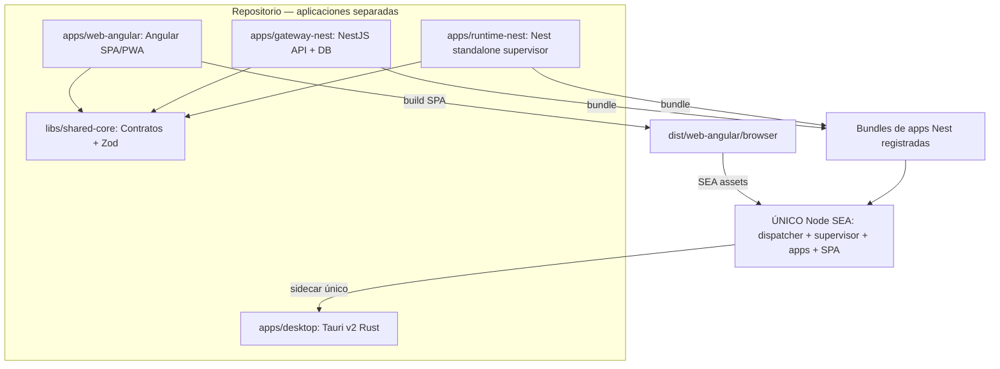

### 1.2 Topología de ejecución instalada


- **Una sola compilación Angular**, servida por el proceso gateway HTTPS a la WebView de Tauri, navegadores de escritorio y dispositivos móviles; ninguna segunda SPA local en Tauri. **Un único SEA físico**: Tauri lo arranca en modo supervisor y el supervisor relanza ese mismo archivo con una identidad de aplicación validada. El baseline arranca solamente `gateway-nest`.
- **Mismo origen en producción:** `https://IP-o-hostname:8443/` aloja `/api/**` y la PWA (manifest, assets, service worker, rutas Angular).
- **LAN-first:** sin Internet MUST continuar funcionando el gateway, la SPA y la persistencia local. Clientes PWA sin conexión al gateway **no** garantizan operaciones de negocio offline.
- **IA offline:** búsqueda vectorial local obligatoria; no imponer en el template un proveedor LLM ni dependencias cloud.

### 1.3 Fuera de alcance de la primera entrega

Aplicaciones de negocio, multi-tenant, sincronización entre clientes desconectados, hosting cloud, remotes ficticios de Module Federation, provisioning MDM empresarial, certificados comerciales de firma de código y elección de un LLM predeterminado. **CI multiplataforma, versión sincronizada y GitHub Releases sí forman parte del alcance**, como fase final y únicamente una vez verificada la base de las aplicaciones.

## 2. Baseline tecnológico y reproducibilidad

| Requisito | Tecnología | Restricción |
|---|---|---|
| REQ-STACK-01 | Node.js | `>=26.13.0 <27`; construir SEA con una versión fija de Node 26 |
| REQ-STACK-02 | pnpm | `>=12.16.1`; `packageManager` fijado a versión exacta verificada |
| REQ-STACK-03 | Tauri | v2, mínimo `2.12.5`; versiones efectivas fijadas |
| REQ-STACK-04 | NestJS | `12.3.2`; `@nestjs/platform-node` / `NodeAdapter`; sin Express ni Fastify |
| REQ-STACK-05 | Angular | `>=22.2.5`, major 22; instalar versión exacta compatible y demostrar zoneless |
| REQ-STACK-06 | Zod | `>=4.6.7`, major 4; declarar versión exacta en catálogo |
| REQ-STACK-07 | Drizzle ORM | Tag estable preferido; `1.0.0-rc.5` es el fallback si el tag estable carece de soporte vectorial en SQLite o PostgreSQL (decisión humana 10, 2026-10-30), para `drizzle-orm/node-sqlite`. Registrar el tag elegido |
| REQ-STACK-08 | pnpm Workspaces + Nx | Nx local, sin Nx Cloud; versión compatible fijada tras discovery |
| REQ-STACK-09 | Vector SQLite | `sqlite-vector` extensión nativa `1.1.2`, por plataforma/arquitectura |
| REQ-STACK-10 | Vector PostgreSQL | `pgvector >=0.8.7`, verificando versión en la instancia |

- `package.json` de todos los paquetes del workspace **MUST** fijar dependencias directas con versiones exactas; **MUST NOT** usar `^` ni `~` para esas dependencias. `pnpm-lock.yaml` **MUST** versionarse.
- Los paquetes compartidos **MUST** centralizar versiones mediante el catálogo de pnpm; `zod`, `@playwright/test`, TypeScript y herramientas de calidad se administran allí. Conservar el estilo `catalog:` y `savePrefix: ""` del repositorio de referencia, adaptando rutas `apps/*` y `libs/*`. No reproducir mecánicamente sus versiones, que pertenecen a otra generación de Node/Nest.
- **Protección de instalación (REQ-SUPPLY-01).** Adoptar, tras verificar compatibilidad con pnpm 12, el patrón real de [`fullstack-base/pnpm-workspace.yaml`](https://github.com/virgenherrera/fullstack-base/blob/50afc753617d628e0d8c5bd7ed2521ceae9a4298/pnpm-workspace.yaml): `minimumReleaseAge: 1440` (24 h) y `allowBuilds` explícito para scripts de instalación. Las excepciones necesarias para una actualización de seguridad se revisan y documentan; las entradas del repo hermano **no** deben copiarse automáticamente. No confundir esas medidas con detección de zero-days desconocidos.
- **Integridad (REQ-SUPPLY-02).** Usar el gestor fijado, `pnpm-lock.yaml` versionado, `pnpm install --frozen-lockfile` en CI y auditoría de **todas** las dependencias (incluidas dev/build). No instalar código arbitrario ni ejecutar `pnpm dlx` no fijado durante el CI. Validar dependencias Rust del sidecar con herramienta auditora verificada (p. ej. `cargo-audit`) cuando esté fijada, sin excluirlas del gate general.
- Cada versión y nombre de paquete **MUST** comprobarse antes de instalar; si una combinación resulta incompatible, el agente **MUST** documentar el bloqueo y elegir la variación mínima que conserve los requisitos, sin inventar APIs.
- Si se usa la RC `1.0.0-rc.5` de Drizzle como fallback, **MUST** quedar señalada como riesgo explícito, no como release estable.

## 3. Estructura de archivos esperada (normativa)

```text
lan-solution-template/
├── .github/workflows/ci-cd.yml    # Fase final: CI + release
├── apps/
│   ├── desktop/                    # Tauri v2: src-tauri, supervisión, tray
│   ├── gateway-nest/               # Nest: API, persistencia, TLS, serving SEA
│   ├── runtime-nest/               # Nest Standalone: supervisor de procesos SEA
│   └── web-angular/                # Angular standalone: SPA/PWA, proxy de dev
├── libs/
│   └── shared-core/
│       └── src/
│           ├── validation/
│           └── index.ts
├── tools/
│   └── scripts/
│       └── compile-sea.ts
├── nx.json
├── pnpm-workspace.yaml
├── package.json
├── pnpm-lock.yaml                  # Reproducibilidad
├── tsconfig.base.json
└── README.md
```

- **REQ-REP-01.** Los cuatro proyectos en `apps/` **MUST** existir al mismo nivel (`desktop`, `gateway-nest`, `runtime-nest`, `web-angular`). El código fuente Angular **MUST NOT** estar dentro de `gateway-nest/`; los assets compilados tampoco se versionan bajo su árbol fuente. Futuros microservicios Nest **MUST** ser proyectos hermanos, no subcarpetas ejecutables del gateway.
- **REQ-REP-02.** `shared-core` puede exportar contratos Zod/TypeScript, pero **MUST NOT** importar ni `@angular/*` ni `@nestjs/*` y **MUST NOT** contener lógica de servidor específica de Nest.
- **REQ-REP-03.** Carpetas internas (`src/`, `src-tauri/`, `public/`, `proxy.conf.*`, `project.json`, etc.) **MAY** añadirse según tooling oficial; no interpretar el árbol anterior como prohibición de archivos generados necesarios.
- **REQ-REP-04.** `.github/workflows/ci-cd.yml` **MUST** implementarse como última fase, después de completar los scripts locales y el build reproducible. Su contenido **MUST NOT** duplicar comandos internos de Nx, Jest, Playwright o Tauri: todas las operaciones del proyecto se invocan mediante scripts del `package.json` raíz.
- **REQ-REP-05.** **MUST** documentar contratos, comandos, límites de seguridad, topología de red y compilación por plataforma.

### 3.1 Dependencias de código permitidas

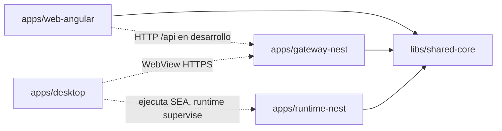

**Interpretación:** las dependencias sólidas son imports permitidos a `shared-core`; las flechas punteadas son interacciones runtime, no imports entre aplicaciones. El traslado del artefacto `dist/web-angular` y el empaquetado de todos los entrypoints Nest en el SEA son dependencias de **tareas Nx**, no imports de código fuente entre apps.

## 4. Configuración y dependencia entre inicializaciones

**REQ-CFG-01.** La configuración de aplicación en producción **MUST** ser persistente, validada mediante Zod 4, organizada por namespaces y expuesta como **singleton inmutable mediante DI de NestJS**.

**REQ-CFG-02.** El resto de la aplicación **MUST NOT** leer archivos de configuración directamente ni acceder a valores sin validar; **MUST** consumir el singleton. Referencia concreta: `https://github.com/virgenherrera/nest-base#namespaced-configuration-workflow`. Inspeccionar el código fuente de las clases namespaced, su registro, congelación e inyección; **trasladar el patrón conceptual a configuración persistida (no exigir `.env`)**, sin copiar dependencias incompatibles de Nest 11 ni asumir que es una biblioteca empaquetada.

**REQ-CFG-03.** `.env` **MAY** utilizarse en desarrollo y CI; **MUST NOT** ser obligatorio en el host instalado. Los argumentos de CLI **MUST** validarse. Los payloads HTTP **MUST** pasar por esquemas Zod estrictos que rechacen campos desconocidos. Angular no debe recibir secretos de configuración persistida del servidor.

**REQ-CFG-04.** La inicialización de persistencia **MUST** depender explícitamente de la configuración validada, utilizando el grafo normal de DI y una inicialización asíncrona (`DrizzleModule.forRootAsync` o composición equivalente soportada). **No** se exige un orquestador adicional de configuración/migraciones. **El supervisor de procesos es un caso distinto**, encargado de iniciar y vigilar apps Nest, no de sustituir la DI y el lifecycle propio de cada app.

**REQ-CFG-05.** Datos, logs, certificados, secretos y configuración **MUST** almacenarse fuera del ejecutable y en directorios apropiados de Windows/macOS/Linux; **MUST NOT** depender de `~/.lan-template/` como ruta universal. La ruta de instalación solo contiene el esquema y los valores por defecto sin secretos; el `config.json` real **MUST** residir en el directorio de configuración del SO (macOS `~/Library/Application Support/<bundleId>/`; Windows `%LOCALAPPDATA%\<bundleId>\`, por usuario; Linux `$XDG_CONFIG_HOME` o `~/.config/<bundleId>/`). Los directorios **MUST** crearse con permisos `0700` y los archivos de secretos con `0600` en POSIX (ACL solo del propietario en Windows: receta not verified). Los secretos **SHOULD** usar mecanismos seguros del sistema cuando estén disponibles.

**REQ-CFG-06.** El singleton de configuración inmutable se crea **por proceso/contenedor DI** (supervisor, gateway o microservicio). **MUST NOT** suponer memoria o singleton compartidos entre procesos; los procesos validan su namespace desde la configuración persistida y coordinan estado exclusivamente por contratos explícitos. El supervisor puede validar los metadatos de arranque, pero **no** debe transportar secretos por argumentos CLI.

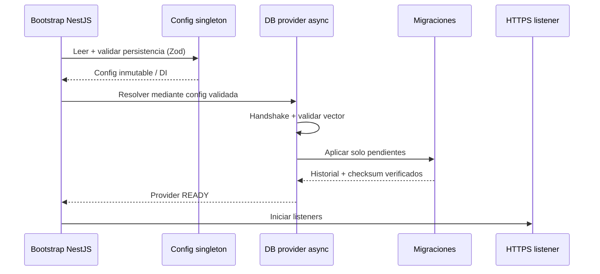

## 5. Persistencia, vectores y migraciones

**REQ-DB-01.** El gateway **MUST** proporcionar dos adaptadores mediante Strategy Pattern:
- **Predeterminado:** SQLite (`node:sqlite` + `drizzle-orm/node-sqlite`) con `sqlite-vector` nativo.
- **Alternativo:** PostgreSQL (`pg` + Drizzle) con `pgvector`.

**REQ-DB-02.** La selección **MUST** provenir del singleton de configuración validada. Los consumidores de dominio **MUST** depender de puertos/contratos y **MUST NOT** importar el adaptador elegido directamente.

**REQ-DB-03.** Cada motor **MUST** mantener sus propios schemas SQL y migraciones. No asumir que `sqliteTable` y `pgTable` sean intercambiables. Las operaciones vectoriales **MUST** ofrecer un contrato compartido, con SQL específico por dialecto cuando corresponda.

**REQ-DB-04.** **MUST NOT** instalar ni ejecutar `drizzle-kit` en este template. Las migraciones **MUST** estar versionadas en SQL/TypeScript, empaquetadas con la aplicación y ejecutadas automáticamente **durante la inicialización de Nest**, antes de que se publique readiness.

**REQ-DB-05.** El migrador propio **MUST**: leer historial persistente (`version`, `checksum`, `applied_at`), aplicar únicamente pendientes en orden, detectar cambios en migraciones ya aplicadas, y fallar de forma explícita ante inconsistencias. **MUST** definir bloqueo/concurrencia y transaccionalidad según cada motor; las migraciones **MUST NOT** darse por aplicadas antes de confirmarse.

**REQ-DB-06.** El orden de dependencia de arranque **MUST** ser: `config validada → resolver adaptador → abrir conexión/handshake → cargar/verificar capacidad vectorial → verificar/aplicar migraciones → publicar DB ready → publicar gateway ready`.

**REQ-DB-07.** SQLite **SHOULD** activar `foreign_keys`, evaluar `WAL` y establecer una política de durabilidad explícita; **MUST** almacenar `.db`, WAL y SHM fuera del SEA.

**REQ-DB-08.** El adaptador vectorial **MUST** demostrar inserción y consulta por similitud sin Internet en SQLite y PostgreSQL; **MUST NOT** pasar silenciosamente a búsquedas no vectoriales cuando falte la extensión. En PostgreSQL, los permisos necesarios para instalar `pgvector` **MUST** detectarse y diagnosticarse.

**REQ-DB-09.** La biblioteca nativa de SQLite **MUST** existir como archivo real antes de `loadExtension()`; si se empaqueta como SEA asset, **MUST** extraerse a una ubicación controlada, validar su integridad y cargar solo la variante OS/arquitectura correspondiente. **MUST NOT** ejecutar extensiones arbitrarias suministradas por clientes.

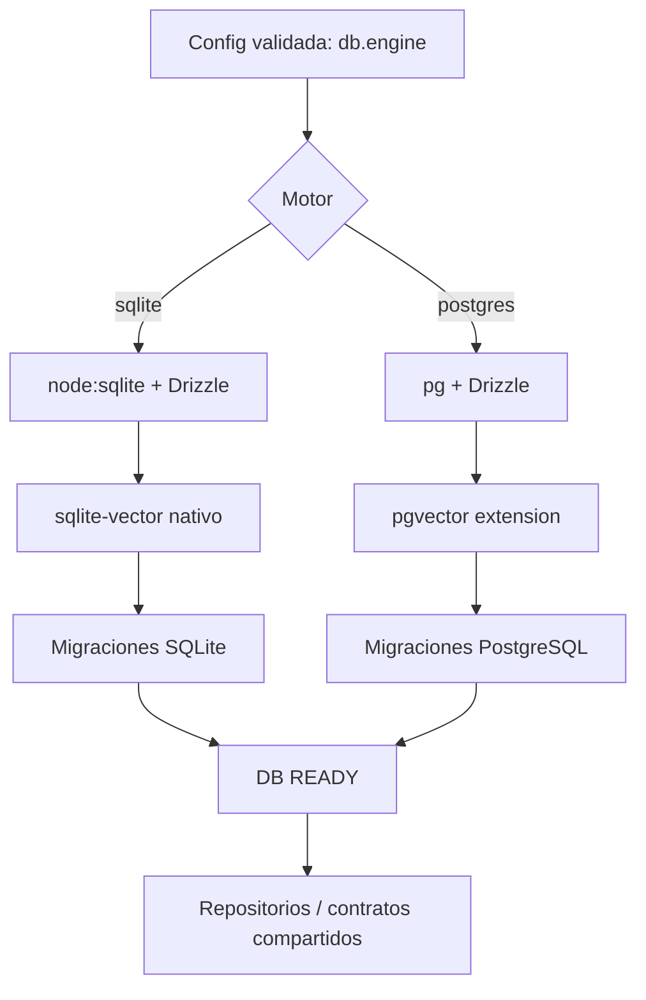

## 6. Desarrollo, empaquetado web, gateway LAN, HTTPS y PWA

### 6.1 Desarrollo: apps independientes + proxy (DX con HMR)

- **REQ-DEV-01.** `web-angular` **MUST** arrancar su propio `ng serve` (por defecto `127.0.0.1:4200`) con HMR y compilación incremental. `gateway-nest` **MUST** arrancar de manera independiente en su puerto de API (por defecto HTTPS `127.0.0.1:8443`).
- **REQ-DEV-02.** Configurar el **`proxyConfig` del dev-server Angular** (`@angular/build:dev-server`, basado en Vite) para reenviar **`/api/**`** al gateway Nest **sin cambiar de origen en el navegador**. El proxy **MUST NOT** redirigir rutas SPA ni HMR a Nest.
- **REQ-DEV-03.** La aplicación Angular **MUST** invocar rutas relativas (`/api/...`) en desarrollo y producción; **MUST NOT** contener IP/host LAN hardcodeados ni URLs de API diferentes en cada componente.
- **REQ-DEV-04.** Para desarrollo TLS, la CA/certificado local **MUST** ser confiable para el proceso del proxy; **MUST NOT** utilizar `secure: false` como configuración final del template. Si existe un desbloqueo temporal de desarrollo, debe documentarse expresamente como **inseguro y no distribuible**.
- **REQ-DEV-05.** `@nestjs/serve-static` **MUST NOT** montarse en el gateway de desarrollo; Angular es servido exclusivamente por `ng serve`. **No** se exige SEA/Tauri para iterar sobre Angular o Nest.

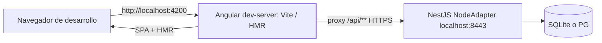

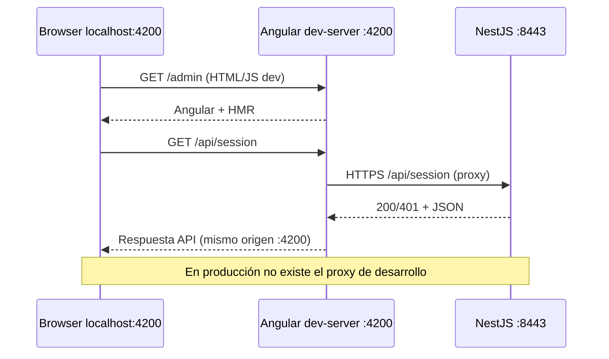

**Ejemplo conceptual de proxy Angular** (el agente **MUST** adaptar el formato al builder real y certificar el resultado, sin fijar esta muestra como API propia):

```json
{
  "/api/**": {
    "target": "https://localhost:8443",
    "secure": true,
    "changeOrigin": true
  }
}
```

### 6.2 Producción: un SEA sirve ambos artefactos compilados

- **REQ-NET-01.** NestJS **MUST** usar `NodeAdapter` de `@nestjs/platform-node`, sin Express ni Fastify. El API y la SPA **MUST** compartir proceso y origen HTTPS en producción. *(Premisa `NodeAdapter` + `ServeStaticModule` sin Express/Fastify: not verified.)*
- **REQ-NET-02.** **Solo cuando `node:sea.isSea()` sea `true`**, el Gateway **MUST** habilitar `ServeStaticModule` de `@nestjs/serve-static` **(>=12.1.1, versión fijada compatible)** con soporte para `@nestjs/platform-node >=12.3.1`. En ejecución de desarrollo, no se habilita.
- **REQ-NET-03.** `@nestjs/serve-static` necesita **`rootPath` como directorio real**; `node:sea.getAsset()` no genera por sí mismo un filesystem navegable. Por tanto, antes de crear el contexto de Nest, el bootstrap **MUST** materializar el árbol Angular empaquetado desde assets SEA a una **caché por versión/build ID fuera del ejecutable**.
- **REQ-NET-04.** La materialización **MUST** ser segura: validar manifest + checksums, prevenir `../` traversal, impedir sobrescritura de rutas no administradas, escritura temporal + publicación atómica, manejo de extracción concurrente, permisos mínimos y limpieza de versiones obsoletas. Si el árbol ya coincide con el manifest, reutilizarlo sin reextraer.
- **REQ-NET-05.** Tras materializar, se **MUST** configurar `ServeStaticModule.forRoot({ rootPath: <directorio-verificado> })` mediante composición de módulos de Nest hecha antes de `NestFactory.create()`. **No** instanciar el módulo a posteriori como paso dinámico; tampoco añadir un orquestador genérico de hooks.
- **REQ-NET-06.** El listener HTTPS **MUST** usar `8443` por defecto, configurable desde el singleton; la exposición LAN `0.0.0.0` se configura en el servidor instalado y el API se sirve bajo `/api/**`. SPA, manifest, service worker y API usan el mismo origen.
- **REQ-NET-07.** Las solicitudes a `/api/**` **MUST NOT** recibir `index.html` como fallback SPA. Rutas Angular válidas pueden recibir el fallback; archivos ausentes (`.js`, `.css`, `.wasm`, manifiestos, íconos) **MUST** responder `404`, no HTML. Implementar headers/MIME/cache correctos.
- **REQ-NET-08.** Un listener HTTP mínimo en `8080` **MUST** redirigir al HTTPS `:8443` usando **308**. No servir datos ni autenticación por HTTP. Validar el destino de redirección y evitar open redirects con `Host` malicioso.

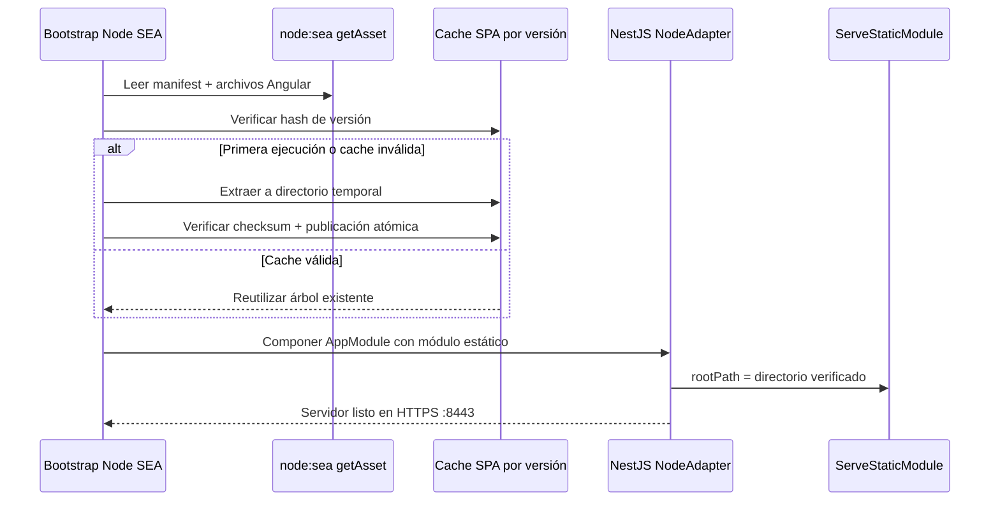

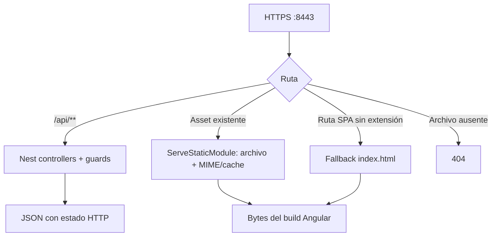

### 6.3 TLS LAN local, sin costo ni dependencia de Internet

- **REQ-TLS-01.** El setup **MUST** generar/provisionar una identidad TLS para **este gateway**, mantener claves en almacenamiento persistente protegido y reutilizar/renovar según SAN e identidad. El certificado **identifica hostname/IP, nunca el puerto**; HTTPS se atiende solamente en los listeners que la app abre.
- **REQ-TLS-02.** La confianza TLS en la computadora anfitriona **SHOULD** facilitarse con consentimiento explícito. Dispositivos móviles y PCs clientes requieren instalar/verificar confianza de la CA/certificado correspondiente; **MUST NOT** prometer confianza automática entre dispositivos.
- **REQ-TLS-03.** El setup **MUST NOT** alterar servidores o configuración de HTTPS de otros dispositivos de la LAN, distribuir claves privadas, usar `rejectUnauthorized=false` ni deshabilitar validación de certificados en producción.
- **REQ-TLS-04.** Si cambia la IP/hostname, el sistema **MUST** detectar incompatibilidad SAN, informar claramente y reemitir certificado cuando aplique. Documentar cómo introducir confianza en iOS, Android, Windows y macOS, incluidos requisitos de PWA.

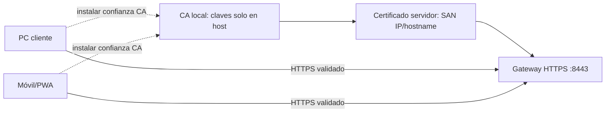

### 6.4 PWA y estrategia de caché

- **REQ-PWA-01.** Angular **MUST** producir PWA instalable donde OS/navegador lo permitan, con `manifest.webmanifest`, iconos, service worker y contexto HTTPS confiable. **MUST NOT** incluir HMR/debug en la distribución.
- **REQ-PWA-02.** El gateway **MUST** diferenciar caché de `index.html` y service worker (revalidables) de archivos con nombres basados en hash (inmutables). Mantener consistencia de versión entre manifest, assets y service worker.
- **REQ-PWA-03.** Móviles/PC **MUST** poder abrir `https://IP-o-hostname:8443/` sin Internet público. **No** exigir DNS público. No prometer acceso a datos mutables si el cliente perdió la conexión al gateway.

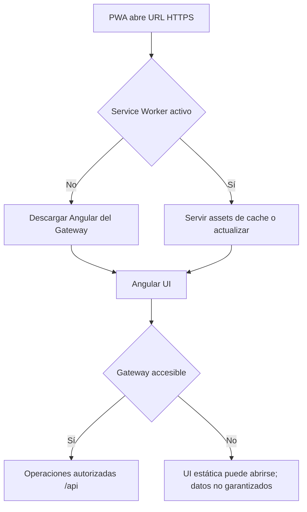

## 7. Seguridad por defecto

**REQ-SEC-01.** Tratar la LAN como no confiable. **MUST** autenticar y autorizar cada operación protegida en NestJS; los guards Angular y la ocultación de UI **MUST NOT** constituir el único control de autorización.

**REQ-SEC-02.** Proveer micro-POC mínimo de roles `public`, `employee` y `admin` (sin crear credenciales predeterminadas permanentes). Solo en desarrollo, el arranque **MAY** sembrar en la base de datos un superusuario autodestructivo `dev-admin` (nunca `admin` ni `root`), con contraseña aleatoria de al menos 15 caracteres mostrada una sola vez, creado por la misma ruta de creación de usuarios que producción, con `expires_at` y purga forzada por el servidor. Producción **MUST NOT** sembrar ninguna cuenta. La base de datos es la única fuente de verdad de identidad y permisos (ASVS 5.0.0 6.3.2 y 6.4.1; cita not verified). Las pruebas **MUST** demostrar `401/403` cuando corresponde y acceso autorizado cuando corresponde.

**REQ-SEC-03.** Los chunks de Angular **SHOULD** cargarse de forma diferida por funcionalidad/rol. **MUST NOT** suponer que ocultar o impedir descargar un `.js` protege datos o secretos. **MUST NOT** incrustar secretos en bundles de navegador.

**REQ-SEC-04.** Mantener API y frontend en un mismo origen siempre que sea posible; aplicar validación estricta, límites de tamaño, defensas frente a abuso de autenticación y configuración mínima de permisos.

**REQ-SEC-05.** Tauri **MUST** restringir comandos IPC y capacidades privilegiadas. El frontend servido por LAN **MUST NOT** recibir privilegios de shell/sidecar solo por mostrarse en la WebView de Tauri.

**REQ-SEC-06.** Certificados, claves y tokens **MUST NOT** escribirse en logs ni incorporarse al binario como secretos fijos. La clave privada TLS **MUST NOT** distribuirse a clientes LAN.

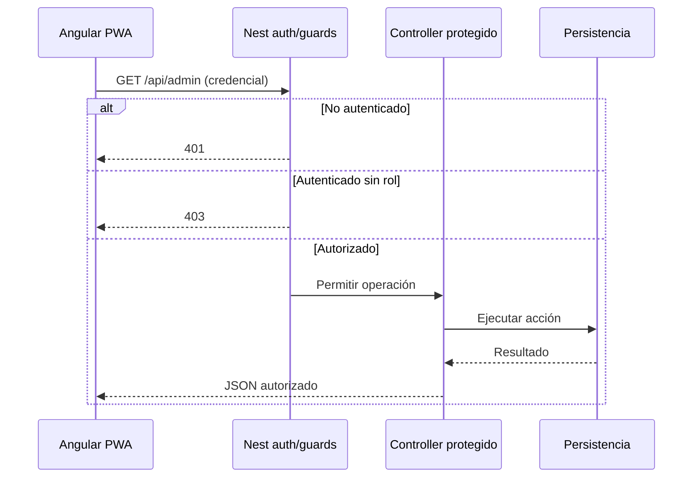

## 8. Web Angular

**REQ-WEB-01.** Angular 22 **MUST** operar con TypeScript strict, Signals, zoneless y Tailwind.

**REQ-WEB-02.** UI inicial minimalista: página pública de estilo **terminal ARPANET retro** (monospaced, verde/ámbar sobre negro), acceso/logon y rutas mínimas protegidas `employee` y `admin`.

**REQ-WEB-03.** Rutas protegidas **MUST** usar lazy loading/code-splitting. Las vistas no autorizadas **MUST NOT** renderizarse en el DOM. El API **MUST** impedir igualmente acciones no autorizadas.

**REQ-WEB-04.** Preparar separación futura para Module/Native Federation, **sin implementar remotes ficticios** en el baseline. Agregar federation real cuando una aplicación derivada tenga múltiples unidades desplegables independientes. **Frontend SPA independiente, ubicado siempre en `apps/web-angular/`.**

## 9. Desktop Tauri y procesos

**REQ-DESK-01.** Tauri v2 **MUST** distribuir el Node SEA mediante `bundle.externalBin` como sidecar con binarios específicos para cada `target triple` Windows/macOS/Linux.

**REQ-DESK-02.** Tauri/Rust **MUST** iniciar, monitorizar y detener **únicamente el proceso supervisor SEA**; ese supervisor **MUST** gestionar directamente los procesos de aplicaciones Nest. La WebView **MUST** mostrar la **misma Angular servida desde el proceso gateway** (no una segunda copia funcional).

**REQ-DESK-03.** Integrar System Tray con estado `starting/ready/error`, acción para abrir la interfaz y acción **Quit** para terminación controlada. **Cerrar la ventana** **SHOULD** ocultarla al tray sin detener el gateway; **Quit** **MUST** terminar el proceso y limpiar recursos.

**REQ-DESK-04.** Ofrecer **autostart al iniciar sesión en el SO**, preferiblemente configurable por el usuario. **No** afirmar que esto constituye un servicio nativo disponible antes del login.

**REQ-DESK-05.** Implementar readiness/health-check, manejo de puerto ocupado, prevención de dos instancias por instalación, proceso hijo huérfano, shutdown y recuperación ante fallo inesperado. **Tauri monitoriza al supervisor; el supervisor monitoriza cada hijo.** Los secretos del gateway y demás servicios no deben quedar expuestos en argumentos de proceso visibles a otros usuarios.

**REQ-DESK-06.** El host **MUST** quedar operable desde clientes LAN aunque la ventana Tauri esté oculta. El supervisor y el gateway **MUST NOT** depender de que la WebView permanezca abierta.

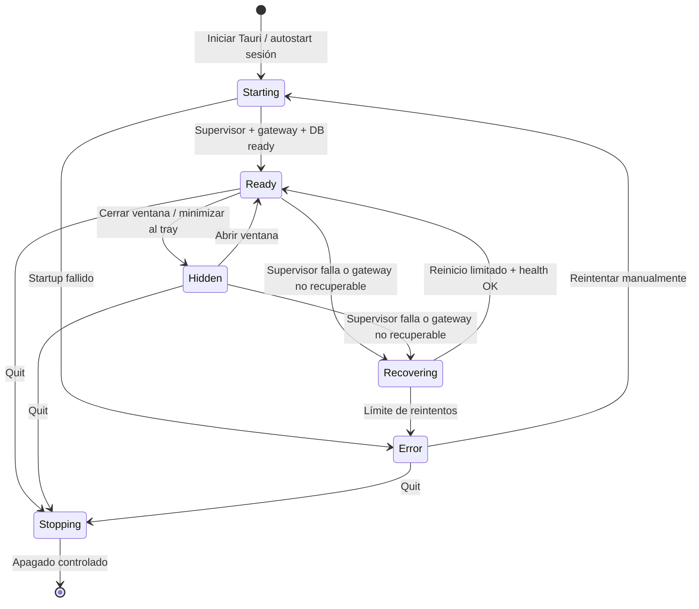

### 9.1 Runtime multiproceso — NestJS Standalone Application (normativo)

**REQ-RUNTIME-01 — Un solo archivo SEA.** Construir **exactamente un ejecutable SEA por OS/arquitectura** que incorpore el dispatcher, el entrypoint `runtime-nest`, el entrypoint `gateway-nest` y, cuando existan, los de otros proyectos Nest. El instalador Tauri **MUST** contener **una sola instancia física del SEA**, no un `node.exe` ni un SEA por servicio. No se exige instalar Node en el equipo anfitrión.

**REQ-RUNTIME-02 — Supervisor sin listeners.** `apps/runtime-nest/` **MUST** usar `NestFactory.createApplicationContext(RuntimeModule)` y los providers nativos de Nest (DI y lifecycle) para supervisar hijos. **MUST NOT** exponer HTTP/gRPC/puerto propio; no es un segundo gateway. `runtime-nest` es una app real de infraestructura, no un microservicio de negocio ficticio.

**REQ-RUNTIME-03 — Reentrada del mismo binario.** Tauri inicia el SEA **sin selector de servicio**, y este entra en modo supervisor. La instancia supervisor invoca `child_process.spawn(process.execPath, ['--service', '<id>'], { shell: false, ... })` (o API equivalente) para arrancar **el mismo ejecutable físico** en modo de app. Un dispatcher único interpreta `process.argv`, valida `id` mediante Zod contra un **registro de servicios cerrado**, y ejecuta exclusivamente el bootstrap empaquetado correspondiente. **MUST NOT** intentar usar el SEA como intérprete de archivos `.js` ajenos; **MUST NOT** depender de ejecutar `node` desde PATH, ni de `fork()`/`cluster.fork()` como mecanismo obligatorio. El selector CLI **solo identifica qué bootstrap lanzar** y **nunca** concede privilegios de autenticación ni permisos a un servicio.

**REQ-RUNTIME-04 — Contratos de bootstrapping.** Cada app Nest **MUST** conservar su bootstrap y target de build Nx: `gateway-nest` inicia `NestFactory.create()` + `NodeAdapter`; un futuro `auth-ms` podrá utilizar `createMicroservice()` (gRPC/TCP) o `create()` (HTTP), sin cambiar cómo Tauri distribuye el producto. Las aplicaciones de negocio **MUST NOT** importar directamente el código fuente de `runtime-nest`; los contratos reutilizables van a `libs/`.

**REQ-RUNTIME-05 — Preparación y salud.** El supervisor **MUST** tener registro tipado de servicios habilitados, dependencias/prioridad de arranque cuando existan, timeout de readiness, health, logs identificados por servicio y política de reinicio acotada (*backoff* + máximo de intentos). `runtime-nest` **MUST** informar a Tauri un estado agregado `starting/ready/degraded/error/stopping`; el gateway **MUST NOT** anunciar readiness si dependen de él procesos obligatorios aún no disponibles. Para el baseline solo está habilitado `gateway-nest`; **MUST NOT** inventar un `auth-ms` de prueba.

**REQ-RUNTIME-06 — Cierre multiplataforma.** Usar un canal de control explícito, preferentemente **IPC de Node por `stdio`**, para ordenar al hijo `app.close()` y esperar su terminación; luego aplicar timeout y finalización forzada, limpiando también descendientes. No depender solo de `SIGTERM` para cierre limpio en **Windows**, pues la señal termina abruptamente el subproceso. La misma secuencia se activa al elegir Quit desde Tauri, y se debe tolerar cierre/crash inesperado del supervisor sin dejar procesos huérfanos. **MUST** verificar el árbol de procesos en Windows, Linux y macOS.

**REQ-RUNTIME-07 — Persistencia y límites.** Cada proceso aloja su propia DI y estado en memoria; la configuración persistida y la DB no deben asumirse instancias de memoria compartida. Definir dueño de migraciones y bloqueo en bases compartidas para impedir carreras. Los servicios internos **SHOULD** escuchar en loopback o socket local, salvo requisito LAN explícito y autenticado. Un único SEA permite *lockstep*, **no** despliegue/versionado independiente de microservicios.

**REQ-RUNTIME-08 — Binario único verificable.** Un smoke APP **MUST** ejecutar el binario real sin argumentos (supervisor) y confirmar que relanza el **mismo `process.execPath`** en rol gateway; debe validar handshake/ready, HTTP/PWA, caída de un hijo, reinicio acotado, error de rol no registrado, apagado ordenado y **ausencia de copias adicionales** del runtime en el instalador. No son pruebas unitarias ni de integración aisladas.

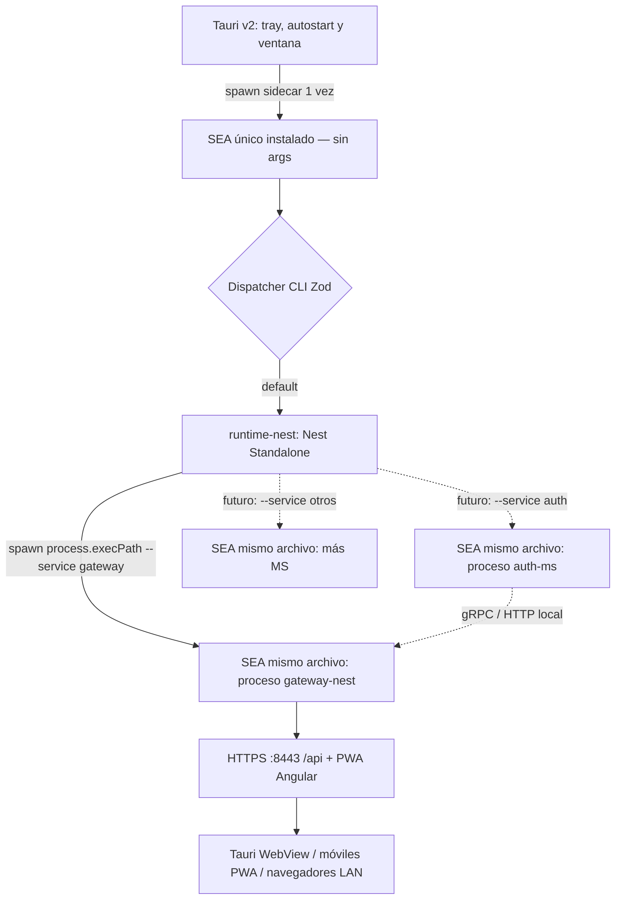

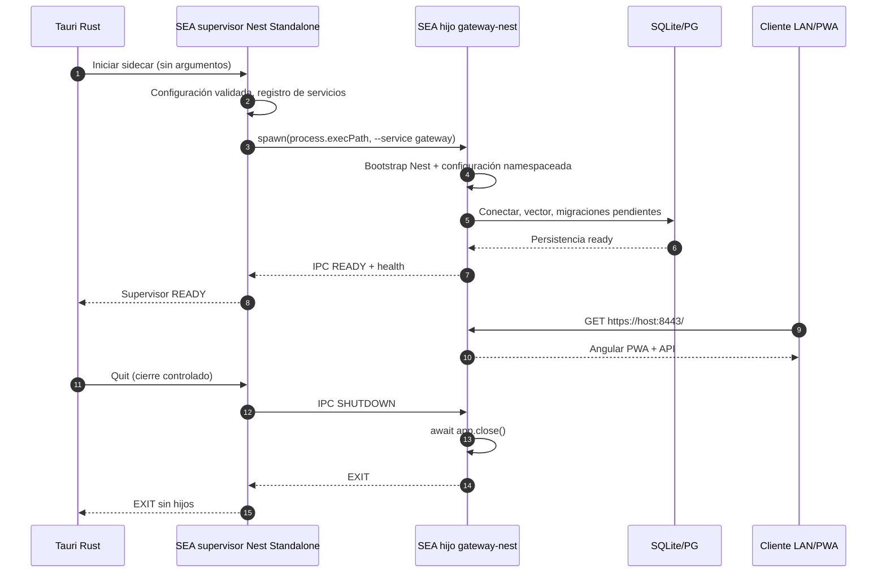

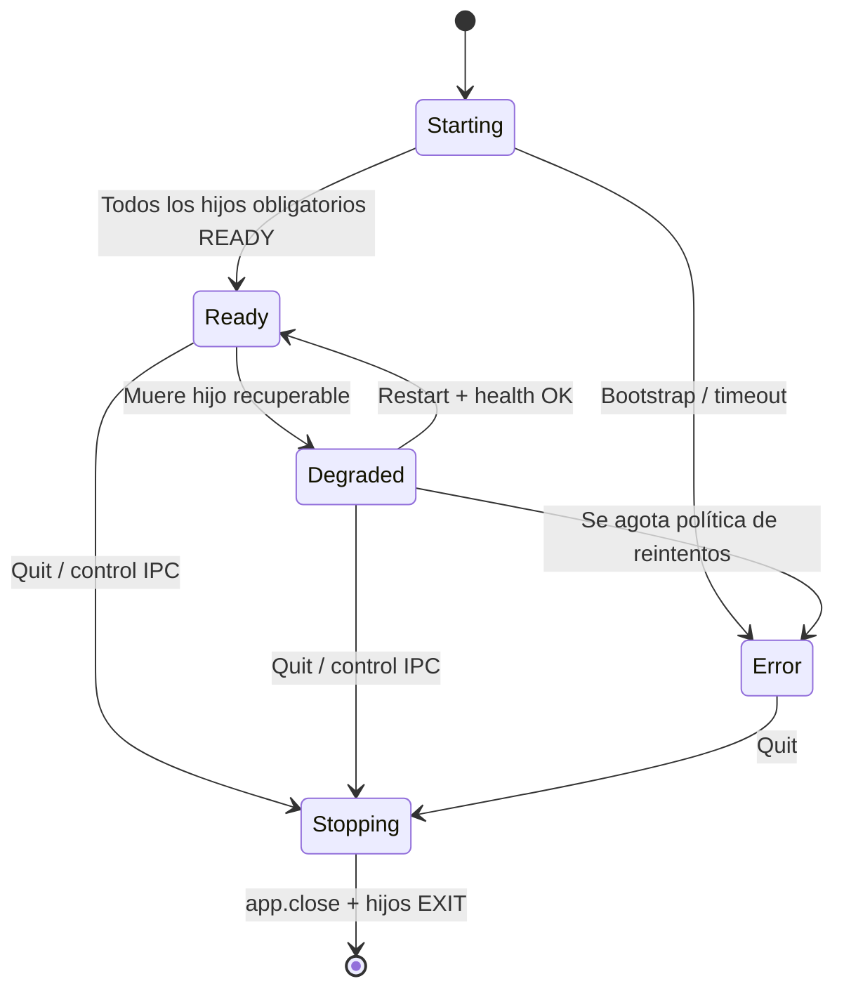

**Trade-off aceptado:** se reduce la duplicación de ejecutables/instaladores y se preserva aislamiento por proceso; a cambio, cada proceso mantiene un runtime Node en memoria y todos los microservicios incorporados comparten versión de release. Se trata de una topología local, no de Kubernetes ni de un despliegue de servicios independientes. **Durante desarrollo** `gateway-nest` **MAY** iniciarse directamente con watch/HMR detrás del proxy Angular: no se obliga a construir SEA ni a arrancar Tauri/supervisor para iterar en la API.

## 10. Node SEA y distribución

**REQ-SEA-01.** `tools/scripts/compile-sea.ts` **MUST** empaquetar un **dispatcher JavaScript único** con entrypoints del supervisor `runtime-nest`, gateway `gateway-nest` y todos los servicios habilitados que se registren posteriormente, más sus dependencias de JavaScript, para ejecución sin `node_modules` externos. **El registro de roles se resuelve en build y en el dispatcher; no se requiere extraer `.js` para lanzarlos.**

**REQ-SEA-02.** Generar la configuración del SEA e invocar el mecanismo nativo **`node --build-sea`**; **MUST NOT** introducir `postject` salvo que una limitación concreta y documentada lo exija.

**REQ-SEA-03.** Baseline del SEA: `useVfs: false`, `useSnapshot: false`, `useCodeCache: true` **solo para builds nativos compatibles**. En cualquier build cruzado donde el code cache no sea compatible, **MUST** deshabilitarlo y documentarlo. La configuración release **SHOULD** fijar `execArgvExtension: "none"` para evitar que `NODE_OPTIONS` altere flags del runtime; si se necesita extensión para diagnóstico, debe ser explícita y no distribuirse como default inseguro.

**REQ-SEA-04.** Migraciones SQL y **la salida compilada `dist/web-angular`**, nunca sus fuentes, **MUST** incorporarse como assets SEA mediante `node:sea` y manifest de rutas/hashes. El backend **MUST** extraer de forma segura el árbol web a caché física versionada antes de montar `ServeStaticModule`. **MUST NOT** tratar `getAsset()` como una ruta/directorio.

**REQ-SEA-05.** Bases de datos, configuraciones, logs, certificados, extensiones nativas extraídas y modelos **MUST** residir fuera del ejecutable de solo lectura. La ruta de instalación solo contiene esquema y valores por defecto sin secretos; el `config.json` real **MUST** residir en el directorio de configuración del SO (rutas en REQ-CFG-05), con directorios `0700` y secretos `0600`. La distribución **MUST** funcionar sin conexión durante la ejecución.

**REQ-SEA-06.** **MUST** validar por plataforma/arquitectura tanto el binario SEA independiente como el paquete Tauri que lo contiene; build exitoso **no equivale** a runtime verificado. El builder **MUST** preservar `index.html`, chunks con hash, CSS, fuentes, manifest, iconos y service worker como assets separados dentro del manifiesto SEA, con tipos MIME correctos.

## 11. Nx, calidad y pruebas

### 11.0 Cadena de suministro: fallo seguro desde el principio

**REQ-SEC-CI-01 — Gate temprano.** `securityCheck` **MUST** ejecutarse antes del primer build y otra vez como dependencia lógica de `pnpm test` independiente. En pnpm, **MUST** usar un audit de **todas** las dependencias del workspace (incluidas dev/optional) con umbral mínimo `high`; ningún resultado `high`/`critical` sin remediación/decisión formal podrá superar el pipeline. `pnpm audit --audit-level high` es la referencia de partida de `fullstack-base` (no copiar `securityFix: pnpm update` como reparación automática).

**REQ-SEC-CI-02 — Fail-closed.** Una consulta audit que falla por timeout, credenciales/registry inaccesibles o resultado incompleto **MUST** detener CI y release. **MUST NOT** usar `--ignore-registry-errors`, `|| true`, `continue-on-error` o cache vieja como «audit verde». Si una instalación offline necesita operar, separar la tarea de instalación de la validación de seguridad; no reportar una auditoría offline sin datos actuales como aprobada. Un audit previo a `install` sobre el lockfile **MAY** añadirse si se demuestra que la versión fijada de pnpm lo soporta, pero nunca sustituye el audit tras instalar.

**REQ-SEC-CI-03 — Prevención previa a build.** `pnpm-workspace.yaml` **MUST** aplicar `minimumReleaseAge: 1440`, `allowBuilds` de forma explícita, `strictDepBuilds: true` y `dangerouslyAllowAllBuilds: false` tras verificar su semántica en pnpm 12. **MUST** prohibir por defecto scripts de instalación no autorizados y revisar/fijar los permitidos para cada dependency real; no importar las allowlists del repo hermano sin inspección. Se **SHOULD** verificar integridad/firmas de registry si el registry ofrece esa capacidad. Cualquier bypass de ventana de 24h para parches urgentes requiere una excepción documentada y auditada, nunca autoaprobada.

**REQ-SEC-CI-04 — Límite de garantía.** Este gate protege de vulnerabilidades **conocidas y publicadas**; **no** detecta de forma fiable zero-days aún no divulgados. Mantener dependencias exactas, lockfile reproducible, permisos mínimos de GitHub Actions, secretos fuera del PR, análisis del árbol Rust/Tauri y release con hashes. No ejecutar `pnpm audit --fix`, `pnpm update` o cambios de dependencias silenciosos durante el CI. La caché opcional de Nx para CI **MUST NOT** aceptar resultados de PRs no confiables como evidencia suficiente para publicar un release; usar límites de confianza y revalidar en el SHA del release.

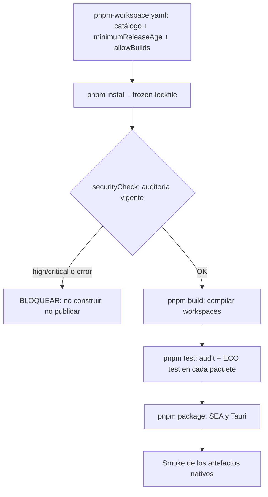


**REQ-BUILD-01.** Nx **MUST** ejecutarse localmente, sin Nx Cloud. Caché local obligatoria; caché remota para GitHub Actions **MAY** incorporarse cuando exista un plugin compatible, mantenido y con aislamiento seguro de artefactos. **MUST NOT** asumir que un paquete existe sin verificarlo.

**REQ-BUILD-02 — Orden del CI y ECOs.** La secuencia pública del root **MUST** ser `install → securityCheck → build → test → package` (seguida de CD solo si el PR se fusiona). `test` **MUST** agregar `test:static` + `test:dynamic` por cada paquete, en ese orden por paquete; **NO** ejecuta `package` ni reemplaza a `build`. Nx **MUST** modelar dependencias, outputs y caché sin inventar aliases como `build:sea`, `test:ut` o `pipeline:prebuild`. Los comandos del CI **MUST** reproducirse localmente. `securityCheck` **MUST** finalizar exitosamente antes de iniciar el primer build; es una barrera de seguridad y no una tarea paralela. En `test` se vuelve a validar la seguridad para que funcione también de manera independiente. `--nxBail` detiene nuevas tareas tras una falla, pero no equivale a cancelar tareas que ya corren. El orden global **NO** implica serializar todos los workspaces: Nx **MAY** paralelizar paquetes después del gate, respetando dependencias.

**REQ-BUILD-03.** Orden **obligatorio** modelado en Nx: `build` de `web-angular`, `runtime-nest`, `gateway-nest` (y nuevos servicios declarados); `package` del ensamblador SEA consume todos sus outputs, empaqueta SPA + dispatcher + aplicaciones, y `package` de `desktop` consume el SEA y construye el instalador. `build` de las apps puede ejecutarse en paralelo; **El `package` del SEA MUST NOT empezar hasta que todos los builds hayan concluido correctamente**. Los targets son `build` y `package` en cada proyecto, sin inventar scripts alias para cada tecnología. Añadir un microservicio **MUST NOT** duplicar el ejecutable Node.

**REQ-BUILD-04.** El target `package` del ensamblador invoca `tools/scripts/compile-sea.ts`, que **MUST** localizar la carpeta real `browser/` producida por el builder Angular (no asumir una ruta fija), enumerar recursivamente archivos publicables, generar manifest con hashes, preparar `assets` SEA y comprobar SPA/manifest/service worker. Además **MUST** validar que los entrypoints Nest declarados existen, que el dispatcher de roles los incluye en **un único bundle ejecutable** y que el build se invalida al agregar/modificar cualquier servicio registrado.

**REQ-BUILD-05.** La verificación posterior a `package` del artefacto **MUST** verificar que cambiar Angular invalida el SEA y, por extensión, el bundle Tauri, aunque no se haya modificado una línea de Nest. Los cambios de solo backend **SHOULD NOT** forzar recompilar Angular si Nx puede reutilizar su build.

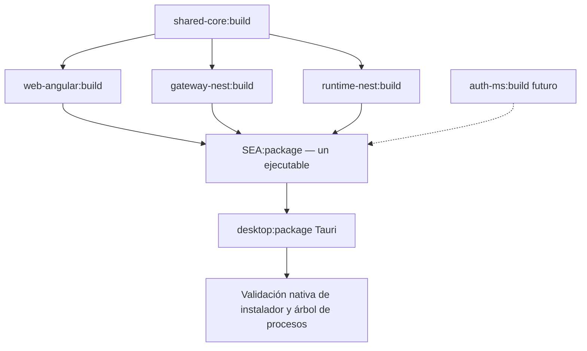

**REQ-TEST-01 — Política no negociable.** Los repositorios hermanos son antecedentes de aprendizaje, **NO** plantillas normativas de suites. **MUST NOT** crear suites, carpetas, proyectos de pruebas ni runners dedicados de **unit testing** o **integration testing**. **MUST** escribir solamente pruebas de **aplicación real (APP/app-level)** y pruebas **E2E del producto instalado (E2E real)**. Se permiten aserciones muy focalizadas, pero siempre a través de la aplicación ensamblada, sin instanciar clases de dominio aisladamente ni simular persistencia, red o contratos de negocio.

**REQ-TEST-02 — Clasificación, NO unit/integration tests.** Cada caso APP **MAY** clasificarse con etiquetas semánticas `@ut`, `@int` o `@app`, pero **ninguna etiqueta cambia el runner, el bootstrap ni la fidelidad del entorno**. `UT` es una selección de comportamientos puntuales observables mediante la app real; `INT` selecciona interacciones entre componentes reales; `APP` es la suite completa. La etiqueta `@app` es opcional: un test sin etiquetas también forma parte de APP. **MUST NOT** confundir `@ut`/`@int` con autorización para escribir unit/integration tests tradicionales.

**REQ-TEST-03 — Scripts y filtros.** La **única entrada pública de selección de pruebas** es `test` con filtro opcional: `pnpm test` (todas) o `pnpm test -- --filter @ut` / `pnpm test -- --filter @int`. **MUST NOT** existir `test:ut`, `test:int`, `test:unit` ni suites unitarias/de integración aisladas. El filtro **MUST** afectar únicamente la selección de pruebas APP dinámicas; `securityCheck`, controles estáticos, typecheck y bootstrap de fixtures reales **MUST** seguir ejecutándose. Un adaptador mínimo de argumentos, reutilizable por root y workspaces, **MUST** traducir el filtro a Jest (`--testNamePattern`) y Playwright (`--grep`), y **MUST** rechazar filtros desconocidos o vacíos accidentalmente (no transformar un filtro sin coincidencias en éxito). El agente **MUST** comprobar la sintaxis real `pnpm test -- --filter ...` mediante pruebas de CLI. Cada paquete **MUST** declarar `test`, `build` y `package`; cuando una operación realmente no aplique, usar `echo 'not defined for this package'` y código `0`, pero **MUST NOT** convertir en no-op un control obligatorio que debería existir (gateway/web deben tener tests APP, Tauri debe empaquetarse). Los hooks `test:static`/`test:dynamic` son etapas ECO, **no** runners diferentes.

**REQ-TEST-04 — Gateway APP.** NestJS **MUST** probarse con **Jest + Supertest**, arrancando un `INestApplication` real y sus providers, configuración y base de pruebas verdaderos; usar DB SQLite temporal y PostgreSQL de pruebas cuando corresponda. `supertest(app.getHttpServer())` verifica contratos HTTP app-level sin requerir puerto LAN expuesto. TLS real, redirect, `ServeStaticModule` solo en SEA y ciclo de vida del proceso **MUST** probarse adicionalmente contra el ejecutable/listeners reales; no fingir que el test in-memory cubre el sistema operativo o la red.

**REQ-TEST-05 — Angular APP.** Angular **MUST** probarse con **Playwright**, navegador real, endpoints del gateway real y aserciones semánticas de DOM. **MUST** cubrir modo dev (`:4200` + proxy + HMR) y modo distribuido (`:8443` servido por SEA), roles público/employee/admin, protecciones de API y ausencia efectiva de componentes restringidos. **MUST NOT** imponer pruebas de componentes aislados ni snapshots cosméticos.

**REQ-TEST-06 — Persistencia APP.** Ejercitar SQLite **y** PostgreSQL desde el contexto de app real: migración inicial, reinicio sin reejecución, migración pendiente, checksums alterados, fallo de inicialización y consulta vectorial genuina. Las fixtures **MUST** aislar los datos de cada ejecución y limpiar recursos; prohibido reemplazar los adaptadores con mocks para considerar aprobada una prueba APP.

**REQ-TEST-07 — SEA APP distribuido.** Ejecutar el **binario SEA compilado en modo supervisor** (no únicamente el bundle TS) y comprobar que lanza el gateway como segundo proceso del mismo archivo físico. Verificar handshake, migraciones, vectores, assets Angular, fallback SPA, `404` correcto, TLS, manifest/PWA, shutdown coordinado, reinicio ante caída de hijo y extracción atómica de assets. Esta suite es **APP sobre artefacto real**, no todavía E2E nativo de escritorio.

**REQ-TEST-08 — E2E real Tauri.** El paso **`package`** (una vez satisfechos build y test) **MUST** validar los artefactos distribuibles mediante smoke de SEA real y automatización Tauri con **WebdriverIO + `@wdio/tauri-service`** cuando la plataforma lo soporte. Cubrir readiness agregado, WebView, HTTPS, tray, sidecar único, shutdown, reinicios y autostart verificable. El producto comercial **MUST NOT** incluir el plugin o los permisos exclusivos de instrumentación WDIO. Complementar con **smoke black-box del instalador sin instrumentación** (instalar, iniciar, navegar, cerrar, desinstalar), automatizado o manual con estado explícito. Estas pruebas corresponden a la verificación de **packaging real**, no a otra suite `test:e2e` ni a un test unitario/integración. No declarar verde una plataforma por una validación no realizada.

**REQ-TEST-09 — Matriz de SO.** **MUST** compilar y verificar el sidecar SEA/Tauri para cada sistema/arquitectura que se declare oficialmente soportado. **MUST NOT** afirmar compatibilidad Windows/Linux por aprobar las pruebas en macOS. Una **VM** con sistema operativo real o runner nativo sirve para comprobar instaladores, WebViews, autostart y tray. **Docker MAY** alojar PostgreSQL, pruebas de gateway, Playwright y smoke Linux con Xvfb/WebKitGTK, pero **MUST NOT** sustituir la validación de un instalador y escritorio nativos de Windows/macOS. Una VM Windows ARM **MUST NOT** tomarse como prueba equivalente a Windows x64.

**REQ-TEST-10 — Alcance inicial mínimo.** Antes de introducir CI/CD, el template **MUST** entregar scripts locales repetibles y una matriz de resultados por plataforma (`verificado` / `pendiente` / `bloqueado`), **SHOULD** automatizar macOS host y al menos un entorno Linux, y **MAY** agregar Windows VM o runner nativo. No introducir Kubernetes, Selenium Grid, granjas de dispositivos ni infraestructura CI ficticia para satisfacer el micro-POC.

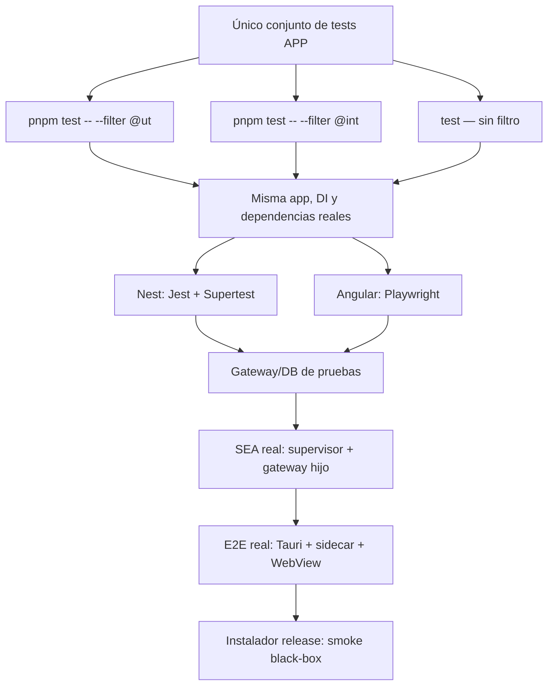

```mermaid
sequenceDiagram
    autonumber
    participant Runner as WebdriverIO en SO destino
    participant Tauri as Tauri instrumentado de pruebas
    participant SEA as Sidecar Node SEA real
    participant DB as Base de pruebas real
    participant Web as WebView Angular
    Runner->>Tauri: Iniciar app de test
    Tauri->>SEA: Spawn SEA en modo supervisor
    SEA->>SEA: spawn mismo archivo --service gateway
    SEA->>DB: Gateway conecta y migra
    DB-->>SEA: Gateway ready
    SEA-->>Tauri: Estado agregado READY
    Tauri->>Web: Abrir https://localhost:8443
    Web->>SEA: GET / y /api/health
    SEA-->>Web: PWA + JSON
    Runner->>Web: Comprobar DOM y navegación
    Runner->>Tauri: Quit desde tray
    Tauri->>SEA: Shutdown supervisor
    SEA->>SEA: IPC a gateway + app.close()
    SEA-->>Tauri: Árbol completo EXIT
    Runner->>Runner: Validar ausencia de proceso huérfano
```

```mermaid
flowchart LR
    ANG["web-angular:build"] --> ASSETS["SEA assets SPA"]
    G["gateway-nest:bundle"] --> REG["Dispatcher: registro de entrypoints"]
    R["runtime-nest:bundle"] --> REG
    F["auth-ms:bundle (futuro)"] -.-> REG
    REG --> SINGLE["node --build-sea — binario único"]
    ASSETS --> SINGLE
    SINGLE --> TEST["APP: mismo archivo, varios procesos"]
    TEST --> TAURI["Tauri externalBin: un sidecar"]
    TAURI --> PKG["Paquete por SO/arquitectura"]
```

### 11.1 Contratos ECO — Scripts del monorepo (normativo)

**REQ-ECO-01 — Ecos, no aliases.** Las operaciones públicas del monorepo **MUST** llamarse igual en el root y en cada paquete. Los scripts del root **MUST** invocar las operaciones equivalentes de los paquetes mediante Nx; las dependencias y orden se definen con `dependsOn`/outputs y no duplicando scripts para cada framework. La **misma cadena** debe funcionar en local, en CI y en una futura herramienta de remediación de deuda técnica. No inventar `pipeline:*`, `build:sea`, `build:app`, `test:ut`, `test:int`, `test:e2e` o wrappers que dupliquen lógica. Los scripts técnicos solo existen cuando hacen una operación distinguible.

| Contrato ECO | Semántica obligatoria | Root | Workspace |
|---|---|---|---|
| `build` | **Compilar** fuentes independientes, sin generar instaladores | Nx → todos los `build` | Angular/Nest/TS/Rust: build local pertinente |
| `test` | **Agregar** `test:static` + `test:dynamic` (APP) | Primero `securityCheck`; Nx → `test` de todos | Invoca `test:static` + `test:dynamic` del paquete |
| `test:static` | Lint, formato, tipos y otras verificaciones estáticas | Seguridad primero + Nx → `test:static` de todos | Herramientas específicas; sin eludir fallos |
| `test:dynamic` | Únicamente suites APP completas (sin filtro por defecto) | Nx → `test:dynamic` de todos | Nest: Jest/Supertest; Angular: Playwright; infra: APP si aplica |
| `package` | **Post-build**: ensamblar SEA/sidecar/instaladores + verificar artefactos | Nx → targets `package`, respetando `^build`/dependencias | SEA y Tauri empaquetan; libs sin distribución no-op explícito |
| `securityCheck` | Gate de cadena de suministro y dependencias; bloqueo temprano | Audit pnpm + dependencias Rust; fail-closed | Solo donde corresponda; jamás pasar por audit omitido |
| `start:dev` | Dev Angular HMR + gateway watch, proxy `/api` | Lanza apps hermanas sin Tauri/SEA | Cada app implementa su arranque dev si aplica |
| `start:prod` | Ejecutar el único SEA en modo supervisor | Arranca ejecutable por OS | No obligatorio en cada paquete |

**REQ-ECO-02 — `test` de cada paquete.** Todo proyecto bajo `apps/*` y `libs/*` **MUST** declarar `test`; también `build` y `package` para uniformidad. Si no hay una operación aplicable, se permite exclusivamente un no-op con mensaje `not defined for this package` y exit code `0`. El no-op **MUST NOT** ocultar tests ausentes de `gateway-nest` o `web-angular` ni pasar checks estáticos obligatorios. Un test fallido o una validación que no pudo ejecutarse **MUST** terminar con código distinto de cero.

**REQ-ECO-03 — Composición y orden verificables.** `pnpm test` en root **MUST** completar `securityCheck` antes de propagar mediante Nx el **target `test` de TODOS los paquetes**, incluidos los que declaran un no-op explícito. El `test` de cada paquete **MUST** ejecutar `test:static` y luego `test:dynamic` si aplica, sin añadir suites unitarias/integración aisladas. `test:static` cubre lint, formato y typecheck; los controles de seguridad global se ejecutan en el root antes del fan-out, evitando que una tarea de paquete los eluda en CI. Los ECOs de root `test:static` y `test:dynamic` **MAY** permitir invocar directamente esas fases en todos los paquetes para diagnóstico; `test:static` de root **MUST** ejecutar primero `securityCheck`. **No afirmar que todas las pruebas estáticas de todos los paquetes terminan antes que cualquier prueba dinámica** si Nx ejecuta distintos paquetes en paralelo; el orden exigido es por paquete. `test` **MUST NOT** lanzar `package` ni publicar releases. El `build` es una operación independiente ejecutada antes de `test` en el pipeline CI.

**REQ-ECO-04 — Filtros, no scripts.** `pnpm test -- --filter @ut` y `pnpm test -- --filter @int` **MUST** ejecutar las mismas pruebas APP bajo los mismos procesos reales, cambiando únicamente qué casos se seleccionan dentro de `test:dynamic`. Los filtros se transmiten de forma **explícita**, sin pasar `--filter` directamente a Nx (donde significa seleccionar proyectos), ni a pnpm (donde también tiene significado propio). El adaptador de CLI puede ser un archivo de `tools/scripts/`, pero **MUST NOT** convertirse en un segundo orquestador de build/testing. Sin filtro, **todos los casos** ejecutan; con filtro sin coincidencias, fallo explícito. Cualquier argumento no soportado falla con uso claro.

**REQ-ECO-05 — Lint nativo por proyecto.** `test:static` exige lint, formato y tipos según tecnología, pero **MUST NOT** forzar ESLint universal: Nest 12 scaffoldea **Oxlint**; Angular usa `angular-eslint` para reglas y templates Angular; Rust ejecuta **Clippy + rustfmt**. La elección final debe demostrar cobertura del código real, incluidas templates Angular. Los scripts opcionales de reparación (`lintFix`, `formatFix`) **MAY** existir, fuera de las tareas read-only de CI. No crear nombres distintos para el mismo concepto por framework.

**REQ-ECO-06 — `build` / `package` por grafo.** `build` compila `libs/shared-core`, `apps/web-angular`, `apps/gateway-nest`, `apps/runtime-nest` y los proyectos que correspondan; `package` del SEA incorpora binarios de Node y assets Angular **solo tras los builds**; `package` de Tauri adjunta el sidecar/instalador **solo tras el SEA**; su verificación de instalador/OS se ejecuta sin otro nombre público para cada fase. No duplicar `build:*`/`package:*` arbitrarios para los mismos pasos. El release toma exclusivamente paquetes verificados desde el SHA versionado.

**REQ-ECO-07 — Pipeline externo fiel.** GitHub Actions se limita a setup/instalación, `pnpm run securityCheck`, `pnpm run build`, `pnpm run test`, `pnpm run package`, publicación y transferencia de artefactos. `securityCheck` se ejecuta antes de `build` y **de nuevo dentro de `test`** porque `test` debe ser seguro también cuando se invoca aisladamente. Esta repetición deliberada no autoriza reutilizar un resultado obsoleto de auditoría ni saltarse el gate. La implementación **MUST** mostrar en README la secuencia CLI idéntica para local y CI, y comprobar códigos de salida. Las operaciones de versionado/release **MUST** exponerse como scripts del root, no copiar lógica de Nx ni de Git al YAML.

```mermaid
flowchart TD
    Install["pnpm install --frozen-lockfile"] --> Security{"pnpm run securityCheck"}
    Security -->|Error / advisory bloqueante| Block["FAIL-CLOSED: no build, no merge"]
    Security -->|OK| Build["pnpm run build: Nx compila workspaces"]
    Build --> Test["pnpm run test: audit vigente y Nx test de todos"]
    Test --> Pkg["pnpm run package: único SEA + Tauri"]
    Pkg --> Smoke["Smoke / E2E nativo por plataforma"]
    Smoke --> Gate{"Checks obligatorios completos"}
    Gate -->|No| Block
    Gate -->|Sí| Merge["PR habilitado para merge; NO publicar aún"]
```

```mermaid
flowchart TD
    Root["root: pnpm test"] --> Guard["securityCheck global, secuencial"]
    Guard --> Nx["Nx run-many: test de CADA workspace"]
    Nx --> A["web-angular:test"]
    Nx --> B["gateway-nest:test"]
    Nx --> C["runtime-nest:test / otros paquetes"]
    A --> AS["test:static"] --> AD["test:dynamic - Playwright APP"]
    B --> BS["test:static"] --> BD["test:dynamic - Jest/Supertest APP"]
    C --> CS["test:static"] --> CD["test:dynamic o no-op explícito"]
```

> **Interpretación:** `test:static` precede a `test:dynamic` **dentro de cada workspace**, pero paquetes independientes pueden probarse en paralelo. La orden `pnpm test` no es sinónimo de ejecutar solamente E2E: es el agregador de pruebas estáticas y dinámicas. Los filtros `--filter @ut|@int` afectan exclusivamente la selección APP; no suprimen el gate de seguridad ni las verificaciones estáticas.

```mermaid
flowchart LR
    Command["pnpm test -- --filter @int"] --> Gate["securityCheck siempre"]
    Gate --> Root["Nx: ejecutar test por paquete"]
    Root --> Checks["test:static íntegro"]
    Checks --> Adapter["Adaptador de filtros de APP"]
    Adapter --> Jest["Nest Jest: testNamePattern @int"]
    Adapter --> PW["Angular Playwright: grep @int"]
    Jest --> DB["DB real, DI completa"]
    PW --> API["API real"]
```

### 11.2 Repositorios hermanos: referencias de intención, no dependencia

**REQ-REF-01.** Estudiar estos puntos específicos antes de generar arquitectura o scripts:

1. **`nest-base` testing/coverage:** <https://github.com/virgenherrera/nest-base#testing--coverage> — reutilizar la idea de pipeline y cobertura observable; **rechazar sus suites unitarias e integración aislada**.
2. **`nest-base` configuración namespaceada:** <https://github.com/virgenherrera/nest-base#namespaced-configuration-workflow> — conservar las clases tipadas, registro e inyección por namespace, validación única con Zod y singleton inmutable; reemplazar fuente `.env` por configuración persistida/CLI validada cuando aplique.
3. **`nest-base` scripts/bump:** <https://github.com/virgenherrera/nest-base/blob/3153f90c72544263ae5a194e7f2864a9dda3cdd8/package.json#L45> — adoptar convención de nombres y doctor, no stack ni test runners antiguos.
4. **`fullstack-base` scripts:** <https://github.com/virgenherrera/fullstack-base/blob/50afc753617d628e0d8c5bd7ed2521ceae9a4298/package.json#L41> — adaptar composición root/workspace; no copiar `test:unit` ni su significado original de `test:e2e`.
5. **`fullstack-base` pnpm catalog:** <https://github.com/virgenherrera/fullstack-base/blob/50afc753617d628e0d8c5bd7ed2521ceae9a4298/pnpm-workspace.yaml> — adoptar versión única para Zod, Playwright, TypeScript y herramientas compartidas en `catalog:` y `savePrefix: ''`; adaptar a `libs/*`.
6. **`fullstack-base` doctor:** <https://github.com/virgenherrera/fullstack-base/blob/50afc753617d628e0d8c5bd7ed2521ceae9a4298/.ncurc.json> — referencia de `npm-check-updates`/doctor. Versiones de esos repos **no** constituyen baseline válido para este template.

**REQ-DEPS-01 — TBD explícito.** **`bumpDependencies` y `test:doctor` NO se implementan en esta entrega.** Dejar únicamente el contrato/documentación y las referencias al repositorio hermano. No instalar NCU ni generar `.ncurc.json` operativo para fingir una capacidad ausente; cuando se habilite `bumpDependencies`, `test:doctor` será **obligatorio** y deberá trabajar con `pnpm catalog:`, manifests, lockfile y scripts ECO reales, con rollback al fallar. Este proyecto inicial no tiene por qué ejecutar automáticamente remediación de deuda técnica.

**REQ-DEPS-02 — Preparar interfaz estable.** La estandarización `build`/`test`/`package`/`securityCheck` y sus fases `test:static`/`test:dynamic` **MUST** permitir implementar después herramientas de *upgrade*, mantenimiento, corrección de deuda y validación repetible **sin** duplicar la lógica del CI. Cualquier corrección futura deberá superar los mismos gates de seguridad, build y APP que un PR. `securityFix` (si se añade después) **MUST NOT** ejecutarse silenciosamente durante CI ni aprobar cambios sin revisión.

```mermaid
flowchart LR
    Now["Hoy: scripts ECO"] --> CI["CI/CD y paquetes reproducibles"]
    Now -. capacidad futura .-> Bump["TBD: bumpDependencies"]
    Bump -. requiere .-> Doctor["TBD: test:doctor"]
    Doctor -. reutiliza .-> Now
    Doctor -. falla .-> Rollback["Rollback / no commit"]
```

### 11.3 Versiones sincronizadas y semver desde rama del PR

**REQ-VERSION-01.** El template usa una **versión de producto lockstep**, estilo paquetes Angular. Definir release group Nx `projectsRelationship: "fixed"` para los proyectos internos publicables. La versión de `web-angular`, `gateway-nest`, `shared-core`, `desktop` y manifiestos de Tauri **MUST** concordar en el artefacto distribuido. No obligar a que las **dependencias externas** (`@angular/*`, `@nestjs/*`, Drizzle, Zod, Tauri CLI) tengan la misma versión semver: su actualización se hará manualmente en el baseline; `bumpDependencies` es una automatización futura TBD.

**REQ-VERSION-02.** Convención de rama fuente del PR, validada en CI:

| Rama del PR | Bump SemVer | Ejemplo desde `1.4.8` |
|---|---|---|
| `major/<slug>` | major | `2.0.0` |
| `minor/<slug>` | minor | `1.5.0` |
| `fix/<slug>` | patch | `1.4.9` |

Para cambios sin release (`docs/*`, `chore/*`) definir una exención explícita; ramas desconocidas **MUST** fallar validación o requerir clasificación explícita. En una misma publicación, si se fusionan varios PRs antes de lanzar, elegir el mayor impacto (`major > minor > fix`) o serializar releases por merge; **MUST** evitar que un merge concurrente produzca tags duplicados.

**REQ-VERSION-03.** `release:version` **MUST** actualizar versiones internas y `tauri.conf.json` / `Cargo.toml` según los mecanismos verificados del tooling. El pipeline **MUST** validar todas las referencias internas a versión y generar changelog reproducible. Los manifests Rust no se actualizan automáticamente por Nx Release salvo integración deliberada y comprobada.

```mermaid
flowchart LR
    M["PR rama major/*"] --> MA["major"]
    N["PR rama minor/*"] --> MI["minor"]
    F["PR rama fix/*"] --> PA["patch"]
    MA --> V["Nx Release fixed / sync manifests"]
    MI --> V
    PA --> V
    V --> S["Una sola versión X.Y.Z"]
    S --> W["Angular + Nest + shared-core"]
    S --> T["Tauri + SEA + instaladores"]
```

### 11.4 CI + GitHub Actions release: ÚLTIMA fase

**REQ-CI-01 — CI de PR obligatorio.** En `pull_request` hacia la rama principal, GitHub Actions **MUST** ejecutar `securityCheck` como gate temprano fail-closed, luego `build`, `test` (estáticos + APP), `package` (SEA, Tauri y smoke real de distribución) y los controles de release cuando correspondan. El workflow solo invoca **scripts de `package.json` raíz** para operaciones del proyecto; se permiten las acciones necesarias de checkout/setup/cache/artifacts (no convertir YAML en otro sistema de build). La matriz objetivo es **Windows, Linux y macOS solamente**, en runners del sistema objetivo. No Linux Docker como sustituto de Windows/macOS.

**REQ-CI-02 — Gate antes del merge.** `main` **SHOULD** exigir checks de PR y no fusionar mientras fallen. Cualquier plataforma no verificada deberá declararse `pendiente/bloqueada`, no mostrarse como verde. Los tests APP no deben depender de mocks para cubrir DB, auth ni assets reales. En CI cada entorno debe resolver prerequisitos reales de Tauri y vector de SQLite; no afirmar soporte de plataforma sin ejecutar la prueba de artefacto correspondiente.

**REQ-CI-03 — Release por merge.** Cuando se cierra un `pull_request` con `merged == true`, recuperar `head.ref`, validar `major/*|minor/*|fix/*`, comprobar que el merge entró en la rama destino admitida y ejecutar el flujo de release desde **el código fusionado de confianza**, nunca ejecutando código del PR no fusionado con credenciales de escritura. Proteger permisos `contents:write` exclusivamente para los jobs que versionan, etiquetan y publican; evitar `pull_request_target` ejecutando scripts de forks sin revisar.

**REQ-CI-04 — Sin `amend` al commit fusionado.** Se **MUST NOT** reescribir (`git commit --amend`/force-push) el SHA que aprobaron los checks. Si `main` permite automatización autorizada de versiones, crear **un commit nuevo de release** después de aplicar SemVer, re-ejecutar verificaciones y taggear ese SHA. Si la branch protection impide escribir sobre `main`, usar **release PR/version plan** automatizado con aprobación normal y publicar tras su merge; no solicitar bypass silencioso.

**REQ-CI-05 — Publicar artefactos del SHA versionado, no del PR.** Después del version bump y su commit, construir desde ese SHA exacto los ejecutables SEA y los instaladores Tauri para los OS/arquitecturas declarados; incluir Angular compilado, migrations/assets y versión definitiva. **MUST NOT** publicar binarios del PR que contienen una versión anterior a la del tag. Ejecutar smoke de instalación / startup / shutdown según SO antes de subir a GitHub Release. Publicar hashes SHA-256, procedencia de artefactos cuando el proveedor la soporte y nombres inequívocos OS/arch.

**REQ-CI-06 — Idempotencia y concurrencia.** Serializar el release de la rama objetivo; repetir un job para el mismo SHA/tag **MUST NOT** duplicar releases ni incrementar de nuevo la versión. Fallo en cualquier plataforma obligatoria **MUST** impedir publicar release como completo; no dejar un tag que señale binarios que nunca se generaron sin marcarlo explícitamente como borrador/bloqueado.

**REQ-CI-07 — Solo invocar npm scripts de raíz.** `ci-cd.yml` debe delegar en `pnpm run securityCheck`, `pnpm run build`, `pnpm run test`, `pnpm run package` y los comandos de release estrictamente necesarios expuestos en root. No copiar comandos `nx`, `jest`, `ng`, `cargo`, `ncu` o `postject` directamente al workflow. Setup del sistema operativo y upload/download de artefactos pueden usar GitHub Actions oficiales.

### 11.4.1 Pipeline normativo: qué ejecuta CI y qué ejecuta CD

**REQ-CI-08 — La frontera es el merge, no `package`.** **CI** valida PRs sin permisos de publicación: `install → securityCheck → build → test → package → smoke/E2E del artefacto → checks del PR`. **CD** comienza **únicamente** cuando se verifica que el PR se fusionó en `main` (o se aceptó el release PR): `determinar bump → aplicar versión lockstep → commit nuevo → reconstruir y revalidar el SHA versionado en matriz nativa → firmar/notarizar cuando aplique → tag → GitHub Release`. Los binarios compilados durante CI son **artefactos de comprobación**, no los instaladores definitivos. El root **MUST** ser la única interfaz de operaciones de proyecto que invoque el workflow.

**REQ-CI-09 — Gates, orden y tolerancia cero.** `securityCheck` es una barrera **secuencial previa a cualquier build**. El fallo de `install`, `securityCheck`, `build`, `test`, `package` o smoke nativo en una plataforma obligatoria **MUST** bloquear merge/release. `test` vuelve a ejecutar `securityCheck` como parte de su contrato independiente. No confundir `--nxBail` con una cancelación instantánea de tareas que ya se iniciaron; **MUST** verificarse el código de salida compuesto. GitHub Actions **MUST** declarar `needs` para ordenar etapas dependientes y impedir que jobs posteriores arranquen después de un fallo requerido.

**REQ-CI-10 — CD reconstruye, no recicla binarios sin versión.** El bump se aplica al código ya fusionado mediante script ECO de release desde la raíz. Una vez creado el commit nuevo (o fusionado el release PR), la matriz nativa **MUST** hacer checkout de ese SHA y repetir `install → securityCheck → build → test → package`; luego validar checksums, sidecar, inicio/cierre, versión embebida y smoke del instalador. **Solo entonces** crear el tag `vX.Y.Z` apuntando al SHA versionado y publicar los artefactos producidos en esa ejecución. La firma/notarización es por plataforma cuando corresponda y si las credenciales están disponibles; no declarar artefactos firmados si no lo están.

#### Diagrama A — Secuencia obligatoria completa

```mermaid
flowchart TD
    PR["Pull request: major/minor/fix"] --> CIINSTALL
    subgraph CI["CI - pull_request, matriz Windows / Linux / macOS"]
      direction TB
      CIINSTALL["1. pnpm install --frozen-lockfile"] --> SEC{"2. pnpm run securityCheck"}
      SEC -->|OK| BUILD["3. pnpm run build"]
      BUILD --> TEST["4. pnpm run test: static + dynamic por paquete"]
      TEST --> PKG["5. pnpm run package: SEA + Tauri"]
      PKG --> SMOKE["6. Smoke / E2E real, salida verificable"]
      SMOKE --> GATE{"7. Todos los checks obligatorios OK"}
    end
    SEC -->|Audit falla / no disponible| FAIL["Bloquear PR"]
    BUILD -->|Falla| FAIL
    TEST -->|Falla| FAIL
    PKG -->|Falla| FAIL
    SMOKE -->|Falla| FAIL
    GATE -->|No| FAIL
    GATE -->|Sí| MERGE["Merge autorizado a main"]
    MERGE --> VERSION
    subgraph CD["CD - solo tras merge autorizado"]
      direction TB
      VERSION["8. Resolver major / minor / patch"] --> BUMP["9. release:version - lockstep"]
      BUMP --> COMMIT["10. Commit NUEVO o release PR"]
      COMMIT --> RELEASECI["11. Matriz nativa: instalar + auditar + build + test + package"]
      RELEASECI --> REGATE{"12. Smoke, integridad y versión OK"}
      REGATE -->|Sí| SIGN["13. Firma / notarización si aplica"]
      SIGN --> TAG["14. Tag vX.Y.Z al SHA versionado"]
      TAG --> PUB["15. GitHub Release + instaladores + SHA256"]
    end
    RELEASECI -->|Falla| HOLD["Detener publicación"]
    REGATE -->|No| HOLD
```

#### Diagrama B — Secuencia temporal: PR, merge, commit de versión y release

```mermaid
sequenceDiagram
    autonumber
    actor Dev as Desarrollo / PR
    participant CI as CI nativo 3 SO
    participant Main as main protegido
    participant CD as CD / Nx Release
    participant Art as Artefactos del SHA versionado
    Dev->>CI: Abrir / actualizar PR
    CI->>CI: install → securityCheck
    alt securityCheck falla o no puede auditar
       CI-->>Dev: Bloquear PR sin build
    else auditoría OK
       CI->>CI: build → test [static + dynamic] → package
       CI->>CI: Smoke SEA / Tauri (3 SO)
       alt Falla cualquier check obligatorio
          CI-->>Dev: Bloquear merge
       else Todos OK
          CI-->>Main: Autorizar merge
          Main->>CD: PR merged == true + head.ref
          CD->>CD: Determinar SemVer y aplicar lockstep
          CD->>Main: Nuevo commit de versión (o release PR)
          Main-->>CD: SHA versionado definitivo
          CD->>CI: Repetir CI completo DESDE ese SHA (3 SO)
          CI-->>Art: Binarios e instaladores definitivos
          Art-->>CD: Smoke + checksums + versión
          alt Falla alguna plataforma / integridad
             CD-->>Main: No tag, no publicación final
          else Todos OK
             CD->>Art: Firmar / notarizar cuando aplique
             CD->>Main: Crear tag vX.Y.Z al SHA versionado
             CD-->>Dev: GitHub Release + artefactos + SHA256
          end
       end
    end
```

#### Diagrama C — ECOs del root y correspondencia por fase

```mermaid
flowchart LR
    subgraph LOCAL["Local: mismos scripts públicos"]
      I["pnpm install"] --> S["pnpm run securityCheck"]
      S --> B["pnpm run build"]
      B --> T["pnpm run test"]
      T --> P["pnpm run package"]
    end
    subgraph ACTIONS["GitHub Actions: sin lógica de proyecto propia"]
      A["CI del PR: repite LOCAL"] --> M["Merge validado"]
      M --> V["CD: release:version - commit nuevo"]
      V --> R["CD: repite LOCAL sobre release SHA"]
      R --> REL["GitHub Release"]
    end
    LOCAL -. "Contrato ECO reutilizado" .-> A
    LOCAL -. "Contrato ECO reutilizado" .-> R
```

> **Barrera CI/CD:** el merge **NO** publica automáticamente los artefactos del PR. El CD publica solo los binarios que se reconstruyeron desde la revisión que incorpora la versión sincronizada. `test:doctor` y `bumpDependencies` siguen **TBD**: no forman parte del pipeline actual.

### 11.5 Criterios de aceptación mínimos del template

| ID | Comportamiento verificable |
|---|---|
| AC-01 | Instalación desde repositorio vacío con versiones fijadas y `pnpm install --frozen-lockfile` reproducible |
| AC-02 | `securityCheck` falla antes del build ante advisories high/critical o falla de registro; `pnpm test` agrega `test:static` + `test:dynamic` sobre todos los proyectos |
| AC-03 | Tauri inicia un SEA supervisor; éste arranca gateway en otro proceso usando el mismo archivo; cerrar ventana mantiene ambos, Quit termina el árbol |
| AC-04 | Desde otro dispositivo LAN se carga UI/manifest mediante `https://IP:8443`, **después** de establecer confianza TLS; Angular y API comparten origen |
| AC-05 | `http://IP:8080/` devuelve `308` al origen seguro correcto |
| AC-06 | API niega acceso no autorizado; frontend solo renderiza rutas habilitadas; Playwright lo verifica |
| AC-07 | Configuración inválida y base incompatible producen fail-fast antes de anunciar readiness |
| AC-08 | SQLite ejecuta migraciones incrementales y búsqueda vectorial real desde el binario SEA |
| AC-09 | PostgreSQL soporta las mismas operaciones contractuales, con migraciones específicas por dialecto |
| AC-10 | Cortar Internet no impide acceder al gateway, Angular ni efectuar operaciones locales de persistencia/vector |
| AC-11 | El host no necesita `node_modules` ni una instalación de Node; instalador contiene **un solo SEA físico** por plataforma aunque ejecute varios procesos |
| AC-12 | Los assets SPA se actualizan sin romper el service worker ni servir una mezcla de versiones |
| AC-13 | `apps/web-angular` y `apps/gateway-nest` compilan independientemente y no importan código fuente entre sí |
| AC-14 | En dev, `localhost:4200` atiende la SPA y reenvía `/api/**` a Nest mediante proxy; Nest no sirve Angular y HMR funciona |
| AC-15 | `web-angular:build` y bundles de `runtime-nest`/`gateway-nest` preceden a **un único** SEA; cambios Angular o en cualquier servicio registrado invalidan el empaquetado |
| AC-16 | En SEA, `ServeStaticModule` sirve desde caché física materializada con hash; reinicios reutilizan caché válida sin extracción |
| AC-17 | `/api/no-existe` no devuelve `index.html`; rutas Angular usan fallback; `.js` ausente devuelve 404 |
| AC-18 | El frontend de la WebView Tauri es idéntico al disponible en móvil/PC desde gateway; `runtime-nest` no aloja una segunda SPA ni un puerto público |
| AC-19 | No hay suites unitarias/integración aisladas ni scripts `test:ut`/`test:int`: `pnpm test -- --filter @ut` filtra la misma APP sin omitir controles estáticos |
| AC-20 | E2E nativo ejecuta Tauri + sidecar SEA reales y verifica lifecycle; la instrumentación WDIO no existe en el instalador comercial |
| AC-21 | Cada plataforma declarada soportada dispone de verificación nativa/VM y resultado trazable; aprobar macOS no implica Windows/Linux |
| AC-22 | `nest-base` y `fullstack-base` se usan como referencias, sin portar `test:unit` ni suites de integración |
| AC-23 | Cada paquete declara `build`, `test`, `package`; los no-op son explícitos y nunca ocultan obligaciones; el CI invoca ECOs del root únicamente |
| AC-24 | Catálogos pnpm con versiones exactas y protecciones minimumReleaseAge/allowBuilds; `bumpDependencies` + `test:doctor` permanecen TBD, sin scripts ni dependencias activos |
| AC-25 | SemVer lockstep sincroniza Angular, Nest, shared-core, Tauri y versión distribuida; branch naming clasifica major/minor/fix |
| AC-26 | PR ejecuta CI completo de Windows/Linux/macOS; merge válido genera un nuevo commit/PR de release, no amend |
| AC-27 | GitHub Release apunta al SHA versionado y adjunta instaladores verificados y checksums; falla segura e idempotente |
| AC-28 | Ejecutar SEA sin argumentos arranca `runtime-nest` como Nest Standalone; solo `gateway-nest` está habilitado inicialmente |
| AC-29 | Supervisor invoca el mismo `process.execPath` en rol gateway; roles desconocidos se rechazan; no hay binarios Node duplicados |
| AC-30 | Cerrar el producto solicita `app.close()` por IPC a los hijos y comprueba ausencia de huérfanos en Windows, macOS y Linux |
| AC-31 | Futura incorporación de `apps/auth-ms` exige únicamente registrar su bootstrap, dependencias y Nx target, sin añadir sidecar Tauri |
| AC-32 | `pnpm run securityCheck` bloquea builds si audit registra high/critical o falla consulta; no ignora errores; cubre devDependencies y el árbol Rust conforme a su tooling |
| AC-33 | `pnpm build` compila, `pnpm test` ejecuta `test` de **todos** los paquetes con orden estático → dinámico por paquete, y `pnpm package` crea/verifica SEA/Tauri; mismas operaciones en macOS/Windows/Linux |
| AC-34 | `pnpm test -- --filter @int` transmite filtro a Jest/Playwright sin alterar el grafo Nx ni el bootstrap APP, y un filtro sin matches falla |
| AC-35 | Diagramas CI/CD y README muestran exactamente: instalación → seguridad → build → test (estático + dinámico) → package → smoke; `securityCheck` falla antes del primer build |
| AC-36 | El PR produce solo artefactos verificables; CD crea nueva versión/commit, repite CI completo desde el SHA versionado y solo después crea tag y publica binarios |

### 11.6 Matriz visual de ejecución por entorno

```mermaid
flowchart LR
    subgraph APP["APP: una suite por aplicación"]
      F["Filtros opcionales @ut / @int"] --> J["Nest Jest + Supertest"]
      F --> P["Angular Playwright"]
      J --> D["Base real SQLite/PG"]
      P --> A["API real"]
    end
    APP --> SEA["SEA real + SPA + TLS"]
    SEA --> WD["Tauri WebdriverIO por SO"]
    WD --> M["Smoke release sin instrumentación"]
```

```mermaid
flowchart TD
    Host["macOS host — desarrollo principal"] --> Mac["macOS: WDIO + Tauri nativo"]
    Host --> Docker["Docker: PostgreSQL / Gateway / Linux smoke"]
    Host --> VM["VM / runner de SO destino"]
    VM --> Win["Windows: instalador, WebView2, autostart"]
    VM --> Linux["Linux: instalador, WebKitGTK, tray"]
    Mac --> R["Matriz de soporte verificado"]
    Win --> R
    Linux --> R
    Docker -.-> R
```

**Criterio de publicación:** se puede trabajar principalmente en macOS, pero **cada sistema operativo objetivo MUST probarse en ese SO** antes de atribuirle soporte de producción. La matriz puede quedar parcial mientras el repositorio sea un micro-POC, siempre que el agente declare las limitaciones.

## 12. Instrucciones de entrega para el agente

1. **MUST** generar el andamiaje, archivos JSON/YAML, código base y README necesarios para cumplir este SRS desde un repositorio vacío. **MUST** usar `nest-base` y `fullstack-base` como antecedentes de diseño, no asumir que sus implementaciones anteriores son prácticas obligatorias. **MUST NOT** materializar tareas TBD (`bumpDependencies`, `test:doctor`) como implementación activa.
2. **MUST** ejecutar los comandos ECO en el orden normativo de CI: instalación con lockfile congelado, `securityCheck`, `build`, `test` sin filtros y `package` con verificación nativa; registrar resultados y corregir problemas reproducibles. `test` **MUST** propagar `test` a todos los paquetes y cada uno ejecutar estático → dinámico. Para E2E nativo **MUST** informar por sistema operativo si se ejecutó en host, VM, runner o quedó pendiente. No presentar configuraciones no ejecutadas como verificadas.
3. **MUST** implementar los micro-POCs integrados más pequeños que satisfagan los criterios de aceptación: `runtime-nest` standalone **real** supervisa exclusivamente `gateway-nest` por ahora; evitar inventar `auth-ms` u otros servicios de negocio ficticios. **MUST** preservar el aislamiento de Angular y Nest y probar el proxy de desarrollo.
4. **MUST** distinguir explícitamente: **implementado**, **verificado**, **bloqueado por entorno** y **fuera de alcance**.
5. **MUST** documentar decisiones que afecten portabilidad, seguridad o compatibilidad con la versión de Drizzle elegida (incluida la RC fallback, si aplica).
6. **MUST** usar las versiones requeridas cuando existan y sean compatibles; cualquier sustitución necesaria **MUST** justificarse con un enlace técnico y quedar identificada en el resultado.
7. **MUST** implementar CI/CD como fase final del template, una vez estables los comandos locales; **MUST NOT** implementar despliegue cloud, motor LLM ficticio, credenciales inseguras de demostración ni sincronización offline entre navegadores.
8. **MUST** incluir diagramas Mermaid en README o arquitectura explicativa y mantenerlos sincronizados con lo realmente construido; este SRS es la referencia de alcance y comportamiento. **MUST** declarar qué OS se comprobó realmente, en lugar de inferir que probar en macOS certifica Windows y Linux.

## 13. Referencias técnicas y normativas

**Especificaciones y seguridad**

- ISO/IEC/IEEE 29148:2018 — https://www.iso.org/standard/72089.html
- ISO/IEC 25010:2023 — https://www.iso.org/standard/78176.html
- RFC 2119 + RFC 8174 (BCP 14) — https://www.rfc-editor.org/rfc/rfc2119 ; https://www.rfc-editor.org/rfc/rfc8174
- RFC 9110 (HTTP semantics y redirección 308) — https://www.rfc-editor.org/rfc/rfc9110
- OWASP ASVS 5.0.0 — https://owasp.org/projects/asvs

**Implementación de referencia**

- Node SEA (`--build-sea`, `assets`, code cache, argumentos) — https://nodejs.org/api/single-executable-applications.html
- Node `child_process.spawn()` e IPC — https://nodejs.org/api/child_process.html
- NestJS standalone `createApplicationContext()` — https://docs.nestjs.com/application-context
- NestJS microservices y gRPC (crecimiento futuro) — https://docs.nestjs.com/microservices/basics ; https://docs.nestjs.com/microservices/grpc
- NestJS NodeAdapter — https://docs.nestjs.com/http/performance
- NestJS ServeStaticModule (compatible `NodeAdapter`) — https://docs.nestjs.com/recipes/serve-static
- Angular CLI dev-server + proxy — https://angular.dev/tools/cli/serve
- Mermaid architecture-beta — https://mermaid.js.org/syntax/architecture
- Nx dependencias de tareas — https://nx.dev/docs/reference/project-configuration
- NestJS + Drizzle + `forRootAsync()` — https://docs.nestjs.com/data/drizzle
- Drizzle `node:sqlite` — https://orm.drizzle.team/docs/sqlite/connect-node-sqlite
- SQLite-vector 1.1.2 — https://github.com/sqliteai/sqlite-vector/releases
- pgvector 0.8.7 — https://github.com/pgvector/pgvector/blob/master/CHANGELOG.md
- Tauri sidecar — https://tauri.app/develop/sidecar/
- Tauri autostart — https://tauri.app/plugin/autostart/
- Tauri WebDriver multiplataforma — https://tauri.app/develop/tests/webdriver/
- WebdriverIO Tauri service — https://webdriver.io/docs/wdio-tauri-service
- WDIO Tauri: plugin de test y exclusión de producción — https://webdriver.io/docs/desktop-testing/tauri/plugin-setup
- Tauri WebDriver CI Linux/Xvfb — https://tauri.app/develop/tests/webdriver/ci/
- Jest CLI testNamePattern (`-t`) — https://jestjs.io/docs/cli
- Playwright: tags y `--grep` — https://playwright.dev/docs/test-annotations
- PWA installability — https://developer.mozilla.org/en-US/docs/Web/Progressive_web_apps/Guides/Making_PWAs_installable
- Apple: trust de certificados en iOS — https://support.apple.com/en-us/102390
- Nx CLI `--nxBail` — https://nx.dev/docs/reference/nx-commands
- SQLite WAL — https://www.sqlite.org/wal.html

**Scripts, dependencias y release**

- nest-base — testing/coverage — https://github.com/virgenherrera/nest-base#testing--coverage
- nest-base — configuración namespaceada — https://github.com/virgenherrera/nest-base#namespaced-configuration-workflow
- nest-base — `package.json` en commit fijado — https://github.com/virgenherrera/nest-base/blob/3153f90c72544263ae5a194e7f2864a9dda3cdd8/package.json#L45
- fullstack-base — `package.json` en commit fijado — https://github.com/virgenherrera/fullstack-base/blob/50afc753617d628e0d8c5bd7ed2521ceae9a4298/package.json#L41
- fullstack-base — catálogo pnpm — https://github.com/virgenherrera/fullstack-base/blob/50afc753617d628e0d8c5bd7ed2521ceae9a4298/pnpm-workspace.yaml
- fullstack-base — npm-check-updates doctor — https://github.com/virgenherrera/fullstack-base/blob/50afc753617d628e0d8c5bd7ed2521ceae9a4298/.ncurc.json
- Nx Release groups y fixed relationship — https://nx.dev/docs/guides/nx-release/release-groups
- Nx Release (configuración y publicación) — https://nx.dev/docs/guides/nx-release
- pnpm catalogs — https://pnpm.io/catalogs
- pnpm 12 `minimumReleaseAge`, `allowBuilds` y settings — https://pnpm.io/settings
- pnpm audit (umbral, consulta y errores) — https://pnpm.io/cli/audit
- pnpm audit signatures — https://pnpm.io/cli/audit#signatures
- Nest 12: Oxlint en scaffolding, Jest sigue soportado — https://docs.nestjs.com/migration-guide
- Angular lint/ESLint — https://angular.dev/cli/lint
- npm-check-updates doctor — https://www.npmjs.com/package/npm-check-updates
- GitHub Actions PR `closed`/`merged` — https://docs.github.com/en/actions/reference/workflows-and-actions/events-that-trigger-workflows
- GitHub workflow artifacts — https://docs.github.com/en/actions/concepts/workflows-and-actions/workflow-artifacts
- GitHub protected branches — https://docs.github.com/en/repositories/configuring-branches-and-merges-in-your-repository/managing-protected-branches/about-protected-branches
- GitHub Actions workflow permissions — https://docs.github.com/en/actions/reference/workflows-and-actions/workflow-syntax

## Amendments 2026-10-30

Enmiendas aplicadas sin cambiar el nombre de archivo ni el título v1.6. Los números de línea son los del archivo antes de las enmiendas (las ediciones no alteran el conteo de líneas hasta esta sección).

- L95 (REQ-STACK-07): Drizzle pasa de RC fijada a tag estable preferido con `1.0.0-rc.5` como fallback si falta soporte vectorial; ref. decisión humana 10 (2026-10-30).
- L105 y L945 (nota Drizzle y entrega 5): el texto de riesgo RC pasa a condicional (solo si se usa el fallback), para coherencia con L95.
- L269 (REQ-NET-01): premisa `NodeAdapter` + `ServeStaticModule` marcada `not verified`; el requisito no cambia.
- L165 (REQ-CFG-05) y L502 (REQ-SEA-05): schema y defaults sin secretos en la ruta de instalación; `config.json` real en el directorio de configuración del SO; permisos `0700`/`0600` (OQ1).
- L349 (REQ-SEC-02, ref. sección 12 punto 7): la base de datos es la fuente de verdad; solo en desarrollo se siembra el superusuario autodestructivo `dev-admin` (decisión humana 12); producción no siembra cuentas; citas ASVS marcadas `not verified` (OQ2).
